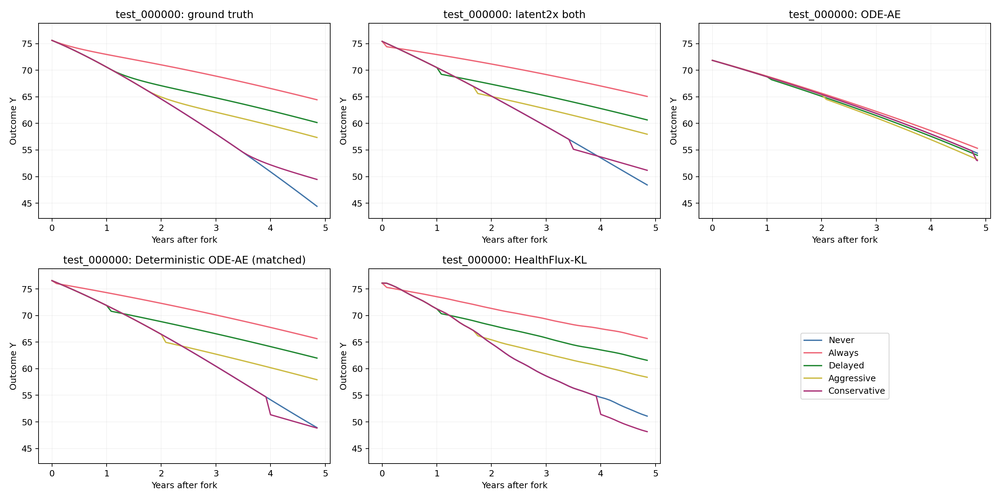
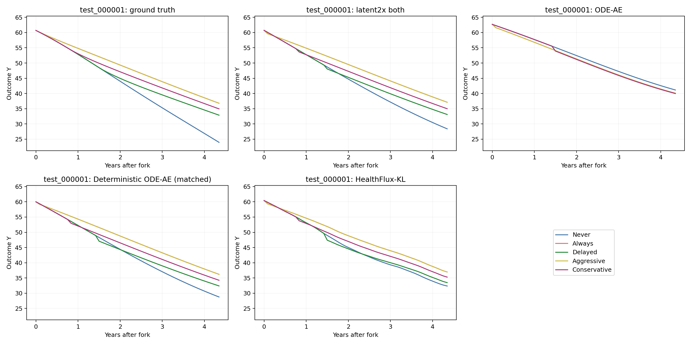
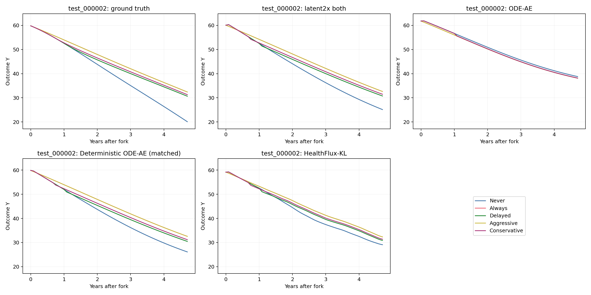
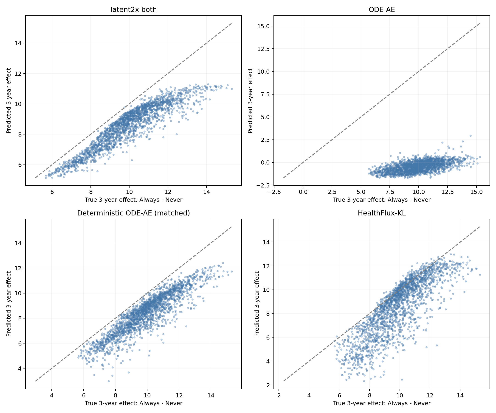

# CausalMed γ=1：四种模型的反事实推断比较

## 1. 同一任务下比较什么

四种模型读取相同的10,000位训练患者、2,000位验证患者和2,000位测试患者。观测字段为Y、X1、X2，静态资料为c，归一化参数仅拟合训练集。测试在首次达到3年的检查后分叉，执行相同五策略并推演至8年边界。

latent2x both与原始ODE-AE复用已完成实验。新增确定性ODE-AE使用GPU 1、ode环境，HealthFlux-KL使用GPU 3、healthflux环境，各自单卡运行。本轮只使用γ=1。

## 2. 模型结构与训练设置

| 模型 | 潜在表示 | 历史编码 | 生成ODE | 参数量 | 正则 |
|---|---|---|---|---:|---|
| latent2x both | 28维确定性状态 | 正向逐次更新 | 编码与生成共享，宽188 | 31,314 | 0.01 prior＋0.01 Jacobian＋0.02 ODE L2 |
| ODE-AE | 6维Gaussian潜在状态 | 12维反向编码，宽16 | 独立6维生成ODE，宽16 | 1,843 | 1×KL＋0.02两场ODE L2 |
| deterministic_22545（同预算） | 6维确定性状态 | 反向编码，UPDATE宽412 | 独立6维生成ODE，宽317 | 31,314 | 0.02两场ODE L2 |
| HealthFlux-KL | 原生256维确定性＋128维随机状态 | 正向GRU与Gaussian后验 | 256维，内部宽384 | 4,361,412 | 0.01 KL＋0.02 ODE L2 |

确定性ODE-AE沿用deterministic_22545的模型结构，在CausalMed输入输出维度下重新匹配到31,314个参数。INIT、DECODER和生成治疗校正网络宽411，UPDATE宽412，编码与生成ODE宽317。HealthFlux保留原生256＋128维及1024/512宽解码器。

治疗切换都采用“新治疗条件输出减去旧治疗条件输出”的残差位移，同一治疗保持时位移为零。ODE-AE的编码状态为12维、生成状态为6维，生成阶段增加一个宽16的治疗校正模块；观测编码仍使用原反向UPDATE。

四种模型使用相同的seed 0、batch 128、Adam学习率0.003及衰减、输入dropout 0.1、300轮上限、50轮下限和40轮早停耐心。验证整体标准化事实误差选模，最终使用最佳检查点；随机模型测试使用后验均值。

## 3. 当前训练进度

| 模型 | GPU | 阶段 | 已训练 / 最佳轮次 | 验证整体 | 验证未来Y RMSE |
|---|---:|---|---:|---:|---:|
| latent2x both | 3 | complete / scored | 188 / 148 | 0.02445 | 1.08438 |
| ODE-AE | 1 | complete / scored | 71 / 31 | 0.43204 | 4.39970 |
| deterministic_22545（同预算） | 1 | complete / scored | 185 / 145 | 0.03030 | 1.24881 |
| HealthFlux-KL | 3 | complete / scored | 79 / 39 | 0.02486 | 1.10768 |

## 4. 反事实轨迹与终点误差

轨迹CF-RMSE使用配对的无噪声Y真值，终点对应精确1/2/3年。动作关闭对照使用同一检查点和分叉状态，只关闭未来治疗校正。

| 模型 | 版本 | 全轨迹CF-RMSE | 1年 | 2年 | 3年 |
|---|---|---:|---:|---:|---:|
| latent2x both | 动作输入 | 1.04478 | 0.40394 | 0.48268 | 0.89447 |
| latent2x both | 关闭未来动作 | 5.49061 | 1.50715 | 3.71403 | 5.91910 |
| ODE-AE | 动作输入 | 5.25066 | 2.97137 | 3.84920 | 5.30532 |
| ODE-AE | 关闭未来动作 | 5.14625 | 2.86017 | 3.78718 | 5.20489 |
| deterministic_22545（同预算） | 动作输入 | 1.21218 | 0.73045 | 0.80250 | 1.07881 |
| deterministic_22545（同预算） | 关闭未来动作 | 5.41739 | 1.51119 | 3.61200 | 5.80334 |
| HealthFlux-KL | 动作输入 | 1.40833 | 0.50236 | 0.63526 | 0.92927 |
| HealthFlux-KL | 关闭未来动作 | 5.24226 | 1.41456 | 3.78547 | 5.87433 |

## 5. 个体治疗效应与策略选择

下表将Always与Never比较。策略效用为Y−3×治疗年数，预测成本来自模型自己生成的治疗区间。

| 模型 | 年限 | sqrt(PEHE) | ATE Error | 真实ATE | 预测ATE | Policy Regret | 最优策略准确率 |
|---|---:|---:|---:|---:|---:|---:|---:|
| latent2x both | 1.0 | 0.34265 | 0.19811 | 1.99824 | 2.19635 | 0.01189 | 95.05% |
| latent2x both | 2.0 | 0.57562 | 0.30496 | 5.72413 | 5.41917 | 0.05781 | 84.95% |
| latent2x both | 3.0 | 1.55409 | 1.39365 | 9.92767 | 8.53402 | 0.27946 | 61.40% |
| ODE-AE | 1.0 | 2.37364 | 2.33103 | 1.99824 | -0.33279 | 0.00782 | 95.90% |
| ODE-AE | 2.0 | 6.20649 | 6.14245 | 5.72413 | -0.41832 | 0.30221 | 64.45% |
| ODE-AE | 3.0 | 10.49813 | 10.39452 | 9.92767 | -0.46685 | 1.30264 | 22.55% |
| deterministic_22545（同预算） | 1.0 | 0.36104 | 0.17393 | 1.99824 | 2.17217 | 0.00957 | 95.55% |
| deterministic_22545（同预算） | 2.0 | 0.67355 | 0.44330 | 5.72413 | 5.28083 | 0.07524 | 82.00% |
| deterministic_22545（同预算） | 3.0 | 1.70577 | 1.52806 | 9.92767 | 8.39961 | 0.34956 | 57.90% |
| HealthFlux-KL | 1.0 | 0.35149 | 0.05193 | 1.99824 | 1.94631 | 0.01613 | 94.40% |
| HealthFlux-KL | 2.0 | 0.66536 | 0.02153 | 5.72413 | 5.70260 | 0.15041 | 63.85% |
| HealthFlux-KL | 3.0 | 1.86781 | 1.30759 | 9.92767 | 8.62009 | 0.23370 | 65.25% |

## 6. 同一患者的平行轨迹

四组完整评分后，取测试名单按编号排序的前三位患者。每位患者分别展示真实轨迹与四模型预测，所有面板使用相同纵轴范围。

## 7. 输出与来源

[方法与实验说明](../../latent2x_experiment/README.zh-CN.md) · [结构化比较数据](comparison.json)

- [latent2x both实验记录](../latent2x_both_cuda3/summary.md)
- [ODE-AE实验记录](../ode_ae_gamma1_cuda1/summary.md)
- [deterministic_22545（同预算）实验记录](../deterministic_matched_gamma1_cuda1/summary.md)
- [HealthFlux-KL实验记录](../healthflux_kl_gamma1_cuda3/summary.md)

模型训练和推演仅挂载公开数据。每个模型先封存预测与自身治疗区间，再由同一个独立评分器读取配对真值。训练接入SwanLab，hardware.json保存实际GPU和张量设备。
