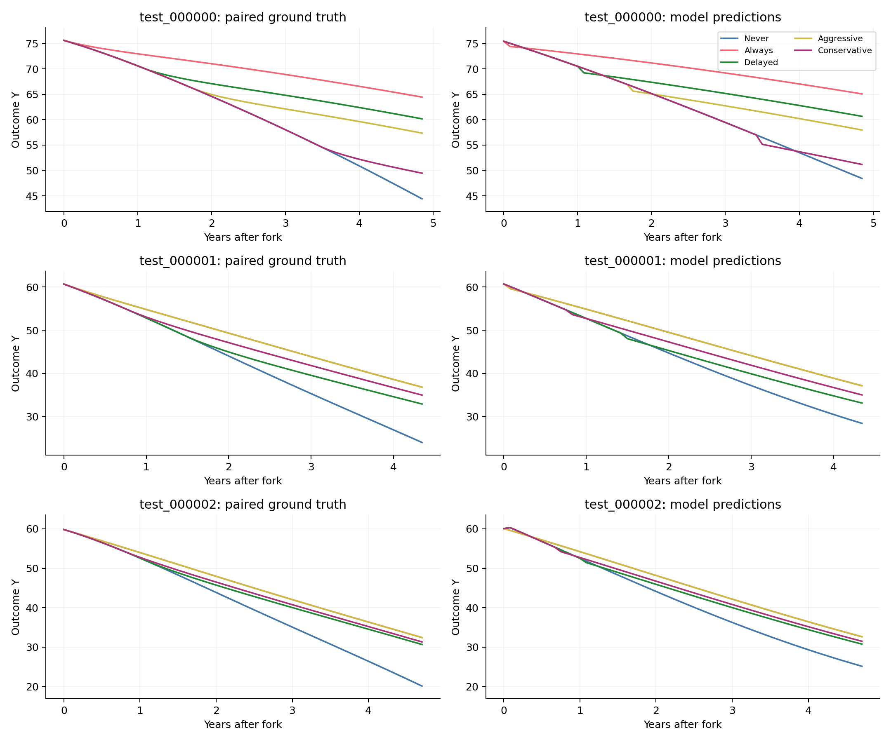
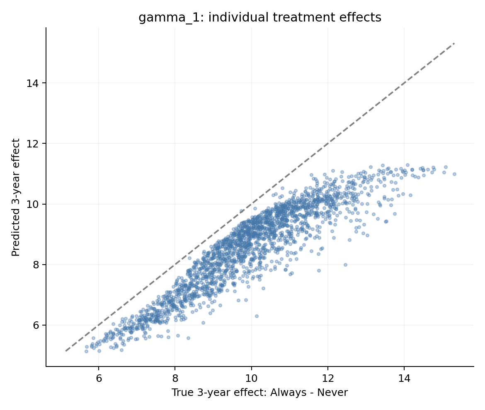
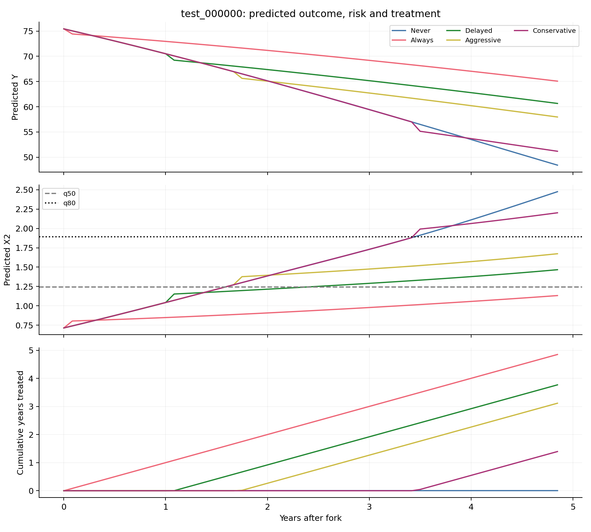

# CausalMed：反事实预测结果与病例分析

先查看整体误差和个体效应，再沿同一患者的五条分支观察预测曲线、风险和治疗时长。图表由封存的GPU预测与独立评分真值生成。

[训练进度与完整指标表](summary.md) · [模型与测试方法](../../latent2x_experiment/README.zh-CN.md)

## gamma=1：3年反事实能力

| 项目 | 动作输入 | 关闭未来动作 |
|---|---:|---:|
| 全轨迹CF-RMSE | 1.04478 | 5.49061 |
| 3年CF-RMSE | 0.89447 | 5.91910 |
| Always相对Never的sqrt(PEHE) | 1.55409 | 10.07340 |
| ATE Error | 1.39365 | 9.92767 |
| 策略Regret | 0.27946 | 1.30264 |
| 最优策略准确率 | 61.40% | 22.55% |

病例取测试名单按编号排序的前三位。每行左右是同一患者，颜色对应相同策略，纵轴范围在该行内保持一致。

下面逐患者比较“Always减去Never”的3年治疗效应，虚线表示预测与真值相同。

同一病例的预测结局、预测风险与累计治疗年数如下。动态策略根据每次未来检查时刻的风险预测更新动作。

3年个体治疗效应的Pearson相关为 0.9201。
