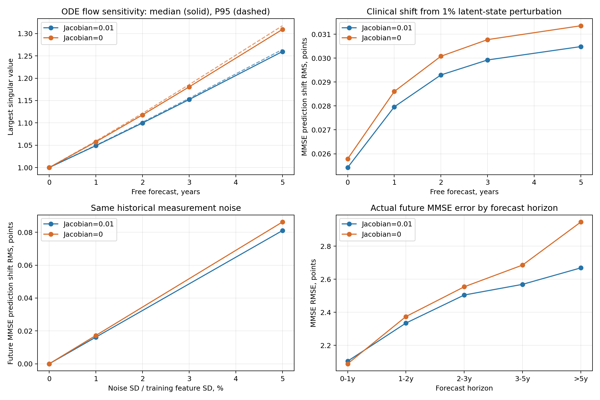
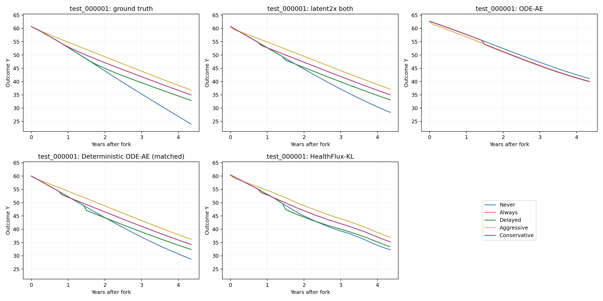

# LatentODE 项目实验总览：ADNI、MIMIC 与 CausalMed

资料快照：**2026-11-05 13:19:29 UTC**。

本项目围绕三个问题展开：如何从不规则的多次检查中估计患者状态，如何利用连续动力学预测后续变化，以及在已知干预条件下能否推演不同治疗方案。本报告先介绍数据和共同任务，再把模型比较、容量与结构消融、训练失稳诊断、状态空间解释和反事实实验按主题放在一起。

表格优先读取实际`metrics.json`和训练历史。一次训练被多个旧文档引用时，在主题表里只作为同一条证据；训练、已停止的尝试、固定检查点评测和仅完成设计的方案分别标注。历史实验使用其实际轮数；目前新训练与续训的总上限为150轮。

阅读顺序：

1. [数据与评测协议](#data)
2. [模型家族与命名](#models)
3. [ADNI、MIMIC模型比较](#comparison)
4. [容量、编码、损失和门控消融](#ablation)
5. [训练失稳与机制诊断](#instability)
6. [状态空间、临床速度与疾病进展](#dynamics)
7. [CausalMed反事实实验](#counterfactual)
8. [各主题形成的insight](#insights)
9. [当前状态、完整账本与来源](#ledger)

<a id="data"></a>

## 一、先明确数据和预测任务

### 1.1 三个主数据集，以及ADNI的两套实验协议

ADNI早期实验先做58个连续字段的未来预测，后来为了对齐ODE-AE任务，另建40个混合字段的季度缓存。两套结果各自成表。MIMIC使用首次ICU住院前48小时的小时窗口；CausalMed由生成器同时提供事实与配对反事实真值。

| 项目 | ADNI早期58字段 | ADNI当前40字段 | MIMIC chronology_v2 | CausalMed γ=1 |
| --- | --- | --- | --- | --- |
| 训练／验证／测试 | 1,677／312／324 | 2,093／393／414 | 21,517／4,649／4,536 | 10,000／2,000／2,000 |
| 输入与目标 | 58数值目标；可附加16维MRI输入 | 36数值＋4类别；展开49维 | 27数值＋4类别；展开44维 | Y、X1、X2；静态c；治疗0/1 |
| 时间组织 | 有效纵向检查窗口 | 自然季度；年龄为年时钟 | 入ICU后小时；最多48小时 | 连续年；不规则检查与动作切换 |
| 历史形成 | 前半段检查 | 枚举所有非空历史前缀 | 训练随机6/12/18/24小时；主测试前24小时 | 训练事实历史；测试在首次达到3年检查处分叉 |
| 目标变换 | 训练集z-score | 训练集min-max | 训练集min-max | 训练集z-score |
| 主要评分 | 数值字段等权平均macro MSE | 数值MSE与类别CE按字段求和 | 同左，另报原量纲与数值标准化误差 | 事实预测＋反事实轨迹、效应与策略评分 |
| 主要文件 | data/adni_cache/ | paper_odeae/cache/local_available.pkl | /data/MIMIC/derived/latentode_iv31/dataset.pkl | CausalMed/outputs/level3_suite/gamma_1/ |

### 1.2 数据整理与审计实验

**目的。** 确定哪些患者真正有纵向支持，哪些模态能够进入模型，以及时间不规则性体现在哪个层次。

**设计。** ADNI把同次访视的结构化量表、MRI/PET定量结果、APOE和CSF合并到自然季度，使用训练集确定字段与缩放。MIMIC取每人的首次ICU住院，核对住院与死亡时间，保留前后24小时均有至少6个非空小时的患者；年龄与小时ODE时钟分开保存。所有患者的记录整体划入训练、验证或测试。

**结果。** ADNI当前缓存共2,900人、17,165个有效季度，每人中位5个时间点；MIMIC共30,702人、1,181,642个非空小时，每人中位39个时间点。ADNI的MRI、淀粉样PET、tau PET、CSF覆盖患者分别为2,834、2,051、1,344、1,635人。缺失字段通过掩码保留，而非要求所有患者都有全部检查。

另一次人群统计从3,065人的完整索引出发，得到39,064个有检查日期，每人中位11次，首次评估年龄72.29±7.57岁，男性1,540、女性1,525。它使用“检查日期数”；模型使用“有效季度数”，因此两组观测次数回答不同问题。

| 不规则性统计，中位数 | ADNI | MIMIC |
| --- | --- | --- |
| 患者联合时间轴的间隔CV | 0.515000 | 0.391000 |
| 患者—动态字段时间轴的间隔CV | 0.353000 | 0.432000 |
| 患者联合时间轴的间隔Gini | 0.268000 | 0.148000 |

**得到的认识。** ADNI主要体现访视间隔的不规则；MIMIC虽然联合时间轴接近逐小时，但单个化验或量表依然异步。两者都需要处理“何时检查”和“检查了什么”。

来源：[数据与字段](reproduction/ADNI_MIMIC_DATASETS.zh-CN.md) · [人群分布与直方图](results/adni_population/summary.zh-CN.md) · [采样间隔比较](reproduction/SAMPLING_IRREGULARITY_COMPARISON.zh-CN.md).

### 1.3 ADNI治疗资料的可行性审计

**目的。** 判断真实ADNI能否直接开展动作预测和治疗反事实研究。

**设计与结果。** 检查用药、不良事件和病史表：RECCMEDS有80,184行、4,292位患者；当前2,900人队列中2,890人能匹配到该表。记录里约40.4%有精确开始日。抗淀粉样治疗明确记录涉及44人，其中35人有精确日期；同时具有治疗前测量和约一年后MMSE的粗筛样本仅3人。药名关键词还统计了胆碱酯酶抑制剂、美金刚等类别，完整分布保存在人群统计中。

**得到的认识。** 有治疗记录，为构建动作时间线提供了入口；记录日期精度、治疗前后支持和组间可比性仍决定能回答什么问题。因此，目前真实ADNI实验继续研究病程预测，反事实能力先在能获得配对真值的CausalMed上测试。治疗方案文档是数据审计和研究设计，尚无ADNI治疗反事实模型效果。来源：[治疗可行性与方案](reproduction/ADNI_TREATMENT_PLAN.zh-CN.md).

### 1.4 全文指标怎样读

历史回顾H评价已提供给模型的历史时点；未来预测F评价截止点之后的真实观测；整体O在全部有效目标上重新按字段汇总，通常不是H、F的算术平均。概率模型的点预测使用后验均值。

ADNI40字段与MIMIC的主指标为“数值字段MSE之和＋类别字段CE之和”，不把KL、prior、Jacobian或L2加到测试数据误差中。原生ODE-RNN历史列采用UPDATE前因果预测，其他模型大多采用整段历史条件下的回顾；未来列的信息条件更统一。

数值标准化MSE把各字段误差换算为训练集标准差单位，再对字段取平均。MAE、RMSE则恢复原始临床单位。CausalMed的CF-RMSE、PEHE和策略遗憾在第七章定义。

### 1.5 共同训练基准与历史预算

主要同任务比较使用Adam学习率0.003，按`0.97^(optimizer_step/2000)`衰减，历史输入dropout=0.1，全模型梯度范数裁剪10。模型按验证集数据误差选择最佳检查点，再重新载入该检查点测试。后期消融通常为seed0；早期58字段实验另外使用5个种子。

| 设置 | ADNI40字段 | MIMIC | CausalMed |
| --- | --- | --- | --- |
| 主要batch | 32；早期DDP全局32 | 128；后期单卡整批，无梯度累积 | 128，单卡 |
| 主模型ODE时间单位 | 年 | 小时；年龄独立以年输入 | 年 |
| 主模型ODE求解 | Tsit5，rtol=1e−4／atol=1e−6 | 同左 | 同左 |
| 至少训练／早停耐心 | 50／40轮 | 50／40轮 | 50／40轮 |
| 当前新增与续训上限 | 累计150轮 | 累计150轮 | 若新增同样按累计150轮 |
| 已完成历史预算 | 部分当时上限300，保留实际轮数 | 同左 | 当时上限300，实际见第七章 |

HealthFlux使用其原生RK4；原生Latent ODE、ODE-RNN在ADNI适配中还使用内部十年时钟，速度可视化已换算为每年。它们的求解与表示差异在比较时保留。MWM修改过batch及选模监督，单独在4.8记录。所有新模型计算使用RTX 4090和对应Conda环境，SwanLab保存训练曲线。

<a id="models"></a>

## 二、模型家族：同一个名字在项目中代表什么

| 名称 | 历史状态估计 | 生成起点与速度场 | 主要训练项 |
| --- | --- | --- | --- |
| ODE-AE概率版 | 向过去读取；维护Gaussian均值/方差 | 首次历史检查；编码和生成场独立 | MSE＋CE＋KL＋ODE L2 |
| 确定性ODE-AE | 向过去读取；确定性状态 | 首次检查；两个独立场 | MSE＋CE＋ODE L2 |
| forward_age／forward_zero | 按时间顺序吸收；年龄INIT／零状态 | 历史截止点；最初仍为两个场 | MSE＋CE＋ODE L2 |
| shared_matched 6D | 顺序ODE＋UPDATE；6维状态 | 截止点；共享一个速度场 | 基础重建；后续分别加prior或Jacobian |
| latent2x baseline | 同上，状态扩为28维 | 共享场；ADNI44,875／MIMIC43,280参数 | 基础重建＋ODE L2 |
| latent2x both，α=1 | 28维，UPDATE输出直接覆盖状态 | 截止点向过去回顾、向未来预测 | 重建＋0.01 prior＋0.01 Jacobian＋0.02 L2 |
| latent2x both，α=0.1 | 28维；采用10%的UPDATE建议 | 同一个共享场与截止点 | 与both相同；门控没有新参数 |
| ODE-RNN | ODE连续演化＋GRU读取观测 | 递归状态；适配版未来使用预测反馈 | 原任务的数据项与原生策略 |
| Latent ODE | ODE-RNN编码器推断随机初始状态 | Gaussian生成状态＋ODE解码 | 数据项＋KL及原生正则 |
| HealthFlux-KL | 256维确定性＋128维随机状态 | 条件ODE、先验/后验、GRU与解码器 | 共同数据项＋0.01 KL＋ODE L2 |
| MWM main/A/B | 首诊年龄INIT；顺序读取 | 训练在UPDATE前预测；评测仍保留历史回顾 | 同权／观测数加权／Gaussian NLL |

共享模型的基本操作是：

\[
\dot z=f_\theta(z),\qquad
z_k^+=(1-\alpha)z_k^-+\alpha U_\phi(z_k^-,y_k).
\]

`latent2x`表示总参数预算约为6维shared_matched的两倍，潜在维度实际从6增至28；`latent4x`、`latent8x`、`latent16x`分别为73、161、339维。它们不是把潜在维度简单乘2、4、8、16。

`deterministic_22545`最初是ADNI的22,545参数版本名称。迁移时会按任务重新匹配预算：MIMIC版本为43,280参数，CausalMed版本为31,314参数。HealthFlux保留原生256＋128维，不参加小预算的严格等参数匹配。

早期`forward_zero`删除INIT网络，参数量从22,545降为21,307；后来的“首次年龄”和“性别INIT”只替换输入标量，结构与参数量相同。两类实验分别放在初始化主题中。

方法来源：[模型思想对照](reproduction/MODEL_METHODS_COMPARISON.zh-CN.md) · [latent2x方法与两个数据集案例](reproduction/CURRENT_MODEL_METHOD.zh-CN.md) · [HealthFlux适配](healthflux/README.zh-CN.md) · [MWM方法](paper_odeae/MWM_METHOD.zh-CN.md).

<a id="comparison"></a>

## 三、模型比较：先把共同任务放在一张表里


来源：[六组结果与逐量表误差](results/adni_cuda/summary.md) · [影像编码器调研与数据流程](reproduction/ADNI_EXPERIMENT.zh-CN.md).


### 3.3 ADNI40字段：原容量、匹配容量和当前主模型

下表统一列出同一40字段任务的结果。所有误差越低越好。“轮数／最佳”保留真实历史训练量，参数量相同与训练轮数相同是两个分别记录的条件。

| 模型 | 总参数 | 轮数／最佳 | 测试H | 测试F | 测试O |
| --- | --- | --- | --- | --- | --- |
| ODE-AE原容量 | 3003 | 90 / 50 | 3.014009 | 3.247804 | 3.115103 |
| 确定性ODE-AE原容量 | 2505 | 122 / 82 | 0.716699 | 1.206059 | 0.929813 |
| LSTM | 4469 | 84 / 44 | 3.628885 | 3.841473 | 3.720943 |
| 确定性ODE-AE 22,545 | 22545 | 116 / 76 | 0.666808 | 1.191548 | 0.894758 |
| ODE-RNN原容量 | 32746 | 96 / 56 | 1.370759 | 1.120580 | 1.264065 |
| ODE-RNN同预算 | 44875 | 69 / 29 | 1.376041 | 1.032329 | 1.228165 |
| Latent ODE原容量 | 72266 | 69 / 29 | 2.524608 | 2.836983 | 2.659362 |
| Latent ODE同预算 | 44875 | 300 / 268 | 2.457803 | 2.761802 | 2.589093 |
| ODE-AE概率版同预算 | 44875 | 81 / 41 | 3.026708 | 3.238572 | 3.118315 |
| HealthFlux KL=1 | 5156722 | 58 / 18 | 0.808341 | 1.534999 | 1.127324 |
| HealthFlux KL=0.01 | 5156722 | 50 / 3 | 1.084390 | 1.603200 | 1.311567 |
| shared_matched 6D | 22545 | 96 / 56 | 0.627254 | 1.139262 | 0.850628 |
| latent2x both α=1 | 44875 | 121 / 81 | 0.471739 | 1.000299 | 0.702538 |
| latent2x both α=0.1 | 44875 | 70 / 30 | 0.413037 | 0.999456 | 0.665897 |

另外完成了小容量Latent ODE（7,641可训练／10,042总参数）和小容量ODE-RNN（2,719／5,120）；测试未来误差分别为2.8276、1.2543。原容量Latent ODE与ODE-RNN保留过旧的闲置分类头，总参数与任务可训练参数因此不同；新的44,875参数比较移除了该分类头。

**结果分析。** 概率ODE-AE从3,003扩大到44,875参数，未来误差仅从3.2478变为3.2386；ODE-RNN匹配后由1.1206降到1.0323。当前α=0.1主模型未来误差约0.9995，历史回顾也更低。HealthFlux的KL从1减到0.01并未在ADNI共同任务上获益。

这些基线包含不同模型的原生训练策略；本地同预算Latent ODE实际使用300轮、最佳268轮，按其真实历史预算列出。当前主模型与新增消融的150轮约束保留在后续主题表中。

来源：[原容量及小容量](paper_odeae/results/baselines_full/summary.md) · [同参数预算](paper_odeae/results/baselines_matched_latent2x/summary.md) · [HealthFlux两种KL](healthflux/results/adni_comparison/summary.md).

### 3.4 MIMIC：共同24小时历史、后24小时预测

本组使用相同chronology_v2缓存。四卡参照的全局batch=128；后来增加单卡完整batch=128及方向、门控对照。表中同时保留它们的训练方式。

| 模型 | 总参数 | 轮数／最佳 | 测试H | 测试F | 测试O | 未来数值标准化MSE |
| --- | --- | --- | --- | --- | --- | --- |
| latent2x both α=1，四卡 | 43280 | 73 / 33 | 1.215770 | 1.871577 | 1.529090 | 0.976765 |
| latent2x both α=1，单卡 | 43280 | 81 / 41 | 1.200620 | 1.855163 | 1.514184 | 1.014613 |
| HealthFlux-KL | 4409965 | 110 / 70 | 1.265998 | 1.947004 | 1.591760 | 0.919463 |
| ODE-AE原容量 | 2838 | 178 / 138 | 3.167254 | 2.557352 | 3.202431 | 0.931238 |
| ODE-AE同预算 | 43280 | 124 / 84 | 3.201955 | 2.552856 | 3.218515 | 0.936109 |
| 确定性ODE-AE同预算 | 43280 | 213 / 173 | 1.255164 | 1.990030 | 1.606299 | 0.932415 |
| ODE-RNN原容量 | 31813 | 226 / 186 | 2.288700 | 1.751082 | 2.359354 | 0.863133 |
| ODE-RNN同预算 | 43280 | 242 / 202 | 2.287866 | 1.745383 | 2.356375 | 0.842845 |
| Latent ODE原容量 | 70565 | 104 / 64 | 3.175188 | 2.499839 | 3.167512 | 0.932194 |
| Latent ODE同预算 | 43280 | 84 / 44 | 3.162445 | 2.482012 | 3.155783 | 0.927523 |
| latent2x both α=0.1，单卡 | 43280 | 237 / 233 | 0.506466 | 1.810933 | 1.126278 | 0.830239 |

**结果分析。** 原容量ODE-RNN的未来误差1.7511，同预算版本为1.7454；当前α=0.1共享模型未来误差1.8109，但整体误差更低，数值标准化MSE为0.8302。模型的排序随“未来总误差、数值误差、历史回顾”而改变。

MIMIC的未来总误差主要受GCS类别CE影响。例如四卡latent2x both的未来1.8716中，数值MSE为0.1635、GCS CE为1.7081。持续值基线在多数字段的原量纲MAE更低：四卡latent2x both为0/27个数值字段优于持续值，ODE-RNN为4/27。单独报告总分容易掩盖这个重要现象。

**得到的认识。** ADNI上共享模型的优势没有直接变成MIMIC未来总分的统一优势。ICU短期任务需要同时检查持续值、GCS分类和数值原单位误差，不能只依赖整体回顾误差决定模型是否适合临床预测。

来源：[全部临床字段和持续值](mimic_experiment/results/baselines_single_cuda/summary.md) · [同预算比较](mimic_experiment/results/baselines_matched_latent2x/summary.md) · [确定性基线](mimic_experiment/results/baselines_with_deterministic_cuda/summary.md).

### 3.5 MIMIC补充评测：历史更少、预测更久会怎样

**设计。** 同一最佳检查点分别只读取6、12、24小时历史，不再训练；主要24小时历史测试另报未来6、12、24小时内的累计误差。下表集中列出最初五模型比较中的所有上下文长度测试。

| 模型 | 24h历史：未来6h | 未来12h | 未来24h | 只知6h：预测至48h | 只知12h：预测至48h |
| --- | --- | --- | --- | --- | --- |
| latent2x both α=1，四卡 | 1.536453 | 1.670760 | 1.871577 | 2.409780 | 2.180719 |
| HealthFlux-KL | 1.657210 | 1.778248 | 1.947004 | 2.522945 | 2.282526 |
| ODE-AE原容量 | 2.504461 | 2.518300 | 2.557352 | 2.786597 | 2.640989 |
| ODE-RNN原容量 | 1.399901 | 1.555047 | 1.751082 | 2.275777 | 2.066015 |
| Latent ODE原容量 | 2.442357 | 2.454672 | 2.499839 | 2.787105 | 2.639161 |

6小时历史测试有4,513人，12小时和24小时历史有4,536人。随着预测时长增加，误差普遍增加；只知道6小时历史时五组误差均更高。ODE-RNN在这些未来总分中仍较低。较短历史同时减少信息并延长自由预测区间，表中保留两项条件以便解释变化。

完整逐字段MAE/RMSE、GCS分类准确率和较短上下文结果见前述MIMIC共同评测资料；后续新模型沿用同一评价器。

<a id="ablation"></a>

## 四、把容量、编码、损失与门控消融合在一起

### 4.1 统一消融地图

各批消融围绕同一个问题逐步拆解：收益来自更大的模型、历史读取方式、共享动力学，还是训练监督和观测校正？下面先给出跨文档的实验矩阵，再按主题集中展示结果。

| 主题 | 改变的因素 | 主要批次 | 要排除的解释 |
| --- | --- | --- | --- |
| 容量 | INIT、UPDATE、Decoder、编码/生成ODE或latent扩容 | forward_age扩容；shared_matched四倍；latent2/4/8/16倍 | 仅因模型更大而改善 |
| 历史编码 | 正序／反序／注意力＋实际时间 | ADNI和MIMIC两轮方向对照 | 收益仅来自读取顺序或锚点 |
| 初始化 | 年龄／零状态；截止年龄／首诊年龄／性别 | forward_age/zero；MIMIC INIT | 初始化时钟和背景信息导致差异 |
| 速度场共享 | 独立、直接共享、同L2共享、等参数共享 | 6D共享；28Dα=0.1双场 | 共享收益来自参数减少或L2次数变化 |
| 辅助损失 | prior、Jacobian、两者联合 | 6D独立项；28D四组；α=0.1移除项 | 校正前监督与动力学规整的独立作用 |
| 监督路径 | future-only、多截止点、遮蔽回顾、MWM | MIMIC连续损失消融；ADNI/MIMIC MWM | 历史向过去生成及早期监督的影响 |
| 梯度路径 | 截止点detach、最多8步编码反传 | MIMIC针对性因果实验 | 异常来自历史梯度返回编码器 |
| 观测校正 | 固定α=0、0.1、0.2、0.3、0.4、0.5、1 | MIMIC门控扫描、ADNI迁移 | UPDATE递归高增益导致训练不稳 |

### 4.2 容量放在哪里最有价值

**设计。** 先以非共享forward_age为参照放大各模块，随后以6维shared_matched为参照，把总参数扩为约4倍；另只扩大latent维度，对应总预算2、4、8、16倍。

| ADNI容量组 | 参数量 | 轮数／最佳 | 验证O | 测试F | 测试O | 状态 |
| --- | --- | --- | --- | --- | --- | --- |
| 6D共享基线 | 22545 | 96 / 56 | 0.887222 | 1.139262 | 0.850628 | 已测试 |
| INIT约4倍总预算 | 90177 | 43 / 41 | 1.365254 | — | — | 已停止 |
| UPDATE约4倍总预算 | 90187 | 84 / 44 | 0.887443 | 1.134567 | 0.845904 | 已测试 |
| ODE约4倍总预算 | 90184 | 191 / 151 | 0.863106 | 1.127234 | 0.837344 | 已测试 |
| latent2x，28D | 44875 | 84 / 44 | 0.741847 | 1.020304 | 0.719630 | 已测试 |
| latent4x，73D | 90550 | 142 / 102 | 0.798014 | 1.123453 | 0.769198 | 已测试 |
| latent8x，161D | 179870 | 50 / 2 | 1.138887 | 1.342139 | 1.090901 | 已测试 |
| latent16x，339D | 360540 | 50 / 2 | 1.017828 | 1.254453 | 0.986419 | 已测试 |

早期非共享forward_age批次还完成INIT约2倍扩容（45,049参数，F=1.1358、O=0.8673）；UPDATE、Decoder、编码ODE、生成ODE的2倍组分别在86、74、70、13轮被停止。对应最佳验证未来误差约1.2076、1.2117、1.2060、1.2996。其余预设4倍组合与12/24/48维候选在该轮取消；它们没有测试成绩。

**得到的认识。** 对共享模型，增大latent比单独增大INIT更有效，但收益不是单调的。28维、约44.9k参数的版本优于73、161、339维版本，成为后续latent2x主干。增大状态维度会同时扩大相连层并改变动力学与优化难度，较大的表示空间本身不保证更好的病程预测。

来源：[早期所有扩容候选](paper_odeae/results/forward_age_scaling/summary.md) · [模块四倍](paper_odeae/results/shared_matched_scaling_4x/summary.md) · [latent2/4/8/16倍](paper_odeae/results/shared_matched_latent_scaling/summary.md).

### 4.3 读取历史、初始化与生成锚点

**设计。** 正序模型顺着时间吸收已知历史，最终状态在截止点；反序模型向过去读取，最终状态在首次检查，再沿ODE向未来生成。注意力版本用因果自注意力和实际时间编码替代历史ODE，保留28维状态与相同总预算。

| 数据 | 编码组 | 参数 | 轮数／最佳 | 验证O | 测试F | 测试O | 状态 |
| --- | --- | --- | --- | --- | --- | --- | --- |
| ADNI | α=1，正序ODE | 44875 | 121 / 81 | 0.744104 | 1.000299 | 0.702538 | 已测试 |
| ADNI | α=1，反序共享ODE | 44875 | 68 / 28 | 0.802886 | 1.087685 | 0.773887 | 已测试 |
| ADNI | α=1，注意力＋时间 | 44875 | 78 / 38 | 0.785531 | 1.109296 | 0.753551 | 已测试 |
| MIMIC | α=1，正序四卡参照 | 43280 | 73 / 33 | 1.552274 | 1.871577 | 1.529090 | 已测试 |
| MIMIC | α=1，早期反序 | 43280 | 78 / 74 | 1.492500 | — | — | 已停止 |
| MIMIC | α=1，早期注意力 | 43280 | 80 / 69 | 1.289091 | — | — | 已停止 |
| ADNI | α=0.1，正序 | 44875 | 70 / 30 | 0.683622 | 0.999456 | 0.665897 | 已测试 |
| ADNI | α=0.1，反序 | 44875 | 58 / 18 | 0.733542 | 1.053120 | 0.706938 | 已测试 |
| MIMIC | α=0.1，反序 | 43280 | 150 / 125 | 1.164118 | 1.818688 | 1.154081 | 已测试 |
| MIMIC | α=0.1，正序 | 43280 | 237 / 233 | 1.127823 | 1.810933 | 1.126278 | 既有训练＋独立测试 |

ADNI在α=1时，正序ODE的未来误差相对反序和注意力分别低约8.0%、9.8%；α=0.1时，正序仍低于反序。MIMIC早期注意力的最佳验证整体较低，但已停止且没有最终测试；后续完整batch方向比较放入训练失稳章节。α=0.1的MIMIC正序沿用237轮结果，反序最多150轮，预算在表中单列。

初始化相关实验集中如下。

| 数据 | 初始化组 | 参数 | 测试H | 测试F | 测试O |
| --- | --- | --- | --- | --- | --- |
| ADNI | 22,545参数正序，年龄INIT | 22545 | 0.592903 | 1.081387 | 0.805673 |
| ADNI | 正序，零状态（删除INIT） | 21307 | 0.608036 | 1.148827 | 0.843945 |
| MIMIC | 截止点年龄INIT | 43280 | 1.200620 | 1.855163 | 1.514184 |
| MIMIC | 首次检查年龄INIT | 43280 | 1.221078 | 1.881183 | 1.538775 |
| MIMIC | 性别INIT | 43280 | 1.178181 | 1.869549 | 1.508798 |

**得到的认识。** ADNI支持保留连续历史ODE而非简单替换为注意力；MIMIC的差异还取决于训练稳定性和监督路径。方向消融会同时改变状态的时间锚点和自由生成长度，含义比“把循环倒过来”更完整。MIMIC首次与截止点年龄在24小时内最多差约0.0026岁，换成首次年龄并没有消除失稳；性别INIT也出现波动。因此，INIT年龄对应位置不是主要机制解释。

来源：[ADNI编码](paper_odeae/results/latent2x_history_encoder_ablation/summary.md) · [MIMIC早期编码](mimic_experiment/results/history_encoder_ablation_cuda/summary.md) · [初始化](mimic_experiment/results/init_covariate_ablation_cuda/summary.md) · [α=0.1方向对照](ablation/Ablation.zh-CN.md).

### 4.4 统一速度场还是两套速度场

**设计。** 6维批次先直接绑定两个ODE网络；`shared_tied_l2x2`恢复原先两次计算L2的强度；`shared_matched`把节省的容量重新分配，严格匹配22,545参数。后续在28维α=0.1主模型下，将10,744个ODE参数分为编码场5,358和生成场5,386，其他模块不变。

| 6D共享实验 | 参数 | 测试F | 测试O |
| --- | --- | --- | --- |
| 两个独立场 | 22545 | 1.166895 | 0.865835 |
| 直接绑定 | 21005 | 1.146936 | 0.861559 |
| 绑定＋双倍L2 | 21005 | 1.143839 | 0.856916 |
| 共享且匹配总参数 | 22545 | 1.139262 | 0.850628 |

同批单卡22,545参数对照中，共享场F从1.1669降到1.1393；改善主要来自类别CE，数值MSE略升。此前四卡非共享forward_age的F为1.0814，说明执行方式和训练轨迹也会影响排序。

28维α=0.1的新双场组采用28→94→28两个独立网络。编码场删除输出偏置以精确省下28个参数；生成场保留偏置。L2覆盖全部独立参数，Jacobian在相同生成状态上对两场取平均。两场起始函数相同，之后独立训练。该组的ADNI F=0.998429、O=0.660562，与统一场F=0.999456、O=0.665897接近；MIMIC尚在训练。

**得到的认识。** 共享能以一套场表达编码与生成，但当前新ADNI等参数结果没有显示共享必然优于独立场。应把“共享的结构简洁性”和“是否改善测试误差”分别评价。

来源：[6D共享分析](paper_odeae/results/shared_matched_comparison/comparison.zh-CN.md) · [28D精确预算设计及结果](ablation/Ablation.zh-CN.md).

### 4.5 weak prior与Jacobian：按主干和门控版本放在同一主题

weak prior监督第2次及以后的历史检查，在当前检查进入UPDATE前预测它；Jacobian约束有效生成状态上的速度场局部变化。它们使用不同的监督对象。

| ADNI主干 | 辅助项 | λprior | λJac | 测试F | 测试O | 测试Jacobian平方范数 |
| --- | --- | --- | --- | --- | --- | --- |
| 6D，α=1 | 无辅助项 | 0 | 0 | 1.139262 | 0.850628 | — |
| 6D，α=1 | prior | 0.010000 | 0 | 1.125436 | 0.843610 | — |
| 6D，α=1 | Jacobian | 0 | 0.010000 | 1.147283 | 0.842968 | 0.005273 |
| 28D，α=1 | baseline | 0 | 0 | 1.020304 | 0.719630 | — |
| 28D，α=1 | prior | 0.010000 | 0 | 1.018222 | 0.710738 | 0.013096 |
| 28D，α=1 | Jacobian | 0 | 0.010000 | 1.026701 | 0.721353 | 0.011907 |
| 28D，α=1 | both | 0.010000 | 0.010000 | 1.000299 | 0.702538 | 0.008285 |
| 28D，α=0.1 | 完整 | 0.010000 | 0.010000 | 0.999456 | 0.665897 | 0.036695 |
| 28D，α=0.1 | 去prior | 0 | 0.010000 | 0.998405 | 0.661391 | 0.026798 |
| 28D，α=0.1 | 去Jacobian | 0.010000 | 0 | 1.009824 | 0.667594 | 0.051840 |

**结果分析。** 6维时prior小幅改善未来预测；单独Jacobian主要改善整体误差，未来误差略高。28维α=1时，联合组F最低，但验证整体最优仍是baseline。加入α=0.1后，去prior与完整组的测试未来几乎相同；去Jacobian使F从0.999456升至1.009824。

MIMIC中需要分清两批去prior：α=1的早期移除实验在42轮停止，仍出现失稳；α=0.1的新移除组在101轮停止、最佳96轮、验证O=1.192842，没有最终测试。后者已按用户要求停止，不再候补；去Jacobian与双场继续运行，最新验证结果见§9.1状态表。

**得到的认识。** 辅助项的效果随主干和校正强度改变。prior没有被证明是失稳根因；Jacobian能直接降低局部敏感性，而是否提高实际稳定性，需要下一节的独立扰动测试。

四卡λ=0／0.01对照最初被设计，后按要求未启动，改为复用单卡基线；这两行没有计作新的完成训练。来源：[6D两项](paper_odeae/results/shared_matched_prior_weak_single/summary.md) · [28D四组](paper_odeae/results/latent2x_loss_ablation/summary.md) · [α=0.1移除项](ablation/Ablation.zh-CN.md).

### 4.6 Jacobian更小之后，实际获得了什么

**目的。** 把局部场的规整度转为完整ODE流的误差放大、临床预测波动和真实随访误差。

**设计。** 固定两组ADNI第30轮检查点、414位测试患者，不训练。保留原全部历史前缀评测；另从每人最早3条历史编码，对截止点状态施加8个相同随机方向、相对长度1%的扰动，并自由推演0/1/2/3/5年。观测端另加相同1%或5%训练标准差的测量噪声。流Jacobian以float64严容差计算，并与原28维流的autograd和更严格容差核对。

| 实测项目 | 保留Jacobian | 去掉Jacobian |
| --- | --- | --- |
| 测试局部Jacobian平方范数 | 0.036695 | 0.051840 |
| 5年最坏方向误差放大倍数，患者中位数 | 1.259699 | 1.309237 |
| 5%测量噪声引起的未来MMSE偏移RMSE，分 | 0.081051 | 0.086272 |
| 5%测量噪声引起的CDR-SB偏移RMSE，分 | 0.069323 | 0.069208 |
| 全部未来MMSE RMSE，分 | 2.453567 | 2.571112 |
| 超过5年MMSE RMSE，分 | 2.668789 | 2.946112 |

**得到的认识。** 局部Jacobian降低29.2%，对应的5年流放大倍数降低3.78%，同测量噪声下MMSE预测波动降低约6%。收益可测但温和；CDR-SB抗噪声基本持平。MMSE较长期预测获益更明显。按患者配对bootstrap，全部未来MMSE RMSE差值为−0.118分，95%区间[−0.247, −0.023]；总误差差值区间则跨过0。这把“局部更平滑”和“临床输出更稳定”联系起来，也给出了各自不同的幅度。



来源：[完整扰动实验与配对区间](ablation/results/jacobian_utility_adni/report.zh-CN.md).

### 4.7 UPDATE门控：既保留观测，也减小单次修正

**设计。** 保留原UPDATE网络，只把输出改为`(1−α)z＋αU(z,y)`。所有MIMIC组维持43,280个总参数；α=0时UPDATE不参与任务计算，实际使用参数量减少，因此它是“取消观测吸收”的端点对照。

| MIMIC α | 轮数／最佳 | 测试H | 测试F | 测试O | 状态 |
| --- | --- | --- | --- | --- | --- |
| α=0 | 150 / 120 | 4.137267 | 3.242851 | 4.038117 | 已测试 |
| α=0.1 | 237 / 233 | 0.506466 | 1.810933 | 1.126278 | 既有237轮＋独立测试 |
| α=0.2 | 150 / 143 | 0.603716 | 1.792090 | 1.169003 | 已测试 |
| α=0.3 | 298 / 292 | — | — | — | 已停止 |
| α=0.4 | 136 / 96 | 0.715648 | 1.803762 | 1.234397 | 已测试 |
| α=0.5 | 147 / 107 | 0.746722 | 1.810970 | 1.254058 | 已测试 |
| α=1 | 81 / 41 | 1.200620 | 1.855163 | 1.514184 | 已测试 |

**结果分析。** α=0取消观测吸收后，整体误差约4.04，说明持续吸收观测是必要的。α=0.1～0.3明显改善历史回顾与训练波动；其中已完成150轮预算内α=0.2的未来误差1.7921，比α=0.1的1.8109更低，而α=0.1整体误差更低。α=0.1与0.3分别保留了237、298轮的历史结果，不能把该表看成完全相同轮数的扫描。

**得到的认识。** 关键不是完全去掉UPDATE，而是在自然演化状态与观测建议间保留适度折中。当前采用α=0.1作为主设计，是结构、回顾、稳定性和后续消融的一致工作点；单看MIMIC未来总分，α=0.2也是重要对照。

来源：[门控扫描、梯度与曲线](mimic_experiment/results/weak_prior_ablation_cuda/targeted_causal_ablation/summary.md).

### 4.8 训练监督改写：future-only、多个截止点与MWM

**目的。** 检验把监督放在什么位置，能否减少失稳并提高自由预测能力。所有future-only组的验证与测试仍保留历史回顾。

| MIMIC监督组，α=1 | 唯一主要改动 | 轮数／最佳 | 测试F／O或观察 | 状态 |
| --- | --- | --- | --- | --- |
| 原both | 历史回顾＋未来＋prior＋Jac | 81／41 | 1.855163／1.514184 | 完成 |
| 去prior | prior系数0，历史仍回顾 | 42／28 | 仍有Jacobian与误差突增 | 停止 |
| future-only，prior=0 | 训练不再向过去生成 | 143／103 | 1.818476／2.697327 | 完成 |
| future-only，prior=0.01 | 恢复弱校正前监督 | 27／25 | 验证O=2.929234 | 停止 |
| future-only，prior=1 | 加强校正前监督 | 26／16 | 验证O=3.256556 | 停止 |
| 多截止点A | 每人最多4个起点；短中长期等权 | 19／17 | 验证O=2.980171 | 停止 |
| 遮蔽回顾B | 移除一条内部历史，单独编码并回顾 | 46／46 | 验证O=2.433935 | 停止 |

future-only保留了较好的未来误差和稳定训练，但历史回顾明显退步。多截止点增加了“每次UPDATE后均能独立预测未来”的要求；遮蔽回顾让模型在未见目标检查时利用其前后历史回顾。两者已实现并完成输入隔离、损失归一化核验，但在停止前没有形成最终测试结果。

MWM则将历史监督改到顺序吸收时的UPDATE之前，用首诊年龄INIT，去掉独立weak prior项；未来仍由最终历史状态自由生成。A按累计观测数使用sigmoid权重，B用Gaussian NLL输出不确定性。所有ADNI组仍匹配44,875参数，MIMIC匹配43,280参数。

| 数据 | MWM版本 | 轮数／最佳 | 测试H | 测试F | 测试O | 状态 |
| --- | --- | --- | --- | --- | --- | --- |
| ADNI | MWM main，batch128 | 56 / 16 | 1.153986 | 1.061541 | 1.133440 | 完成 |
| ADNI | MWM A，batch128 | 50 / 10 | 0.982195 | 1.072194 | 1.033902 | 完成 |
| ADNI | MWM B，batch128 | 82 / 42 | 2.186563 | 1.045817 | 1.725162 | 完成 |
| ADNI | MWM A，batch32 | 55 / 24 | — | — | — | 暂停 |
| ADNI | MWM B，batch32 | 47 / 33 | — | — | — | 暂停 |
| MIMIC | MWM main，batch128 | 75 / 69 | — | — | — | 暂停 |

ADNI的MWM未来误差均高于原both的1.0003，历史回顾退步更多；B的逐次预测可以较好，但原回顾整体误差达到1.7252。batch32的A/B及MIMIC main按要求暂停，MIMIC A/B没有正式启动。此前一次batch32初始化/实现试跑单独归档，不作为当前版本完成结果。

**得到的认识。** “读历史时预测下一次观测”与“读完历史后再解释过去”是两种能力。直接前者替换后者会改变训练任务；当前MWM没有保住共同评测中的回顾能力。batch对照的结果也要同时看累计参数更新数，不能仅按epoch判断优化程度。

来源：[监督路径连续消融](mimic_experiment/results/weak_prior_ablation_cuda/summary.md) · [ADNI MWM与batch对照](paper_odeae/results/mwm/summary.md) · [MIMIC MWM](mimic_experiment/results/mwm/summary.md) · [归档试跑](mwm/results/adni_mimic_batch32_20261101T094505Z/summary.md).

<a id="instability"></a>

## 五、MIMIC训练失稳：从现象到具体梯度路径

### 5.1 先建立可比较的训练现象

早期方向实验存在四卡参照、单卡微批梯度累积和完整batch三种执行方式。后来两方向都改为单卡一次读取128人、一次backward、一次step，排除梯度累积路径差异。

标准α=1正序模型第41轮验证最佳，第46轮和64–65轮明显恶化；反序组早期较差，但后期更稳。原反序训练被暂停在134轮，按用户要求用第128轮检查点补测：H=1.002926、F=2.000007、O=1.476967。它的整体优于正序1.514184，而未来误差高于正序1.855163。后来α=0.1的两方向是独立的新一轮对照。

来源：[完整batch方向与指标](mimic_experiment/results/direction_full_batch_cuda/summary.md) · [失稳时段分解](mimic_experiment/results/direction_full_batch_cuda/instability_analysis/report.zh-CN.md).

### 5.2 将分散的诊断整理成一条证据链

**设计。** 固定原模型结构和损失，利用检查点、训练重放、相同真实batch和固定验证患者，分别计算历史与未来梯度、更新前后流敏感性、积分精度和患者贡献。重放按原每轮种子重建，核对50项SwanLab记录与逐batch结果；后续保存完整Adam、调度器与RNG并验证恢复。

| 要检验的问题 | 实验 | 核心结果 | 形成的解释 |
| --- | --- | --- | --- |
| 是否为持续的全局梯度冲突 | 固定患者、跨稳定与异常检查点 | 稳定期历史／未来余弦中位数通常为正；异常真实batch为−0.693 | 冲突集中于局部参数与样本状态 |
| 敏感性突然一步爆炸还是累积 | 逐次Adam更新前后测量507次更新 | 第46轮b119→b120→b121，固定状态敏感性约16.63→42.51→92.72→119.2；固定状态B最大单步2.56倍，重新编码A为3.48倍 | 多次更新快速累积，不是一次≥5倍跳变 |
| 是否主要是求解精度错误 | 严格Tsit5、float64、步长收敛RK4 | 异常反向敏感性中位数约92.665；与RK4奇异值相对差约6.1e−8 | 高敏感性属于该快照的真实流性质 |
| 是否单纯由最长回顾者主导 | 患者级原batch分母分解 | 最长／最高流敏感性者排除后总梯度几乎不变；排除最大梯度者，总ODE梯度92.8→8.0 | 敏感性上界与实际梯度贡献不同 |
| 异常来自生成还是编码链 | 历史梯度按路径拆分 | 异常batch历史ODE梯度95.683；编码路径95.246、生成直接路径6.911 | 主要异常经截止点返回历史编码链 |
| 哪位患者、哪段放大 | 真实batch患者级链式分解 | 一人贡献历史损失3.96%，沿历史梯度总方向贡献100.11%；编码参数VJP放大因子739 | 少数患者在特定递归状态产生极高参数增益 |
| UPDATE权重还是ODE位置 | 稳定／异常ODE与UPDATE组成2×2 | 固定稳定INIT时ODE参数敏感性A13.48、B40.55、C21.21、D1438.78；固定异常INIT时联合D增至25,167 | 两模块变化存在很强交互；INIT背景会进一步调制 |

**得到的认识。** 原假设“向过去积分敏感性高，使历史梯度变大”只解释了一部分。更完整的链是：参数更新改变场和编码轨迹，患者进入递归高增益区；历史回顾误差再通过截止点状态返回ODE＋UPDATE编码链，少数样本主导参数梯度并与未来梯度冲突。流的最大奇异值描述可能放大的上界，实际还取决于梯度方向和编码参数敏感性。

模块交叉使用了训练中未必出现过的混合参数组合，其用途是分离模块敏感性。主导患者的诊断性排除没有改动正式训练集。

来源：[初始梯度与敏感性](mimic_experiment/results/direction_full_batch_cuda/gradient_sensitivity_analysis/report.zh-CN.md) · [逐更新、数值收敛和患者路径](mimic_experiment/results/weak_prior_ablation_cuda/mechanism_diagnosis/report.zh-CN.md).

### 5.3 针对机制的训练干预

把这些干预与前面的损失替换分开看：它们保持原历史回顾目标，只改变梯度传播或UPDATE校正幅度。

| 干预 | 保持什么、切断什么 | 结果 | 认识 |
| --- | --- | --- | --- |
| 历史截止点完全detach，续训 | 历史生成仍训练ODE/Decoder；不再经截止点回编码器 | 原45轮完整状态续训至64轮停止；最佳验证O=2.5682，历史严重退步 | 切断全部编码监督过强 |
| 从零训练就完全detach | 同上，从seed0开始 | 16轮停止；验证O=2.6651 | 未形成优于原模型的结果 |
| 历史最大编码反传深度8 | 前向历史完整；历史梯度仅返回最后8步；未来梯度完整 | 78轮／最佳38；F=1.873541、O=1.522646 | 没有超过原α=1的F=1.855163 |
| α门控 | 保留完整目标和梯度；减小每次UPDATE位移 | α=0.1/0.2等改善稳定性和回顾；见4.7统一表 | 观测校正幅度比完全取消历史监督更有价值 |

对比这些尝试，当前采用α=0.1、完整历史回顾、prior和Jacobian作为后续主配置。这个选择是沿具体高增益路径进行控制，而不是把所有异常归因于某个单独损失项。


来源：[截断、模块交叉、门控和深度8完整记录](mimic_experiment/results/weak_prior_ablation_cuda/targeted_causal_ablation/summary.md).

<a id="dynamics"></a>

## 六、状态空间和临床动力学：把多个分析实验放在一起

### 6.1 状态空间可视化与模型横向比较

**目的。** 检查是否形成疾病相关状态结构，ODE在这些区域如何移动，UPDATE是否把不同患者放到不同位置。

**设计。** 先为shared_matched、概率ODE-AE和deterministic_22545绘制训练集PCA、真实未平滑速度、邻域平均场和同患者轨迹；再扩为HealthFlux-KL、latent2x四种损失组、ODE-AE、Latent ODE、ODE-RNN，共9个对照。用同三位CN/MCI/Dementia患者，统一前三次历史与未来MMSE展示。每个模型PCA只用自身训练状态拟合；速度能量与状态方差分别统计。

| 模型 | 状态维数 | 前两状态PC方差 | 前两状态PC内速度能量 | 有效秩 | 末次状态诊断轮廓系数 |
| --- | --- | --- | --- | --- | --- |
| shared_matched | 6 | 53.01% | 69.62% | 5.230000 | 0.202700 |
| latent2x baseline | 28 | 40.55% | 12.72% | 13.050000 | 0.209700 |
| latent2x both | 28 | 39.28% | 7.60% | 13.400000 | 0.182100 |
| latent2x prior | 28 | 39.32% | 11.18% | 13.080000 | 0.183900 |
| latent2x Jacobian | 28 | 46.99% | 14.16% | 11.060000 | 0.235900 |
| 概率ODE-AE | 6 | 99.95% | 100.00% | 1.890000 | -0.039200 |
| Latent ODE | 32 | 82.12% | 71.06% | 3.380000 | 0.089200 |
| ODE-RNN | 32 | 39.15% | 7.56% | 13.340000 | 0.153800 |
| HealthFlux-KL确定性部分 | 256 | 51.23% | 0.82% | 10.640000 | 0.117500 |

**得到的认识。** 状态PCA能展示诊断结构，但未必展示主要运动：latent2x both的状态前两PC只保留7.6%的速度能量，换成速度主平面可保留98.15%。概率ODE-AE的状态接近二维且速度非常齐整，预测误差却高；latent2x Jacobian的诊断分群最清楚，预测也没有因此排名第一。二维图、分群和预测质量分别回答不同问题。

ODE-RNN的纯ODE MMSE曲线在三例中几乎水平，但其原生预测还含反馈GRU；HealthFlux解码还使用随机先验和条件背景。因此，单看某个子空间的箭头，不能代表整个模型的预测机制。

来源：[三个模型平行病例](paper_odeae/results/odeae_baseline_state_space/report.zh-CN.md) · [共享场与未平滑速度](paper_odeae/results/shared_matched_state_space/report.zh-CN.md) · [九组共同可视化](paper_odeae/results/state_space_model_comparison/report.zh-CN.md).

### 6.2 实验A：将潜在速度换算为临床变化率

**设计。** 直接使用原Decoder的MMSE头，通过链式法则计算临床瞬时变化率；再沿真实相邻随访间隔自由积分，以预测评分差除以实际间隔评价年变化率。没有新增可学习预测头。

\[
\dot{\widehat y}=\nabla_z g(z)^\top f(z),\qquad
r_{\rm pred}=\frac{g(\Phi_{\Delta t}(z_i^+))-g(z_i^+)}{\Delta t}.
\]

| 六维模型的临床速度指标 | 原shared_matched | 加0.01 weak prior |
| --- | --- | --- |
| 相邻MMSE间隔／患者 | 1,086／286 | 1,086／286 |
| MMSE年变化MAE | 1.894000 | 1.884000 |
| Pearson相关 | 0.299000 | 0.320000 |
| Spearman相关 | 0.188000 | 0.196000 |
| 首次历史识别快速下降AUROC | 0.863000 | 0.859000 |
| CN真实／预测平均年变化 | −0.127／−0.056 | −0.127／−0.043 |
| MCI真实／预测平均年变化 | −0.507／−0.407 | −0.507／−0.390 |
| Dementia真实／预测平均年变化 | −2.407／−1.005 | −2.407／−1.065 |

间隔至少0.9年的MMSE速度MAE为1.279分/年，低于全部相邻间隔的1.894；短间隔会把量表波动除以较小时间，从而提高年化误差。模型可以识别较快进展患者的排序，但对Dementia下降幅度明显低估。

**得到的认识。** 区域中潜在移动更快，不等于临床下降更快。weak prior对临床速度相关性和MAE只有小幅改善，没有解决快速下降者向群体均值收缩的问题。

来源：[实验A](paper_odeae/results/shared_matched_clinical_velocity/report.zh-CN.md) · [weak prior重做A/B](paper_odeae/results/weak_prior_research_AB/report.zh-CN.md).

### 6.3 Dementia下降偏慢：速度、读出敏感度和方向

**设计。** 将瞬时临床速度拆为梯度范数、潜在速度范数和夹角余弦；再沿实际间隔积分，把模型“可提供的临床变化量级”与向下降方向的有效投影分开。

\[
\dot{\widehat y}=\|\nabla g(z)\|\,\|f(z)\|\cos\theta.
\]

| 原shared_matched区域 | 潜在速度均值 | MMSE梯度范数均值 | cosθ均值 | 瞬时MMSE变化率 |
| --- | --- | --- | --- | --- |
| CN | 0.198000 | 0.538000 | -0.478000 | -0.051000 |
| MCI | 0.351000 | 1.253000 | -0.689000 | -0.371000 |
| Dementia | 0.471000 | 2.920000 | -0.732000 | -1.030000 |

Dementia区潜在速度和MMSE梯度均比CN大，没有出现“严重区域读出头完全不敏感”的现象。真实下降约2.407分/年，模型约1.005，差额1.402；按路径预算分解，约71%来自可输出变化量级不足，约29%来自方向投影折损。weak prior后比例约73%／27%，只略有改善。

快速下降子组真实均值−8.796分/年，原模型约−1.111，进一步说明模型没有充分展开个体进展幅度。

**得到的认识。** 应优化临床变化方向与量级的对应，而不是只把潜在向量场整体放快。量级不足在这里指Decoder梯度与潜在速度共同形成的临床变化预算，不能只归给ODE速度模长。

来源：[两版本三因素与路径预算分解](paper_odeae/results/mmse_decline_mechanism/report.zh-CN.md).

### 6.4 实验B：邻近患者是否遵循相似演化规律

**设计。** 在完整六维空间找不同训练患者近邻，计算速度方向余弦C、速度差／状态差D及Jacobian范数；比较CN核心、交界、MCI和Dementia核心，并联系未来12/24个月MMSE误差。

| 指标 | 原shared_matched | weak prior |
| --- | --- | --- |
| 六维近邻平均方向一致性C | 0.992700 | 0.987200 |
| 局部平均速度敏感性D | 0.031200 | 0.031500 |
| 二维／六维邻近患者重合率 | 0.187700 | 0.190600 |
| 12个月MMSE MAE，患者等权 | 1.803000 | 1.750000 |
| 24个月MMSE MAE，患者等权 | 1.850000 | 1.827000 |

原模型CN、MCI、Dementia核心区C分别约0.989、0.997、0.999，随机不同患者参照约0.731。二维近邻使完整高维速度一致性降至0.977，表明二维相近与真实状态相近并不等价。原D与12、24个月误差的相关分别−0.102、−0.137，调整诊断和其他因素后约0.107、0.025，未显示“局部速度变化大就必然预测差”的清晰关系。

**得到的认识。** 当前场本来已经相当平滑；局部一致性不能单独作为预测可靠度。Jacobian规整化的价值应通过4.6那样的直接扰动和真实预测测试确认。

来源：[实验B及k敏感性](paper_odeae/results/shared_matched_local_dynamics/report.zh-CN.md) · [weak prior对照](paper_odeae/results/weak_prior_local_dynamics/report.zh-CN.md).

### 6.5 连续疾病阶段与MCI转化

**设计。** 固定6维shared_matched，使用已有诊断Softmax定义`阶段s=p(MCI)+2p(Dementia)`，范围0–2。历史末状态自由推演0、6、12、24、36、60个月；用自动微分计算阶段速度。转化验证从首次MCI历史出发，要求真实随访支持，并按患者计数。

**结果。** 最后状态上，CN/MCI/Dementia平均阶段约0.054/0.954/1.877，阶段与真实诊断Spearman约0.937；约91%的患者在1–5年推演中阶段上升。不同窗口纳入患者数分别149、96、81，其中真实转化11、23、29人。

| 窗口 | s₀ AUROC | 瞬时速度AUROC | 未来Δs AUROC | 未来P(D) AUROC | Δs AUPRC |
| --- | --- | --- | --- | --- | --- |
| 12个月 | 0.762000 | 0.700000 | 0.702000 | 0.741000 | 0.309000 |
| 24个月 | 0.794000 | 0.742000 | 0.772000 | 0.800000 | 0.515000 |
| 36个月 | 0.803000 | 0.810000 | 0.834000 | 0.828000 | 0.726000 |

转化患者的阶段增长更快；36个月Δs均值约0.388，稳定组约0.122。未来推演相对当前阶段的AUROC增益在36个月约0.031，但配对区间跨0。

**得到的认识。** 现有状态已形成连续的诊断严重度结构，ODE也体现总体进展方向；这些有用的解释量尚没有稳定超过当前阶段评分的风险区分能力。Dementia阶段接近2时的评分饱和，也使它的阶段增量不能直接与MCI比较病程速度。

来源：[完整转化验证、ROC与演化曲线](paper_odeae/results/shared_matched_continuous_stage/report.zh-CN.md).

### 6.6 28维状态是否位于低维流形，ODE是否沿流形运动

**设计。** 对固定的ADNI与MIMIC latent2x both检查点，做全局PCA、有效秩、kNN/TwoNN局部维度估计，并与各向同性／协方差匹配Gaussian、线性8维、Swiss-roll对照。再测ODE速度在局部切平面内外的能量，以及冻结投影／收缩干预是否改善真实预测。

| 几何与动态指标 | ADNI | MIMIC |
| --- | --- | --- |
| PCA达到95%方差所需维数 | 17 | 10 |
| 熵有效秩 | 12.990000 | 7.700000 |
| kNN局部维度中位数，k=20 | 6.510000 | 5.660000 |
| 局部PCA95%维数中位数，k=80 | 14 | 9 |
| 12维局部平面外速度能量中位数 | 约85% | 约68% |
| 1年／12小时后邻域残差超过训练阈值 | 7.7% | 100% |
| 2年／24小时后超过阈值 | 13.6% | 100% |

验证选择的全局投影／收缩版本在两数据集都回到baseline。ADNI局部投影候选测试误差从0.87633升至0.88686，配对区间为[0.00122, 0.02120]；MIMIC局部候选也由验证选择baseline。这是该几何实验自定义固定起点评分，独立于前文全前缀总表。

**得到的认识。** 观测后状态具有局部低维结构，但它不是一个已被ODE保持的低维流形。把状态投回点云附近可以破坏有用动力学；临床Decoder诱导度量也显著各向异性，不能仅凭PCA维度决定压缩或投影。

来源：[维度、人工对照、投影干预定量结果](paper_odeae/results/latent2x_both_manifold/metrics_report.zh-CN.md) · [方法与几何解释](paper_odeae/results/latent2x_both_manifold/report.zh-CN.md).

### 6.7 自适应积分步数与计算量

**目的与设计。** 在完整ADNI测试集上，使用原检查点和原容差，分别记录ODE调用、接受／拒绝步和向量场调用NFE，并用真实患者展示动态步长。

**结果。** 概率ODE-AE约1,520次非零积分、3,040个接受步、NFE=21,280；原容量Latent ODE为1,596、3,192、22,344；ODE-RNN为779、1,558、10,906。多数调用采用两步且无拒绝，与该批较平滑速度场一致。正序forward_age因历史回顾和未来分支分开生成，约2,246次非零积分、NFE=31,444。

**得到的认识。** ODE调用次数、实际自适应步数和NFE是不同量。相同物理时间跨度，不同批次的误差控制会给出不同步长；目前使用Tsit5而非固定RK4。HealthFlux是其原生RK4，因此也不能只用“都是ODE”推断计算量相同。

来源：[完整测试计数](paper_odeae/results/solver_steps_full_test/summary.zh-CN.md) · [动态步长真实例子](paper_odeae/results/step_examples/examples.zh-CN.md).

<a id="counterfactual"></a>

## 七、CausalMed：从事实拟合到不同动作下的反事实

### 7.1 数据生成与验收

**目的。** 在能观察同一患者不同策略真值的系统里，直接检验干预条件是否被模型利用。

**设计。** Level3生成器提供不规则检查、动态混杂、治疗反馈和患者个体差异；公开数据只有事实轨迹，配对反事实由独立评分器读取。已准备γ=0、0.5、1、2四档，正式模型实验仅γ=1。事实治疗重放14,000人的无噪声Y最大误差为0，更严容差隐藏状态最大差约5.65e−9；另有100人smoke/calibrated验收和评分器命令行自检。

**得到的认识。** 数据生成正确、动作时序正确和模型反事实预测正确是三个独立环节。这里先验证生成与评分，再训练模型；其他γ档只完成数据准备，没有对应正式模型效果。

来源：[生成器](CausalMed/synthetic_cf_level3/README.md) · [γ=1验收](CausalMed/outputs/level3_suite/gamma_1/diagnostics/validation_report.md) · [训练与封存评分协议](CausalMed/latent2x_experiment/README.zh-CN.md).

### 7.2 动作怎样进入模型

latent2x保留28维状态和共享ODE，INIT读取静态c。UPDATE接收三观测、三掩码、二治疗编码与二事件类型，共10维事件输入。治疗从旧状态切换到新状态时，用同一UPDATE两种治疗条件输出的差作为状态位移；治疗不变时位移严格为0。

训练只读取事实轨迹，测试在首次达到3年的检查处分叉，执行五种相同策略并推演到8年边界。Never始终不治疗，Always始终治疗；Delayed在分叉1年后的首次检查开始；Aggressive、Conservative分别用当前分支预测X2超过公开训练阈值q50、q80决定治疗。动态策略只依据各自分支的模型预测闭环更新。

预测和模型自身治疗区间先封存，再读配对真值。动作关闭对照使用相同检查点和分叉状态，只关闭未来动作校正。

| 模型 | 参数量 | 状态／场 | 轮数／最佳 | 验证事实O |
| --- | --- | --- | --- | --- |
| latent2x both | 31314 | 28D确定性、共享场 | 188 / 148 | 0.024453 |
| ODE-AE | 1843 | 6D Gaussian、独立场 | 71 / 31 | 0.432042 |
| deterministic_22545（同预算） | 31314 | 6D确定性、独立场 | 185 / 145 | 0.030302 |
| HealthFlux-KL | 4361412 | 256＋128原生容量 | 79 / 39 | 0.024858 |

确定性ODE-AE精确匹配31,314参数；概率ODE-AE保持1,843参数小模型，HealthFlux保持约436万参数原生256＋128维。各组seed0、batch128、Adam 0.003、事实验证整体误差选模；这些已完成历史训练当时上限300轮，实际训练量如表，不改记为现在的150轮预算。

### 7.3 全轨迹、终点、治疗效应和策略：同一组模型的联合表

CF-RMSE使用配对无噪声Y真值。sqrt(PEHE)评价患者个体效应误差；ATE Error评价群体平均效应误差。Policy Regret评价模型选中策略与真实最优策略的效用差，效用为`Y−3×治疗年数`。

| 模型 | 全轨迹CF-RMSE | 关闭动作CF-RMSE | 3年CF-RMSE | 3年√PEHE | 3年ATE Error | 3年Regret | 3年策略准确率 |
| --- | --- | --- | --- | --- | --- | --- | --- |
| latent2x both | 1.044776 | 5.490612 | 0.894466 | 1.554089 | 1.393652 | 0.279463 | 61.40% |
| ODE-AE | 5.250657 | 5.146253 | 5.305324 | 10.498133 | 10.394523 | 1.302645 | 22.55% |
| deterministic_22545（同预算） | 1.212183 | 5.417391 | 1.078809 | 1.705769 | 1.528060 | 0.349563 | 57.90% |
| HealthFlux-KL | 1.408327 | 5.242264 | 0.929265 | 1.867809 | 1.307587 | 0.233698 | 65.25% |

| 模型 | 1年CF-RMSE | 2年CF-RMSE | 1年／2年√PEHE | 3年真实／预测ATE |
| --- | --- | --- | --- | --- |
| latent2x both | 0.403945 | 0.482677 | 0.3427／0.5756 | 9.9277／8.5340 |
| ODE-AE | 2.971375 | 3.849196 | 2.3736／6.2065 | 9.9277／-0.4668 |
| deterministic_22545（同预算） | 0.730448 | 0.802504 | 0.3610／0.6735 | 9.9277／8.3996 |
| HealthFlux-KL | 0.502361 | 0.635259 | 0.3515／0.6654 | 9.9277／8.6201 |

**结果分析。** latent2x的轨迹CF-RMSE为1.0448，关闭未来动作后增至5.4906，说明同一模型确实依赖动作条件推演。等预算确定性ODE-AE为1.2122，与latent2x接近但略差；小概率ODE-AE为5.2507，关闭动作后5.1463，三年效应甚至预测为负。HealthFlux轨迹误差1.4083，三年策略遗憾0.2337却优于latent2x的0.2795。

**得到的认识。** 事实拟合、轨迹误差、个体效应和策略选择不会给出完全相同排名。latent2x对动作校正的利用明确、轨迹与PEHE较好；HealthFlux在本次三年策略指标上更优。小概率ODE-AE的容量与概率目标都不同，应结合等预算确定性对照理解差距。γ=1结果用于验证合成系统中的反事实能力，真实ADNI治疗建模仍对应第一章的数据审计阶段。

病例与个体效应图还显示：三年个体效应Pearson相关为latent2x 0.9201、等预算确定性0.8975、HealthFlux 0.8200、概率ODE-AE 0.5556。latent2x较好地区分了患者效应排序，但平均效应8.534仍低于真实9.928。因此，效应异质性排序与效应幅度校准也需要分开评价。



来源：[四模型统一比较与全部时间范围](CausalMed/outputs/gamma1_model_comparison/summary.md) · [latent2x分析](CausalMed/outputs/latent2x_both_cuda3/analysis.zh-CN.md) · [等预算确定性分析](CausalMed/outputs/deterministic_matched_gamma1_cuda1/analysis.zh-CN.md) · [HealthFlux分析](CausalMed/outputs/healthflux_kl_gamma1_cuda3/analysis.zh-CN.md).

<a id="insights"></a>

## 八、从这些实验中提取的insight

下面把跨文档、跨主题的发现压到一张表。每行给出观察、证据和对设计的含义。描述只对应所列数据和实验版本。

| 编号 | insight | 支持证据 | 对模型设计的含义 |
| --- | --- | --- | --- |
| I01 | 不规则性同时存在于患者时间轴和字段时间轴 | ADNI联合CV更高，MIMIC字段CV更高；§1.2 | 既编码真实时间，也保留字段缺失掩码 |
| I02 | 影像表征的有效性取决于提取方式和可用时间 | MedicalNet早期最早T1＋PCA16的增益小；§3.1 | 原始影像新增效果应按具体encoder和随访支持评价 |
| I03 | 增大参数并不自动修复概率模型表现 | ADNI概率ODE-AE扩到44,875参数仍约3.24未来误差；§3.3 | 优先检查概率目标、历史状态与生成机制 |
| I04 | 扩容位置比总量更重要，且有最合适的规模 | 28D latent2x优于6D和更大73/161/339D；§4.2 | 以中等状态维度为工作点，避免无限scale-up |
| I05 | 读历史方向改变的是估计时间位置与生成路径 | 正序截止点、反序首次检查；ADNI两轮方向结果一致；§4.3 | 解释方向收益时同时记录锚点和自由推演长度 |
| I06 | 统一速度场是一种有用约束，不是每次都最优 | 早期6D同批共享改善，新28D双场ADNI略低误差；§4.4 | 保留精确等预算双场作为核心对照 |
| I07 | 辅助项效果依赖状态维度和UPDATE强度 | 6D单项、28D四组及α=0.1移除项排序不同；§4.5 | 不能把某批loss收益直接复制到所有版本 |
| I08 | 速度场局部更平滑，可以带来温和的真实抗扰动收益 | Jacobian降低29%，5年流增益降3.78%，MMSE波动约降6%；§4.6 | 把局部场、完整流和临床输出分别测量 |
| I09 | 模型仍需持续吸收观测，但一次修正不宜过强 | α=0失败；α=0.1/0.2改进MIMIC；§4.7 | 保留UPDATE并用固定残差门控控制幅度 |
| I10 | 未来预测和历史回顾是两种独立能力 | future-only、MWM未来尚可，历史回顾明显退步；§4.8 | 设计训练目标时明确要保留哪种状态估计能力 |
| I11 | 训练异常不是普遍持续的历史／未来冲突 | 稳定检查点余弦多为正，异常真实batch为负；§5.2 | 检查局部参数区间和真实异常batch |
| I12 | 反向流高敏感性只是异常梯度链的一部分 | 精度收敛；编码路径梯度95.25、直接生成6.91；§5.2 | 同时分析UPDATE递归与编码参数VJP |
| I13 | 损失贡献小的患者也能主导梯度 | 3.96%历史loss对应100.11%历史梯度投影；§5.2 | 训练诊断应看原batch分母下的梯度贡献 |
| I14 | INIT背景、ODE轨迹与UPDATE增益有交互 | 2×2权重交叉的联合敏感性远超单模块变化；§5.2 | 不能只把异常归给某一层权重大小 |
| I15 | 二维状态图可能遗漏绝大多数真实运动 | 28D both前两状态PC只留7.6%速度能量；§6.1 | 并列提供速度主平面和未平滑高维验证 |
| I16 | 潜在速度大不等于认知恶化快 | Dementia潜在速度最大，却明显低估MMSE下降；§6.2–6.3 | 使用临床梯度×速度的方向投影解释动力学 |
| I17 | 当前Dementia缺口主要是临床变化预算不足 | 约71%量级缺口、29%方向折损；§6.3 | 面向快速进展监督临床变化，不只增加ODE模长 |
| I18 | 邻域一致性高不等于预测可靠度高 | 六维C≈0.99，调整后D与误差相关弱；§6.4 | 可靠度需要独立真实预测或扰动检验 |
| I19 | 连续分期存在，但推演增益小于分期结构本身 | s与诊断相关约0.937，转化AUROC增益区间跨0；§6.5 | 风险评测应和当前评分作配对对照 |
| I20 | 状态点云低维不等于ODE沿流形演化 | 大量平面外速度；冻结投影未改善预测；§6.6 | 几何先作为诊断证据，避免直接强制投影 |
| I21 | ICU总分会掩盖数值与类别的不同排序 | GCS CE占主导，持续值多数数值字段更好；§3.4 | 把原量纲、分类与持续值并列报告 |
| I22 | 能预测事实并不等于学会动作效应 | latent2x关闭动作显著变差；小ODE-AE动作开关近似；§7.3 | 固定检查点做动作关闭，是必要机制对照 |
| I23 | 轨迹、效应和策略质量不共享同一排行榜 | latent2x CF/PEHE较优，HealthFlux三年Regret更低；§7.3 | 反事实研究同时报告轨迹、效应和决策指标 |
| I24 | 数据有药物字段与可估计治疗效应之间还有时间线问题 | ADNI精确日期、治疗前后支持有限；§1.3 | 先把动作与信息可用时间做可靠，再进入真实反事实实验 |
| I25 | 个体效应排序好，仍可能系统性低估效应幅度 | CausalMed latent2x效应相关0.920，但ATE约8.53而真值9.93；§7.3 | 同时检查效应排序、PEHE与平均偏差 |

### 8.1 哪些方向当前更值得延续

从预测和机制两方面合看，28维状态、顺序观测吸收、适度UPDATE门控是当前较清楚的工作基础。Jacobian以小权重保留有独立扰动证据支持。共享或双场、weak prior的收益则依赖具体任务，继续以同参数、同训练预算对照决定。

ADNI最明确的剩余问题是快速Dementia变化幅度被压缩；MIMIC最明确的问题是未来数值预测与持续值、GCS总分之间的分歧。CausalMed下一步的目标应围绕长时个体效应和策略质量，而非只追求一个轨迹RMSE。这里记录研究方向，不新增训练任务。

<a id="ledger"></a>

## 九、当前状态与完整账本

### 9.1 本次快照中的未完成任务

下表只记录现状，不改变任何正在执行的训练、队列或已停止标记。

| 任务 | 状态 | 已训练 | 当前最佳轮 | 对应验证F | 对应验证O | 总轮次上限 |
| --- | --- | --- | --- | --- | --- | --- |
| mimic_no_jacobian | 运行中 | 126 | 125 | 1.826640 | 1.177897 | 150 |
| mimic_separate_fields | 运行中 | 74 | 68 | 1.839787 | 1.272475 | 150 |
| mimic_no_prior | 已停止 | 101 | 96 | 1.819368 | 1.192842 | 150 |

ADNI α=0.1完整组、去prior、去Jacobian、双场和两数据集α=0.1方向组已经有独立测试结果。MIMIC正序α=0.1保留237轮历史结果及第233轮独立测试。MWM、早期多截止点／遮蔽回顾、完全历史detach和weak prior移除组保持停止。

### 9.2 完整训练账本

下面按数据集展开每个有训练记录的正式运行，列出种子、实际轮数、最佳轮次与测试分数。相同模型不同种子分别保留。固定检查点诊断与数据审计已经整合在前面主题章节，不重复算作新的模型训练。缺少最终测试文件的运行只显示验证与训练状态。

本次扫描发现124条三数据集正式训练目录记录：ADNI 84、MIMIC 36、CausalMed 4。另保留预检、复用参照、归档和早期工程验证的分类记录，见[CSV账本](reproduction/experiment_inventory.csv)与[完整快照和来源指纹](reproduction/experiment_inventory.json)。

<details>
<summary>ADNI：展开逐运行记录</summary>

| 运行与结果来源 | seed | 参数 | 轮数／最佳 | 测试F或早期macro MSE | 测试O | 状态 |
| --- | --- | --- | --- | --- | --- | --- |
| [ablation/results/alpha01_components/adni_no_jacobian](ablation/results/alpha01_components/adni_no_jacobian/metrics.json) | 0 | 44875 | 70 / 30 | 1.009824 | 0.667594 | 已测试 |
| [ablation/results/alpha01_components/adni_no_prior](ablation/results/alpha01_components/adni_no_prior/metrics.json) | 0 | 44875 | 70 / 30 | 0.998405 | 0.661391 | 已测试 |
| [ablation/results/alpha01_components/adni_separate_fields](ablation/results/alpha01_components/adni_separate_fields/metrics.json) | 0 | 44875 | 84 / 44 | 0.998429 | 0.660562 | 已测试 |
| [healthflux/results/adni_comparison/common_task/seed_0](healthflux/results/adni_comparison/common_task/seed_0/metrics.json) | 0 | 5156722 | 58 / 18 | 1.534999 | 1.127324 | 已测试 |
| [healthflux/results/adni_comparison/paper_kl/seed_0](healthflux/results/adni_comparison/paper_kl/seed_0/metrics.json) | 0 | 5156722 | 50 / 3 | 1.603200 | 1.311567 | 已测试 |
| [mimic_experiment/results/weak_prior_ablation_cuda/targeted_causal_ablation/adni_update_alpha_01](mimic_experiment/results/weak_prior_ablation_cuda/targeted_causal_ablation/adni_update_alpha_01/metrics.json) | 0 | 44875 | 70 / 30 | 0.999456 | 0.665897 | 已测试 |
| [mimic_experiment/results/weak_prior_ablation_cuda/targeted_causal_ablation/direction_alpha01/adni_reverse](mimic_experiment/results/weak_prior_ablation_cuda/targeted_causal_ablation/direction_alpha01/adni_reverse/metrics.json) | 0 | 44875 | 58 / 18 | 1.053120 | 0.706938 | 已测试 |
| [paper_odeae/results/baselines_full/native/latent_ode/seed_0](paper_odeae/results/baselines_full/native/latent_ode/seed_0/metrics.json) | 0 | 72266 | 69 / 29 | 2.836983 | 2.659362 | 已测试 |
| [paper_odeae/results/baselines_full/native/ode_rnn/seed_0](paper_odeae/results/baselines_full/native/ode_rnn/seed_0/metrics.json) | 0 | 32746 | 96 / 56 | 1.120580 | 1.264065 | 已测试 |
| [paper_odeae/results/baselines_full/small/latent_ode/seed_0](paper_odeae/results/baselines_full/small/latent_ode/seed_0/metrics.json) | 0 | 10042 | 194 / 154 | 2.827623 | 2.657756 | 已测试 |
| [paper_odeae/results/baselines_full/small/ode_rnn/seed_0](paper_odeae/results/baselines_full/small/ode_rnn/seed_0/metrics.json) | 0 | 5120 | 128 / 88 | 1.254285 | 1.419824 | 已测试 |
| [paper_odeae/results/baselines_matched_latent2x/latent_ode/seed_0](paper_odeae/results/baselines_matched_latent2x/latent_ode/seed_0/metrics.json) | 0 | 44875 | 300 / 268 | 2.761802 | 2.589093 | 已测试 |
| [paper_odeae/results/baselines_matched_latent2x/ode_ae/seed_0](paper_odeae/results/baselines_matched_latent2x/ode_ae/seed_0/metrics.json) | 0 | 44875 | 81 / 41 | 3.238572 | 3.118315 | 已测试 |
| [paper_odeae/results/baselines_matched_latent2x/ode_rnn/seed_0](paper_odeae/results/baselines_matched_latent2x/ode_rnn/seed_0/metrics.json) | 0 | 44875 | 69 / 29 | 1.032329 | 1.228165 | 已测试 |
| [paper_odeae/results/capacity_matched/deterministic_22545/seed_0](paper_odeae/results/capacity_matched/deterministic_22545/seed_0/metrics.json) | 0 | 22545 | 116 / 76 | 1.191548 | 0.894758 | 已测试 |
| [paper_odeae/results/direction_ablation/forward_age_from22545/seed_0](paper_odeae/results/direction_ablation/forward_age_from22545/seed_0/metrics.json) | 0 | 22545 | 150 / 110 | 1.081387 | 0.805673 | 已测试 |
| [paper_odeae/results/direction_ablation/forward_from22545/seed_0](paper_odeae/results/direction_ablation/forward_from22545/seed_0/metrics.json) | 0 | 21307 | 200 / 160 | 1.148827 | 0.843945 | 已测试 |
| [paper_odeae/results/forward_age_scaling/baseline/seed_0](paper_odeae/results/forward_age_scaling/baseline/seed_0/metrics.json) | 0 | 22545 | 164 / 124 | 1.166895 | 0.865835 | 已测试 |
| [paper_odeae/results/forward_age_scaling/decoder_2x/seed_0](paper_odeae/results/forward_age_scaling/decoder_2x/seed_0/history.json) | 0 | 45057 | 74 / 73 | — | — | 有训练记录，未生成最终测试 |
| [paper_odeae/results/forward_age_scaling/encoder_ode_2x/seed_0](paper_odeae/results/forward_age_scaling/encoder_ode_2x/seed_0/history.json) | 0 | 45048 | 70 / 44 | — | — | 有训练记录，未生成最终测试 |
| [paper_odeae/results/forward_age_scaling/generator_ode_2x/seed_0](paper_odeae/results/forward_age_scaling/generator_ode_2x/seed_0/history.json) | 0 | 45048 | 13 / 10 | — | — | 有训练记录，未生成最终测试 |
| [paper_odeae/results/forward_age_scaling/init_2x/seed_0](paper_odeae/results/forward_age_scaling/init_2x/seed_0/metrics.json) | 0 | 45049 | 121 / 81 | 1.135769 | 0.867328 | 已测试 |
| [paper_odeae/results/forward_age_scaling/shared_matched/seed_0](paper_odeae/results/forward_age_scaling/shared_matched/seed_0/metrics.json) | 0 | 22545 | 96 / 56 | 1.139262 | 0.850628 | 已测试 |
| [paper_odeae/results/forward_age_scaling/shared_tied/seed_0](paper_odeae/results/forward_age_scaling/shared_tied/seed_0/metrics.json) | 0 | 21005 | 160 / 120 | 1.146936 | 0.861559 | 已测试 |
| [paper_odeae/results/forward_age_scaling/shared_tied_l2x2/seed_0](paper_odeae/results/forward_age_scaling/shared_tied_l2x2/seed_0/metrics.json) | 0 | 21005 | 182 / 142 | 1.143839 | 0.856916 | 已测试 |
| [paper_odeae/results/forward_age_scaling/update_2x/seed_0](paper_odeae/results/forward_age_scaling/update_2x/seed_0/history.json) | 0 | 45051 | 86 / 78 | — | — | 有训练记录，未生成最终测试 |
| [paper_odeae/results/latent2x_history_encoder_ablation/attention_time/seed_0](paper_odeae/results/latent2x_history_encoder_ablation/attention_time/seed_0/metrics.json) | 0 | 44875 | 78 / 38 | 1.109296 | 0.753551 | 已测试 |
| [paper_odeae/results/latent2x_history_encoder_ablation/reverse_shared/seed_0](paper_odeae/results/latent2x_history_encoder_ablation/reverse_shared/seed_0/metrics.json) | 0 | 44875 | 68 / 28 | 1.087685 | 0.773887 | 已测试 |
| [paper_odeae/results/latent2x_loss_ablation/both/seed_0](paper_odeae/results/latent2x_loss_ablation/both/seed_0/metrics.json) | 0 | 44875 | 121 / 81 | 1.000299 | 0.702538 | 已测试 |
| [paper_odeae/results/latent2x_loss_ablation/jacobian/seed_0](paper_odeae/results/latent2x_loss_ablation/jacobian/seed_0/metrics.json) | 0 | 44875 | 80 / 40 | 1.026701 | 0.721353 | 已测试 |
| [paper_odeae/results/latent2x_loss_ablation/weak_prior/seed_0](paper_odeae/results/latent2x_loss_ablation/weak_prior/seed_0/metrics.json) | 0 | 44875 | 103 / 63 | 1.018222 | 0.710738 | 已测试 |
| [paper_odeae/results/local_available/deterministic/seed_0](paper_odeae/results/local_available/deterministic/seed_0/metrics.json) | 0 | 2505 | 122 / 82 | 1.206059 | 0.929813 | 已测试 |
| [paper_odeae/results/local_available/deterministic/seed_1](paper_odeae/results/local_available/deterministic/seed_1/history.json) | 1 | 2505 | 143 / 120 | — | — | 有训练记录，未生成最终测试 |
| [paper_odeae/results/local_available/deterministic/seed_2](paper_odeae/results/local_available/deterministic/seed_2/history.json) | 2 | 2505 | 48 / 43 | — | — | 有训练记录，未生成最终测试 |
| [paper_odeae/results/local_available/lstm/seed_0](paper_odeae/results/local_available/lstm/seed_0/metrics.json) | 0 | 4469 | 84 / 44 | 3.841473 | 3.720943 | 已测试 |
| [paper_odeae/results/local_available/lstm/seed_1](paper_odeae/results/local_available/lstm/seed_1/metrics.json) | 1 | 4469 | 62 / 22 | 3.849225 | 3.717378 | 已测试 |
| [paper_odeae/results/local_available/lstm/seed_2](paper_odeae/results/local_available/lstm/seed_2/history.json) | 2 | 4469 | 7 / 7 | — | — | 有训练记录，未生成最终测试 |
| [paper_odeae/results/local_available/ode_ae/seed_0](paper_odeae/results/local_available/ode_ae/seed_0/metrics.json) | 0 | 3003 | 90 / 50 | 3.247804 | 3.115103 | 已测试 |
| [paper_odeae/results/local_available/ode_ae/seed_1](paper_odeae/results/local_available/ode_ae/seed_1/metrics.json) | 1 | 3003 | 168 / 128 | 3.241721 | 3.115917 | 已测试 |
| [paper_odeae/results/local_available/ode_ae/seed_2](paper_odeae/results/local_available/ode_ae/seed_2/history.json) | 2 | 3003 | 61 / 43 | — | — | 有训练记录，未生成最终测试 |
| [paper_odeae/results/mwm/A/seed_0](paper_odeae/results/mwm/A/seed_0/metrics.json) | 0 | 44875 | 50 / 10 | 1.072194 | 1.033902 | 已测试 |
| [paper_odeae/results/mwm/A_batch32/seed_0](paper_odeae/results/mwm/A_batch32/seed_0/history.json) | 0 | 44875 | 55 / 24 | — | — | 有训练记录，未生成最终测试 |
| [paper_odeae/results/mwm/B/seed_0](paper_odeae/results/mwm/B/seed_0/metrics.json) | 0 | 44875 | 82 / 42 | 1.045817 | 1.725162 | 已测试 |
| [paper_odeae/results/mwm/B_batch32/seed_0](paper_odeae/results/mwm/B_batch32/seed_0/history.json) | 0 | 44875 | 47 / 33 | — | — | 有训练记录，未生成最终测试 |
| [paper_odeae/results/mwm/main/seed_0](paper_odeae/results/mwm/main/seed_0/metrics.json) | 0 | 44875 | 56 / 16 | 1.061541 | 1.133440 | 已测试 |
| [paper_odeae/results/shared_matched_jacobian_single/jacobian/seed_0](paper_odeae/results/shared_matched_jacobian_single/jacobian/seed_0/metrics.json) | 0 | 22545 | 187 / 147 | 1.147283 | 0.842968 | 已测试 |
| [paper_odeae/results/shared_matched_latent_scaling/latent_16x/seed_0](paper_odeae/results/shared_matched_latent_scaling/latent_16x/seed_0/metrics.json) | 0 | 360540 | 50 / 2 | 1.254453 | 0.986419 | 已测试 |
| [paper_odeae/results/shared_matched_latent_scaling/latent_2x/seed_0](paper_odeae/results/shared_matched_latent_scaling/latent_2x/seed_0/metrics.json) | 0 | 44875 | 84 / 44 | 1.020304 | 0.719630 | 已测试 |
| [paper_odeae/results/shared_matched_latent_scaling/latent_8x/seed_0](paper_odeae/results/shared_matched_latent_scaling/latent_8x/seed_0/metrics.json) | 0 | 179870 | 50 / 2 | 1.342139 | 1.090901 | 已测试 |
| [paper_odeae/results/shared_matched_prior_weak_single/weak_prior/seed_0](paper_odeae/results/shared_matched_prior_weak_single/weak_prior/seed_0/metrics.json) | 0 | 22545 | 110 / 70 | 1.125436 | 0.843610 | 已测试 |
| [paper_odeae/results/shared_matched_scaling_4x/init_4x/seed_0](paper_odeae/results/shared_matched_scaling_4x/init_4x/seed_0/history.json) | 0 | 90177 | 43 / 41 | — | — | 有训练记录，未生成最终测试 |
| [paper_odeae/results/shared_matched_scaling_4x/latent_4x/seed_0](paper_odeae/results/shared_matched_scaling_4x/latent_4x/seed_0/metrics.json) | 0 | 90550 | 142 / 102 | 1.123453 | 0.769198 | 已测试 |
| [paper_odeae/results/shared_matched_scaling_4x/ode_4x/seed_0](paper_odeae/results/shared_matched_scaling_4x/ode_4x/seed_0/metrics.json) | 0 | 90184 | 191 / 151 | 1.127234 | 0.837344 | 已测试 |
| [paper_odeae/results/shared_matched_scaling_4x/update_4x/seed_0](paper_odeae/results/shared_matched_scaling_4x/update_4x/seed_0/metrics.json) | 0 | 90187 | 84 / 44 | 1.134567 | 0.845904 | 已测试 |
| [results/adni_cuda/medicalnet/latent_ode/seed_0](results/adni_cuda/medicalnet/latent_ode/seed_0/metrics.json) | 0 | 82691 | 30 / 29 | 0.616992 | — | 已测试 |
| [results/adni_cuda/medicalnet/latent_ode/seed_1](results/adni_cuda/medicalnet/latent_ode/seed_1/metrics.json) | 1 | 82691 | 30 / 30 | 0.616525 | — | 已测试 |
| [results/adni_cuda/medicalnet/latent_ode/seed_2](results/adni_cuda/medicalnet/latent_ode/seed_2/metrics.json) | 2 | 82691 | 30 / 30 | 0.622887 | — | 已测试 |
| [results/adni_cuda/medicalnet/latent_ode/seed_3](results/adni_cuda/medicalnet/latent_ode/seed_3/metrics.json) | 3 | 82691 | 30 / 29 | 0.613589 | — | 已测试 |
| [results/adni_cuda/medicalnet/latent_ode/seed_4](results/adni_cuda/medicalnet/latent_ode/seed_4/metrics.json) | 4 | 82691 | 30 / 28 | 0.605416 | — | 已测试 |
| [results/adni_cuda/medicalnet/ode_rnn/seed_0](results/adni_cuda/medicalnet/ode_rnn/seed_0/metrics.json) | 0 | 38371 | 30 / 29 | 0.683955 | — | 已测试 |
| [results/adni_cuda/medicalnet/ode_rnn/seed_1](results/adni_cuda/medicalnet/ode_rnn/seed_1/metrics.json) | 1 | 38371 | 30 / 30 | 0.667948 | — | 已测试 |
| [results/adni_cuda/medicalnet/ode_rnn/seed_2](results/adni_cuda/medicalnet/ode_rnn/seed_2/metrics.json) | 2 | 38371 | 30 / 29 | 0.679517 | — | 已测试 |
| [results/adni_cuda/medicalnet/ode_rnn/seed_3](results/adni_cuda/medicalnet/ode_rnn/seed_3/metrics.json) | 3 | 38371 | 30 / 30 | 0.660869 | — | 已测试 |
| [results/adni_cuda/medicalnet/ode_rnn/seed_4](results/adni_cuda/medicalnet/ode_rnn/seed_4/metrics.json) | 4 | 38371 | 30 / 29 | 0.675817 | — | 已测试 |
| [results/adni_cuda/medicalnet_matched/ode_rnn/seed_0](results/adni_cuda/medicalnet_matched/ode_rnn/seed_0/metrics.json) | 0 | 97377 | 30 / 30 | 0.641438 | — | 已测试 |
| [results/adni_cuda/medicalnet_matched/ode_rnn/seed_1](results/adni_cuda/medicalnet_matched/ode_rnn/seed_1/metrics.json) | 1 | 97377 | 30 / 30 | 0.636685 | — | 已测试 |
| [results/adni_cuda/medicalnet_matched/ode_rnn/seed_2](results/adni_cuda/medicalnet_matched/ode_rnn/seed_2/metrics.json) | 2 | 97377 | 30 / 29 | 0.632916 | — | 已测试 |
| [results/adni_cuda/medicalnet_matched/ode_rnn/seed_3](results/adni_cuda/medicalnet_matched/ode_rnn/seed_3/metrics.json) | 3 | 97377 | 30 / 30 | 0.624661 | — | 已测试 |
| [results/adni_cuda/medicalnet_matched/ode_rnn/seed_4](results/adni_cuda/medicalnet_matched/ode_rnn/seed_4/metrics.json) | 4 | 97377 | 30 / 29 | 0.622048 | — | 已测试 |
| [results/adni_cuda/structured/latent_ode/seed_0](results/adni_cuda/structured/latent_ode/seed_0/metrics.json) | 0 | 76019 | 30 / 29 | 0.613322 | — | 已测试 |
| [results/adni_cuda/structured/latent_ode/seed_1](results/adni_cuda/structured/latent_ode/seed_1/metrics.json) | 1 | 76019 | 30 / 30 | 0.618581 | — | 已测试 |
| [results/adni_cuda/structured/latent_ode/seed_2](results/adni_cuda/structured/latent_ode/seed_2/metrics.json) | 2 | 76019 | 30 / 29 | 0.623092 | — | 已测试 |
| [results/adni_cuda/structured/latent_ode/seed_3](results/adni_cuda/structured/latent_ode/seed_3/metrics.json) | 3 | 76019 | 30 / 29 | 0.613252 | — | 已测试 |
| [results/adni_cuda/structured/latent_ode/seed_4](results/adni_cuda/structured/latent_ode/seed_4/metrics.json) | 4 | 76019 | 30 / 30 | 0.612551 | — | 已测试 |
| [results/adni_cuda/structured/ode_rnn/seed_0](results/adni_cuda/structured/ode_rnn/seed_0/metrics.json) | 0 | 34771 | 30 / 30 | 0.691639 | — | 已测试 |
| [results/adni_cuda/structured/ode_rnn/seed_1](results/adni_cuda/structured/ode_rnn/seed_1/metrics.json) | 1 | 34771 | 30 / 30 | 0.684848 | — | 已测试 |
| [results/adni_cuda/structured/ode_rnn/seed_2](results/adni_cuda/structured/ode_rnn/seed_2/metrics.json) | 2 | 34771 | 30 / 30 | 0.685757 | — | 已测试 |
| [results/adni_cuda/structured/ode_rnn/seed_3](results/adni_cuda/structured/ode_rnn/seed_3/metrics.json) | 3 | 34771 | 30 / 29 | 0.687443 | — | 已测试 |
| [results/adni_cuda/structured/ode_rnn/seed_4](results/adni_cuda/structured/ode_rnn/seed_4/metrics.json) | 4 | 34771 | 30 / 29 | 0.667229 | — | 已测试 |
| [results/adni_cuda/structured_matched/ode_rnn/seed_0](results/adni_cuda/structured_matched/ode_rnn/seed_0/metrics.json) | 0 | 90728 | 30 / 30 | 0.638500 | — | 已测试 |
| [results/adni_cuda/structured_matched/ode_rnn/seed_1](results/adni_cuda/structured_matched/ode_rnn/seed_1/metrics.json) | 1 | 90728 | 30 / 30 | 0.627545 | — | 已测试 |
| [results/adni_cuda/structured_matched/ode_rnn/seed_2](results/adni_cuda/structured_matched/ode_rnn/seed_2/metrics.json) | 2 | 90728 | 30 / 29 | 0.622279 | — | 已测试 |
| [results/adni_cuda/structured_matched/ode_rnn/seed_3](results/adni_cuda/structured_matched/ode_rnn/seed_3/metrics.json) | 3 | 90728 | 30 / 30 | 0.635168 | — | 已测试 |
| [results/adni_cuda/structured_matched/ode_rnn/seed_4](results/adni_cuda/structured_matched/ode_rnn/seed_4/metrics.json) | 4 | 90728 | 30 / 28 | 0.634924 | — | 已测试 |

</details>

<details>
<summary>MIMIC：展开逐运行记录</summary>

| 运行与结果来源 | seed | 参数 | 轮数／最佳 | 测试F或早期macro MSE | 测试O | 状态 |
| --- | --- | --- | --- | --- | --- | --- |
| [ablation/results/alpha01_components/mimic_no_jacobian](ablation/results/alpha01_components/mimic_no_jacobian/history.json) | 0 | 43280 | 126 / 125 | — | — | 运行中 |
| [ablation/results/alpha01_components/mimic_no_prior](ablation/results/alpha01_components/mimic_no_prior/history.json) | 0 | 43280 | 101 / 96 | — | — | 已停止 |
| [ablation/results/alpha01_components/mimic_separate_fields](ablation/results/alpha01_components/mimic_separate_fields/history.json) | 0 | 43280 | 74 / 68 | — | — | 运行中 |
| [mimic_experiment/results/baselines_matched_latent2x/latent_ode/seed_0](mimic_experiment/results/baselines_matched_latent2x/latent_ode/seed_0/metrics.json) | 0 | 43280 | 84 / 44 | 2.482012 | 3.155783 | 已测试 |
| [mimic_experiment/results/baselines_matched_latent2x/ode_ae/seed_0](mimic_experiment/results/baselines_matched_latent2x/ode_ae/seed_0/metrics.json) | 0 | 43280 | 124 / 84 | 2.552856 | 3.218515 | 已测试 |
| [mimic_experiment/results/baselines_matched_latent2x/ode_rnn/seed_0](mimic_experiment/results/baselines_matched_latent2x/ode_rnn/seed_0/metrics.json) | 0 | 43280 | 242 / 202 | 1.745383 | 2.356375 | 已测试 |
| [mimic_experiment/results/baselines_single_cuda/healthflux_kl/seed_0](mimic_experiment/results/baselines_single_cuda/healthflux_kl/seed_0/metrics.json) | 0 | 4409965 | 110 / 70 | 1.947004 | 1.591760 | 已测试 |
| [mimic_experiment/results/baselines_single_cuda/latent_ode/seed_0](mimic_experiment/results/baselines_single_cuda/latent_ode/seed_0/metrics.json) | 0 | 70565 | 104 / 64 | 2.499839 | 3.167512 | 已测试 |
| [mimic_experiment/results/baselines_single_cuda/ode_ae/seed_0](mimic_experiment/results/baselines_single_cuda/ode_ae/seed_0/metrics.json) | 0 | 2838 | 178 / 138 | 2.557352 | 3.202431 | 已测试 |
| [mimic_experiment/results/baselines_single_cuda/ode_rnn/seed_0](mimic_experiment/results/baselines_single_cuda/ode_rnn/seed_0/metrics.json) | 0 | 31813 | 226 / 186 | 1.751082 | 2.359354 | 已测试 |
| [mimic_experiment/results/baselines_with_deterministic_cuda/deterministic_matched/seed_0](mimic_experiment/results/baselines_with_deterministic_cuda/deterministic_matched/seed_0/metrics.json) | 0 | 43280 | 213 / 173 | 1.990030 | 1.606299 | 已测试 |
| [mimic_experiment/results/direction_full_batch_cuda/forward_shared/seed_0](mimic_experiment/results/direction_full_batch_cuda/forward_shared/seed_0/metrics.json) | 0 | 43280 | 81 / 41 | 1.855163 | 1.514184 | 已测试 |
| [mimic_experiment/results/direction_full_batch_cuda/reverse_shared/seed_0](mimic_experiment/results/direction_full_batch_cuda/reverse_shared/seed_0/history.json) | 0 | 43280 | 134 / 128 | — | — | 有训练记录，未生成最终测试 |
| [mimic_experiment/results/history_encoder_ablation_cuda/attention_time/seed_0](mimic_experiment/results/history_encoder_ablation_cuda/attention_time/seed_0/history.json) | 0 | 43280 | 80 / 69 | — | — | 有训练记录，未生成最终测试 |
| [mimic_experiment/results/history_encoder_ablation_cuda/reverse_shared/seed_0](mimic_experiment/results/history_encoder_ablation_cuda/reverse_shared/seed_0/history.json) | 0 | 43280 | 78 / 74 | — | — | 有训练记录，未生成最终测试 |
| [mimic_experiment/results/init_covariate_ablation_cuda/first_age/seed_0](mimic_experiment/results/init_covariate_ablation_cuda/first_age/seed_0/metrics.json) | 0 | 43280 | 108 / 68 | 1.881183 | 1.538775 | 已测试 |
| [mimic_experiment/results/init_covariate_ablation_cuda/sex/seed_0](mimic_experiment/results/init_covariate_ablation_cuda/sex/seed_0/metrics.json) | 0 | 43280 | 89 / 49 | 1.869549 | 1.508798 | 已测试 |
| [mimic_experiment/results/latent2x_both_cuda/seed_0](mimic_experiment/results/latent2x_both_cuda/seed_0/metrics.json) | 0 | 43280 | 73 / 33 | 1.871577 | 1.529090 | 已测试 |
| [mimic_experiment/results/mwm/main/seed_0](mimic_experiment/results/mwm/main/seed_0/history.json) | 0 | 43280 | 75 / 69 | — | — | 有训练记录，未生成最终测试 |
| [mimic_experiment/results/weak_prior_ablation_cuda/future_prior_0p01/seed_0](mimic_experiment/results/weak_prior_ablation_cuda/future_prior_0p01/seed_0/history.json) | 0 | 43280 | 27 / 25 | — | — | 有训练记录，未生成最终测试 |
| [mimic_experiment/results/weak_prior_ablation_cuda/future_prior_1/seed_0](mimic_experiment/results/weak_prior_ablation_cuda/future_prior_1/seed_0/history.json) | 0 | 43280 | 26 / 16 | — | — | 有训练记录，未生成最终测试 |
| [mimic_experiment/results/weak_prior_ablation_cuda/masked_historical_retrospection/seed_0](mimic_experiment/results/weak_prior_ablation_cuda/masked_historical_retrospection/seed_0/history.json) | 0 | 43280 | 46 / 46 | — | — | 有训练记录，未生成最终测试 |
| [mimic_experiment/results/weak_prior_ablation_cuda/multi_cutoff_forecast/seed_0](mimic_experiment/results/weak_prior_ablation_cuda/multi_cutoff_forecast/seed_0/history.json) | 0 | 43280 | 19 / 17 | — | — | 有训练记录，未生成最终测试 |
| [mimic_experiment/results/weak_prior_ablation_cuda/no_history_reconstruction/seed_0](mimic_experiment/results/weak_prior_ablation_cuda/no_history_reconstruction/seed_0/metrics.json) | 0 | 43280 | 143 / 103 | 1.818476 | 2.697327 | 已测试 |
| [mimic_experiment/results/weak_prior_ablation_cuda/no_weak_prior/seed_0](mimic_experiment/results/weak_prior_ablation_cuda/no_weak_prior/seed_0/history.json) | 0 | 43280 | 42 / 28 | — | — | 有训练记录，未生成最终测试 |
| [mimic_experiment/results/weak_prior_ablation_cuda/targeted_causal_ablation/control](mimic_experiment/results/weak_prior_ablation_cuda/targeted_causal_ablation/control/metrics.json) | 0 | 43280 | 36 / 59 | 1.878114 | 1.611721 | 已测试 |
| [mimic_experiment/results/weak_prior_ablation_cuda/targeted_causal_ablation/direction_alpha01/mimic_reverse](mimic_experiment/results/weak_prior_ablation_cuda/targeted_causal_ablation/direction_alpha01/mimic_reverse/metrics.json) | 0 | 43280 | 150 / 125 | 1.818688 | 1.154081 | 已测试 |
| [mimic_experiment/results/weak_prior_ablation_cuda/targeted_causal_ablation/fresh_history_stop](mimic_experiment/results/weak_prior_ablation_cuda/targeted_causal_ablation/fresh_history_stop/history.json) | 0 | 43280 | 16 / 16 | — | — | 已停止 |
| [mimic_experiment/results/weak_prior_ablation_cuda/targeted_causal_ablation/history_depth_8](mimic_experiment/results/weak_prior_ablation_cuda/targeted_causal_ablation/history_depth_8/metrics.json) | 0 | 43280 | 78 / 38 | 1.873541 | 1.522646 | 已测试 |
| [mimic_experiment/results/weak_prior_ablation_cuda/targeted_causal_ablation/history_stop](mimic_experiment/results/weak_prior_ablation_cuda/targeted_causal_ablation/history_stop/history.json) | 0 | 43280 | 64 / 62 | — | — | 已停止 |
| [mimic_experiment/results/weak_prior_ablation_cuda/targeted_causal_ablation/update_alpha_00](mimic_experiment/results/weak_prior_ablation_cuda/targeted_causal_ablation/update_alpha_00/metrics.json) | 0 | 43280 | 150 / 120 | 3.242851 | 4.038117 | 已测试 |
| [mimic_experiment/results/weak_prior_ablation_cuda/targeted_causal_ablation/update_alpha_01](mimic_experiment/results/weak_prior_ablation_cuda/targeted_causal_ablation/update_alpha_01/history.json) | 0 | 43280 | 237 / 233 | — | — | 已停止 |
| [mimic_experiment/results/weak_prior_ablation_cuda/targeted_causal_ablation/update_alpha_02](mimic_experiment/results/weak_prior_ablation_cuda/targeted_causal_ablation/update_alpha_02/metrics_150.json) | 0 | 43280 | 150 / 143 | 1.792090 | 1.169003 | 已测试 |
| [mimic_experiment/results/weak_prior_ablation_cuda/targeted_causal_ablation/update_alpha_03](mimic_experiment/results/weak_prior_ablation_cuda/targeted_causal_ablation/update_alpha_03/history.json) | 0 | 43280 | 298 / 292 | — | — | 已停止 |
| [mimic_experiment/results/weak_prior_ablation_cuda/targeted_causal_ablation/update_alpha_04](mimic_experiment/results/weak_prior_ablation_cuda/targeted_causal_ablation/update_alpha_04/metrics.json) | 0 | 43280 | 136 / 96 | 1.803762 | 1.234397 | 已测试 |
| [mimic_experiment/results/weak_prior_ablation_cuda/targeted_causal_ablation/update_alpha_05](mimic_experiment/results/weak_prior_ablation_cuda/targeted_causal_ablation/update_alpha_05/metrics.json) | 0 | 43280 | 147 / 107 | 1.810970 | 1.254058 | 已测试 |

</details>

<details>
<summary>CausalMed γ=1：展开逐运行记录</summary>

| 运行与结果来源 | seed | 参数 | 轮数／最佳 | 测试F或早期macro MSE | 测试O | 状态 |
| --- | --- | --- | --- | --- | --- | --- |
| [CausalMed/outputs/deterministic_matched_gamma1_cuda1/gamma_1/model](CausalMed/outputs/deterministic_matched_gamma1_cuda1/gamma_1/model/training_complete.json) | 0 | 31314 | 185 / 145 | — | — | 有训练记录，未生成最终测试 |
| [CausalMed/outputs/healthflux_kl_gamma1_cuda3/gamma_1/model](CausalMed/outputs/healthflux_kl_gamma1_cuda3/gamma_1/model/training_complete.json) | 0 | 4361412 | 79 / 39 | — | — | 有训练记录，未生成最终测试 |
| [CausalMed/outputs/latent2x_both_cuda3/gamma_1/model](CausalMed/outputs/latent2x_both_cuda3/gamma_1/model/training_complete.json) | 0 | 31314 | 188 / 148 | — | — | 有训练记录，未生成最终测试 |
| [CausalMed/outputs/ode_ae_gamma1_cuda1/gamma_1/model](CausalMed/outputs/ode_ae_gamma1_cuda1/gamma_1/model/training_complete.json) | 0 | 1843 | 71 / 31 | — | — | 有训练记录，未生成最终测试 |

</details>

CausalMed正式训练目录把事实验证与反事实评分分开保存，因此账本中的F/O可以为空；第七章的配对评分文件是反事实成绩来源。部分已停止运行只保留检查点与历史记录，不自动补测。

### 9.3 未启动、归档和工程验证怎样记录

早期非共享扩容预设中的both_odes/all_mlps/all_networks及多种4倍和latent12/24/48候选在启动前取消；6D weak prior四卡控制计划也被单卡复用方案替代。MWM的MIMIC A/B只完成设置，未进入正式训练。它们作为计划状态记录在对应主题，而不是记成失败效果。

MIMIC早期chronology修复前pilot、年龄输入修复前baseline预检，以及MWM旧batch32试跑单独归档。早期100患者非反事实合成分类还比较过Transformer、Latent ODE、ODE-RNN的原生／BCE损失、20轮参数匹配、MC采样与输入梯度：发现判别信号在后段，反向识别网络更偏前段，扩大ODE-RNN在原生损失下有效而统一BCE不总获益。这些属于工程与早期非反事实合成验证，不混入三数据集主排名。历史CPU分析与后续CUDA复核在原记录中分开保存。

对应来源：[早期合成分类容量](results/capacity_cuda/capacity_summary.md) · [判别信号、采样与梯度诊断](reproduction/PERFORMANCE_GAP.zh-CN.md) · [MIMIC旧队列pilot](mimic_experiment/results/latent2x_both_cuda_pilot_pre_chronology/PILOT_ONLY.zh-CN.md) · [MWM归档说明](paper_odeae/results/mwm_batch32_20261101T094505Z/ARCHIVED.zh-CN.md).

### 9.4 主题与原始文档对应表

主文已按问题重新组织。下面保留每类资料入口，供查图、逐字段误差、运行配置和实现细节。

| 本报告主题 | 整合的主要原始资料 |
| --- | --- |
| 数据／影像／治疗审计 | [数据](reproduction/ADNI_MIMIC_DATASETS.zh-CN.md)；[MRI](reproduction/ADNI_EXPERIMENT.zh-CN.md)；[治疗](reproduction/ADNI_TREATMENT_PLAN.zh-CN.md) |
| 基线复现与容量对齐 | [ADNI原容量](paper_odeae/results/baselines_full/summary.md)；[同预算总队列](capacity_matched/results/adni_mimic/summary.md)；[MIMIC原容量](mimic_experiment/results/baselines_single_cuda/summary.md) |
| 所有结构／容量／loss消融 | [初始扩容](paper_odeae/results/forward_age_scaling/summary.md)；[latent](paper_odeae/results/shared_matched_latent_scaling/summary.md)；[损失](paper_odeae/results/latent2x_loss_ablation/summary.md)；[α=0.1新一轮](ablation/Ablation.zh-CN.md) |
| 监督与训练稳定性 | [连续监督消融](mimic_experiment/results/weak_prior_ablation_cuda/summary.md)；[因果干预](mimic_experiment/results/weak_prior_ablation_cuda/targeted_causal_ablation/summary.md)；[机制诊断](mimic_experiment/results/weak_prior_ablation_cuda/mechanism_diagnosis/report.zh-CN.md) |
| 状态、临床速度、转化与流形 | [模型状态空间](paper_odeae/results/state_space_model_comparison/report.zh-CN.md)；[A/B](paper_odeae/results/weak_prior_research_AB/report.zh-CN.md)；[阶段](paper_odeae/results/shared_matched_continuous_stage/report.zh-CN.md)；[流形](paper_odeae/results/latent2x_both_manifold/metrics_report.zh-CN.md) |
| 反事实 | [四模型](CausalMed/outputs/gamma1_model_comparison/summary.md)；[动作适配与隔离评分](CausalMed/latent2x_experiment/README.zh-CN.md) |

<details>
<summary>展开结果文档逐项索引（按主题归类）</summary>

| 归并到的主题 | 原文档 |
| --- | --- |
| §7 反事实：模型和动作评分 | [CausalMed/outputs/deterministic_matched_gamma1_cuda1/analysis.zh-CN.md](CausalMed/outputs/deterministic_matched_gamma1_cuda1/analysis.zh-CN.md) |
| §7 反事实：模型和动作评分 | [CausalMed/outputs/deterministic_matched_gamma1_cuda1/summary.md](CausalMed/outputs/deterministic_matched_gamma1_cuda1/summary.md) |
| §7 反事实：模型和动作评分 | [CausalMed/outputs/gamma1_model_comparison/summary.md](CausalMed/outputs/gamma1_model_comparison/summary.md) |
| §7 反事实：模型和动作评分 | [CausalMed/outputs/healthflux_kl_gamma1_cuda3/analysis.zh-CN.md](CausalMed/outputs/healthflux_kl_gamma1_cuda3/analysis.zh-CN.md) |
| §7 反事实：模型和动作评分 | [CausalMed/outputs/healthflux_kl_gamma1_cuda3/summary.md](CausalMed/outputs/healthflux_kl_gamma1_cuda3/summary.md) |
| §7 反事实：模型和动作评分 | [CausalMed/outputs/latent2x_both_cuda3/analysis.zh-CN.md](CausalMed/outputs/latent2x_both_cuda3/analysis.zh-CN.md) |
| §7 反事实：模型和动作评分 | [CausalMed/outputs/latent2x_both_cuda3/analysis_smoke/SMOKE_ONLY.zh-CN.md](CausalMed/outputs/latent2x_both_cuda3/analysis_smoke/SMOKE_ONLY.zh-CN.md) |
| §7 反事实：模型和动作评分 | [CausalMed/outputs/latent2x_both_cuda3/summary.md](CausalMed/outputs/latent2x_both_cuda3/summary.md) |
| §7 反事实：生成验收 | [CausalMed/outputs/level3_suite/gamma_0.5/diagnostics/validation_report.md](CausalMed/outputs/level3_suite/gamma_0.5/diagnostics/validation_report.md) |
| §7 反事实：生成验收 | [CausalMed/outputs/level3_suite/gamma_0/diagnostics/validation_report.md](CausalMed/outputs/level3_suite/gamma_0/diagnostics/validation_report.md) |
| §7 反事实：生成验收 | [CausalMed/outputs/level3_suite/gamma_1/diagnostics/validation_report.md](CausalMed/outputs/level3_suite/gamma_1/diagnostics/validation_report.md) |
| §7 反事实：生成验收 | [CausalMed/outputs/level3_suite/gamma_2/diagnostics/validation_report.md](CausalMed/outputs/level3_suite/gamma_2/diagnostics/validation_report.md) |
| §7 反事实：模型和动作评分 | [CausalMed/outputs/ode_ae_gamma1_cuda1/analysis.zh-CN.md](CausalMed/outputs/ode_ae_gamma1_cuda1/analysis.zh-CN.md) |
| §7 反事实：模型和动作评分 | [CausalMed/outputs/ode_ae_gamma1_cuda1/summary.md](CausalMed/outputs/ode_ae_gamma1_cuda1/summary.md) |
| §7 反事实：模型和动作评分 | [CausalMed/outputs/smoke_100/diagnostics/validation_report.md](CausalMed/outputs/smoke_100/diagnostics/validation_report.md) |
| §7 反事实：模型和动作评分 | [CausalMed/outputs/smoke_100_calibrated/diagnostics/validation_report.md](CausalMed/outputs/smoke_100_calibrated/diagnostics/validation_report.md) |
| §3 模型比较与复现 | [ablation/results/alpha01_components/adni_no_jacobian/temporary_evaluations/epoch030_20261104T075535Z/report.zh-CN.md](ablation/results/alpha01_components/adni_no_jacobian/temporary_evaluations/epoch030_20261104T075535Z/report.zh-CN.md) |
| §4.6 正则的实际作用 | [ablation/results/jacobian_utility_adni/report.zh-CN.md](ablation/results/jacobian_utility_adni/report.zh-CN.md) |
| §3 模型比较与复现 | [healthflux/results/adni_comparison/summary.md](healthflux/results/adni_comparison/summary.md) |
| §3 模型比较与复现 | [mimic_experiment/results/baselines_matched_latent2x/summary.md](mimic_experiment/results/baselines_matched_latent2x/summary.md) |
| §3 模型比较与复现 | [mimic_experiment/results/baselines_single_cuda/summary.md](mimic_experiment/results/baselines_single_cuda/summary.md) |
| §9.3 预检、历史工程或归档 | [mimic_experiment/results/baselines_single_cuda_pre_age_input/PREFLIGHT_ONLY.zh-CN.md](mimic_experiment/results/baselines_single_cuda_pre_age_input/PREFLIGHT_ONLY.zh-CN.md) |
| §9.3 预检、历史工程或归档 | [mimic_experiment/results/baselines_single_cuda_pre_age_input/summary.md](mimic_experiment/results/baselines_single_cuda_pre_age_input/summary.md) |
| §3 模型比较与复现 | [mimic_experiment/results/baselines_with_deterministic_cuda/summary.md](mimic_experiment/results/baselines_with_deterministic_cuda/summary.md) |
| §1 数据与人群统计 | [mimic_experiment/results/dataset_profile/summary.zh-CN.md](mimic_experiment/results/dataset_profile/summary.zh-CN.md) |
| §5 失稳机制 | [mimic_experiment/results/direction_full_batch_cuda/gradient_sensitivity_analysis/report.zh-CN.md](mimic_experiment/results/direction_full_batch_cuda/gradient_sensitivity_analysis/report.zh-CN.md) |
| §5 失稳机制 | [mimic_experiment/results/direction_full_batch_cuda/gradient_sensitivity_analysis/summary_section.zh-CN.md](mimic_experiment/results/direction_full_batch_cuda/gradient_sensitivity_analysis/summary_section.zh-CN.md) |
| §5 失稳机制 | [mimic_experiment/results/direction_full_batch_cuda/instability_analysis/report.zh-CN.md](mimic_experiment/results/direction_full_batch_cuda/instability_analysis/report.zh-CN.md) |
| §4.3／§5.1 编码与初始化 | [mimic_experiment/results/direction_full_batch_cuda/summary.md](mimic_experiment/results/direction_full_batch_cuda/summary.md) |
| §4.3／§5.1 编码与初始化 | [mimic_experiment/results/history_encoder_ablation_cuda/summary.md](mimic_experiment/results/history_encoder_ablation_cuda/summary.md) |
| §4.3／§5.1 编码与初始化 | [mimic_experiment/results/init_covariate_ablation_cuda/summary.md](mimic_experiment/results/init_covariate_ablation_cuda/summary.md) |
| §3 模型比较与复现 | [mimic_experiment/results/latent2x_both_cuda/summary.md](mimic_experiment/results/latent2x_both_cuda/summary.md) |
| §9.3 预检、历史工程或归档 | [mimic_experiment/results/latent2x_both_cuda_pilot_pre_chronology/PILOT_ONLY.zh-CN.md](mimic_experiment/results/latent2x_both_cuda_pilot_pre_chronology/PILOT_ONLY.zh-CN.md) |
| §9.3 预检、历史工程或归档 | [mimic_experiment/results/latent2x_both_cuda_pilot_pre_chronology/summary.md](mimic_experiment/results/latent2x_both_cuda_pilot_pre_chronology/summary.md) |
| §4.8 MWM与监督替换 | [mimic_experiment/results/mwm/summary.md](mimic_experiment/results/mwm/summary.md) |
| §5 失稳机制 | [mimic_experiment/results/weak_prior_ablation_cuda/mechanism_diagnosis/report.zh-CN.md](mimic_experiment/results/weak_prior_ablation_cuda/mechanism_diagnosis/report.zh-CN.md) |
| §5 失稳机制 | [mimic_experiment/results/weak_prior_ablation_cuda/mechanism_diagnosis/summary_section.zh-CN.md](mimic_experiment/results/weak_prior_ablation_cuda/mechanism_diagnosis/summary_section.zh-CN.md) |
| §4.8／§5 连续监督消融 | [mimic_experiment/results/weak_prior_ablation_cuda/summary.md](mimic_experiment/results/weak_prior_ablation_cuda/summary.md) |
| §4.7／§5.3 门控与梯度干预 | [mimic_experiment/results/weak_prior_ablation_cuda/targeted_causal_ablation/summary.md](mimic_experiment/results/weak_prior_ablation_cuda/targeted_causal_ablation/summary.md) |
| §4.7／§5.3 门控与梯度干预 | [mimic_experiment/results/weak_prior_ablation_cuda/targeted_causal_ablation/summary_section.zh-CN.md](mimic_experiment/results/weak_prior_ablation_cuda/targeted_causal_ablation/summary_section.zh-CN.md) |
| §4.8 MWM与监督替换 | [mwm/results/adni_mimic/summary.md](mwm/results/adni_mimic/summary.md) |
| §4.8 MWM与监督替换 | [mwm/results/adni_mimic_batch32_20261101T094505Z/summary.md](mwm/results/adni_mimic_batch32_20261101T094505Z/summary.md) |
| §3 模型比较与复现 | [paper_odeae/results/baselines_full/summary.md](paper_odeae/results/baselines_full/summary.md) |
| §3 模型比较与复现 | [paper_odeae/results/baselines_matched_latent2x/summary.md](paper_odeae/results/baselines_matched_latent2x/summary.md) |
| §9.3 预检、历史工程或归档 | [paper_odeae/results/baselines_smoke/summary.md](paper_odeae/results/baselines_smoke/summary.md) |
| §4.2 容量与共享 | [paper_odeae/results/forward_age_scaling/summary.md](paper_odeae/results/forward_age_scaling/summary.md) |
| §6.6 流形与投影干预 | [paper_odeae/results/latent2x_both_manifold/metrics_report.zh-CN.md](paper_odeae/results/latent2x_both_manifold/metrics_report.zh-CN.md) |
| §6.6 流形与投影干预 | [paper_odeae/results/latent2x_both_manifold/report.zh-CN.md](paper_odeae/results/latent2x_both_manifold/report.zh-CN.md) |
| §4.3／§5.1 编码与初始化 | [paper_odeae/results/latent2x_history_encoder_ablation/summary.md](paper_odeae/results/latent2x_history_encoder_ablation/summary.md) |
| §4.5 辅助损失 | [paper_odeae/results/latent2x_loss_ablation/summary.md](paper_odeae/results/latent2x_loss_ablation/summary.md) |
| §3 模型比较与复现 | [paper_odeae/results/local_available/paper_comparison.zh-CN.md](paper_odeae/results/local_available/paper_comparison.zh-CN.md) |
| §3 模型比较与复现 | [paper_odeae/results/local_available/summary.md](paper_odeae/results/local_available/summary.md) |
| §6.2–6.4 临床速度与局部规律 | [paper_odeae/results/mmse_decline_mechanism/report.zh-CN.md](paper_odeae/results/mmse_decline_mechanism/report.zh-CN.md) |
| §4.8 MWM与监督替换 | [paper_odeae/results/mwm/summary.md](paper_odeae/results/mwm/summary.md) |
| §4.8 MWM与监督替换 | [paper_odeae/results/mwm_batch32_20261101T094505Z/ARCHIVED.zh-CN.md](paper_odeae/results/mwm_batch32_20261101T094505Z/ARCHIVED.zh-CN.md) |
| §4.8 MWM与监督替换 | [paper_odeae/results/mwm_batch32_20261101T094505Z/summary.md](paper_odeae/results/mwm_batch32_20261101T094505Z/summary.md) |
| §6.1 状态与速度可视化 | [paper_odeae/results/odeae_baseline_state_space/report.zh-CN.md](paper_odeae/results/odeae_baseline_state_space/report.zh-CN.md) |
| §6.2–6.4 临床速度与局部规律 | [paper_odeae/results/shared_matched_clinical_velocity/report.zh-CN.md](paper_odeae/results/shared_matched_clinical_velocity/report.zh-CN.md) |
| §3.3／§4.4 共享模型对照 | [paper_odeae/results/shared_matched_comparison/comparison.zh-CN.md](paper_odeae/results/shared_matched_comparison/comparison.zh-CN.md) |
| §6.5 疾病阶段与转化 | [paper_odeae/results/shared_matched_continuous_stage/report.zh-CN.md](paper_odeae/results/shared_matched_continuous_stage/report.zh-CN.md) |
| §4.5 辅助损失 | [paper_odeae/results/shared_matched_jacobian_single/summary.md](paper_odeae/results/shared_matched_jacobian_single/summary.md) |
| §4.2 容量与共享 | [paper_odeae/results/shared_matched_latent_scaling/summary.md](paper_odeae/results/shared_matched_latent_scaling/summary.md) |
| §6.2–6.4 临床速度与局部规律 | [paper_odeae/results/shared_matched_local_dynamics/report.zh-CN.md](paper_odeae/results/shared_matched_local_dynamics/report.zh-CN.md) |
| §6.2–6.4 临床速度与局部规律 | [paper_odeae/results/shared_matched_mmse_mechanism/report.zh-CN.md](paper_odeae/results/shared_matched_mmse_mechanism/report.zh-CN.md) |
| §4.5 辅助损失 | [paper_odeae/results/shared_matched_prior_weak/summary.md](paper_odeae/results/shared_matched_prior_weak/summary.md) |
| §4.5 辅助损失 | [paper_odeae/results/shared_matched_prior_weak_single/summary.md](paper_odeae/results/shared_matched_prior_weak_single/summary.md) |
| §4.2 容量与共享 | [paper_odeae/results/shared_matched_scaling_4x/summary.md](paper_odeae/results/shared_matched_scaling_4x/summary.md) |
| §6.1 状态与速度可视化 | [paper_odeae/results/shared_matched_state_space/report.zh-CN.md](paper_odeae/results/shared_matched_state_space/report.zh-CN.md) |
| §9.3 预检、历史工程或归档 | [paper_odeae/results/smoke/summary.md](paper_odeae/results/smoke/summary.md) |
| §6.7 求解步数 | [paper_odeae/results/solver_steps_full_test/summary.zh-CN.md](paper_odeae/results/solver_steps_full_test/summary.zh-CN.md) |
| §6.1 状态与速度可视化 | [paper_odeae/results/state_space_model_comparison/healthflux_kl/report.zh-CN.md](paper_odeae/results/state_space_model_comparison/healthflux_kl/report.zh-CN.md) |
| §6.1 状态与速度可视化 | [paper_odeae/results/state_space_model_comparison/latent2x_baseline/report.zh-CN.md](paper_odeae/results/state_space_model_comparison/latent2x_baseline/report.zh-CN.md) |
| §6.1 状态与速度可视化 | [paper_odeae/results/state_space_model_comparison/latent2x_both/report.zh-CN.md](paper_odeae/results/state_space_model_comparison/latent2x_both/report.zh-CN.md) |
| §6.1 状态与速度可视化 | [paper_odeae/results/state_space_model_comparison/latent2x_jacobian/report.zh-CN.md](paper_odeae/results/state_space_model_comparison/latent2x_jacobian/report.zh-CN.md) |
| §6.1 状态与速度可视化 | [paper_odeae/results/state_space_model_comparison/latent2x_prior/report.zh-CN.md](paper_odeae/results/state_space_model_comparison/latent2x_prior/report.zh-CN.md) |
| §6.1 状态与速度可视化 | [paper_odeae/results/state_space_model_comparison/latent_ode/report.zh-CN.md](paper_odeae/results/state_space_model_comparison/latent_ode/report.zh-CN.md) |
| §6.1 状态与速度可视化 | [paper_odeae/results/state_space_model_comparison/ode_ae/report.zh-CN.md](paper_odeae/results/state_space_model_comparison/ode_ae/report.zh-CN.md) |
| §6.1 状态与速度可视化 | [paper_odeae/results/state_space_model_comparison/ode_rnn/report.zh-CN.md](paper_odeae/results/state_space_model_comparison/ode_rnn/report.zh-CN.md) |
| §6.1 状态与速度可视化 | [paper_odeae/results/state_space_model_comparison/report.zh-CN.md](paper_odeae/results/state_space_model_comparison/report.zh-CN.md) |
| §6.1 状态与速度可视化 | [paper_odeae/results/state_space_model_comparison/shared_matched/report.zh-CN.md](paper_odeae/results/state_space_model_comparison/shared_matched/report.zh-CN.md) |
| §6.7 求解步数 | [paper_odeae/results/step_examples/examples.zh-CN.md](paper_odeae/results/step_examples/examples.zh-CN.md) |
| §6.2–6.4 临床速度与局部规律 | [paper_odeae/results/weak_prior_clinical_velocity/report.zh-CN.md](paper_odeae/results/weak_prior_clinical_velocity/report.zh-CN.md) |
| §6.2–6.4 临床速度与局部规律 | [paper_odeae/results/weak_prior_local_dynamics/report.zh-CN.md](paper_odeae/results/weak_prior_local_dynamics/report.zh-CN.md) |
| §6.2–6.4 临床速度与局部规律 | [paper_odeae/results/weak_prior_mmse_mechanism/report.zh-CN.md](paper_odeae/results/weak_prior_mmse_mechanism/report.zh-CN.md) |
| §6.2–6.4 临床速度与局部规律 | [paper_odeae/results/weak_prior_research_AB/report.zh-CN.md](paper_odeae/results/weak_prior_research_AB/report.zh-CN.md) |
| §6.1 状态与速度可视化 | [paper_odeae/results/weak_prior_state_space/report.zh-CN.md](paper_odeae/results/weak_prior_state_space/report.zh-CN.md) |
| §3.1 早期ADNI与MRI | [results/adni_cuda/paper_comparison.md](results/adni_cuda/paper_comparison.md) |
| §3.1 早期ADNI与MRI | [results/adni_cuda/summary.md](results/adni_cuda/summary.md) |
| §1 数据与人群统计 | [results/adni_population/summary.zh-CN.md](results/adni_population/summary.zh-CN.md) |
| §9.3 预检、历史工程或归档 | [results/capacity_cuda/bce_base/summary.md](results/capacity_cuda/bce_base/summary.md) |
| §9.3 预检、历史工程或归档 | [results/capacity_cuda/bce_matched/summary.md](results/capacity_cuda/bce_matched/summary.md) |
| §9.3 预检、历史工程或归档 | [results/capacity_cuda/capacity_summary.md](results/capacity_cuda/capacity_summary.md) |
| §9.3 预检、历史工程或归档 | [results/capacity_cuda/native_base/summary.md](results/capacity_cuda/native_base/summary.md) |
| §9.3 预检、历史工程或归档 | [results/capacity_cuda/native_matched/summary.md](results/capacity_cuda/native_matched/summary.md) |
| §9.3 预检、历史工程或归档 | [results/comparison_bce/summary.md](results/comparison_bce/summary.md) |
| §9.3 预检、历史工程或归档 | [results/comparison_gpu_smoke/summary.md](results/comparison_gpu_smoke/summary.md) |
| §9.3 预检、历史工程或归档 | [results/comparison_native/summary.md](results/comparison_native/summary.md) |
| §9.3 预检、历史工程或归档 | [results/gpu_default_check/summary.md](results/gpu_default_check/summary.md) |
| §9.3 预检、历史工程或归档 | [results/gpu_paper_default_check/summary.md](results/gpu_paper_default_check/summary.md) |
| §9.3 预检、历史工程或归档 | [results/paper/summary.md](results/paper/summary.md) |
| §9.3 预检、历史工程或归档 | [results/paper_classification/summary.md](results/paper_classification/summary.md) |

</details>

### 9.5 快照与更新方式

整理脚本只读取已有JSON、CSV、训练历史和文档，不加载模型或运行新的训练与评测。运行中的曲线与最佳验证结果以后可能继续变化，本报告保留上述时间点。重新整理命令：

```bash
/home/xjh/miniforge3/envs/ode/bin/python scripts/build_experiment_overview.py
```

原始实验文件保持原位置；报告中的链接均指向相应资料。
