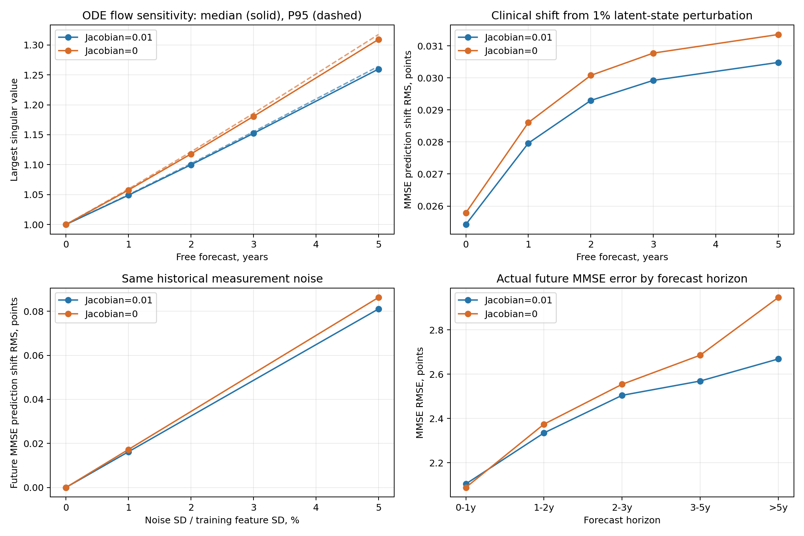

# Jacobian正则有什么实际作用：ADNI固定检查点测试

## 1. 从“更平滑”到“更可靠”

相邻潜在状态的速度更相近，表示一次小状态偏差引起的速度变化更小。疾病预测还要经过多年的ODE积分和Decoder，因此本次逐层检查三个结果：小偏差会被ODE放大多少、会让临床评分预测变化多少、最终真实随访预测是否更准确。

## 2. 两组和测试方式

两组均为ADNI、α=0.1、latent28、44,875参数，并使用各自第30轮最佳验证检查点。一组保留0.01 Jacobian正则，另一组权重为0；weak prior均为0.01。参数快照已复制到本目录，全程不训练、不更新参数。

真实预测误差采用原414位测试患者、2,402个历史前缀、batch=32，保持原min-max归一化和字段聚合。未来目标按实际间隔分为0–12、12–24、24–36、36–60及60个月以上。

扰动敏感性为每位患者取最早3次已知观测，不足3次则使用已有观测。仅用这些历史进行编码，随后自由推演0、1、2、3、5年，不执行未来UPDATE。

所有模型计算使用CUDA。真实预测与测量噪声测试沿用float32、Tsit5、rtol=1e-4、atol=1e-6。ODE流敏感性使用float64、rtol=1e-8、atol=1e-10，并以更严容差和原28维ODE的autograd导数核验。

## 3. 小状态偏差经过ODE会放大多少

计算 $\lVert D_z\Phi_T(z_c)\rVert_2$，它表示相同大小的初始状态误差，在最容易被放大的方向上，经过T年会变为原来的多少倍。1表示相同大小，小于1表示缩小，大于1表示放大。

| 推演时间 | 保留正则：中位数 | 去掉正则：中位数 | 保留正则：P95 | 去掉正则：P95 |
|---|---:|---:|---:|---:|
| 0年 | 1.000000 | 1.000000 | 1.000000 | 1.000000 |
| 1年 | 1.048918 | 1.057558 | 1.049785 | 1.059266 |
| 2年 | 1.099779 | 1.117827 | 1.101567 | 1.121335 |
| 3年 | 1.152213 | 1.180605 | 1.154917 | 1.185620 |
| 5年 | 1.259699 | 1.309237 | 1.264332 | 1.317461 |

5年最坏方向放大倍数的患者中位数，保留正则相对去掉正则变化-3.78%。这是对完整ODE流的测量，不再仅看局部速度场Jacobian。

## 4. 状态偏差会造成多大的临床预测偏移

每位患者生成8个固定随机方向，在两组中使用相同方向。扰动长度为各自截止点状态范数的1%，分别推演。下表统计扰动前后预测之差的RMS，单位为临床评分的分值。

| 推演时间 | 保留正则：MMSE偏移 | 去掉正则：MMSE偏移 | 保留正则：CDR-SB偏移 | 去掉正则：CDR-SB偏移 |
|---|---:|---:|---:|---:|
| 0年 | 0.025424 | 0.025787 | 0.017122 | 0.017220 |
| 1年 | 0.027963 | 0.028605 | 0.018810 | 0.018979 |
| 2年 | 0.029297 | 0.030080 | 0.019801 | 0.020018 |
| 3年 | 0.029923 | 0.030775 | 0.020352 | 0.020437 |
| 5年 | 0.030484 | 0.031355 | 0.021186 | 0.021037 |

两个模型经过训练后，潜在坐标和状态范数可以不同。下一项从原始观测端加入完全相同的噪声，直接比较相同测量误差带来的预测偏移。

## 5. 相同测量误差会让预测晃动多少

仅扰动历史中实际观测到的连续检查字段。每个字段的噪声标准差取其训练集标准差的1%或5%；两组使用相同随机噪声。年龄、教育年限、APOE4及类别字段保持原值。测试目标、时间、缺失掩码和截止点不变。

这里的“预测偏移”比较同一模型在干净与带噪历史下的预测；“真实误差”比较预测与真实随访。两者分别回答稳定性和准确性。

| 噪声幅度 | 保留：MMSE预测偏移RMSE | 去掉：MMSE预测偏移RMSE | 保留：CDR-SB预测偏移RMSE | 去掉：CDR-SB预测偏移RMSE | 保留：未来总误差 | 去掉：未来总误差 |
|---|---:|---:|---:|---:|---:|---:|
| 0%训练标准差 | 0.000000 | 0.000000 | 0.000000 | 0.000000 | 0.999456 | 1.009824 |
| 1%训练标准差 | 0.016209 | 0.017249 | 0.013861 | 0.013842 | 0.999492 | 1.009861 |
| 5%训练标准差 | 0.081051 | 0.086272 | 0.069323 | 0.069208 | 1.000365 | 1.010776 |

## 6. 真实随访：收益是否集中在更长的推演

| 未来间隔 | 有真实随访的患者数 | 保留：总误差 | 去掉：总误差 | 保留：MMSE RMSE | 去掉：MMSE RMSE |
|---|---:|---:|---:|---:|---:|
| all_future | 414 | 0.999456 | 1.009824 | 2.453567 | 2.571112 |
| 0-12m | 402 | 0.770221 | 0.770051 | 2.104945 | 2.089017 |
| 12-24m | 314 | 0.900320 | 0.903599 | 2.335007 | 2.374469 |
| 24-36m | 247 | 0.975241 | 0.971951 | 2.504627 | 2.554415 |
| 36-60m | 202 | 1.082716 | 1.083293 | 2.569190 | 2.685754 |
| >60m | 133 | 1.093167 | 1.133471 | 2.668789 | 2.946112 |

对固定的两个模型，按患者整体重采样2,000次；同一患者的所有历史前缀和随访一起保留。差值定义为“保留正则−去掉正则”，负数表示保留正则误差更低。

| 全部未来的指标 | 差值 | 患者配对bootstrap 95%区间 |
|---|---:|---|
| 总误差 | -0.010368 | [-0.051006, +0.022380] |
| 数值标准化MSE | -0.008394 | [-0.020188, +0.001515] |
| MMSE RMSE | -0.117545 | [-0.247369, -0.023068] |
| CDR-SB RMSE | -0.087623 | [-0.184301, -0.007878] |

## 7. 这些结果如何解释

1. **ODE对初始状态误差的放大。** 5年流敏感性中位数为1.2597（保留）与1.3092（去掉），变化-3.78%。

2. **观测误差到临床预测的传递。** 相同5%测量噪声引起的未来MMSE预测偏移RMSE为0.0811分（保留）与0.0863分（去掉），变化-6.05%。这表示同样的检查误差造成的MMSE预测波动更小。CDR-SB预测波动分别为0.0693与0.0692分，基本持平。该项同时经过INIT、历史ODE、UPDATE、生成ODE与Decoder。

3. **真实预测表现。** 干净测试数据的未来总误差为0.999456与1.009824；未来MMSE RMSE为2.4536与2.5711分。上面的分时长表给出收益出现在哪些时间范围。

真实随访中，0–12个月MMSE误差基本接近；36–60个月从2.6858降到2.5692分，60个月以上从2.9461降到2.6688分，后者变化-9.41%。收益更集中在较长的推演。

按患者配对重采样，全部未来MMSE和CDR-SB RMSE差值的95%区间均小于0；未来总误差的区间跨过0。这里体现的是临床数值预测的改善，总指标中的类别CE会抵消部分数值收益。

从机制上看，初始状态有小偏差时，后续偏差满足“偏差变化速度＝速度场Jacobian×当前偏差”。局部速度变化较小，能够减轻ODE反复传播偏差的强度；本次直接测到5年流放大倍数降低3.78%，并在MMSE输出上测到较小的预测波动。

因此，这项正则在当前ADNI模型中具有可测的作用：减轻多年推演对小状态误差的放大，稍微提高MMSE预测对测量噪声的稳定性，并改善较长期的临床评分预测。收益幅度温和，适合继续作为0.01权重的辅助动力学约束。CDR-SB抗测量噪声表现基本持平，未来总误差的优势也小于单看MMSE时的优势。



## 8. 原始记录与复现

[全部指标与配对区间](metrics.json) · [按时间和噪声分组的误差CSV](forecast_by_horizon.csv) · [患者级流敏感性CSV](patient_flow.csv) · [实验配置与检查点指纹](manifest.json)

[保留正则数值核验](flow_checks_regularized.json) · [去掉正则数值核验](flow_checks_unregularized.json)

保留的NPZ文件包含患者级误差分子、有效目标分母、状态、流敏感性及扰动结果；停止后重启会复用已完成阶段。所有模型参数在测试结束后逐张量核对，未执行optimizer.step()。

复现命令：

```bash
CUDA_VISIBLE_DEVICES=1 PYTHONPATH=ablation/results/jacobian_utility_adni/source_snapshot:paper_odeae/results/latent2x_loss_ablation/source_snapshot /home/xjh/miniforge3/envs/ode/bin/python ablation/results/jacobian_utility_adni/source_snapshot/jacobian_utility_adni.py --output ablation/results/jacobian_utility_adni --gpu 1
```
