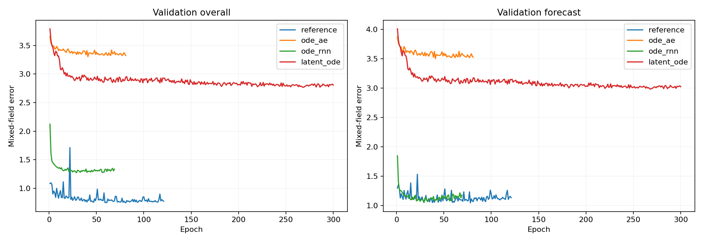

# ADNI：与latent2x both相同参数预算的基线比较

当前主模型为latent2x both。此前暂停的同预算baseline从last.pt继续训练；已完成的实验保留原结果。MWM相关训练已暂停。

## 1. 本轮比较什么

本轮为概率ODE-AE、ODE-RNN、Latent ODE新增同预算版本，目标为 **44,875个总参数和可训练参数**。latent2x both及原容量模型读取已有结果，新版从seed 0初始化训练。新版本保持各模型原有编码方向、生成方式、概率假设、损失与训练预算。

ODE-AE仍是6维Gaussian状态和独立编码/生成ODE；ODE-RNN使用38维递归状态及两层隐藏ODE；Latent ODE保留32维随机状态，编码状态调为48维。通过网络隐藏宽度精确匹配预算。旧的冻结二分类头服务于此前的其他任务，新版只保留当前混合字段预测所用网络。

## 2. 参数与训练进度

| 模型 | 容量 | 总参数 | 可训练参数 | 物理GPU | 阶段 | 已训练 / 最佳轮次 |
|---|---|---:|---:|---|---|---:|
| latent2x both | 参照 | 44,875 | 44,875 | 1 | complete | 121 / 81 |
| ODE-AE（概率版） | 原容量 | 3,003 | — | 0 | complete | 90 / 50 |
| ODE-AE（概率版） | 同预算 | 44,875 | 44,875 | 0 | complete | 81 / 41 |
| ODE-RNN | 原容量 | 32,746 | 22,545 | 1 | complete | 96 / 56 |
| ODE-RNN | 同预算 | 44,875 | 44,875 | 1 | complete | 69 / 29 |
| Latent ODE | 原容量 | 72,266 | 62,065 | 0 | complete | 69 / 29 |
| Latent ODE | 同预算 | 44,875 | 44,875 | 1 | complete | 300 / 268 |

## 3. 主要指标

| 模型 | 容量 | 验证历史 | 验证未来 | 验证整体 | 测试历史 | 测试未来 | 测试整体 |
|---|---|---:|---:|---:|---:|---:|---:|
| latent2x both | 参照 | 0.501960 | 1.069675 | 0.744104 | 0.471739 | 1.000299 | 0.702538 |
| ODE-AE（概率版） | 原容量 | 3.132677 | 3.487206 | 3.287258 | 3.014009 | 3.247804 | 3.115103 |
| ODE-AE（概率版） | 同预算 | 3.151014 | 3.501412 | 3.303937 | 3.026708 | 3.238572 | 3.118315 |
| ODE-RNN | 原容量 | 1.423009 | 1.084522 | 1.280190 | 1.370759 | 1.120580 | 1.264065 |
| ODE-RNN | 同预算 | 1.433803 | 1.051740 | 1.272101 | 1.376041 | 1.032329 | 1.228165 |
| Latent ODE | 原容量 | 2.673924 | 3.078778 | 2.849461 | 2.524608 | 2.836983 | 2.659362 |
| Latent ODE | 同预算 | 2.600591 | 2.983216 | 2.766802 | 2.457803 | 2.761802 | 2.589093 |

## 4. 调整容量后的变化

以下差值为同预算模型减去原容量模型；负值表示扩大或重新分配容量后误差下降。

| 模型 | 历史误差差值 | 未来误差差值 | 整体误差差值 |
|---|---:|---:|---:|
| ODE-AE（概率版） | 0.012699 | -0.009232 | 0.003211 |
| ODE-RNN | 0.005282 | -0.088251 | -0.035900 |
| Latent ODE | -0.066805 | -0.075181 | -0.070269 |

## 配置与执行记录

同一数据缓存、患者划分和评测代码，数据SHA256为`9606b09cc6163d7e55890338d96d55454aa8593ab030b63537488f8ddf165de7`。新增模型按各自原训练策略执行，Adam学习率0.003、原学习率衰减、输入dropout 0.1、300轮上限、50轮下限、40轮早停耐心。验证整体数据误差选模，最佳检查点重新载入后测试。

新实验使用ode环境，独立单卡，接入SwanLab。队列轮询物理GPU 0、1、2、3，只在空闲卡上启动作业。既有实验继续运行；新结果分目录保存。

[设计与宽度分配](../../../capacity_matched/README.zh-CN.md) · [运行队列](../../../capacity_matched/results/adni_mimic/queue.json) · [全部配置与源码](../../../capacity_matched/results/adni_mimic/manifest.json) · [结构化比较](comparison.json)

