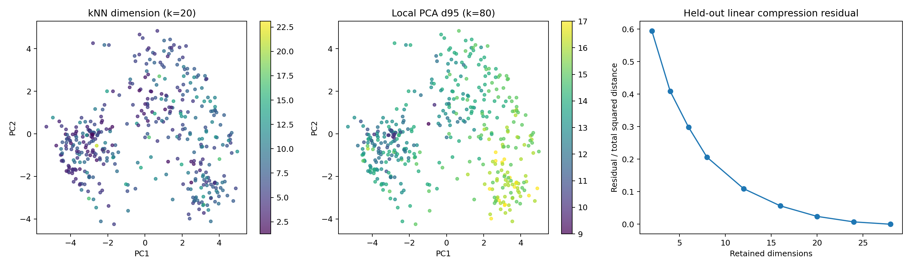
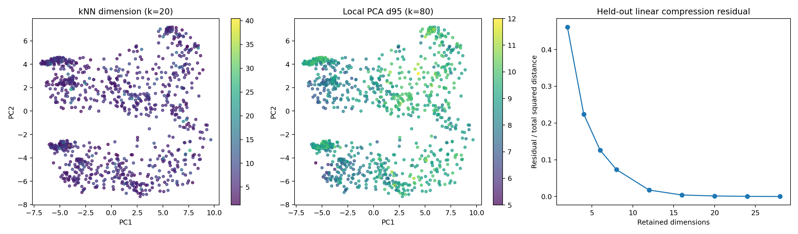
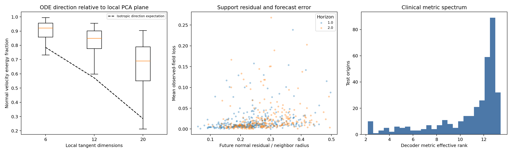
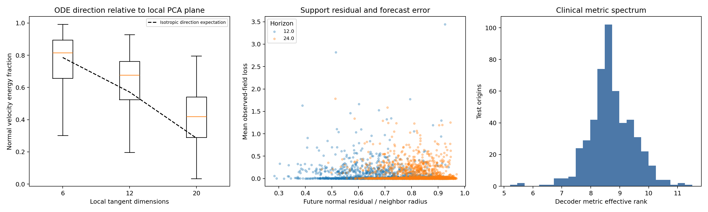

# latent2x both：低维流形假设与几何约束实验

## 1. 从什么问题出发

模型使用28维状态描述患者。要判断这些状态是否集中在更低维的结构上，需要同时查看全局压缩、局部维度、邻域结构以及ODE生成的状态。此次固定ADNI与MIMIC的既有最佳检查点，依次检验这些问题。

第二个问题是：这种结构能否帮助预测？我们冻结模型参数，将生成状态向训练点云的局部平面轻微收回，再检查验证与测试误差，并与向全局均值收缩的对照比较。

## 2. 实验如何组织

主维度分析每位患者只取一个状态。ADNI通过固定哈希选择一个历史前缀；MIMIC使用前24小时观测后的状态。训练患者定义PCA和邻域，测试患者提供独立查询点。补充分析改变ADNI前缀选择和参考样本量，并比较原始坐标、逐轴标准化和白化坐标。

局部维度使用10、20、40、80、160个近邻的距离估计，并用40、80、160邻域的局部PCA交叉检查。对照包括28维各向同性Gaussian、具有相同全局协方差的28维Gaussian、嵌在28维中的8维平面，以及二维Swiss roll。

动力学分析使用训练患者的观测校正状态作为参考点云。每个邻域最多保留其他患者各一个最近状态。比较ODE速度的法向能量、观测前后及未来状态的邻域残差，以及临床解码器诱导的Fisher度量。

冻结投影试验包含6、12、20维全局PCA投影；相同维度的局部投影，收回强度分别为0.25、1；以及向训练全局均值收缩0.25的对照。各候选均保持原解码器，使用验证集选择，再报告测试结果。

| 任务 | 物理GPU | 状态 |
|---|---:|---|
| adni_geometry | 0 | complete |
| adni_dynamics | 1 | complete |
| mimic_geometry | 2 | complete |
| mimic_dynamics | 3 | complete |

## 3. 全局需要多少维，局部又需要多少维

| 数据 | 训练患者 | 测试查询患者 | PCA 90% / 95% / 99% | 熵有效秩 | kNN维度k=20，中位数 | TwoNN | 局部PCA95%，k=80，中位数 |
|---|---:|---:|---|---:|---:|---:|---:|
| ADNI | 2,093 | 414 | 13 / 17 / 23 | 12.99 | 6.51 | 6.92 | 14.0 |
| MIMIC | 21,517 | 1,024 | 8 / 10 / 14 | 7.70 | 5.66 | 6.74 | 9.0 |

### ADNI：与对照数据比较

| 点云 | PCA95%维数 | kNN维度k=20 | kNN维度k=80 | 局部PCA95%，k=80 |
|---|---:|---:|---:|---:|
| 真实状态 | 17 | 6.51 | 6.28 | 14.0 |
| isotropic_gaussian28 | 27 | 18.61 | 17.13 | 23.0 |
| covariance_matched_gaussian28 | 17 | 13.04 | 11.39 | 19.0 |
| linear8_in_28 | 8 | 7.47 | 7.10 | 8.0 |
| swiss_roll2_in_28 | 3 | 1.86 | 1.90 | 2.0 |





### MIMIC：与对照数据比较

| 点云 | PCA95%维数 | kNN维度k=20 | kNN维度k=80 | 局部PCA95%，k=80 |
|---|---:|---:|---:|---:|
| 真实状态 | 10 | 5.66 | 5.13 | 9.0 |
| isotropic_gaussian28 | 27 | 20.87 | 20.22 | 24.0 |
| covariance_matched_gaussian28 | 10 | 11.11 | 10.46 | 13.0 |
| linear8_in_28 | 8 | 7.74 | 7.69 | 8.0 |
| swiss_roll2_in_28 | 3 | 1.90 | 1.95 | 2.0 |





## 4. ODE是否沿着局部状态结构演化

将速度分成局部PCA平面内和平面外两部分。法向能量比例越大，速度越多指向局部平面之外。邻域残差使用状态到局部平面的距离除以第80个近邻的距离；其参考阈值来自训练患者当前状态的95%分位数。

| 数据 / 预测间隔 | 测试患者 | 12维平面外速度能量，中位数 | 当前残差中位数 | 未来残差中位数 | 未来超过训练阈值比例 |
|---|---:|---:|---:|---:|---:|
| ADNI / 1年 | 325 | 84.7% | 0.217 | 0.237 | 7.7% |
| ADNI / 2年 | 264 | 85.2% | 0.215 | 0.271 | 13.6% |



| MIMIC / 12小时 | 2039 | 67.7% | 0.107 | 0.714 | 100.0% |
| MIMIC / 24小时 | 2025 | 67.7% | 0.107 | 0.837 | 100.0% |




## 5. 临床解码器给出了怎样的几何

对于数值字段，将解码结果转为训练标准差单位，按固定单位方差Gaussian建立局部度量；类别字段使用Softmax的Fisher度量。将各临床字段的度量拉回28维状态空间并取平均。人口学静态字段从这个临床度量中移除。

| 数据 | 分析状态数 | 度量熵有效秩，中位数 | 加微小对角项后的条件数，中位数 | 邻近患者归一化度量变化，中位数 |
|---|---:|---:|---:|---:|
| ADNI | 355 | 12.15 | 5258.6 | 0.080 |
| MIMIC | 512 | 8.66 | 9892.8 | 0.052 |

## 6. 冻结投影能否改善预测

ADNI每位患者每个预测间隔选一个支持约1年或2年随访的起点，最多读取前三条历史；MIMIC读取前24小时，并选取约12或24小时后的观测。每位患者每个间隔贡献一条目标记录。所有投影使用相同起点、时间和目标掩码。

| 数据 | 候选家族 | 验证集选中的版本 | 原始测试误差 | 选择后测试误差 | 差值 | 配对患者bootstrap 95%区间 |
|---|---|---|---:|---:|---:|---|
| ADNI | global_or_shrink | baseline | 0.87633 | 0.87633 | +0.00000 | [+0.00000, +0.00000] |
| ADNI | local | local_d20_a025 | 0.87633 | 0.88686 | +0.01053 | [+0.00122, +0.02120] |


| MIMIC | global_or_shrink | baseline | 1.87816 | 1.87816 | +0.00000 | [+0.00000, +0.00000] |
| MIMIC | local | baseline | 1.87816 | 1.87816 | +0.00000 | [+0.00000, +0.00000] |


## 7. 误差关联

同时计算原始Spearman相关，以及控制年龄、历史长度、历史观测覆盖、目标观测覆盖、预测间隔后的秩相关。

| 数据 / 预测间隔 | 平面外速度与误差：原始 / 调整后 | 未来邻域残差与误差：原始 / 调整后 |
|---|---|---|
| ADNI / 1.0 | -0.095 / -0.054 | +0.407 / +0.319 |
| ADNI / 2.0 | +0.055 / +0.078 | +0.401 / +0.381 |
| MIMIC / 12.0 | +0.079 / +0.066 | -0.118 / -0.120 |
| MIMIC / 24.0 | +0.079 / +0.043 | -0.063 / -0.083 |

## 8. 数据、代码与方法来源

[运行配置和源码校验](manifest.json) · [运行进度](queue.json)

各子目录的summary.json保存完整数值，geometry_arrays.npz和dynamics_arrays.npz保存图表数据。forecast_rows.json记录预测起点和目标选择；模型检查点和数据SHA256、实际CUDA设备、显存峰值与耗时保存在provenance中。

维度估计参考[Levina与Bickel的kNN最大似然方法](https://www.stat.berkeley.edu/~bickel/mldim.pdf)，使用k−2的小样本修正；TwoNN参考[Facco等人的原始论文](https://www.nature.com/articles/s41598-017-11873-y)。临床解码器的局部Fisher度量采用[Pulling back information geometry](https://proceedings.mlr.press/v151/arvanitidis22b.html)的拉回度量思路。

```bash
bash scripts/run_latent2x_manifold.sh
```
