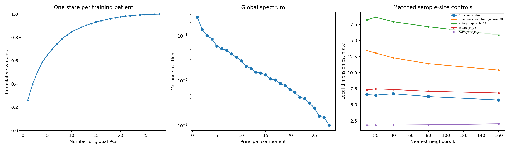
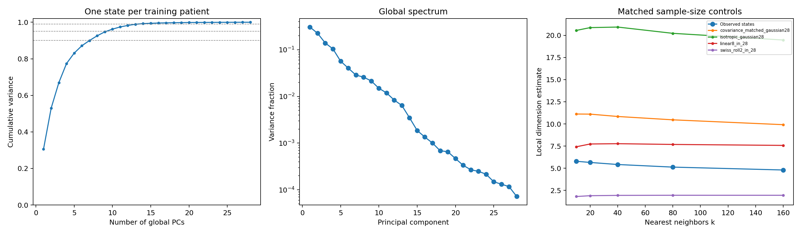
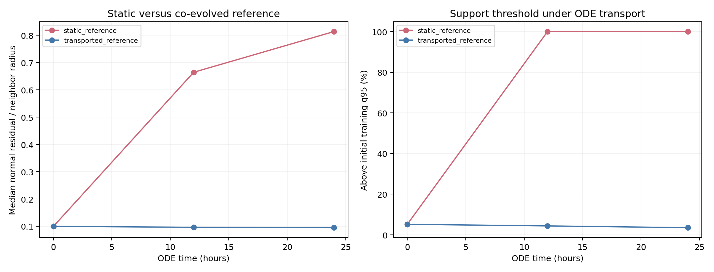
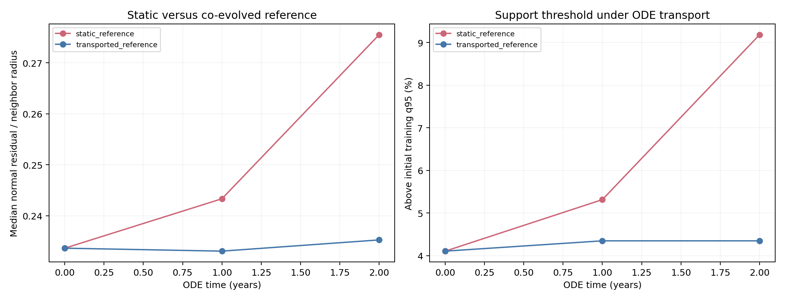
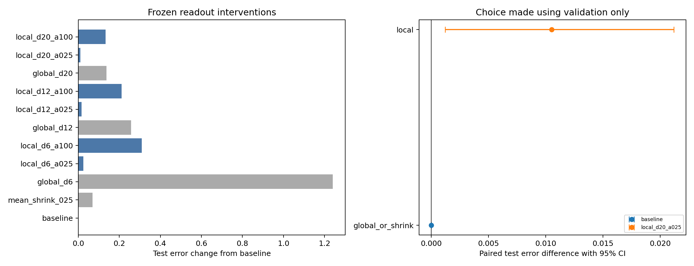
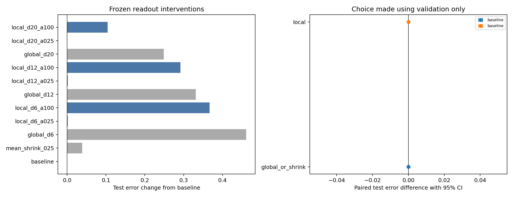
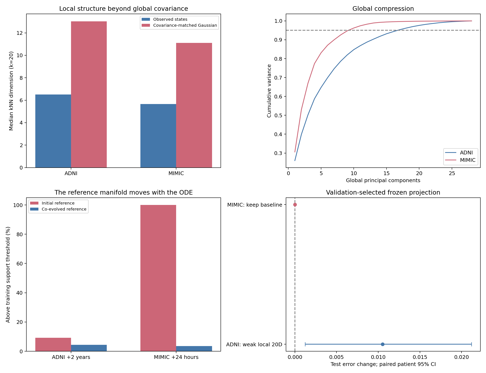

# latent2x both：低维流形假设与黎曼几何约束分析

## 1. 从28维患者状态出发

latent2x both 用28维向量表示患者。历史观测逐次进入 UPDATE，观测之间由共享 ODE 推进，最后由 DECODER 读出临床指标。

本次研究依次回答三个问题：

1. 这些28维状态，实际上需要多少个自由度来描述？
2. ODE 推演之后，患者是否仍分布在类似的低维结构上？
3. 利用这种几何结构约束状态，是否能改善真实指标预测？

实验使用已有的两个 seed 0 最佳检查点：

| 数据实例 | 潜在维度 | 参数量 | 检查点轮次 |
|---|---:|---:|---:|
| ADNI latent2x both | 28 | 44,875 | 81 |
| MIMIC latent2x both | 28 | 43,280 | 33 |

模型参数保持固定。实验包括维度估计、人工点云对照、局部切平面分析、ODE点云搬运、临床度量，以及冻结模型的投影干预。四张4090分别执行独立CUDA诊断，现有训练继续运行。

## 2. 怎样理解和检验低维流形

### 2.1 全局维度和局部维度回答不同问题

可以把低维流形想成一张弯曲的薄纸。描述纸上一个小区域，也许只需要两个坐标；但把整张弯纸放到空间中，用一张平面去逼近它，可能需要更多方向。

对应到患者状态，本次采用两类指标：

| 指标 | 计算方式 | 回答的问题 |
|---|---|---|
| 全局PCA维度 | 计算保留90%、95%、99%状态方差需要的主成分数量 | 整个人群能压缩到多大的线性空间 |
| 熵有效秩 | 根据主成分方差占比计算有效方向数 | 全局变化是否主要集中在少数方向 |
| kNN局部维度 | 根据近邻距离随邻居数量增长的规律估计 | 一个小邻域中大约有多少自由度 |
| TwoNN维度 | 使用第一、第二近邻距离的比值估计 | 换一种距离估计方法是否得到相近结果 |
| 局部PCA维度 | 对每个邻域单独做PCA | 小范围内的状态是否接近一个较低维平面 |

kNN估计使用10、20、40、80、160个邻居，并采用[Levina–Bickel方法](https://www.stat.berkeley.edu/~bickel/mldim.pdf)中的 \(k-2\) 修正。TwoNN采用[Facco等人的方法](https://www.nature.com/articles/s41598-017-11873-y)，对距离比的经验分布拟合维度。局部PCA分别使用40、80、160个邻居。

### 2.2 先让患者独立，再比较点云

主维度分析每位患者只取一个 UPDATE 后状态，防止同一患者的大量相邻记录主导邻域结构。

| 内容 | ADNI | MIMIC |
|---|---:|---:|
| 定义全局PCA和主维度参考的训练患者 | 2,093 | 21,517 |
| 独立测试查询患者 | 414 | 1,024 |
| 状态选择 | 按固定哈希选择一个历史前缀 | 固定读取前24小时 |
| 动力学分析的训练参考点云 | 全部12,544个历史前缀状态 | 6/12/18/24小时的85,955个状态 |

MIMIC的1,024位查询患者从完整测试集按固定随机种子抽取。训练患者定义参考，测试患者提供查询。动力学邻域还限制为每位其他患者最多保留一个最近状态。

### 2.3 人工对照给估计值建立刻度

本次使用四种对照，参考样本量与对应真实点云相同：

- **28维各向同性Gaussian**：28个方向都独立变化。
- **同协方差Gaussian**：按照真实状态的均值和协方差采样，保留全局方向的强弱关系。
- **嵌入28维的8维平面**：已知只有8个自由度。
- **嵌入28维的二维Swiss roll**：已知局部为二维，整体会弯曲。

同协方差对照尤其有用：它帮助我们检查，真实状态的局部结构是否超出了“某些全局方向方差较小”这一现象。

## 3. 全局压缩与局部维度的结果

### 3.1 全局需要保留多少方向

| 指标 | ADNI | MIMIC |
|---|---:|---:|
| 前2个主成分保留的训练方差 | 39.9% | 53.0% |
| 保留90%方差需要的维度 | 13 | 8 |
| 保留95%方差需要的维度 | **17** | **10** |
| 保留99%方差需要的维度 | 23 | 14 |
| 熵有效秩 | 12.99 | 7.70 |
| 测试状态压到2维后的平方距离残差占比 | 59.5% | 46.1% |

因此，当前二维图展示的是整体结构的一部分。MIMIC的全局变化比ADNI更集中，但两者都保留了多个有作用的方向。

### 3.2 局部维度比28维明显更低

下面的kNN数值为测试查询点局部估计的中位数。

| 点云 | ADNI：kNN，k=20 | MIMIC：kNN，k=20 |
|---|---:|---:|
| 真实患者状态 | **6.51** | **5.66** |
| 同协方差Gaussian | 13.04 | 11.11 |
| 28维各向同性Gaussian | 18.61 | 20.87 |
| 8维平面对照 | 7.47 | 7.74 |
| 二维Swiss roll对照 | 1.86 | 1.90 |

真实状态的TwoNN估计分别为 **6.92、6.74**。使用80个邻居时，kNN中位数分别为6.28、5.13。局部PCA保留95%方差的中位数分别为14维、9维。

这些方法测量的尺度不同，但给出的方向一致：**患者状态存在明显的局部低维组织结构**。它的局部复杂度也低于按照相同全局协方差生成的Gaussian点云。





图中蓝线为真实状态，橙线为同协方差Gaussian。真实状态在多个邻域规模下都保持较低的局部维度。

### 3.3 换坐标和抽样方式后，主要结构仍然存在

| 坐标处理 | ADNI：kNN中位数，k=20 | MIMIC：kNN中位数，k=20 |
|---|---:|---:|
| 模型原始坐标 | 6.51 | 5.66 |
| 每个坐标轴按训练标准差缩放 | 8.66 | 6.08 |
| 按训练协方差白化 | 10.31 | 7.16 |

ADNI更换两次患者前缀选择后，原始坐标中的估计中位数为6.54、6.47，PCA95%维度均为17。对全部历史前缀按患者等权计算，PCA95%维度仍为17；MIMIC仍为10。

样本量也会影响邻域尺度。例如，MIMIC将训练参考从21,517人减少到2,093人时，kNN估计中位数由5.66变为4.47。结合这些检查，更合适的描述是：**ADNI呈现局部约6–10维、MIMIC呈现局部约6–8维的有效结构**。这些范围描述当前点云在所检验尺度上的组织方式。

## 4. 不同疾病和信息密度对应不同局部结构

我们进一步在患者子组内部重新寻找邻居，每组仍然每位患者一个状态。ADNI诊断使用历史截止前最后一次已知诊断。

| ADNI子组 | 训练患者 | 测试患者 | 组内kNN维度中位数 | 组内同协方差Gaussian |
|---|---:|---:|---:|---:|
| CN | 827 | 170 | 5.70 | 11.53 |
| MCI | 798 | 155 | 7.09 | 11.75 |
| Dementia | 430 | 82 | 7.63 | 12.01 |

三个疾病区域都有局部结构，但其复杂程度不同。当前模型的MCI与Dementia邻域需要比CN更多的局部自由度。

观测信息量也影响状态。根据历史有效观测覆盖率，用训练集四分位数划分子组：

| 历史观测覆盖 | ADNI组内维度 | MIMIC组内维度 |
|---|---:|---:|
| Q1，最低 | 3.68 | 5.09 |
| Q2 | 5.59 | 4.93 |
| Q3 | 6.31 | 5.05 |
| Q4，最高 | 6.89 | 5.13 |

ADNI在读取1次、2–3次、4次及以上历史时，组内维度中位数分别为4.82、5.80、6.21。

这与模型的用途一致：状态同时表达疾病特征和已经积累的信息。ADNI的记录较稀疏，新增模态与随访会展开更多状态方向；MIMIC在固定24小时历史下，覆盖率子组的维度更接近。

据此，当前点云适合被理解为**局部维度有所变化的近似流形或薄层结构**，使用统一的极低维平面会合并一部分有意义的差异。

## 5. ODE推演中的低维结构随时间移动

### 5.1 先检查速度与当前局部平面的关系

对状态 \(z\)，用训练邻域的主方向构造投影 \(P_z\)，将ODE速度分为：

\[
f(z)=f_\parallel(z)+f_\perp(z),
\qquad f_\parallel=P_zf,\quad f_\perp=(I-P_z)f.
\]

采用共同的12维局部平面，在预测探针的独立测试患者中，速度法向能量占比的中位数约为：

| 数据 | 平面外的速度能量 |
|---|---:|
| ADNI | 约85% |
| MIMIC | 约68% |

这说明，ODE经常把状态推向当前观测校正点云的局部平面之外。接下来需要确定：这个平面应该固定在原位置，还是随时间移动？

### 5.2 将训练点云也推演到相同时间

设观测校正后的训练点云为 \(\mathcal M_0\)。同时推演训练和测试状态，构造：

\[
\mathcal M_\tau=\Phi_\tau(\mathcal M_0).
\]

然后，对同一个未来测试状态，分别使用两种参考：

1. 原位置的训练点云 \(\mathcal M_0\)。
2. 已经沿同一ODE推演到相同时间的训练点云 \(\mathcal M_\tau\)。

这项检验使用每位训练患者一个状态；ADNI为2,093人，MIMIC为21,517人，查询患者分别为414、1,024人。两种参考都只来自训练患者。

残差定义为到12维局部平面的距离，除以第80个近邻的距离。阈值采用初始训练状态残差的95%分位数。

| 数据 / 推演间隔 | 相对原位置参考的残差中位数 | 相对同步推演参考的残差中位数 | 原位置参考：超过阈值 | 同步推演参考：超过阈值 |
|---|---:|---:|---:|---:|
| ADNI，1年 | 0.243 | 0.233 | 5.3% | 4.3% |
| ADNI，2年 | 0.275 | 0.235 | 9.2% | 4.3% |
| MIMIC，12小时 | 0.664 | 0.096 | **100%** | **4.4%** |
| MIMIC，24小时 | 0.813 | 0.095 | **100%** | **3.5%** |

同时，推演前后的局部维度基本保持：

| 数据 | 初始kNN维度 | 第一个推演时刻 | 第二个推演时刻 |
|---|---:|---:|---:|
| ADNI：0 / 1 / 2年 | 6.51 | 6.54 | 6.56 |
| MIMIC：0 / 12 / 24小时 | 5.66 | 5.64 | 5.58 |





这个结果给出了更完整的解释：**ODE主要在搬运一个低维结构，未来状态会离开这个结构原来的位置，但仍与同时间的训练生成结构保持接近。**

可以继续用薄纸作比喻：纸在空间中移动时，纸上的点仍然位于薄纸上，却会离开纸原先的位置。将点拉回原来的纸面，会抵消模型正在表达的演化。

这项实验检验的是模型内部的几何一致性。下面再用真实随访指标评价投影的效果。

## 6. 用临床解码器衡量状态变化

### 6.1 给潜在空间建立临床尺度

潜在坐标没有固定的临床单位。为衡量某个方向的移动会改变多少临床预测，本次利用现有DECODER建立局部度量。

数值字段按训练标准差作为固定尺度，类别字段使用现有Softmax概率。其Fisher拉回度量为：

\[
G(z)=\frac1F\left[
\sum_{j\in\mathrm{数值}}\frac{J_{g_j}^{\top}J_{g_j}}{\sigma_j^2}
+\sum_{j\in\mathrm{类别}}
J_{\ell_j}^{\top}\bigl(\operatorname{diag}(p_j)-p_jp_j^\top\bigr)J_{\ell_j}
\right].
\]

这里的 \(\sigma_j\) 是归一化训练标签的标准差，\(\ell_j\) 是该类别字段的logits。人口学静态字段从临床度量中移除，剩余临床字段等权汇总。数值部分相当于为标准差单位下的预测配固定单位方差Gaussian观测模型。

这沿用[将观测分布的Fisher几何拉回潜在空间](https://proceedings.mlr.press/v151/arvanitidis22b.html)的思路。度量由既有解码器和训练统计量直接计算。

### 6.2 不同潜在方向的临床影响确实不同

| 指标，中位数 | ADNI | MIMIC |
|---|---:|---:|
| 评估患者数 | 355 | 512 |
| 临床度量的熵有效秩 | 12.15 | 8.66 |
| 加稳定对角项后的条件数 | 5,259 | 9,893 |
| 邻近患者的归一化度量矩阵变化 | 0.080 | 0.052 |

稳定项取 \(10^{-4}\operatorname{tr}(G)/28\)。这些值说明，在当前潜在坐标中，同样大小的移动朝向不同方向时，临床预测响应可以相差很大。

因此，临床距离和临床进展速度适合用 \(G\) 加权。例如，局部临床速度可以读成 \(\sqrt{f(z)^\top G(z)f(z)}\)。

### 6.3 当前法向运动承载了较多临床变化信号

对12维局部平面，分别计算切向、法向分量在临床度量下的能量，再取：

\[
\frac{\|f_\perp\|_G^2}
{\|f_\perp\|_G^2+\|f_\parallel\|_G^2}.
\]

| 指标，中位数 | ADNI | MIMIC |
|---|---:|---:|
| 法向分量在两分量临床能量中的占比 | **90.5%** | **86.7%** |
| 只保留欧氏切向速度后，与原临床速度的度量余弦 | 0.66 | 0.69 |

这表明，平面外方向承担着模型已有的大部分临床变化信号。直接删除这些方向，会同时改变模型输出的变化幅度和方向。

我们还计算了临床度量下最接近原速度的切向投影。采用12维平面时，投影后的欧氏速度中位数增大到原来的1.84倍、2.03倍，仍存在约23.6%、14.2%的临床速度残差能量。

这些结果支持把临床度量用于分析和几何设计，同时也说明，固定切向约束会实质性改变当前动力学。

## 7. 冻结模型的几何投影能否改善真实预测

### 7.1 先明确这项干预怎样进行

先用原模型照常生成未来状态，再在送入DECODER前进行几何调整：

\[
\widetilde z=z+\alpha\left(\Pi(z)-z\right).
\]

\(\Pi\) 分别取训练全局PCA平面投影、训练邻域的局部平面投影。局部邻域使用80位其他训练患者，保留6、12、20维；收回强度为25%或100%。另加入向训练全局均值收缩25%的对照。

包括原模型在内，共11个候选。每个候选使用相同的历史、ODE生成状态、目标时刻与标签掩码。验证集选择候选，测试集评价。

预测探针的任务为：

| 内容 | ADNI | MIMIC |
|---|---|---|
| 历史起点选择 | 按3→2→1次历史寻找有随访支持的起点 | 前24小时 |
| 目标间隔 | 约1年、2年，容差±25% | 约12、24小时，容差±2小时 |
| 每位患者贡献 | 每个间隔一条目标记录 | 每个间隔一条目标记录 |
| 验证患者 / 目标记录 | 340 / 555 | 1,024 / 2,038 |
| 测试患者 / 目标记录 | 355 / 589 | 2,046 / 4,064 |

患者在计算误差前按固定规则选择。表中误差是这项起点—终点探针任务的字段MSE＋交叉熵，完整纵向实验结果继续保存在各自原实验目录。

### 7.2 全部候选的结果

| 方案 | ADNI验证 | ADNI测试 | MIMIC验证 | MIMIC测试 |
|---|---:|---:|---:|---:|
| 原模型 | 0.87019 | **0.87633** | **1.86828** | 1.87816 |
| 向全局均值收缩25% | 0.95428 | 0.94593 | 1.88411 | 1.91722 |
| 全局6维投影 | 2.13247 | 2.11603 | 2.38982 | 2.33953 |
| 全局12维投影 | 1.12579 | 1.13376 | 2.28096 | 2.20961 |
| 全局20维投影 | 0.93451 | 1.01289 | 2.17999 | 2.12707 |
| 局部6维，收回25% | 0.87556 | 0.90036 | 1.87495 | 1.87956 |
| 局部6维，收回100% | 1.09333 | 1.18532 | 2.29032 | 2.24524 |
| 局部12维，收回25% | 0.87208 | 0.89194 | 1.87561 | 1.87974 |
| 局部12维，收回100% | 1.00156 | 1.08657 | 2.21124 | 2.17017 |
| 局部20维，收回25% | **0.86603** | 0.88686 | 1.87205 | 1.87757 |
| 局部20维，收回100% | 0.92257 | 1.00869 | 1.99679 | 1.98239 |

ADNI验证集选中“局部20维、收回25%”。它的测试误差从0.87633变为0.88686，增加 **0.01053，约1.2%**。以患者为单位成对重采样500次，差值95%区间为 **[+0.00122, +0.02120]**。

MIMIC验证集在全局与局部两类候选中都选择保留原模型。局部20维弱投影在测试上的微小变化未伴随验证改善。





另一个有用的观察是：观测校正后的测试状态用20维全局PCA近似时，几何平方距离残差仅为ADNI的2.41%、MIMIC的0.15%。将同一平面用于未来生成状态后，预测误差却明显增加。这与第5节的搬运结果相呼应：当前点云中较少使用的方向，可以在未来演化时承担有作用的变化。

### 7.3 几何残差与困难病例的关系

控制年龄、历史长度、历史观测覆盖、目标观测覆盖和实际预测间隔后，未来局部平面残差与单条目标平均误差的秩相关为：

| 预测范围 | 调整后相关 |
|---|---:|
| ADNI，约1年 | +0.319 |
| ADNI，约2年 | +0.381 |
| MIMIC，约12小时 | −0.120 |
| MIMIC，约24小时 | −0.083 |

ADNI的残差可以帮助定位一部分较难预测的病例。MIMIC相对旧点云的残差主要伴随整体搬运而增长，其数值与错误大小的关系较弱。两种数据的结果支持结合时间位置和临床任务阅读几何指标。

## 8. 根据这些证据决定怎样使用几何

### 8.1 对低维流形假设的判断

**当前28维状态存在明显的局部低维结构。** 这一点同时得到近邻维度、TwoNN、局部PCA、同协方差对照、患者独立抽样及分组检查的支持。

整体结构会弯曲，局部复杂度随疾病区域与观测信息变化。ADNI保留95%全局变化仍需要17维，MIMIC需要10维。因此，28维可以继续作为容纳这些局部结构及其演化的嵌入空间。

### 8.2 对黎曼几何的实施优先级

**当前优先保留现有共享ODE与28维状态，把解码器诱导的临床度量用于分析；强制状态留在同一个静态低维流形上的训练约束，优先级较低。**

这个选择来自三组相互衔接的证据：

1. **结构存在。** 患者状态确实比无结构Gaussian更低维。
2. **结构会移动。** 同步推演参考点云后，MIMIC的几何偏离大幅减小，而局部维度保持接近。
3. **静态收回会改变预测。** 投影干预未产生稳定收益，较强投影增加误差，法向运动又承担了较多临床变化信号。

低维流形假设描述数据怎样组织；黎曼度量描述不同位置、不同方向的移动对应多大临床变化。当前结果支持使用后者改善距离、速度和邻域的解释，同时保留ODE搬运结构的能力。

如果继续开展几何训练消融，建议先研究**随时间搬运的参考结构与临床度量下的弱一致性**，并以真实未来预测误差选模。参考状态、邻域和度量在正则计算中应有明确的固定或停止梯度规则，使优化目标始终对应临床预测任务。

这种后续训练将检验“几何一致性是否帮助学习”。本轮冻结投影实验已经给出了选择约束形式和强度的实际依据。



## 9. 运行、数值检查与文件

八个CUDA诊断任务均已完成。训练及测试状态提取、PCA、近邻、局部特征分解、ODE、解码器导数和投影都在GPU上执行；CPU负责文件、抽样索引、统计汇总及绘图。

检查包括：

- 原始检查点SHA256在全部实验前后保持一致。
- 原生编码与已有缓存状态一致，最大绝对差约为ADNI的3.34e−6、MIMIC的1.50e−5。
- 解码器解析Jacobian与自动微分一致，最大绝对差分别为7.15e−7、1.49e−7。
- 8维平面、二维Swiss roll在局部PCA95%检查中恢复为8维、2维。
- 验证集候选选择已独立复核，PCA基的正交性与执行源码校验通过。

| 文件或目录 | 内容 |
|---|---|
| [主实验清单](manifest.json) | 检查点、数据来源、四卡任务和源码校验 |
| [补充实验清单](followup_manifest.json) | 同步搬运、临床切向与分组维度检查 |
| [最终核查](final_verification.json) | 数值、检查点和选择流程核对 |
| [原始指标汇总](metrics_report.zh-CN.md) | 全局、局部、动力学、预测等详细表格 |
| `adni_geometry/`、`mimic_geometry/` | 维度、坐标尺度、样本量和人工对照 |
| `adni_dynamics/`、`mimic_dynamics/` | 切向/法向、临床度量、投影、误差关联 |
| `adni_flow/`、`mimic_flow/` | 原位置与同步推演参考比较 |
| `adni_clinical/`、`mimic_clinical/` | 临床法向分量和分组维度 |
| `source_snapshot/`、`followup_source_snapshot/` | 实际执行源码 |

各目录的 `summary.json` 保存完整数值，NPZ保存图表数据，`forecast_rows.json`保存预测起点与目标选择。图表同时提供PNG、SVG和PDF。

在新输出目录完整复现：

```bash
bash scripts/run_latent2x_manifold.sh \
  --output paper_odeae/results/latent2x_both_manifold_repeat
```

主要实现：[维度分析](../../diagnostics/manifold_geometry.py)、[动力学与冻结投影](../../diagnostics/manifold_dynamics.py)、[同步搬运与临床切向](../../diagnostics/manifold_followup.py)、[CUDA公共计算](../../diagnostics/manifold_core.py)。
