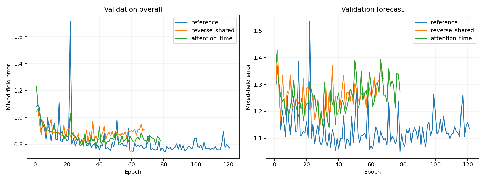

# ADNI：历史读取方向与ODE编码作用的等参数消融

## 1. 比较从哪里开始

参照是已经完成训练的latent2x both。它使用28维状态、44,875参数，按时间从前往后吸收观测，从最后一个历史状态出发重构过去并预测未来。本轮复用其检查点和结果，新增两组独立单卡实验。

数据保持为同一ADNI缓存：训练2,093人、验证393人、测试414人，40个有效字段、49维展开输出，按训练集min-max归一化。训练与评测继续枚举每位患者的所有非空历史前缀。

## 2. 每组具体改变什么

| 模型 | 主历史编码 | 生成起点 | 状态维度 | 总参数 | 物理GPU |
|---|---|---|---:|---:|---:|
| latent2x both | 正向ODE＋UPDATE | 最后一次历史检查 | 28 | 44,875 | 历史实验1 |
| reverse_shared | 反向ODE＋相同UPDATE | 第一次历史检查 | 28 | 44,875 | 2 |
| attention_time | 因果自注意力＋真实时间编码 | 最后一次历史检查 | 28 | 44,875 | 3 |

反向组保留原有全部网络、隐藏宽度和共享关系。主编码从历史末端读到起点，再从起点沿同一个ODE向前生成完整轨迹。

注意力组只替换16,882参数的历史观测编码模块。它使用四头注意力，观测嵌入隐藏宽59，前馈隐藏宽156；固定正余弦编码使用实际相隔年数。因果掩码让每个前缀状态只读取当前及此前观测。INIT、28维状态、188宽生成ODE和159宽解码器全部保留。

两组均保持0.01 weak prior、0.01 Jacobian和0.02 ODE L2。反向组用同一套参数做辅助正向扫描，继续计算原定义的因果weak prior；辅助状态只用于这项监督。注意力组从截至上一次观测的注意力状态出发，用共享ODE预测下一次观测，计算同一含义的weak prior；ODE不参与注意力历史状态的形成。

## 3. 相同训练预算与当前进度

seed 0、batch 32、Adam学习率0.003、按0.97^(step/2000)衰减、输入dropout 0.1、梯度上限10。最多300轮、至少50轮，验证整体数据误差连续40轮未改善时早停。每组使用ode环境与一张4090，接入SwanLab。

| 模型 | 阶段 | 已训练 / 最佳轮次 | 验证历史 | 验证未来 | 验证整体 |
|---|---|---:|---:|---:|---:|
| latent2x both（正向ODE） | complete | 121 / 81 | 0.501960 | 1.069675 | 0.744104 |
| 反向共享ODE | complete | 68 / 28 | 0.562969 | 1.129362 | 0.802886 |
| 因果注意力＋连续时间编码 | complete | 78 / 38 | 0.516121 | 1.151388 | 0.785531 |

## 4. 完整测试结果

| 模型 | 测试历史重构 | 测试未来预测 | 测试整体 | 校正前预测误差 | 平均Jacobian平方范数 |
|---|---:|---:|---:|---:|---:|
| latent2x both（正向ODE） | 0.471739 | 1.000299 | 0.702538 | 0.676858 | 0.008285 |
| 反向共享ODE | 0.536063 | 1.087685 | 0.773887 | 0.771577 | 0.047812 |
| 因果注意力＋连续时间编码 | 0.482066 | 1.109296 | 0.753551 | 0.731197 | 0.020425 |

## 5. 正向ODE编码带来多少收益

对每个消融分别计算：误差差值＝消融误差−参照误差；正向ODE方案相对误差降低＝差值÷消融误差。正值表示参照方案更好。

| 对比 | 历史误差差值 | 未来误差差值 | 整体误差差值 | 未来相对误差降低 |
|---|---:|---:|---:|---:|
| 反向共享ODE | 0.064324 | 0.087386 | 0.071348 | 8.03% |
| 因果注意力＋连续时间编码 | 0.010326 | 0.108996 | 0.051012 | 9.83% |

方向组用于比较“正向估计截止状态”与“反向估计起点再生成”的整套读取方式。注意力组用于比较同样的截止点预测任务下，ODE递推编码和直接时间注意力编码的差异。

## 6. 逐字段结果、检查和复现

[实验设计说明](../../HISTORY_ENCODER_ABLATION.zh-CN.md) · [固定配置与源码](manifest.json) · [运行队列](queue.json) · [完整指标与差值](comparison.json)

每组先通过CUDA正确性检查和小规模训练测试，再进入正式训练。检查覆盖等参数、共有网络初始权重一致、共享场身份、时间单位、未来信息隔离、注意力因果性，以及所有参数的有限梯度。反向组还重新评价参照检查点，核对共同评测代码。

训练结束自动重新载入最佳检查点，核对验证分数并测试。每组目录保存best.pt、last.pt、history.json、hardware.json、swanlab.json和metrics.json。逐字段MSE或交叉熵保存在comparison.json的validation/test/per_field中。

```bash
bash scripts/run_adni_history_encoder_ablation.sh
```


