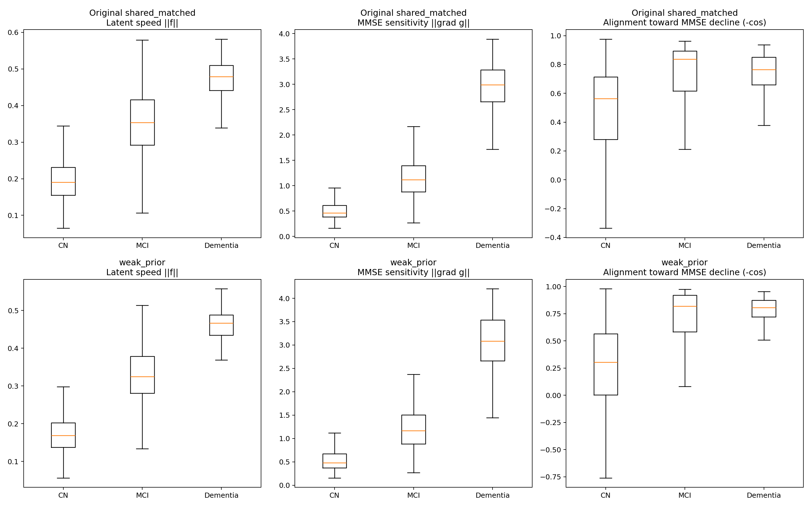
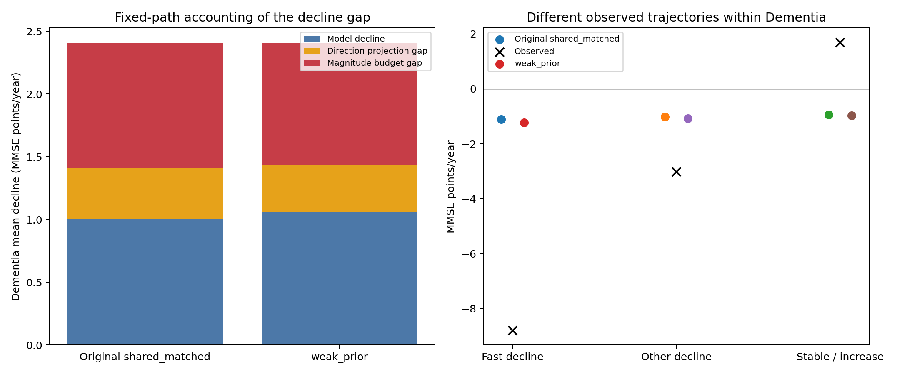

# Dementia下降偏慢：速度、临床敏感性与方向投影的分解

## 1. 从潜在速度到MMSE年变化率

原始 shared_matched 和 weak_prior 在Dementia组都低估了MMSE平均下降幅度。本实验沿用实验A的检查点、患者和相邻随访间隔，分别计算潜在速度大小、MMSE头梯度大小及二者夹角。

\[\dot y=\nabla g(z)^\top f(z)=\underbrace{\|\nabla g(z)\|}_{临床头敏感性}\underbrace{\|f(z)\|}_{潜在速度}\underbrace{\cos\theta}_{方向投影}.\]

g输出已经还原成原始MMSE分数，时间单位为年。夹角相对“MMSE上升”的梯度定义，因此cosθ小于0表示下降；−cosθ越接近1，速度越朝MMSE下降方向。

原始模型使用第56轮检查点，weak_prior使用第70轮检查点。全部测试区间共1,086个；其中Dementia为186个区间、82位患者。每个状态只读取截至当前检查的历史。

## 2. 三类患者的瞬时分解

| 模型 | 当前诊断 | 平均潜在速度 | 平均MMSE梯度范数 | 平均cosθ | 平均瞬时MMSE变化率 |
|---|---|---:|---:|---:|---:|
| shared_matched | CN | 0.198 | 0.538 | -0.478 | -0.051 |
| shared_matched | MCI | 0.351 | 1.253 | -0.689 | -0.371 |
| shared_matched | Dementia | 0.471 | 2.920 | -0.732 | -1.030 |
| weak_prior | CN | 0.172 | 0.553 | -0.262 | -0.036 |
| weak_prior | MCI | 0.323 | 1.296 | -0.693 | -0.364 |
| weak_prior | Dementia | 0.458 | 3.026 | -0.757 | -1.084 |

这些量先对每个状态逐项计算，再按诊断汇总。速度和梯度使用各模型自身的六维坐标，最终内积的单位为MMSE分/年。



Dementia组的潜在速度和MMSE头梯度范数均为三组最高，且方向总体指向MMSE下降。其下降偏慢并未表现为“这个区域的速度或头梯度比其他诊断组更小”。接下来需要把三者合起来，比较整个随访区间的临床变化量级。

以每个状态的1−cos²θ衡量位于MMSE等值面切向的速度能量比例，Dementia组平均为原模型 44.2%、weak_prior 39.9%。这部分运动在当前状态的一阶近似下保持MMSE不变。weak_prior的下降方向投影有所增强。

## 3. 沿真实随访间隔积分，分开量级与对齐

对每个实际检查间隔，在原模型轨迹上取16个Gauss–Legendre积分节点，计算：

\[B_i=\frac1{\Delta t}\int\|\nabla g(z(t))\|\|f(z(t))\|\,dt,\qquad A_i=-\frac{\frac1{\Delta t}\int\dot y(t)\,dt}{B_i}.\]

B是沿该条原轨迹的“下降投影预算”：保留各位置的速度与梯度大小，将方向投影全部取为下降端。A是实际使用这份预算的有效下降对齐比例。因此原模型区间预测满足 r_pred=−B×A。这里计算的是原轨迹上的投影预算，轨迹位置与模型参数保持原样。

| 模型 | 诊断组 | 实际平均速率 | 模型平均速率 | 平均路径预算B | 有效下降对齐比例 |
|---|---|---:|---:|---:|---:|
| shared_matched | CN | -0.127 | -0.056 | 0.116 | 48.2% |
| shared_matched | MCI | -0.507 | -0.407 | 0.501 | 81.2% |
| shared_matched | Dementia | -2.407 | -1.005 | 1.411 | 71.2% |
| weak_prior | CN | -0.127 | -0.043 | 0.106 | 40.0% |
| weak_prior | MCI | -0.507 | -0.390 | 0.473 | 82.6% |
| weak_prior | Dementia | -2.407 | -1.065 | 1.431 | 74.4% |

组级对齐比例用“平均预测下降 / 平均预算”计算，保持表中乘积关系。原模型Dementia的有效对齐约为71.2%，MCI约为81.2%。Dementia在方向投影上有折损，同时其1.411分/年的路径预算仍低于真实平均下降2.407分/年。

## 4. Dementia平均缺口有多少来自这两部分

令真实平均下降幅度为R、模型平均下降幅度为P，则在原轨迹预算下：

\[R-P=\underbrace{B-P}_{方向投影折损}+\underbrace{R-B}_{乘积预算与真实幅度之差}.\]

| 模型 | 真实下降R | 模型下降P | 总缺口 | 方向投影折损 | 预算量级差 | 缺口中的方向 / 量级占比 |
|---|---:|---:|---:|---:|---:|---|
| shared_matched | 2.407 | 1.005 | 1.402 | 0.406 | 0.996 | 29.0% / 71.0% |
| weak_prior | 2.407 | 1.065 | 1.342 | 0.366 | 0.976 | 27.3% / 72.7% |



原模型平均缺口1.402分/年，其中0.406对应方向投影折损，0.996对应乘积预算与真实幅度的差距。weak_prior的对应值为0.366和0.976。按患者整组bootstrap，两个模型的预算量级差95%区间均高于零，详见原始指标文件。

这将问题定位到临床速率的量级校准：在当前已访问轨迹上，单独提高对齐只能覆盖部分缺口；速度×临床敏感性的乘积也需要覆盖更大的下降幅度。

## 5. Dementia内部：模型是否区分快速下降者

以训练集Dementia相邻MMSE间隔年变化率最低20%的阈值（-5.313分/年）划分较快下降组。两模型使用同一批真实标签：

| 未来实际变化组 | 区间数 | 真实平均速率 | 原模型预测 | weak_prior预测 | 原模型路径预算 | weak_prior路径预算 |
|---|---:|---:|---:|---:|---:|---:|
| 较快下降 | 44 | -8.796 | -1.111 | -1.226 | 1.510 | 1.576 |
| 其他下降 | 64 | -3.015 | -1.013 | -1.069 | 1.427 | 1.440 |
| 持平或上升 | 78 | 1.696 | -0.937 | -0.970 | 1.342 | 1.342 |

真实较快下降组平均为−8.796分/年，而原模型预测−1.111、weak_prior预测−1.226。持平或上升组的真实平均为+1.696，两模型仍预测约−1分/年。Dementia内部不同进展者的模型速率集中在相近的下降趋势，说明个体变化幅度的区分仍不足。

## 6. 检查短间隔和预测头饱和的影响

将Dementia检查间隔限制到至少0.9年后，再计算相同分解：

| 模型 | 区间数 | 真实平均速率 | 模型平均速率 | 路径预算 |
|---|---:|---:|---:|---:|
| shared_matched | 100 | -2.180 | -0.976 | 1.407 |
| weak_prior | 100 | -2.180 | -1.046 | 1.444 |

一年左右及更长的间隔中，真实下降仍大于路径预算。

再查看DECODER中Tanh的激活。按MMSE输出权重与输入权重大小加权，计算局部导数1−tanh²及饱和单元（|tanh|>0.95）占比：

| 模型 | CN加权导数 | MCI加权导数 | Dementia加权导数 | Dementia加权饱和占比 |
|---|---:|---:|---:|---:|
| shared_matched | 0.531 | 0.601 | 0.596 | 11.4% |
| weak_prior | 0.495 | 0.581 | 0.612 | 11.8% |

Dementia的Tanh加权导数没有低于CN，其MMSE梯度范数也最高。当前分解未呈现Dementia区域普遍发生预测头饱和、导致梯度整体变小的现象。

## 7. weak_prior主要改变了什么

Dementia的平均预测下降从1.005增加到1.065分/年。用B×A作对称差分解，提升的0.060分/年中，约0.015来自路径预算变化，约0.045来自有效对齐变化。

weak_prior的小幅改善主要表现为下降方向投影增加；路径预算只略有增加，较快下降者的预测幅度依旧偏小。

## 8. 对后续消融的具体建议

本次结果将优先问题指向“临床变化量级和个体进展差异”。可以分别检验：增加原始单位的区间MMSE变化率监督；在固定预测头下学习状态相关的时间尺度；在固定向量场下调整临床头的动态敏感性。三个方向保持独立，比较随访分数误差、变化率误差与Dementia快速下降组。方向约束可作为配套对照，与量级改进分开评估。

## 9. 文件与复现

[原模型逐间隔分解](../shared_matched_mmse_mechanism/interval_decomposition.csv) · [weak_prior逐间隔分解](../weak_prior_mmse_mechanism/interval_decomposition.csv) · [完整比较数据](comparison.json)

[原模型空间分布](../shared_matched_mmse_mechanism/mechanism_state_space.png) · [weak_prior空间分布](../weak_prior_mmse_mechanism/mechanism_state_space.png) · [原实验A](../shared_matched_clinical_velocity/report.zh-CN.md) · [weak_prior实验A](../weak_prior_clinical_velocity/report.zh-CN.md)

原模型在GPU 2、weak_prior在GPU 3上完成分解。六维速度、MMSE头梯度和轨迹积分都在CUDA计算；分组统计、患者bootstrap与绘图使用CPU。16节点积分的变化率与端点差分核对，最大差异小于0.00002分/年。

```bash
CUDA_VISIBLE_DEVICES=2 /home/xjh/miniforge3/envs/ode/bin/python \
  -m paper_odeae.diagnostics.mmse_rate_mechanism --variant shared_matched --gpu 2

CUDA_VISIBLE_DEVICES=3 /home/xjh/miniforge3/envs/ode/bin/python \
  -m paper_odeae.diagnostics.mmse_rate_mechanism --variant weak_prior --gpu 3

/home/xjh/miniforge3/envs/ode/bin/python -m paper_odeae.diagnostics.report_mmse_mechanism
```
