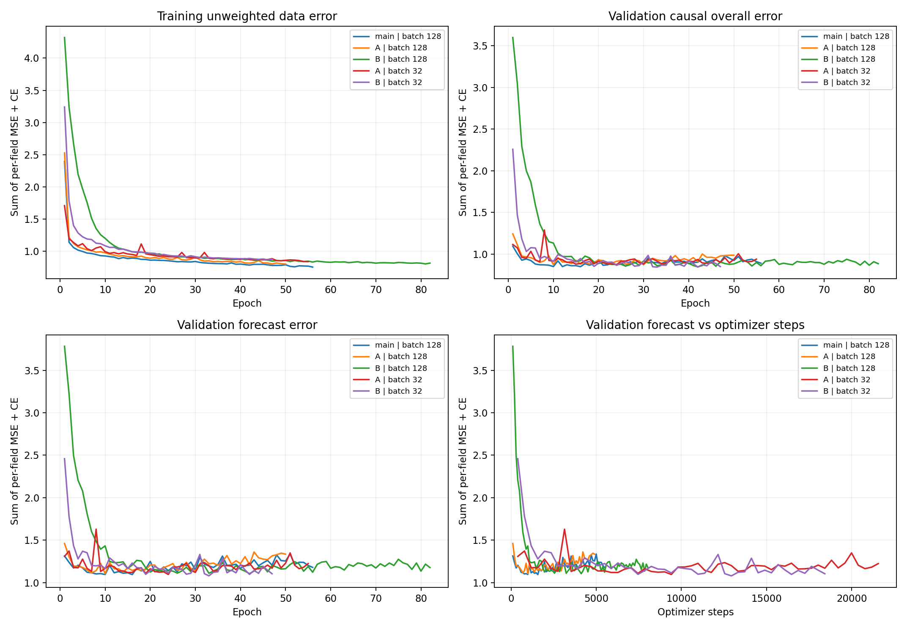
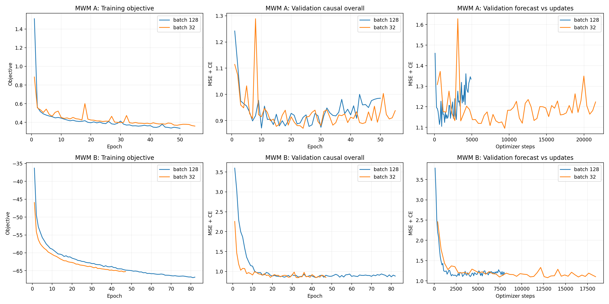

# ADNI：MWM训练与比较

MWM相关训练已按要求暂停，已有结果、曲线和恢复检查点保留。当前主模型恢复为latent2x both，同参数量baseline继续训练。

当前状态见下方进度表。

## 1. 训练设置

所有版本按检查时间顺序读取历史。首次观测年龄用于INIT，第一次检查经UPDATE建立初始估计；此后每次先用ODE预测当前检查，再吸收该次检查。历史截止点之后只做ODE预测。

主比较的main、A、B使用batch=128；新增A和B的batch=32对照，分别从seed 0重新训练。每组独占一张RTX 4090，每个batch执行一次反向传播和参数更新，无梯度累积。最多300轮、至少50轮，验证指标连续40轮未改善时早停。全部训练接入SwanLab。

三种方法统一按验证集未加权的逐次预测MSE＋交叉熵选择检查点。A的计数权重和B的NLL只作用于训练。验证与共同测试沿用固定32条查询批次。

## 2. 损失与参数量

| 版本 | batch | 数据监督 | INIT / UPDATE / Decoder / ODE隐藏宽度 | 参数量 |
|---|---:|---|---|---:|
| MWM main | 128 | 数值MSE＋类别交叉熵，所有观测同权 | 159 / 159 / 159 / 188 | 44,875 |
| MWM A | 128 | 逐次预测误差乘sigmoid(N−3)，N为已吸收观测数 | 159 / 159 / 159 / 188 | 44,875 |
| MWM B | 128 | 数值Gaussian NLL＋类别交叉熵，每个时刻输出一个σ | 159 / 160 / 158 / 187 | 44,875 |
| MWM A | 32 | 逐次预测误差乘sigmoid(N−3)，N为已吸收观测数 | 159 / 159 / 159 / 188 | 44,875 |
| MWM B | 32 | 数值Gaussian NLL＋类别交叉熵，每个时刻输出一个σ | 159 / 160 / 158 / 187 | 44,875 |

各组保留0.01 Jacobian与0.02共享ODE参数L2。B的σ头通过少量隐藏宽度调整匹配总参数量，σ=softplus(输出)＋0.01，初始为1。

## 3. 实验进度

| 版本 | batch | 状态 | 物理GPU | 已训练 / 最佳轮次 | 验证逐次预测整体误差 |
|---|---:|---|---:|---:|---:|
| MWM main | 128 | complete / tested | 0 | 56 / 16 | 0.847947 |
| MWM A | 128 | complete / tested | 1 | 50 / 10 | 0.871878 |
| MWM B | 128 | complete / tested | 3 | 82 / 42 | 0.844465 |
| MWM A | 32 | paused_by_user / user_paused | 0 | 55 / 24 | 0.870801 |
| MWM B | 32 | paused_by_user / user_paused | 1 | 47 / 33 | 0.842940 |

## 4. 训练曲线

曲线随已完成轮次自动更新。第一幅图用统一的未加权MSE＋交叉熵展示训练数据误差、验证逐次预测整体误差与未来预测误差；右下图按优化器更新次数比较未来预测误差。

[SVG](training_curves.svg) · [PDF](training_curves.pdf)

第二幅图分别比较A、B在两个batch下的真实训练总损失、验证整体误差与按更新次数计的未来误差。B的训练总损失包含NLL；A、B的损失数值含义不同，各自在同一行比较batch差异。

[SVG](batch_comparison_curves.svg) · [PDF](batch_comparison_curves.pdf)

## 5. 共同测试结果

测试历史回顾从已知历史截止点向过去自由ODE积分；测试未来从同一截止点向未来自由ODE积分，两者均不吸收目标观测。“整体”汇总历史回顾和未来预测。历史逐次预测单列，首次检查为UPDATE后读出，其余历史检查均在UPDATE前预测。

| 模型 | batch | 参数量 | 最佳轮次 | 测试历史回顾 | 测试未来 | 测试整体 | 测试历史逐次预测 |
|---|---:|---:|---:|---:|---:|---:|---:|
| latent2x both参考 | 32 | 44875 | 81 | 0.471739 | 1.000299 | 0.702538 | — |
| MWM main | 128 | 44875 | 16 | 1.153986 | 1.061541 | 1.133440 | 0.616109 |
| MWM A | 128 | 44875 | 10 | 0.982195 | 1.072194 | 1.033902 | 0.664849 |
| MWM B | 128 | 44875 | 42 | 2.186563 | 1.045817 | 1.725162 | 0.608958 |
| MWM A | 32 | 44875 | 24 | — | — | — | — |
| MWM B | 32 | 44875 | 33 | — | — | — | — |

参考组按旧的历史回顾＋未来整体误差选检查点；MWM按逐次预测整体误差选择。MWM与参考组的变化包括首次年龄初始化、监督方式、空输入UPDATE处理和选模方式。

## 6. batch=32与128的配对比较

每种方法仅改变训练batch，模型参数、seed 0、数据划分、输入dropout、学习率0.003、衰减规则、损失、早停和测试流程保持一致。新batch32组从初始权重重新训练。

batch32每轮的参数更新次数约为batch128的四倍。学习率仍按更新次数衰减。下表同时记录最佳轮次、累计更新次数与达到最佳验证分数的时间，以解释batch变化带来的优化差异。

| 方法 | batch | 最佳轮次 | 最佳时累计更新数 | 达到最佳用时/分 | 验证逐次整体 | 测试未来 | 测试整体 |
|---|---:|---:|---:|---:|---:|---:|---:|
| MWM A | 32 | 24 | 9408 | 40.21 | 0.870801 | — | — |
| MWM A | 128 | 10 | 980 | 5.73 | 0.871878 | 1.072194 | 1.033902 |
| MWM B | 32 | 33 | 12936 | 63.68 | 0.842940 | — | — |
| MWM B | 128 | 42 | 4116 | 26.38 | 0.844465 | 1.045817 | 1.725162 |

| 方法 | batch32−batch128：测试未来误差 | batch32未来误差相对降低 |
|---|---:|---:|
| MWM A | 等待两组完成 | — |
| MWM B | 等待两组完成 | — |

差值为负表示batch32未来误差更小；相对降低为正表示batch32有改善。

## 7. 数据与原始记录

数据SHA256：`9606b09cc6163d7e55890338d96d55454aa8593ab030b63537488f8ddf165de7`。

各组保存config.json、hardware.json、history.json、best.pt、last.pt、metrics.json和swanlab.json；设备记录包含实际物理GPU和张量设备。

[方法说明](../../MWM_METHOD.zh-CN.md) · [运行队列](../../../mwm/results/adni_mimic/queue.json) · [结构化比较](comparison.json)

此前中断的batch32结果保存在[归档目录](../mwm_batch32_20261101T094505Z/summary.md)；本轮新增的batch32对照保存在A_batch32、B_batch32目录。
