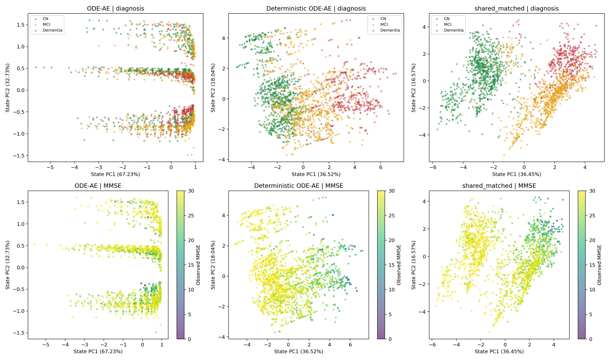
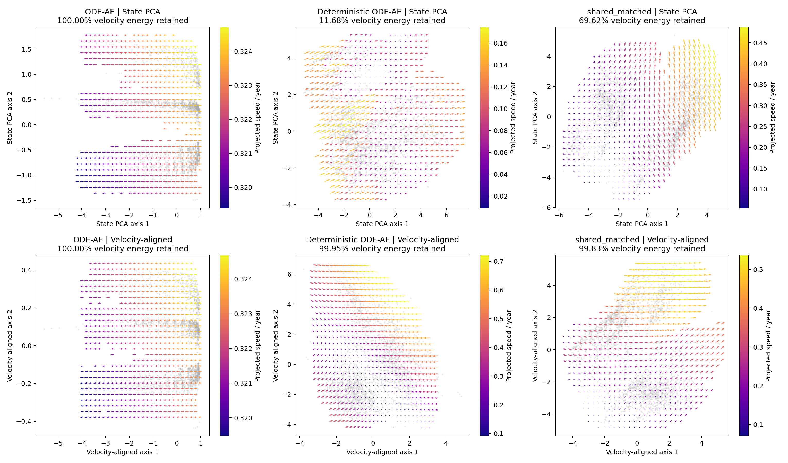
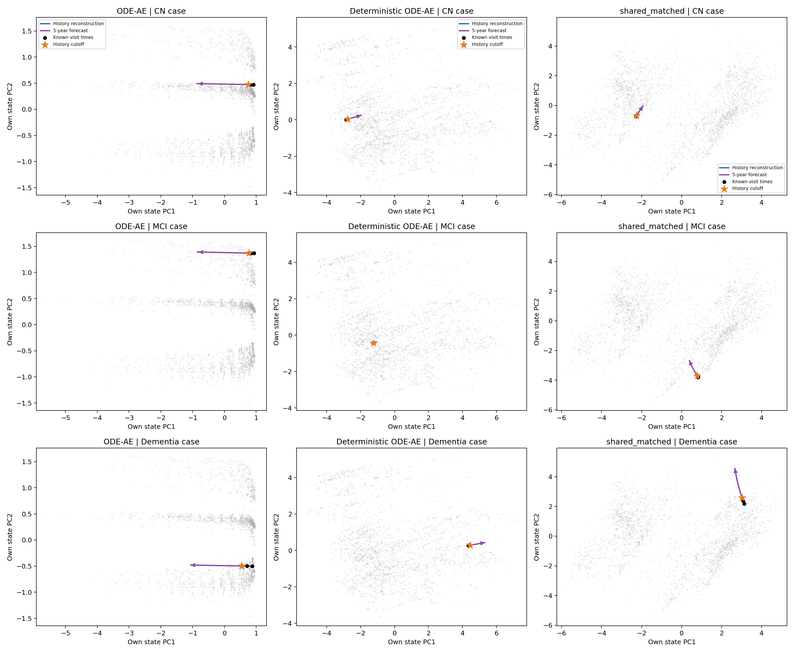
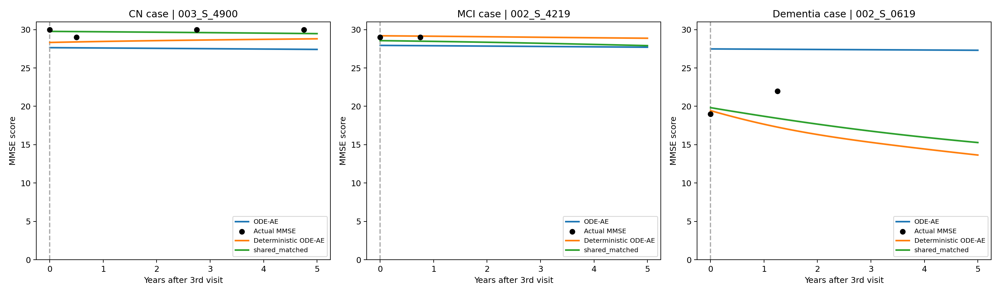

# shared_matched、ODE-AE 与确定性 ODE-AE 的比较

## 1. 比较任务：用已有检查重建历史、预测未来

ADNI 的每位患者都有一串检查记录，检查时间和可用项目各不相同。模型读取其中一段历史，估计患者状态，再生成整段检查轨迹。本报告比较三个已完成的 seed 0 模型：概率 ODE-AE、确定性 ODE-AE（`deterministic_22545`），以及我们的 `shared_matched`。

三者使用同一份本地数据：40 个字段，训练集 2,093 人、验证集 393 人、测试集 414 人。数值字段按训练集 min-max 归一化；类别字段以独热编码输入。每位患者的全部历史截断都参与评价。例如，患者有四次检查，会分别评价“只知道第一次”“知道前两次”等情况。

评价分为三个区域：

- **历史重构**：模型能否还原已经提供的检查。
- **未来预测**：模型能否预测历史截止点之后的检查。
- **整体误差**：将历史与未来的全部有效观测放在一起计算。

每个数值字段计算有效观测上的平均平方误差，每个类别字段计算交叉熵，再按字段求和。三个指标都是越低越好。整体误差按全部观测重新计算，因此与前两项的简单平均有所不同。

## 2. 三个模型怎样估计患者状态

可以把潜在状态理解为患者在一张地图上的位置，ODE 决定这个位置随时间怎样移动。模型之间的区别，主要在于如何读取历史、如何表示状态，以及从哪里开始生成轨迹。

| 模型 | 状态表示 | 读取历史的顺序 | 生成轨迹的起点 | 编码与生成的向量场 |
|---|---|---|---|---|
| ODE-AE | 六维高斯分布，编码器维护均值和方差参数 | 从最近检查向最早检查读取 | 首次检查处的后验状态 | 两套独立网络 |
| 确定性 ODE-AE | 六维确定性向量 | 从最近检查向最早检查读取 | 首次检查处的状态 | 两套独立网络 |
| shared_matched | 六维确定性向量 | 从最早检查向最近检查读取 | 最后一次已知检查处的状态 | 一套共享网络 |

概率 ODE-AE 先把历史压缩成首次检查处的分布，训练时从中采样，再向前生成轨迹；测试点预测从后验均值出发。确定性 ODE-AE 保留相同的反向读取方式，直接输出一个初始状态。

shared_matched 则从前向后吸收历史：两次检查之间沿 ODE 演化，遇到检查时用 UPDATE 修正状态。读完历史后，从当前状态向过去重建、向未来预测。历史吸收与轨迹生成使用同一个向量场。

三者的训练目标都包含数值重构、类别重构和 0.02 倍 ODE 参数 L2。概率 ODE-AE 另有权重为 1 的 KL 项；两个确定性模型的 KL 为零。shared_matched 的共享向量场只计算一次 L2。

## 3. 定量结果：相同测试任务上的误差

### 3.1 参数量与训练记录

| 模型 | 状态 | 可训练参数量 | 总参数量 | 训练轮数 | 最佳轮次 | 原训练方式 |
|---|---|---:|---:|---:|---:|---|
| ODE-AE | complete | 3,003 | 3,003 | 90 | 50 | 单卡 |
| 确定性 ODE-AE | complete | 22,545 | 22,545 | 116 | 76 | 四卡 DDP |
| shared_matched | complete | 22,545 | 22,545 | 96 | 56 | 单卡 |

每组先按验证整体误差选择检查点，再计算测试指标。本报告使用原始 shared_matched 检查点；新增弱约束和四倍扩容实验单独记录。

### 3.2 验证集与测试集指标

| 模型 | 验证整体 | 验证未来预测 | 测试历史重构 | 测试未来预测 | 测试整体 |
|---|---:|---:|---:|---:|---:|
| ODE-AE | 3.28726 | 3.48721 | 3.01401 | 3.24780 | 3.11510 |
| 确定性 ODE-AE | 0.93254 | 1.25422 | 0.66681 | 1.19155 | 0.89476 |
| **shared_matched** | **0.88722** | **1.16130** | **0.62725** | **1.13926** | **0.85063** |

两个确定性模型的误差均低于当前概率 ODE-AE 复现。进一步比较同为 22,545 参数的两个模型，shared_matched 的测试未来预测误差降低 **4.39%**，测试整体误差降低 **4.93%**，历史重构误差降低 **5.93%**。

这组结果比较的是三套完整方案。概率表示、网络容量、读取方向、生成起点和训练执行方式的差异均已列在前两张表中。共享结构本身的同批等参数对照，见 [shared_matched 结构消融](../shared_matched_comparison/comparison.zh-CN.md)。

## 4. 状态空间：疾病信息被组织成什么样子

### 4.1 统一画历史截止点处的状态

为了让每个点对应同一个时间含义，ODE-AE 和确定性 ODE-AE 都从首次检查处的状态沿生成 ODE 推进到历史截止点；shared_matched 直接使用读完历史后的状态。

共得到 17,165 个状态，分别来自训练集 12,544 个、验证集 2,219 个、测试集 2,402 个历史截断。每个点代表一次历史条件下的状态估计，同一患者可以贡献多个点。

三个模型各自使用训练状态拟合 PCA，再把六维状态投影到二维。图中每列对应一个模型，上排按当前诊断着色，下排按当前 MMSE 着色。各模型拥有自己的坐标轴和尺度。



### 4.2 从图中看到的差异

**ODE-AE** 的状态集中在几条狭长带上，CN、MCI 和痴呆在带内混合较多。进一步按个体属性着色，条带与性别、婚姻状态有较强关联，见 [属性分布图](context_factors.png)。

**确定性 ODE-AE** 的状态分布更展开。CN 偏左，痴呆偏右，MCI 主要位于中间及交叠区域；MMSE 也随左右位置呈现变化。

**shared_matched** 中，CN 主要位于左侧，MCI 偏右下，痴呆偏右上。MMSE 在这些区域之间呈现相应变化，形成与患者认知状态有关的空间结构。

诊断和 MMSE 都是模型输入。这里展示的是各模型如何组织已有临床信息，以及这些信息在测试患者状态中的分布。

| 投影统计 | ODE-AE | 确定性 ODE-AE | shared_matched |
|---|---:|---:|---:|
| 状态前两维保留的方差 | 99.95% | 54.56% | 53.01% |
| 第一状态主方向保留的方差 | 67.23% | 36.52% | 36.45% |

ODE-AE 的状态变化高度集中，二维图几乎显示了它的全部变化。两个确定性模型的变化分散在更多方向，二维图展示的是其中的主要结构。表中的保留比例衡量投影的信息量；预测表现对应第 3 节的测试误差。

概率版本还有一个明显特征：首次检查处的后验均值有 **99.53%** 的变化集中在一个主方向。其余多数维度的后验标准差约为 1，而均值在患者之间的变化约为 0.02–0.04。[后验分布图](posterior_uncertainty.png) 展示了这种表示集中的现象。确定性 ODE-AE 初始状态的第一主方向占比为 **38.49%**，状态变化分布在更多方向。

## 5. 速度场：各位置会向哪里演化

速度场描述潜在位置每年变化的方向和速度。我们先在真实六维状态上计算 ODE 速度，再投影到图中；网格箭头取附近 30 个训练状态的加权平均，灰点显示测试状态的位置。

下面每列仍对应同一个模型，并提供两种互补的视角：

- **上排：状态 PCA 平面。** 与第 4 节使用同一坐标，便于把速度与人群区域对应起来。
- **下排：速度方向平面。** 根据训练速度选择两个主要方向，优先保留 ODE 的运动信息。



| 二维平面保留的速度能量 | ODE-AE | 确定性 ODE-AE | shared_matched |
|---|---:|---:|---:|
| 状态 PCA 平面 | 约 100.00% | 11.68% | 69.62% |
| 速度方向平面 | 约 100.00% | 99.95% | 99.83% |

ODE-AE 的箭头大多同向，速度颜色变化范围也较窄。两个确定性模型的方向和速度随位置变化得更明显。

确定性 ODE-AE 的主要运动方向大部分位于状态 PCA 平面之外，因此下排更完整地显示了它的演化。shared_matched 的状态平面已保留约七成速度能量，下排进一步补全其主要方向。每幅图使用自己的坐标尺度、色条和箭头显示比例，读图时关注各模型内部不同区域的演化结构。

这里 ODE-AE 和确定性 ODE-AE 展示生成向量场；shared_matched 展示编码与生成共用的向量场。所有轨迹求解都在原六维状态空间中完成，二维图负责呈现求解结果。

## 6. 相同患者案例：读取前三次检查后会怎样预测

### 6.1 病例与输入条件

选择三位已有可视化中的测试患者，三个模型均只读取其前三次检查，随后生成未来五年的轨迹。

| 病例 | 患者编号 | 图中的病例类别 |
|---|---|---|
| A | 003_S_4900 | CN |
| B | 002_S_4219 | MCI |
| C | 002_S_0619 | 痴呆 |

类别取自患者最后一次记录，用于选例和标注。模型输入固定为前三次检查，其余检查用于展示后续实际观测。

### 6.2 潜在状态中的演化轨迹

下图每行是一位患者，每列是一个模型。蓝线是前三次检查期间的生成重构，紫线是截止点之后五年的 ODE 预测。黑点标记历史检查时间在生成轨迹中的位置，橙色星号标记第三次检查，即预测的起点。灰色背景与第 4 节的测试状态分布相同。



ODE-AE 的三条预测基本沿相似方向移动。确定性 ODE-AE 的轨迹在这个状态平面中移动较短，其主要运动方向见第 5 节下排。shared_matched 的三个病例从不同区域出发，沿各自位置对应的方向演化。

这张图比较生成阶段：模型先读完三次历史，再连续重建和预测。shared_matched 在历史读取过程中发生的观测更新，另见 [连续演化与 UPDATE 跳变示例](../shared_matched_state_space/patient_paths.png)。

### 6.3 映射回 MMSE：比较实际分数

将潜在轨迹经过 DECODER 映射回 MMSE 原始分数后，可以直接对照检查结果。横轴为第三次检查后的年数，黑点为期间实际记录的 MMSE；三条彩色曲线分别为三个模型的预测。



- **CN 病例**：后续实际分数主要在 29–30。shared_matched 的预测接近 30，确定性 ODE-AE 约为 28–29，概率 ODE-AE 约为 27–28。
- **MCI 病例**：截止点和随后一次检查均为 29。确定性 ODE-AE 和 shared_matched 的起点更接近这一分数，三个模型随后都给出平缓变化。
- **痴呆病例**：截止点实际为 19，一年多后的实际记录为 22。两个确定性模型从约 19 开始预测下降，概率 ODE-AE 则维持在约 27。这一病例同时呈现了两个问题：起点状态估计是否贴合患者，以及自然演化是否跟随后续变化。

病例图把第 3 节的总体误差展开到具体患者：状态所在区域影响解码结果，向量场决定后续变化，二者共同形成最终的检查预测。

## 7. 图表、数据与复现入口

[ODE-AE 交互页面](interactive.html)、[确定性 ODE-AE 交互页面](deterministic_22545_interactive.html) 和 [shared_matched 交互页面](../shared_matched_state_space/interactive.html) 均支持切换着色、缩放和悬停查看。

本页三模型平行图、病例数据和原有可视化均保存在当前目录。各图提供 PNG、SVG、PDF 版本。[指标汇总及原始来源](comparison_metrics.json) 对应第 3 节表格；设备、检查点哈希和病例求解核对见 [comparison_visuals.json](comparison_visuals.json)，病例轨迹与 MMSE 数值见 [comparison_cases.json](comparison_cases.json)。

此次新增的模型计算、速度投影和 ODE 求解使用物理 GPU 1（RTX 4090）；文件处理、标量统计和绘图使用 CPU。已有训练继续运行。

复现本页四张平行比较图：

```bash
CUDA_VISIBLE_DEVICES=1 /home/xjh/miniforge3/envs/ode/bin/python \
  -m paper_odeae.diagnostics.model_comparison_visuals --gpu 1
```

代码见 [model_comparison_visuals.py](../../diagnostics/model_comparison_visuals.py)。底层状态数据分别保存在 [ODE-AE](states.npz)、[确定性 ODE-AE](deterministic_22545_states.npz) 和 [shared_matched](../shared_matched_state_space/states.npz) 的文件中。
