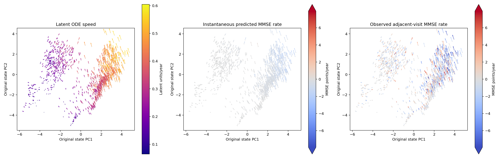
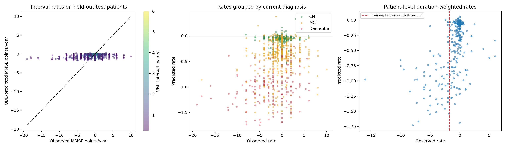
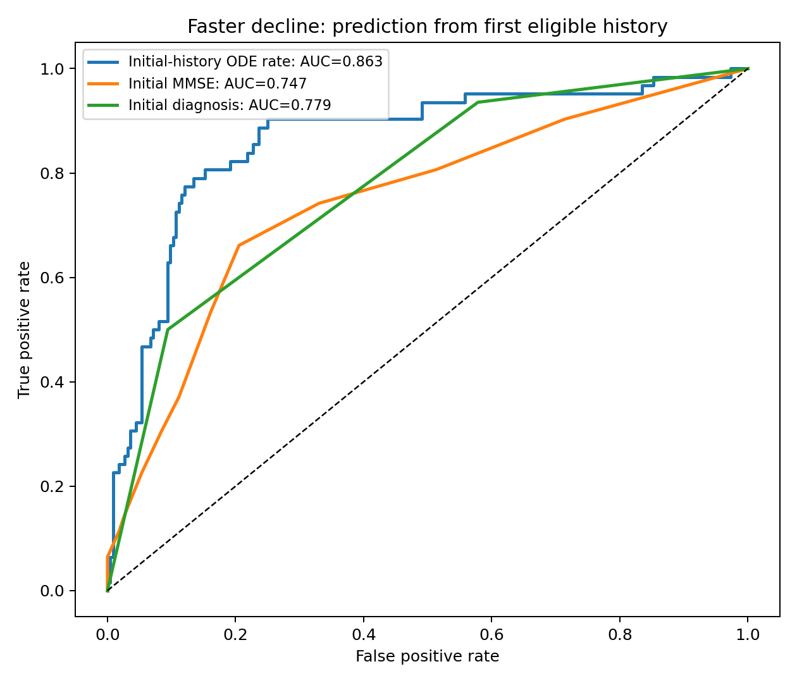

# 实验 A：从潜在 ODE 速度到真实临床变化速度

## 1. 用已有临床预测头读取潜在动力学

本实验使用原始 shared_matched（22,545参数，第56轮检查点）。它的 DECODER 已输出 MMSE、CDR-SB 和 ADAS 各题分数，因此直接使用现有预测头。数据和模型保持原样。

临床预测值先从训练集 min-max 尺度还原到原始分数。瞬时变化率通过链式法则计算：

\[\frac{d\widehat{\mathrm{MMSE}}}{dt}=\nabla_z g(z)^\top f(z).\]

MMSE 的单位为分/年，负值表示模型预测评分下降，正值表示预测评分上升。CDR-SB 和 ADAS 题目同样使用原始题目分数/年；各题单独报告，未拼接为 ADAS-Cog 总分。

## 2. 在相同检查间隔上评价

对患者第i次检查，模型只读取截至这次检查的历史，得到更新后的状态。随后独立沿ODE推进到第i+1次检查，中间不读入新观测。真实与预测年变化率分别为：

\[r_i^{real}=\frac{x_{i+1}-x_i}{\Delta t},\qquad r_i^{pred}=\frac{g(\Phi_{\Delta t}(z_i^+))-g(z_i^+)}{\Delta t}.\]

主评价使用数据中相邻检查且两端均有真实MMSE的间隔。补充评价连接相邻的有效MMSE记录，并按间隔长度分组。重复访视属于同一患者，MAE置信区间按患者整组重抽样。

时间轴沿用模型数据中的自然季度聚合：同季度数值检查取平均，时间记在季度末，间隔按该时间戳换算成年。所有真实与预测变化率使用同一时间轴。

## 3. 测试集临床速度场

三幅图保留原状态PCA坐标，并使用相同的相邻MMSE检查起点。每支箭头的方向和长度来自该状态的真实潜在速度投影：左图按六维潜在速度大小着色，中图按预测瞬时MMSE年变化率着色，右图按真实相邻检查年变化率着色。



临床两图共用色条，负值为蓝色、正值为红色。色条范围为 ±7.94 分/年，取训练集真实年变化率绝对值的95%分位；超出范围的值使用端点颜色，原始数值完整保留。

## 4. MMSE年变化率预测指标

| 评价间隔 | 间隔数 | 患者数 | MAE（分/年） | Pearson | Spearman | 上升/下降准确率 | 三方向准确率 |
|---|---:|---:|---:|---:|---:|---:|---:|
| 相邻检查，全部间隔 | 1086 | 286 | 1.894 | 0.299 | 0.188 | 58.621% | 42.265% |
| 相邻检查，至少0.5年 | 953 | 279 | 1.708 | 0.265 | 0.165 | 58.187% | 41.763% |
| 相邻检查，至少0.9年 | 690 | 242 | 1.279 | 0.358 | 0.206 | 58.996% | 40.870% |
| 相邻有效MMSE记录 | 1404 | 336 | 1.826 | 0.280 | 0.174 | 58.260% | 42.450% |

主评价MAE为 **1.894分/年**，患者整组bootstrap的95%区间为 **[1.715, 2.077]**。零变化基线的MAE为 1.933分/年。真实变化率标准差为 2.989，模型预测为 0.430分/年。

上升/下降准确率仅评价真实变化非零的 783 个间隔；三方向准确率将下降、不变、上升一起评价。真实方向数量为：下降 474、不变 303、上升 309。训练集多数方向基线在测试非零变化间隔上的准确率为 60.54%。

模型在年变化率MAE上较零变化基线改善 1.99%。真实年变化率的波动范围明显更大，当前ODE给出的变化较平缓；方向判断表现低于上述多数方向基线。



## 5. 不同诊断区域的实际与预测速度

| 当前诊断 | 测试间隔数 | 真实平均变化率 | 预测区间平均变化率 | 预测瞬时平均变化率 | MAE |
|---|---:|---:|---:|---:|---:|
| CN | 395 | -0.127 | -0.056 | -0.051 | 1.075 |
| MCI | 504 | -0.507 | -0.407 | -0.371 | 1.894 |
| Dementia | 186 | -2.407 | -1.005 | -1.030 | 3.621 |
| 未记录 | 1 | -4.058 | -0.056 | -0.060 | 4.003 |

模型与真实随访都呈现CN较稳定、MCI平均缓慢下降、痴呆平均下降更快的顺序。痴呆组的预测平均下降幅度小于真实随访，体现出当前动力学对较快变化的低估。

## 6. MCI区域向左上移动意味着什么

沿用原PCA方向，将横向速度小于0、纵向速度大于0定义为“左上”。下面分别列出这些MCI状态的预测瞬时变化，以及有后续MMSE观测的间隔：

| MCI速度方向 | 测试状态数 | 平均预测瞬时MMSE速度 | 预测下降占比 | 有真实相邻MMSE的间隔数 | 真实平均变化率 | 真实下降占比 |
|---|---:|---:|---:|---:|---:|---:|
| 左上 | 770 | -0.379 | 94.545% | 456 | -0.539 | 45.614% |
| 其他方向 | 80 | -0.260 | 93.750% | 48 | -0.205 | 41.667% |

在当前模型中，MCI区域向左上移动主要对应预测MMSE下降。真实随访在这些起点上的平均变化也为下降，同时包含评分不变和上升的间隔。

## 7. 能否识别变化较快的患者

对每位患者，将相邻间隔的变化量相加，再除以总间隔年数，得到按时间加权的平均年变化率。以训练患者真实速率最低20%的分位点定义本实验的“较快下降”组。

阈值为 -1.741分/年。测试集共 286 位有效患者，其中 62 位属于该组；模型按下降速度排序的 AUROC 为 **0.861**，患者级 Spearman 相关性为 **0.476**。

将多次历史下的预测汇总后，模型可以区分总体变化较快与较慢的患者。下面用相同患者上的已有MMSE作排序参照，并单独列出只使用首次有效历史的早期预测：

| 排序方式 | 有效患者数 | AUROC | 患者bootstrap 95%区间 |
|---|---:|---:|---|
| 各间隔起点ODE预测，按时长汇总 | 286 | 0.861 | [0.802, 0.915] |
| 各间隔起点实际MMSE，按时长汇总 | 286 | 0.789 | [0.715, 0.863] |
| 首次有效历史的ODE预测 | 286 | 0.863 | [0.796, 0.918] |
| 首次有效历史的实际MMSE | 286 | 0.747 | [0.667, 0.819] |
| 首次有效历史的诊断代码 | 285 | 0.779 | — |

首次有效历史指该患者首个可评价MMSE区间起点之前的全部检查。其后的实际随访用于计算患者平均真实变化率。AUROC越高，下降较快的患者越倾向于排在前面。



本实验中，患者级下降风险排序比逐间隔下降幅度预测更好：原ODE能够区分变化较快的人群，但预测变化幅度偏小，短期上升与下降的方向判断仍较弱。

## 8. 其他临床指标

| 指标 | 测试相邻间隔数 | MAE（原始分/年） | Pearson | Spearman |
|---|---:|---:|---:|---:|
| cdrsb | 1122 | 0.858 | 0.368 | 0.316 |
| adas_q1 | 1189 | 1.168 | 0.099 | 0.108 |
| adas_q2 | 1189 | 0.364 | 0.139 | 0.080 |
| adas_q3 | 1189 | 0.526 | 0.099 | 0.075 |
| adas_q4 | 1189 | 1.565 | 0.029 | 0.038 |
| adas_q5 | 1187 | 0.231 | 0.132 | 0.107 |
| adas_q6 | 1187 | 0.261 | 0.174 | 0.147 |
| adas_q7 | 1189 | 0.836 | 0.200 | 0.192 |
| adas_q8 | 1184 | 2.588 | 0.050 | 0.062 |
| adas_q9 | 1184 | 0.221 | 0.176 | 0.116 |
| adas_q10 | 1189 | 0.220 | 0.164 | 0.120 |
| adas_q11 | 1189 | 0.422 | 0.118 | 0.086 |
| adas_q12 | 1189 | 0.186 | 0.136 | 0.121 |
| adas_q13 | 1168 | 0.781 | 0.115 | 0.099 |

## 9. 计算与数据记录

计算在物理GPU 2（NVIDIA GeForce RTX 4090）上完成。模型、链式法则与ODE求解均在CUDA上执行。采用原检查点和原训练集PCA；统计汇总与绘图使用CPU。

[逐间隔原始数据](interval_rates.csv) · [完整指标](metrics.json) · [患者平均速率](patient_mmse_rates.csv) · [模型与数值核对](provenance.json)

```bash
CUDA_VISIBLE_DEVICES=2 /home/xjh/miniforge3/envs/ode/bin/python \
  -m paper_odeae.diagnostics.clinical_velocity --gpu 2
```

## 补充：下降速度偏慢的三因素分解

已进一步计算速度大小、MMSE梯度大小与夹角，并沿同一随访区间积分，分开方向投影折损与临床变化量级差距。

[原始模型与weak_prior的完整机制比较](../mmse_decline_mechanism/report.zh-CN.md)
