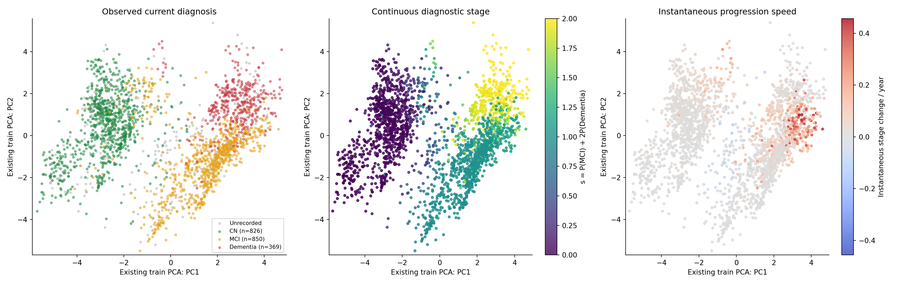
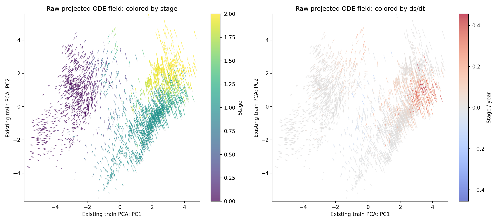
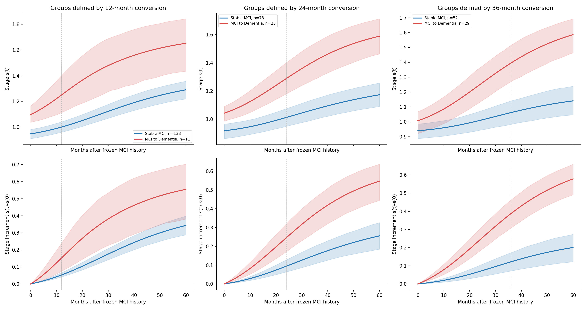
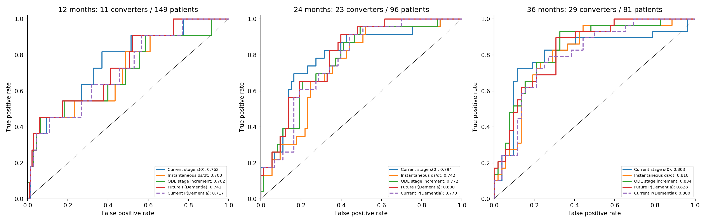
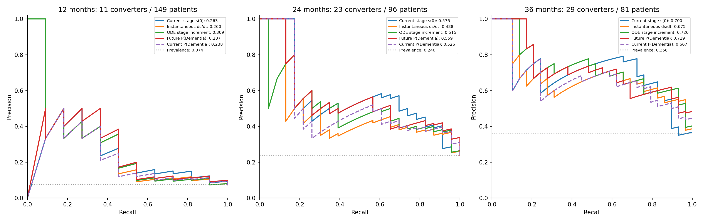

# 连续疾病阶段与进展分析

## 1. 从现有诊断输出得到连续阶段

本实验使用已经训练完成的六维 shared_matched：共 22,545 个参数，使用第 56 轮检查点。INIT、UPDATE、共享 ODE 和 DECODER 全部保持原样，参数被冻结。

原 DECODER 中已有 CN、MCI、Dementia 三个诊断 logits。对它们做 Softmax，得到三类概率，再计算：

\[s(z)=p_{\mathrm{MCI}}(z)+2p_{\mathrm{Dementia}}(z),\qquad 0\le s\le2.\]

这个分数是模型诊断概率的加权平均：接近 0 表示概率偏向 CN，接近 1 表示总体偏向中间阶段，接近 2 表示概率偏向 Dementia。例如 MCI 概率为 1 时评分是 1；CN 与 Dementia 各占一半时评分也为 1。因此评分要结合三类概率理解。

当前诊断本来就是模型的观测输入之一。这里先看读取当前观测后的状态如何表达疾病阶段，再用起点之后的真实诊断验证进展预测。

## 2. 先确定历史截止点，再向未来推演

测试集共有 **414 位患者、2,402 个 UPDATE 后状态**。空间图使用全部测试检查状态；每位患者完整已知历史的最后状态也单独保存了未来推演。

从每个起点出发，只沿共享 ODE 积分，不执行任何未来 UPDATE。每月保存一次结果，并明确导出 0、6、12、24、36、60 个月的诊断概率与阶段评分。时间以年进入 ODE，6 个月对应 0.5 年。

\[\dot s(z)=\nabla_zs(z)^\top f_\theta(z),\qquad \Delta s_H=s(H)-s(0),\qquad \bar v_H=\frac{\Delta s_H}{H/12}.\]

瞬时速度用自动微分计算，单位为阶段分/年。正值表示诊断概率整体向较高阶段移动，负值表示向较低阶段移动。12、24、36 个月的平均速度由各自区间的评分增量除以年数得到。

## 3. 潜在空间中是否存在连续阶段结构

下图严格复用此前由训练集拟合的 PCA 均值、基向量和坐标方向。两维保留原六维状态方差的 53.01%。每个点对应一个真实测试检查后的六维状态；颜色直接来自该状态的诊断头和自动微分结果。



左图用当前真实诊断着色，中图显示连续评分，右图显示瞬时进展速度。右图红色为正、蓝色为负。图中没有重新拟合投影，也没有对分数和速度做空间平滑。

为让每位患者权重相同，下面的定量表每人只取完整已知历史的最后状态。其中 354 人在这次检查有真实诊断，另有 60 人该次诊断缺失。诊断分组使用前者，全体推演统计使用全部 414 人。

| 当前真实诊断 | 患者数 | 平均阶段 s | 阶段中位数 [Q1, Q3] | 平均瞬时速度（阶段/年） | 正速度占比 | 5年平均阶段增量 |
|---|---:|---:|---|---:|---:|---:|
| CN | 126 | 0.054 | 0.021 [0.010, 0.050] | 0.0089 | 95.2% | 0.106 |
| MCI | 123 | 0.954 | 1.003 [0.960, 1.041] | 0.0529 | 82.9% | 0.434 |
| Dementia | 105 | 1.877 | 1.966 [1.847, 1.990] | 0.0753 | 100.0% | 0.093 |

每位患者最后状态的评分与真实诊断等级（0、1、2）之间，Spearman 相关为 **0.937**；同次诊断概率最大类别的准确率为 93.5%。全部检查状态的描述性相关为 0.923。

空间图与分组评分共同呈现了明确的阶段次序：左侧 CN 以低评分为主，右下 MCI 接近中间评分，右上 Dementia 接近高评分，交界处存在过渡和重叠。诊断头能从六维状态中读出连续的诊断阶段结构。下面继续检验，不再读取新观测时模型会把状态推向哪里。

## 4. ODE 是否沿疾病进展方向演化

每支箭头都是原六维 ODE 速度在同一 PCA 平面上的直接投影。左图按当前阶段着色，右图按阶段的瞬时变化率着色，箭头使用相同的物理时间比例。



以每位患者最后状态计，瞬时速度为正的占比为 **90.8%**，为负的占比为 9.2%。

| 自由演化时长 | 平均阶段增量 | 平均变化速度（阶段/年） | 阶段上升患者占比 | 阶段下降患者占比 |
|---|---:|---:|---:|---:|
| 6个月 | 0.022 | 0.0440 | 90.6% | 9.4% |
| 12个月 | 0.045 | 0.0447 | 91.1% | 8.9% |
| 24个月 | 0.091 | 0.0453 | 91.1% | 8.9% |
| 36个月 | 0.134 | 0.0448 | 91.3% | 8.7% |
| 60个月 | 0.211 | 0.0421 | 91.3% | 8.7% |

五年终点评分上升的患者占 91.3%，而整条轨迹在每个月采样点都保持不下降的占 74.2%。因此整体演化主要指向较高阶段，部分个体路径包含阶段评分下降的区间。

评分有 0 到 2 的边界，因此接近 Dementia 端点时，即使潜在速度仍大，评分增加也可能变慢。本实验中 Dementia 组的平均瞬时速度最高，但五年阶段增量小于 MCI 组，与其起点评分已接近 2 的情况相符。

## 5. 用真实随访定义 MCI 转化

若把一位患者全部记录都读完，最后状态之后就没有可用于验证的现有随访。为了评价转化预测，本实验在较早的检查处冻结历史，再把之后的诊断留作结果标签。

每位患者选取**首次有真实 MCI 诊断、且此前没有 Dementia 记录**的检查作为固定起点，共 210 位。模型吸收截至该次检查的所有历史，同一患者在三个预测窗口中使用同一个起点。

对每个 12、24、36 个月窗口，两组都要求目标月份至其后 6 个月内至少有一次真实诊断。以这个区间内的首次真实诊断作为随访支持：

- 转化组：起点之后、目标月份以内已经首次记录 Dementia。
- 稳定 MCI 组：从起点之后到支持检查，所有已记录诊断均为 MCI。
- 随访不足者、出现 CN 回转者，以及首次 Dementia 只出现在目标月份之后的边界病例，单独记录。

分组使用原数据的季度末检查日期，按日历月份比较；一位患者在每个窗口中只贡献一条记录。组名“稳定”描述该窗口的真实随访。三个窗口的起点选择规则相同，随访要求使纳入患者不同，因此自由推演的增益在每个窗口内做配对比较。

| 窗口 | 候选患者 | 转化组 | 稳定MCI组 | 纳入总数 | 无目标随访支持 | 其他诊断或窗口后边界 | 转化率 |
|---|---:|---:|---:|---:|---:|---:|---:|
| 12个月 | 210 | 11 | 138 | 149 | 52 | 9 | 7.4% |
| 24个月 | 210 | 23 | 73 | 96 | 98 | 16 | 24.0% |
| 36个月 | 210 | 29 | 52 | 81 | 119 | 10 | 35.8% |

## 6. 稳定与转化患者的演化速度是否不同

两行曲线均从冻结的 MCI 历史出发，完整自由演化到 60 个月。上行画阶段评分，下行减去各自起点评分后画增量，用来区分“起点已经更严重”和“之后演化更快”。阴影为患者 bootstrap 得到的均值逐时点 95% 区间；虚线是定义分组的预测窗口。



| 窗口 | 转化组平均 s₀ | 稳定组平均 s₀ | 转化组平均 ṡ₀ | 稳定组平均 ṡ₀ | 转化组平均 Δs | 稳定组平均 Δs | Δs组间差及95%区间 |
|---|---:|---:|---:|---:|---:|---:|---|
| 12个月 | 1.098 | 0.947 | 0.1114 | 0.0376 | 0.153 | 0.053 | 0.100 [0.015, 0.190] |
| 24个月 | 1.043 | 0.918 | 0.0732 | 0.0252 | 0.246 | 0.094 | 0.151 [0.075, 0.239] |
| 36个月 | 1.008 | 0.940 | 0.0686 | 0.0168 | 0.388 | 0.122 | 0.266 [0.178, 0.359] |

转化组的平均瞬时速度均高于稳定组：12个月组约 2.96 倍、24个月组约 2.91 倍、36个月组约 4.07 倍。三个窗口的阶段增量组间差均为正，患者重抽样的95%区间也均高于0。尤其在36个月组，起点评分均值已经接近，之后的平均阶段增量仍明显分开，模型动力学包含了与后续转化相关的变化信息。

## 7. 哪个量更能区分真实转化

以下四个主要指标直接用原模型输出排序：当前评分、当前瞬时速度、目标时点阶段增量，以及目标时点 Dementia 概率。另列当前 Dementia 概率作为补充对照，便于判断自由推演是否改变了原有风险排序。没有拟合新分类器，也没有按测试标签调整方向或阈值。

| 窗口 | 排序指标 | 患者数（转化/稳定） | AUROC及95%区间 | AUPRC及95%区间 |
|---|---|---:|---|---|
| 12个月 | 当前阶段 s₀ | 149（11/138） | 0.762 [0.605, 0.893] | 0.263 [0.134, 0.557] |
| 12个月 | 瞬时进展速度 ṡ₀ | 149（11/138） | 0.700 [0.514, 0.866] | 0.260 [0.121, 0.550] |
| 12个月 | 未来阶段增量 Δs | 149（11/138） | 0.702 [0.511, 0.872] | 0.309 [0.121, 0.600] |
| 12个月 | 未来 Dementia 概率 | 149（11/138） | 0.741 [0.584, 0.882] | 0.287 [0.137, 0.590] |
| 12个月 | 当前 Dementia 概率（补充对照） | 149（11/138） | 0.717 [0.556, 0.859] | 0.238 [0.116, 0.527] |
| 24个月 | 当前阶段 s₀ | 96（23/73） | 0.794 [0.677, 0.893] | 0.576 [0.449, 0.732] |
| 24个月 | 瞬时进展速度 ṡ₀ | 96（23/73） | 0.742 [0.635, 0.842] | 0.488 [0.361, 0.649] |
| 24个月 | 未来阶段增量 Δs | 96（23/73） | 0.772 [0.668, 0.870] | 0.515 [0.385, 0.699] |
| 24个月 | 未来 Dementia 概率 | 96（23/73） | 0.800 [0.705, 0.886] | 0.559 [0.426, 0.723] |
| 24个月 | 当前 Dementia 概率（补充对照） | 96（23/73） | 0.770 [0.667, 0.857] | 0.526 [0.399, 0.680] |
| 36个月 | 当前阶段 s₀ | 81（29/52） | 0.803 [0.674, 0.905] | 0.700 [0.562, 0.849] |
| 36个月 | 瞬时进展速度 ṡ₀ | 81（29/52） | 0.810 [0.713, 0.894] | 0.675 [0.548, 0.819] |
| 36个月 | 未来阶段增量 Δs | 81（29/52） | 0.834 [0.743, 0.914] | 0.726 [0.597, 0.864] |
| 36个月 | 未来 Dementia 概率 | 81（29/52） | 0.828 [0.735, 0.908] | 0.719 [0.584, 0.852] |
| 36个月 | 当前 Dementia 概率（补充对照） | 81（29/52） | 0.800 [0.697, 0.888] | 0.667 [0.534, 0.812] |

AUPRC 使用 average precision 定义；随机排序的参照是该窗口的转化率。阶段增量除以固定窗口年数，就是平均进展速度，两者排序完全相同，因此对应 AUROC、AUPRC 相同。所有区间按患者、在两类内分别重抽样 1,000 次。





## 8. 自由推演是否提升转化区分能力

下面用完全相同的患者、相同的重抽样索引，比较未来 Dementia 概率与两个当前量的 AUROC。正数表示未来概率区分能力更高。

| 窗口 | 未来P(D)减当前s₀：AUROC差 [95%区间] | 未来P(D)减当前P(D)：AUROC差 [95%区间] | Δs减当前s₀：AUROC差 [95%区间] |
|---|---|---|---|
| 12个月 | -0.021 [-0.068, 0.020] | 0.024 [-0.010, 0.056] | -0.060 [-0.126, -0.001] |
| 24个月 | 0.006 [-0.045, 0.066] | 0.030 [-0.026, 0.081] | -0.021 [-0.098, 0.072] |
| 36个月 | 0.025 [-0.040, 0.103] | 0.029 [-0.036, 0.084] | 0.031 [-0.051, 0.131] |

12个月内，当前阶段的AUROC最高；24个月内，未来Dementia概率与当前阶段接近；36个月内，阶段增量的AUROC和AUPRC最高。ODE的优势主要体现在36个月窗口的点估计，而不是每个窗口都一致提升。

三个窗口中，未来Dementia概率相对当前Dementia概率的AUROC点估计均增加约0.02～0.03；这些配对差值的95%区间都跨过0。现有结果支持“自由推演保留并部分改善转化排序”的判断，尚未给出稳定超越当前状态评分的统计证据。

对本次研究问题，证据形成了三层关系：当前状态呈现清楚的诊断阶段次序；ODE总体向更高阶段演化，并给真实转化者更高的预测速度；进一步要求它在同一窗口显著提升风险排序时，当前样本得到的增益仍有较大不确定性。

## 9. 输出与复现

本次模型读取、Softmax、自动微分、ODE 积分和 PCA 投影在物理 **GPU 3（NVIDIA GeForce RTX 4090）** 上完成。统计与绘图使用 CPU。检查点参数逐项核对未变化，新增可学习参数为 0。

自动微分与 float64 方向有限差分最大误差为 5.94e-10；完整记录与截断历史的编码逐位相同。缓存状态与独立编码最大误差为 1.67e-06。

[完整指标](metrics.json) · [全部测试状态](test_states.csv) · [指定时点推演](forecasts.csv) · [逐患者转化分组及风险分数](conversion_cohorts.csv) · [原始数组](continuous_stage.npz) · [GPU与数值核对](provenance.json)

```bash
bash scripts/run_continuous_disease_stage.sh --gpu 3
```
