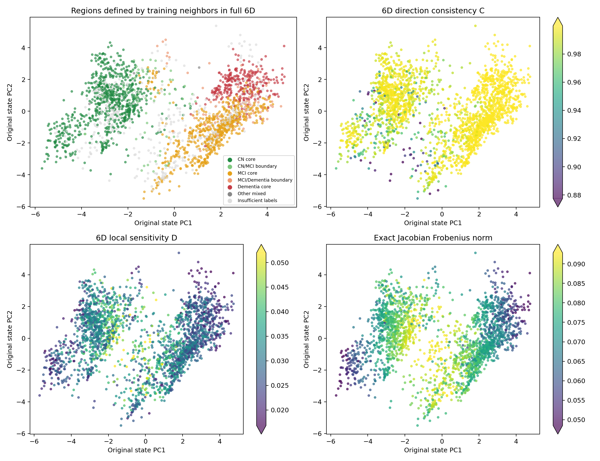
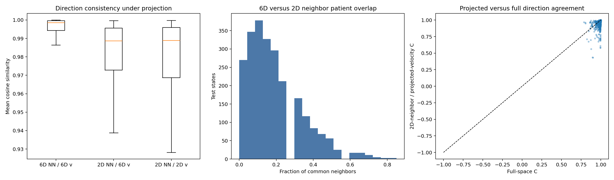
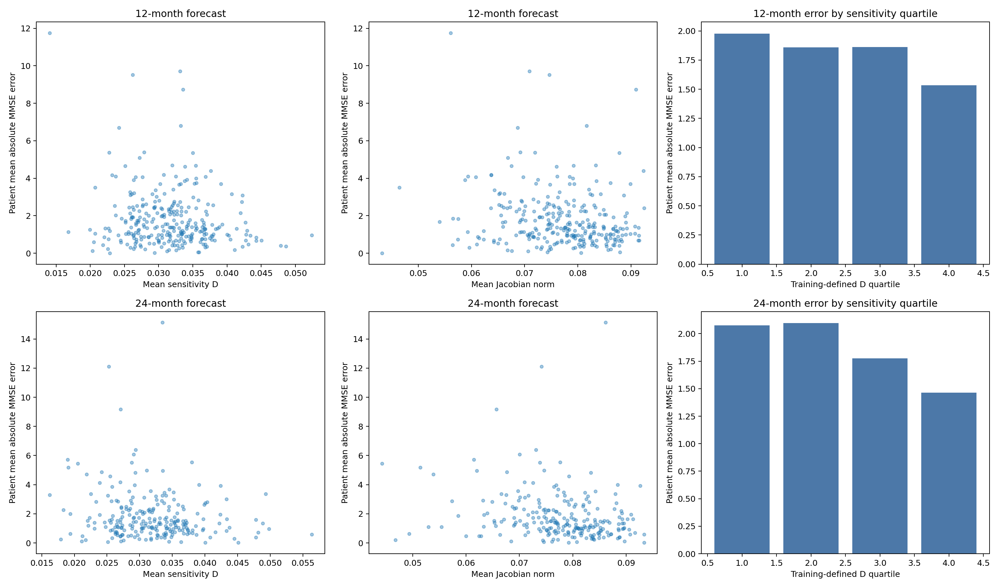

# 实验 B：高维局部速度一致性与长期预测误差

## 1. 从六维邻域研究相似患者的演化

本实验沿用原始 shared_matched（22,545参数，第56轮检查点）及其17,165个状态。每个状态对应一位患者某次历史截止点的估计。近邻距离直接在完整六维潜在空间中计算。

主邻域由20位不同训练患者构成：每位患者仅保留距查询状态最近的一个状态，查询患者自身的所有随访排除。验证集与测试集的近邻均来自训练集。另计算k=10和40的结果。

方向一致性C是查询状态与各邻居原始六维速度的余弦相似度平均值；局部敏感性D是速度差范数除以状态距离后的平均值。Jacobian范数使用共享向量场的完整6×6精确导数。

\[\bar C_i=\frac1k\sum_j\frac{f(z_i)^\top f(z_j)}{\|f(z_i)\|\|f(z_j)\|+\epsilon},\qquad D_i=\frac1k\sum_j\frac{\|f(z_i)-f(z_j)\|}{\|z_i-z_j\|+\epsilon}.\]

## 2. 五类核心区与交界区

区域由六维训练邻域中的诊断比例定义。某类占比至少80%为该类核心区；CN/MCI或MCI/痴呆两类合计至少80%、且各占至少20%为交界区，核心区优先。诊断有效邻居至少占80%。其余状态列为其他混合区或标签不足。



图中的坐标只用于显示，区域和数值都在六维空间中计算。色条范围取训练状态数值的1%–99%分位。

| 测试区域 | 状态数 | 患者数 | 平均C | C第10分位 | 平均D | 平均Jacobian范数 | 反向邻居占比 |
|---|---:|---:|---:|---:|---:|---:|---:|
| CN core | 747 | 184 | 0.989 | 0.975 | 0.032 | 0.077 | 0.000% |
| CN/MCI boundary | 66 | 42 | 0.973 | 0.922 | 0.036 | 0.080 | 0.000% |
| MCI core | 667 | 182 | 0.997 | 0.993 | 0.031 | 0.077 | 0.030% |
| MCI/Dementia boundary | 95 | 49 | 0.995 | 0.988 | 0.028 | 0.071 | 0.000% |
| Dementia core | 297 | 104 | 0.999 | 0.999 | 0.027 | 0.067 | 0.000% |
| Other mixed | 4 | 4 | 0.968 | 0.954 | 0.034 | 0.076 | 0.000% |
| Insufficient labels | 526 | 249 | 0.991 | 0.976 | 0.033 | 0.078 | 0.000% |

以C<0.9标记局部方向分歧，测试集中共有 26 个状态，占 1.08%。具体为：CN core 13个、Insufficient labels 7个、CN/MCI boundary 4个、MCI core 2个。

同一患者可在不同历史截止点进入不同区域。反向邻居指六维速度余弦小于0的邻居。

五类疾病区域的局部方向一致性均较高。其中CN/MCI交界的平均C最低、平均D最高；痴呆核心区的方向最一致，D和Jacobian范数也更小。

## 3. 二维投影怎样改变局部一致性

分别在六维状态和原PCA二维坐标中寻找20位不同患者。对于二维邻居，同时计算其六维原始速度和二维投影速度的方向一致性。



| 近邻空间 / 速度空间 | 测试平均C | C第10分位 |
|---|---:|---:|
| 6D neighbors / 6D velocities | 0.9927 | 0.9834 |
| 2D neighbors / 6D velocities | 0.9769 | 0.9448 |
| 2D neighbors / projected velocities | 0.9740 | 0.9386 |
| Random distinct training patients / 6D velocities | 0.7308 | 0.5549 |

两种近邻列表中相同患者的平均占比为 **18.77%**。二维坐标保留原状态53.01%的方差，其邻域组成与六维邻域存在上述差异。

随机参照从20位不同训练患者中取状态，排除查询患者本人；每位训练患者的代表状态以固定种子随机选择。它用于比较相邻患者与一般患者之间的方向一致性。

六维近邻的原始速度一致性高于二维近邻，因此当前平滑结构在完整状态空间中同样存在。二维位置接近会引入一批在六维空间中较远的患者。

## 4. 用未来12、24个月的真实MMSE评价预测

对每个历史截止点，在目标月份±3个月窗口内选择最接近目标日期、且有真实MMSE的下一次检查。模型只使用截止点及之前的历史，沿六维ODE直接推进到目标检查的实际时间。误差为预测MMSE与真实MMSE的绝对差，单位为分。时间沿用原季度聚合数据。

主相关分析先按患者汇总：D和Jacobian取该患者各有效起点的平均值，E取相应预测绝对误差的平均值。按患者重抽样1000次给出95%区间。调整相关性使用秩残差，控制年龄、实际间隔、历史次数、最近MMSE及其缺失和时间间隔、性别、当前诊断构成。

| 预测时长 | 测试患者 / 起点 | MMSE MAE（患者等权） | D与误差Spearman | 95%区间 | 调整后相关 | 95%区间 |
|---|---:|---:|---:|---|---:|---|
| 12个月 | 289 / 1022 | 1.803 | -0.102 | [-0.225, 0.023] | 0.107 | [-0.016, 0.218] |
| 24个月 | 237 / 698 | 1.850 | -0.137 | [-0.262, -0.008] | 0.025 | [-0.113, 0.157] |



图中每个散点是一位患者。四分组的D边界由相应时长的训练患者确定；柱高为测试患者的平均MMSE绝对误差。

| 预测时长 | Jacobian与误差Spearman | 95%区间 | 调整后相关 | 95%区间 |
|---|---:|---|---:|---|
| 12个月 | -0.173 | [-0.296, -0.053] | 0.038 | [-0.076, 0.147] |
| 24个月 | -0.272 | [-0.391, -0.142] | -0.112 | [-0.241, 0.014] |

D与误差的原始相关性为弱负相关，控制当前患者信息后接近零；调整后95%区间都覆盖零。Jacobian范数与误差也没有呈现正向递增关系。敏感性四分组图中，D最高组的平均误差反而较低。

区域对比有助于理解这一关系：痴呆核心区的速度场更一致、D更小，但预测误差更大。下面按预测起点列出区域误差，单位为MMSE分。

| 测试区域 | 12个月起点数 | 12个月MAE | 24个月起点数 | 24个月MAE |
|---|---:|---:|---:|---:|
| CN core | 246 | 0.922 | 230 | 0.986 |
| CN/MCI boundary | 27 | 1.354 | 17 | 1.604 |
| MCI core | 363 | 1.777 | 252 | 1.920 |
| MCI/Dementia boundary | 39 | 2.401 | 15 | 2.046 |
| Dementia core | 127 | 2.643 | 59 | 3.349 |
| Other mixed | 0 | — | 0 | — |
| Insufficient labels | 220 | 1.786 | 125 | 1.403 |

## 5. 邻域大小与区域误差

| k | 测试平均C | 测试平均D | 12个月D与误差相关 | 24个月D与误差相关 |
|---|---:|---:|---:|---:|
| 10 | 0.9955 | 0.0313 | -0.074 | -0.115 |
| 20 | 0.9927 | 0.0312 | -0.102 | -0.137 |
| 40 | 0.9870 | 0.0308 | -0.167 | -0.231 |

区域的12/24个月误差见 [region_forecast_errors.csv](region_forecast_errors.csv)，敏感性四组见 [sensitivity_quartiles.csv](sensitivity_quartiles.csv)。

## 6. 本实验对动力学规整化的启示

当前检查点已经具有较高的六维局部一致性。五类区域中，较大的局部敏感性没有对应更大的长期预测误差；控制诊断、最近MMSE等信息后，这种相关接近零。实验B因此没有建立“局部速度变化剧烈导致长期误差更大”这一关系。

结合 [实验A](../shared_matched_clinical_velocity/report.zh-CN.md)，当前更明显的误差现象是临床变化幅度偏小，尤其在痴呆组。现有Jacobian正则消融将直接比较预测指标与平滑程度；本实验提供了其基线状态和后续对照指标。

## 7. 原始结果与复现

所有近邻搜索、向量场、Jacobian及ODE预测在物理GPU 2（NVIDIA GeForce RTX 4090）上完成。CPU用于数据整理、统计汇总、bootstrap及绘图。模型没有重新训练。

[状态级数值](state_local_metrics.csv) · [近邻索引与完整数值](neighborhoods.npz) · [预测起点与误差](forecast_errors.csv) · [患者级汇总](patient_forecast_summary.csv) · [完整指标](metrics.json) · [检查与设备记录](provenance.json)

```bash
CUDA_VISIBLE_DEVICES=2 /home/xjh/miniforge3/envs/ode/bin/python \
  -m paper_odeae.diagnostics.local_dynamics --gpu 2
```
