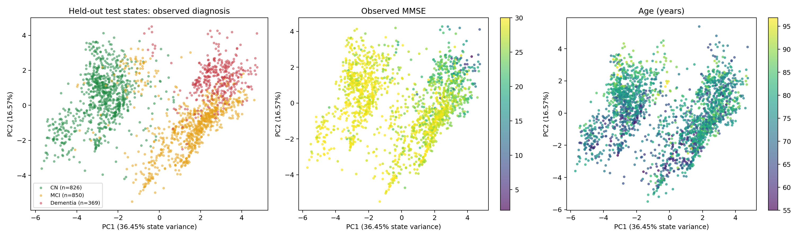
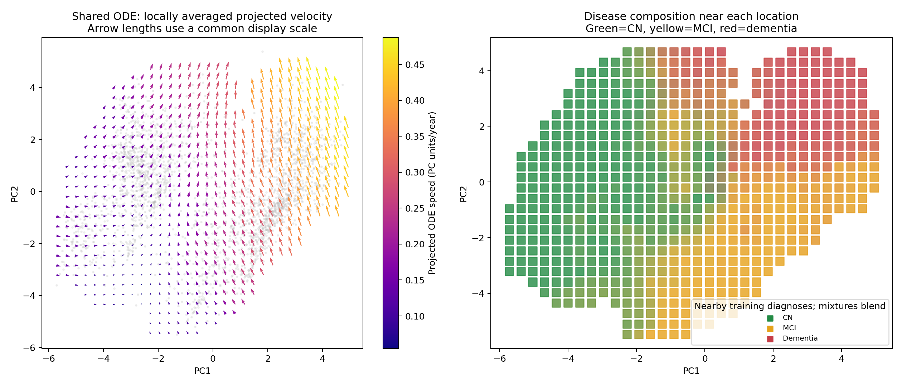
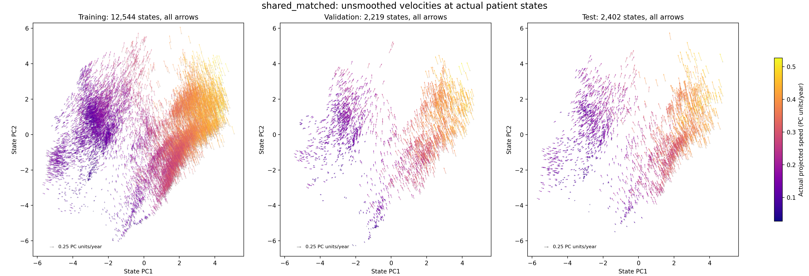
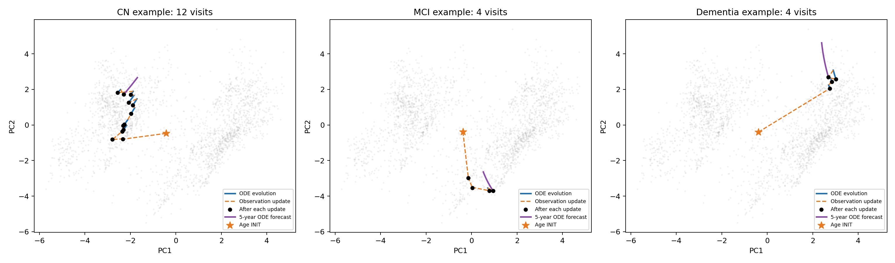

# shared_matched 的状态空间与共享速度场

## 1. 我们要看什么

shared_matched 用 6 个数表示患者状态，并学习一个共享函数 `f(z)`。给定当前位置 `z`，这个函数输出状态每年变化的方向和速度。遇到检查时，UPDATE 再根据观测修正位置。

因此可以从三个角度看模型：患者状态分布在哪里，各位置的 ODE 指向哪里，以及一位患者怎样在连续演化和观测更新之间移动。本次使用已完成的 shared_matched 第 56 轮检查点，不重新训练模型。

## 2. 怎样把六维状态画成二维

对每位患者，依次提供前一次、前两次、前三次等全部可用历史，分别提取读取历史后的状态。例如，一名患者有 5 次检查，就产生 5 个截止点状态。每个点表示一次状态估计，不是一个独立患者。

共提取 2,900 名患者的 17,165 个状态：训练集 12,544 个，验证集 2,219 个，测试集 2,402 个。所有检查都采用原缺失掩码，没有使用训练时的随机输入丢弃。

只使用训练集状态拟合 PCA，确定两个投影方向。验证集、测试集、ODE 速度和患者轨迹全部使用这两个相同方向。这样不会为了让测试诊断分组好看而选择坐标。这里没有逐维标准化，也没有使用诊断监督降维。

前两维分别保留 36.45% 和 16.57% 的状态方差，合计 **53.01%**。六维状态仍有约 47% 的变化没有出现在图里。因此这是一张主要结构的投影图，二维中接近的点在另外四维可能不同。

## 3. 状态空间里确实出现了疾病相关区域



三幅图使用相同的投影方向。左图按当前检查的诊断着色，中图按当前检查的 MMSE 着色，右图按年龄着色。诊断或 MMSE 缺失的点不参加相应面板的着色；年龄图仍保留这些点。左、中图与右图的坐标显示范围会因有效点不同而略有差异。

测试集左图可以看到：认知正常 CN 主要集中在左侧，MCI 主要分布在右下方，痴呆主要分布在右上方。MCI 与另外两类有交叠，区域之间没有清楚的硬边界。对应的平均位置和平均 MMSE 如下。

| 当前诊断 | 有该诊断的测试状态数 | 平均 PC1 | 平均 PC2 | 其中有 MMSE 者的平均分 |
|---|---:|---:|---:|---:|
| CN | 826 | -2.786 | 0.383 | 28.97 |
| MCI | 850 | 1.417 | -1.068 | 27.51 |
| 痴呆 | 369 | 2.740 | 1.552 | 21.79 |

其余 357 个测试截止点在当前检查处没有诊断标签，没有向前填充历史诊断。表中的状态数包含同一患者的多次检查。MMSE 均值只用于描述本次图中的观测，不是模型预测分数。

这些结果支持将某些区域解释为“更常对应某类疾病状态的位置”。诊断与 MMSE 本来就是输入字段，状态又需要重建这些字段，所以这也说明模型保留了已有诊断和认知信息。当前图不能作为独立发现疾病亚型或临床分期边界的证据。

## 4. 箭头怎样表示速度场

### 4.1 平滑版：观察各区域的整体演化方向



先在每个真实六维状态上计算 ODE 速度，再投影到二维。如果投影为 `y = Pᵀ(z - mean)`，则投影速度正好是 `dy/dt = Pᵀ f(z)`。这一步保留真实六维 ODE 在两个显示方向上的分量，不需要把二维网格人为还原成某个六维位置。

左图把附近训练状态的真实投影速度作加权平均，用箭头显示局部方向。箭头颜色表示投影速度，单位为 PC 坐标单位/年；箭头长度使用统一的显示缩放，不能直接当作一年后的位移。邻域采用最近的 30 个训练状态，缺少附近训练样本的位置留白。灰色背景为测试状态，速度箭头和邻域规则均由训练状态构建。

右图显示同一邻域内训练状态的诊断构成：绿色偏 CN，黄色偏 MCI，红色偏痴呆，混合颜色表示多类共存。它是样本标签的局部统计，不是额外训练的疾病分类器，也不是模型给出的诊断概率。

两个显示方向保留了全部提取状态上约 **69.62% 的速度平方和**。有支持样本的网格中，局部投影方向一致性中位数约为 **0.989**；这里的一致性是“平均速度的长度 / 各速度长度的平均值”，接近 1 表示附近投影速度大体同向。

实际速度由完整的六维状态 `z` 决定。这张网格图通过局部平均呈现整体演化方向；后面的患者轨迹在六维空间求解，再投影展示。

### 4.2 未平滑版：直接查看每个患者状态的真实速度

下面把每个真实状态自身的速度直接画出来。对于状态 `zᵢ`，先计算共享 ODE 输出 `f(zᵢ)`，再用原来的 PCA 矩阵投影到二维，在该状态的位置画一支箭头：

```text
箭头起点：yᵢ = Pᵀ(zᵢ − mean)
箭头向量：vᵢ = Pᵀ f(zᵢ)
```



三个面板依次展示训练集 **12,544** 个、验证集 **2,219** 个和测试集 **2,402** 个状态。全部状态逐点绘制，每支箭头直接对应模型在该状态上的输出，没有近邻平均、网格插值或抽样。

三幅图共用坐标范围、颜色范围和速度标尺：箭头朝向表示瞬时演化方向，长度与二维投影速度等比例，颜色越偏黄表示速度越大。左下角标尺为 **0.25 PC 坐标单位/年**。完整轨迹由持续积分得到。

原始箭头呈现出与平滑图相同的主要结构：左侧区域速度较小，右侧区域速度较大；中间及下方区域的方向随位置逐渐变化。逐点图还保留了邻近状态之间的方向和速度差异。二维位置接近的状态，在另外四个潜在维度上仍可以不同，因此其箭头也可以不同。

两种图的分工如下：

| 版本 | 箭头位于哪里 | 箭头来自哪里 | 主要用途 |
|---|---|---|---|
| 平滑版 | 有样本支持的网格位置 | 附近 30 个训练状态的加权平均速度 | 看整体方向与区域结构 |
| 未平滑版 | 每个真实患者状态的位置 | 该状态自身的 ODE 输出 | 看实际样本上的速度与局部差异 |

未平滑图仍使用同一组状态 PCA 方向，保留 **69.62%** 的六维速度能量。[逐点速度数据](velocity_field_raw.npz) 保存每个箭头的起点、六维速度、二维投影速度及速度大小；[计算记录](velocity_field_raw.json) 保存检查点哈希、CUDA 设备和与原速度数据的核对结果。

### 4.3 从潜在速度读取 MMSE 的真实分数变化

沿用上述状态和坐标，现有 DECODER 可以把潜在位置映射为 MMSE 分数。将临床预测头的梯度与 ODE 速度相乘，就得到每个位置的 MMSE 瞬时年变化率：`dMMSE/dt = ∇g(z)ᵀf(z)`。

[临床速度实验 A](../shared_matched_clinical_velocity/report.zh-CN.md) 已完成潜在速度、预测 MMSE 年变化率和真实随访变化率的三幅平行图，并按相邻检查区间评价预测。测试集覆盖 286 位患者、1,086 个有效相邻 MMSE 间隔，年变化率 MAE 为 1.894 分/年，Pearson 相关系数为 0.299。

MCI区域向左上移动的状态中，模型预测的MMSE瞬时年变化率平均为 −0.379 分/年。完整报告还比较了不同诊断区域、随访间隔长度以及较快下降患者的排序效果。

针对Dementia下降预测偏慢，[三因素机制分析](../mmse_decline_mechanism/report.zh-CN.md) 继续将临床速率拆成潜在速度、MMSE头梯度和方向投影，并沿随访轨迹计算各自贡献。

### 4.4 相邻状态是否具有相似演化规律

[局部动力学实验 B](../shared_matched_local_dynamics/report.zh-CN.md) 在完整六维状态中寻找20位不同训练患者的近邻，逐点计算原始速度余弦一致性、速度差/状态距离，以及Jacobian范数。测试平均方向一致性为0.9927，随机不同患者参照为0.7308。

该实验还将局部敏感性与12/24个月MMSE预测误差关联，提供核心区、交界区的统计及控制当前临床状态后的相关性结果。

## 5. 连续演化和位置跳变可以分开看



每幅图代表一位测试患者，分别以最后一次检查的 CN、MCI、痴呆作为示例类别。每类按患者编号排序，选择第一位至少有 4 次检查的患者，没有按轨迹是否漂亮筛选。

- 橙色星号：年龄 INIT 给出的初始位置。
- 蓝色实线：两次检查之间沿共享 ODE 连续演化。
- 橙色虚线：读入检查结果后，UPDATE 对状态估计的修正。
- 黑点：每次观测更新后的状态。
- 紫色线：从最后状态出发，不再读取新观测，沿 ODE 外推 5 年。

第一次观测前没有经过时间，第一次橙色跳变可以很大：它把只含年龄信息的初步估计，更新为包含首次检查信息的状态。后续的跳变也是估计修正，不表示疾病在检查瞬间发生了突变。

这三条历史轨迹各自固定一次 INIT，然后顺序吸收完整历史。它们与“每个历史截止点重新初始化后得到的状态散点”有所不同：后者会随截止年龄重新计算 INIT，不能把散点按患者直接连起来，就称为一次连续的 ODE 演化。

紫线表示模型外推，不是未来真实检查，也没有在这里验证 5 年预测准确性。图中没有强制的 CN→MCI→痴呆路线；区域差异与完整自然病程是两个需要分别检查的问题。

## 6. 交互查看与可复现记录

[打开交互式状态空间](interactive.html)，可切换患者划分，按诊断、MMSE、年龄着色，缩放、拖动并悬停查看单个状态。勾选箭头后，显示各真实状态自身的投影速度，未进行邻域平均。HTML 不依赖网络，也不在浏览器执行模型推理。

原始状态提取、ODE 求解、PCA 和近邻计算在物理 GPU 0 的 RTX 4090 上执行；新增未平滑图的逐点速度在物理 GPU 1 上重新计算。模型与计算张量均使用 CUDA。可视化与训练任务独立运行，CPU 用于文件处理、统计汇总和绘图。

提取器已在第一批数据上与原模型 `forward` 的最终状态逐元素核对，结果完全相同。轨迹示例采用分段细采样，最终状态与原编码器通过容差核对。检查点、数据哈希、设备和投影统计保存在 [statistics.json](statistics.json)；原始六维状态、速度、二维坐标和投影矩阵保存在 [states.npz](states.npz)。

复现命令：

```bash
CUDA_VISIBLE_DEVICES=0 /home/xjh/miniforge3/envs/ode/bin/python \
  -m paper_odeae.diagnostics.state_space --gpu 0
```

状态分布、平滑速度场、未平滑速度场和患者轨迹均提供 PNG、SVG、PDF 版本。原可视化代码位于 [state_space.py](../../diagnostics/state_space.py)。新增未平滑图使用原有状态数据，在 GPU 上重新计算逐点速度，代码位于 [raw_velocity_field.py](../../diagnostics/raw_velocity_field.py)：

```bash
CUDA_VISIBLE_DEVICES=1 /home/xjh/miniforge3/envs/ode/bin/python \
  -m paper_odeae.diagnostics.raw_velocity_field --gpu 1
```
