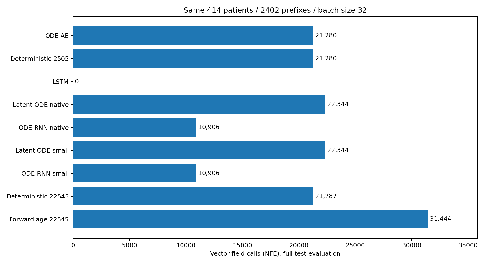

# 各模型 ODE 数值步数与向量场调用比较

本次使用完整测试集的 414 位患者，枚举全部 2402 个历史截断，batch size 32，共 76 批。四张 RTX 4090 分配独立诊断任务，所有模型均在 CUDA 上执行，未训练或修改检查点。

这里只统计一次完整评估的前向求解开销，不是历史累计训练步数。所有任务使用当前 Tsit5 实现，rtol=1e-4、atol=1e-6。计数器开关前后的首批预测逐位相同。

## 1. 这些计数分别是什么意思

- 积分调用：模型要求解一个时间区间的次数，包含整批时间间隔为零而直接返回的情况。
- 非零积分：该批至少一个患者有非零间隔，求解器实际进行数值步。
- 接受步：误差检查通过并推进了时间的数值步；拒绝步只花计算，没有推进时间。
- NFE：向量场网络的前向调用次数。当前实现每个尝试步调用7次，因此 NFE=7×（接受步＋拒绝步）。解码器、GRU、MLP更新和反向传播不包含在内。

这些是批向量化调用计数。不同患者的积分共享批内步长控制，不能理解成每个人分别独立求解的次数。换批量大小、患者分组或容差后，数字可能变化。

## 2. 完整测试集比较

| 模型 | 可训练参数 | 检查点轮次 | 积分调用 | 非零积分 | 接受步 | 拒绝步 | NFE |
|---|---:|---:|---:|---:|---:|---:|---:|
| ODE-AE | 3,003 | 50 | 1,596 | 1,520 | 3,040 | 0 | 21,280 |
| Deterministic 2505 | 2,505 | 82 | 1,596 | 1,520 | 3,040 | 0 | 21,280 |
| LSTM | 4,469 | 44 | 0 | 0 | 0 | 0 | 0 |
| Latent ODE native | 62,065 | 29 | 1,596 | 1,596 | 3,192 | 0 | 22,344 |
| ODE-RNN native | 22,545 | 56 | 779 | 779 | 1,558 | 0 | 10,906 |
| Latent ODE small | 7,641 | 154 | 1,596 | 1,596 | 3,192 | 0 | 22,344 |
| ODE-RNN small | 2,719 | 88 | 779 | 779 | 1,558 | 0 | 10,906 |
| Deterministic 22545 | 22,545 | 76 | 1,596 | 1,520 | 3,041 | 0 | 21,287 |
| Forward age 22545（训练中快照） | 22,545 | 84 | 2,489 | 2,246 | 4,492 | 0 | 31,444 |

零初始化正向版本若尚未生成正式检查点，则不填写数值，不用随机初始化或单轮检查替代。LSTM 无 ODE，故为0，但不意味着它没有递归计算成本。



## 3. 编码和生成分别用了多少步

| 模型 | 阶段 | 非零积分 | 接受步 | 拒绝步 | NFE |
|---|---|---:|---:|---:|---:|
| ODE-AE | encoder | 741 | 1,482 | 0 | 10,374 |
| ODE-AE | generator | 779 | 1,558 | 0 | 10,906 |
| Deterministic 2505 | encoder | 741 | 1,482 | 0 | 10,374 |
| Deterministic 2505 | generator | 779 | 1,558 | 0 | 10,906 |
| Latent ODE native | encoder | 741 | 1,482 | 0 | 10,374 |
| Latent ODE native | generator | 855 | 1,710 | 0 | 11,970 |
| ODE-RNN native | recurrent_dynamics | 779 | 1,558 | 0 | 10,906 |
| Latent ODE small | encoder | 741 | 1,482 | 0 | 10,374 |
| Latent ODE small | generator | 855 | 1,710 | 0 | 11,970 |
| ODE-RNN small | recurrent_dynamics | 779 | 1,558 | 0 | 10,906 |
| Deterministic 22545 | encoder | 741 | 1,482 | 0 | 10,374 |
| Deterministic 22545 | generator | 779 | 1,559 | 0 | 10,913 |
| Forward age 22545 | encoder | 741 | 1,482 | 0 | 10,374 |
| Forward age 22545 | generator | 1,505 | 3,010 | 0 | 21,070 |

## 4. 如何理解差异

绝大多数非零区间都只接受2步、没有拒绝。当前求解器把每次区间归一到[0,1]，从0.25开始尝试，误差足够小时第二步可覆盖剩余0.75。因此2步是当前起步策略下的最低常见值，不是每年固定走2步。完整统计中，22,545参数的反向确定性模型有一个区间用了3步，其余区间为2步。

ODE-RNN只有一条随时间递推的动力学；ODE-AE包含历史编码和轨迹生成两条求解路径，所以总NFE约为ODE-RNN的两倍。扩大网络并没有使接受步数明显增加，但每次向量场调用更贵，不能根据NFE相同就认定耗时相同。

Latent ODE比原ODE-AE多一次从截止点回到首次检查的生成积分；这同时避免了原ODE-AE编码首步的全零间隔。原容量与小容量Latent ODE本次恰好具有相同的步数分布。

正向截止点锚定模型分别重建过去和生成未来，且一个批中的患者截断点不同，所以会增加批积分调用。按“接受步×非零间隔患者数”计算，正向年龄版本为48,954，与小确定性ODE-AE相同；其批NFE更高主要体现了分批和掩码路径的开销，不应说成每位患者的有效积分区间都变多。这个加权量也不是独立单患者求解的实测步数。

当前诊断与正式训练共用GPU，记录的墙钟时间不用于公平速度排名。不同模型的状态维度、隐藏层宽度、层数、时间单位以及解码/递归更新成本也不同。ODE-AE用年，Latent ODE/ODE-RNN保留十年单位；同一容差不能保证训练先验完全等价。

尚未结束的正向年龄模型使用诊断当时的稳定best.pt快照，最终模型的步数可能改变。历史训练没有记录逐批NFE，不能用本次评估计数乘以训练轮数来冒充训练总开销。

## 5. 文件和复查

`summary.json`和各`job_*.json`保存每模型设备、检查点轮次、阶段计数和每次非零积分接受步数的直方图；`comparison.csv`用于表格处理。`counter_verification.json`额外检验了出现拒绝步时的NFE计数，并与真实函数调用次数逐一吻合。

```bash
conda activate ode
python -m paper_odeae.diagnostics.solver_steps
```
