# 八组模型的状态空间、速度场与轨迹比较

## 1. 本次如何建立共同对照

我们已经用 shared_matched 六维模型观察了患者状态、ODE 速度和观测更新。本次将同一套流程扩展到 HealthFlux-kl、四组 latent2x、概率 ODE-AE、Latent ODE 和 ODE-RNN，并把原 shared_matched 作为第九个参照面板。所有检查点均来自已经完成的 seed 0 实验。

HealthFlux-kl使用[共同ADNI任务适配](../../../healthflux/README.zh-CN.md)中KL=0.01的paper_kl检查点；Latent ODE和ODE-RNN使用此前native容量组；ODE-AE使用原概率版本。latent2x baseline不加新增损失，both加入0.01×weak_prior与0.01×Jacobian，prior与jacobian分别只加对应一项。参数、检查点轮次和同任务误差见下一节。

各模型读取完全相同的患者和历史截止点：2,900位患者、17,165个状态，其中训练12,544个、验证2,219个、测试2,402个。每个点代表一次截止历史后的状态估计。同一患者可以贡献多个点。测试状态中有CN 826个、MCI 850个、Dementia 369个，另外357个当次诊断缺失；没有用历史诊断补填。

每个模型只在自己的训练状态上拟合不做逐维标准化的PCA，再投影验证、测试、速度和轨迹。九宫格中的每幅图使用该模型自己的坐标和标尺；模型之间比较诊断结构、投影保留率、方向一致性和同一患者的轨迹。原六维 shared_matched 直接沿用此前的PCA均值、基向量和方向。

### 先明确图中的“状态”

| 模型 | 本次主图的状态 | 原维度 | 观测怎样进入状态 | 速度换算 |
|---|---|---:|---|---|
| HealthFlux-kl | ODE直接推进的确定性状态h | 256 | 先诊断事件、再其他模态，Gaussian后验与GRU更新 | 原十年速度÷10 |
| latent2x四组 | 历史截止处UPDATE后的共享状态z | 28 | 正向逐次吸收历史 | 原速度已是每年 |
| 概率ODE-AE | 从初始后验均值生成、推进到截止时刻的状态z | 6 | 反向编码历史后，生成状态轨迹 | 原速度已是每年 |
| Latent ODE | 历史截止处生成后验的均值z | 32 | 64维编码器吸收历史，产生32维生成状态 | 原十年速度÷10 |
| ODE-RNN | 当前观测更新后的GRU隐藏状态h | 32 | 正向ODE与观测GRU交替 | 原十年速度÷10 |
| shared_matched参照 | 历史截止处UPDATE后的共享状态z | 6 | 正向逐次吸收历史 | 原速度已是每年 |

HealthFlux另保存完整384维解码表示r=LN([h,z])的状态图，见第5节。主速度图使用256维h，因为它是直接被ODE推进的位置。其速度在每条状态自己的实际年龄和背景条件下计算。

## 2. 先看同一任务上的定量结果

全部模型都重新在GPU上运行原验证和测试评分，并与已保存指标核对。下面的历史、未来与整体误差均是原40字段MSE与类别交叉熵按字段汇总的结果。它们沿用原训练选点，不根据本次可视化重新选择检查点。

| 模型 | 可训练参数 | 总参数 | 最佳轮次 | 验证整体 | 测试历史重构/预测 | 测试未来 | 测试整体 |
|---|---:|---:|---:|---:|---:|---:|---:|
| HealthFlux-kl | 5,156,722 | 5,156,722 | 3 | 1.38124 | 1.08439 | 1.60320 | 1.31157 |
| latent2x baseline | 44,875 | 44,875 | 44 | 0.74185 | 0.48877 | 1.02030 | 0.71963 |
| latent2x both | 44,875 | 44,875 | 81 | 0.74410 | 0.47174 | 1.00030 | 0.70254 |
| latent2x prior | 44,875 | 44,875 | 63 | 0.75347 | 0.47562 | 1.01822 | 0.71074 |
| latent2x jacobian | 44,875 | 44,875 | 40 | 0.75461 | 0.48824 | 1.02670 | 0.72135 |
| ODE-AE | 3,003 | 3,003 | 50 | 3.28726 | 3.01401 | 3.24780 | 3.11510 |
| Latent ODE | 62,065 | 72,266 | 29 | 2.84946 | 2.52461 | 2.83698 | 2.65936 |
| ODE-RNN | 22,545 | 32,746 | 56 | 1.28019 | 1.37076 | 1.12058 | 1.26406 |
| shared_matched 6D (reference) | 22,545 | 22,545 | 56 | 0.88722 | 0.62725 | 1.13926 | 0.85063 |

在这批固定检查点中，latent2x both的测试未来误差1.00030、整体误差0.70254均最低。用于选择检查点的验证整体误差则是latent2x baseline最低，为0.74185。

ODE-RNN的历史项是读取当前观测前的因果预测；其余模型的历史项利用截止历史进行重构。未来列使用各模型原生评测路径，其中ODE-RNN包含预测反馈更新。后面的纯ODE轨迹则把连续动力学单独取出观察。

### 二维图保留了多少信息

状态保留率衡量两维承载的训练状态方差。速度保留率在全部17,165个状态上统计，衡量真实高维速度在这两维中的平方和占比，与原报告口径一致。有效秩根据训练状态方差谱计算，用来描述状态实际占用了多少变化方向。最后一列对每位测试患者只取最后状态，在有真实诊断的354人上计算高维轮廓系数：正值越高，表示同类距离相对更小、异类距离相对更大。

| 模型 | 状态维度 | 两维状态方差 | 两维速度能量 | 状态有效秩 | 局部投影方向一致性中位数 | 最后状态诊断轮廓系数 |
|---|---:|---:|---:|---:|---:|---:|
| HealthFlux-kl | 256 | 51.23% | 0.82% | 10.64 | 1.0000 | 0.1175 |
| latent2x baseline | 28 | 40.55% | 12.72% | 13.05 | 0.9749 | 0.2097 |
| latent2x both | 28 | 39.28% | 7.60% | 13.40 | 0.9858 | 0.1821 |
| latent2x prior | 28 | 39.32% | 11.18% | 13.08 | 0.9901 | 0.1839 |
| latent2x jacobian | 28 | 46.99% | 14.16% | 11.06 | 0.9904 | 0.2359 |
| ODE-AE | 6 | 99.95% | 100.00% | 1.89 | 1.0000 | -0.0392 |
| Latent ODE | 32 | 82.12% | 71.06% | 3.38 | 1.0000 | 0.0892 |
| ODE-RNN | 32 | 39.15% | 7.56% | 13.34 | 1.0000 | 0.1538 |
| shared_matched 6D (reference) | 6 | 53.01% | 69.62% | 5.23 | 0.9890 | 0.2027 |

从完整状态的变化方向看，latent2x四组的有效秩为11.06～13.40，高于六维参照的5.23。扩容后的状态确实使用了更多变化方向，而前两维覆盖其中约39%～47%。

## 3. 状态空间怎样保留诊断与临床信息

所有模型都使用相同颜色：CN为绿色，MCI为黄色，Dementia为红色。诊断和MMSE都是已有观测字段；这些图检查模型是否在状态中保留了相应临床信息。

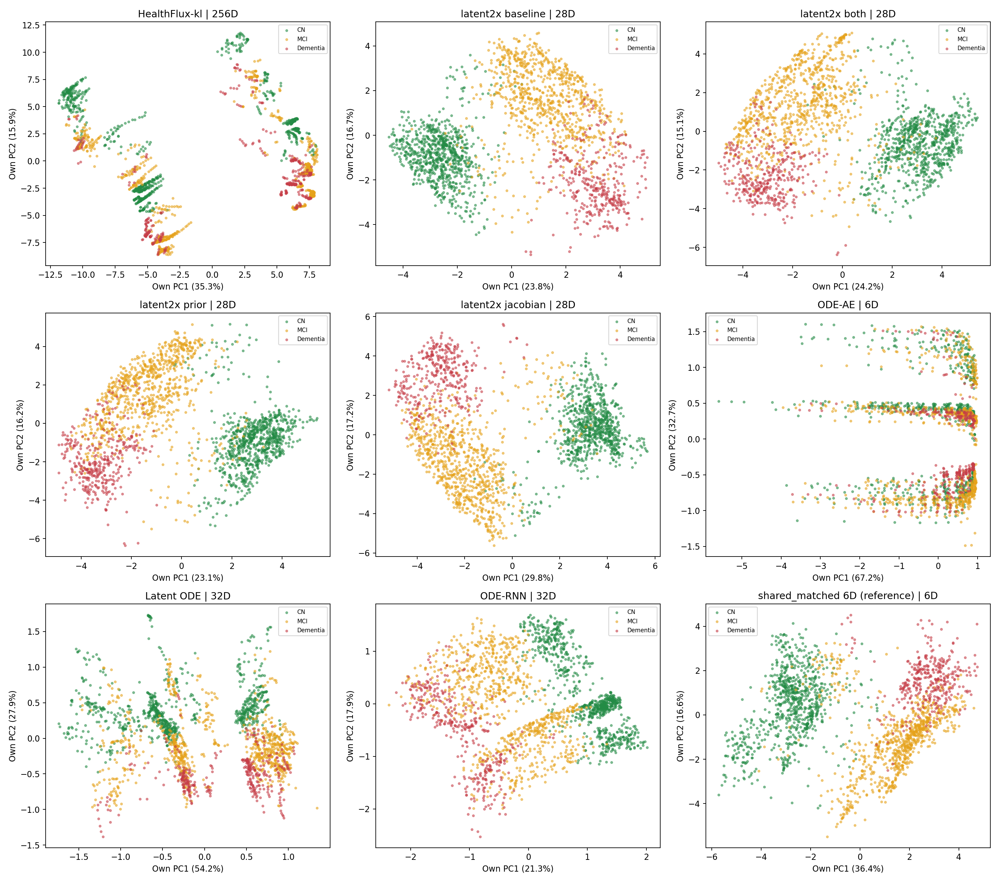

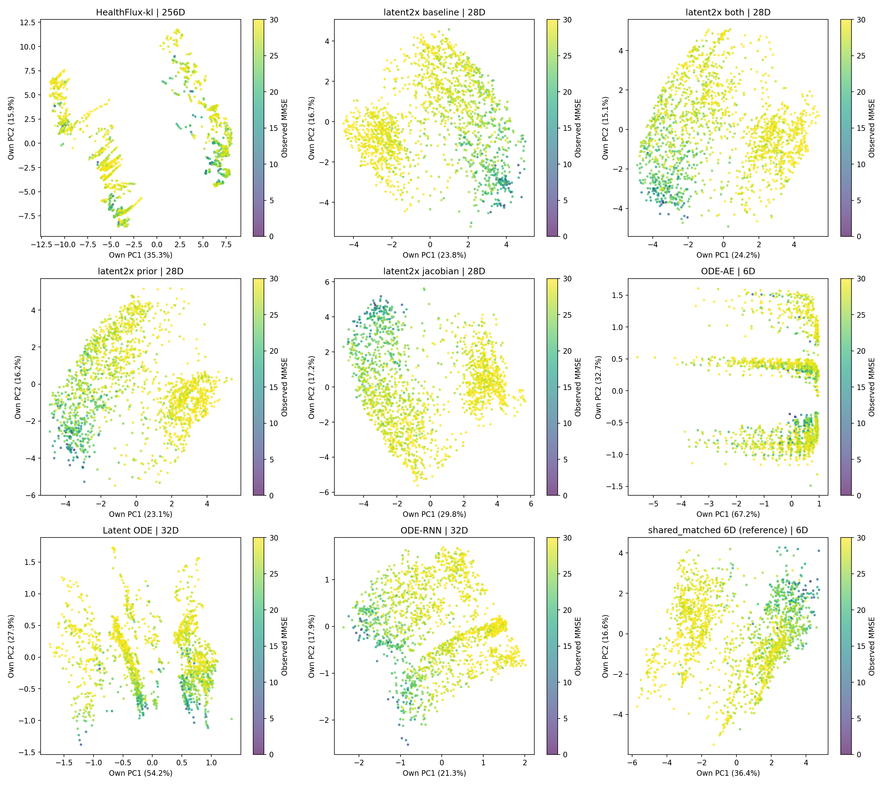

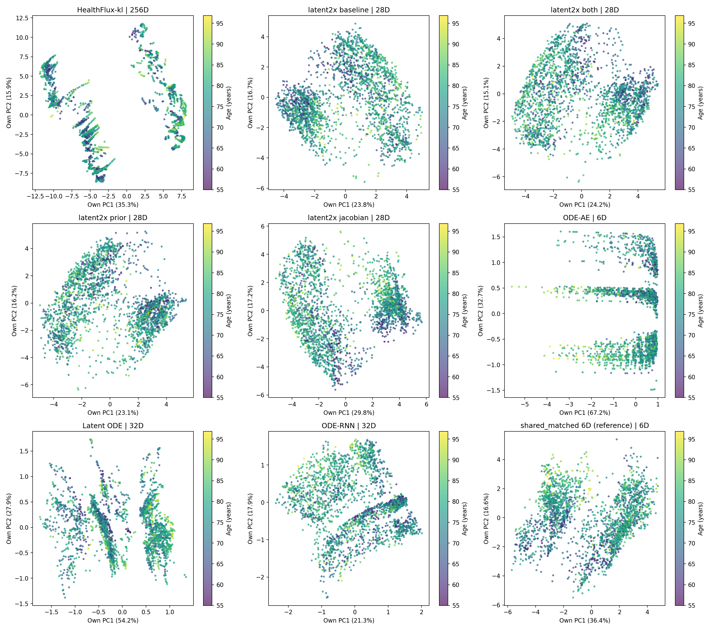

latent2x四组都保留了明显的CN、MCI、Dementia分组和交界。jacobian组的高维诊断轮廓系数最高，为0.2359；both组为0.1821，却有更低的测试未来误差。疾病分组清楚和未来字段预测准确，分别描述了表示与动力学的不同表现。

概率ODE-AE的前两维已经覆盖99.95%的状态变化，三种诊断仍明显交叠，高维诊断轮廓系数为−0.0392。Latent ODE前两维保留82.12%，图中也存在较多诊断混合。HealthFlux的主图则呈分支条带状，诊断分组在这些条带上交错分布。

## 4. 同时比较平滑场与每个真实状态的原始速度

先在每个完整状态上计算真实速度，再乘以该模型的PCA矩阵，得到二维速度。HealthFlux、Latent ODE、ODE-RNN的原时间单位是十年，已统一换算为每年。每幅图沿用自身的坐标单位，箭头使用该模型统一的显示缩放，色条显示原坐标单位/年的投影速度。

### 邻域平均：看整体方向

在训练状态的PCA平面中建立32×28网格，每个网格取最近30个训练状态的真实速度做加权平均。附近训练样本不足的位置留白。背景是测试状态，场的估计只使用训练状态。方向一致性是平均速度长度除以速度长度的加权平均，取值接近1表示邻域投影方向更一致。

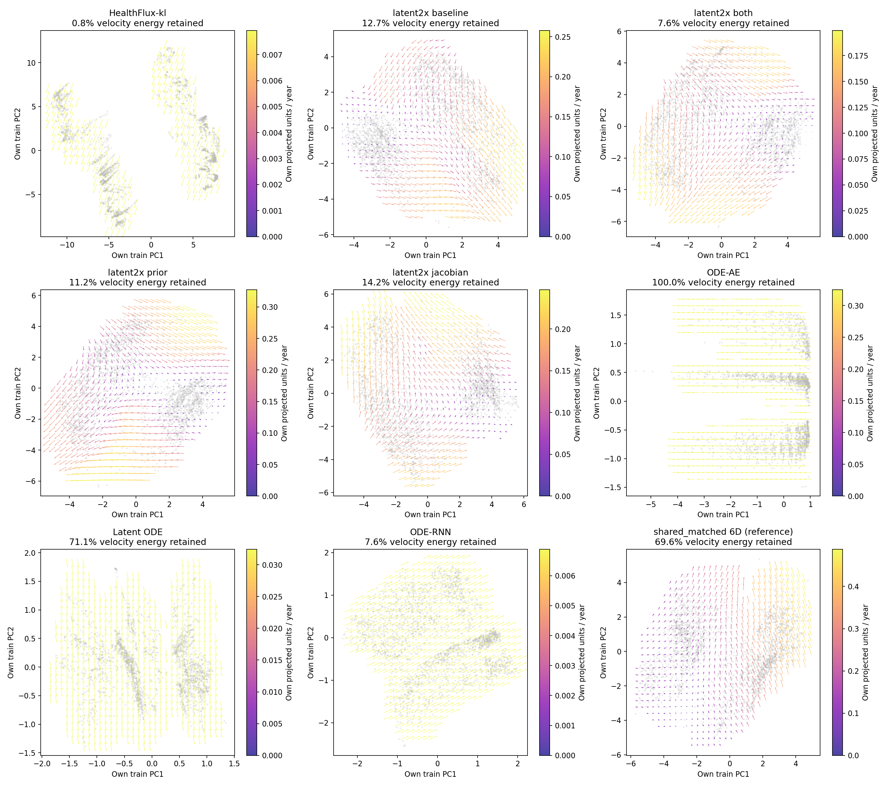

对应网格的诊断组成如下，三类邻居的比例直接混色：

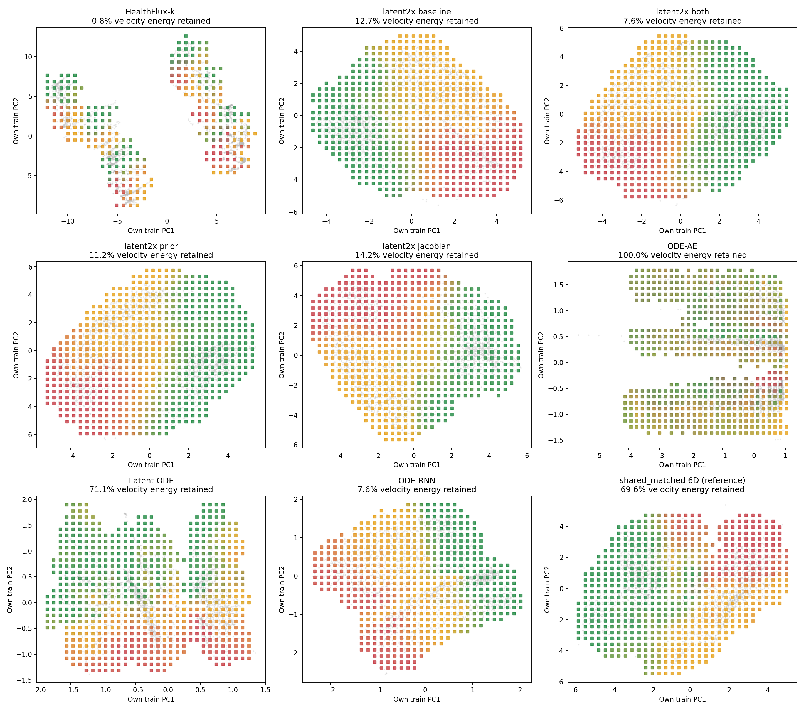

### 未平滑：看每个测试状态的实际输出

下面每支箭头都来自该测试状态自身的高维速度，不做平均。每组模型另外保存训练、验证、测试三幅全量原始箭头图，链接列于第9节。

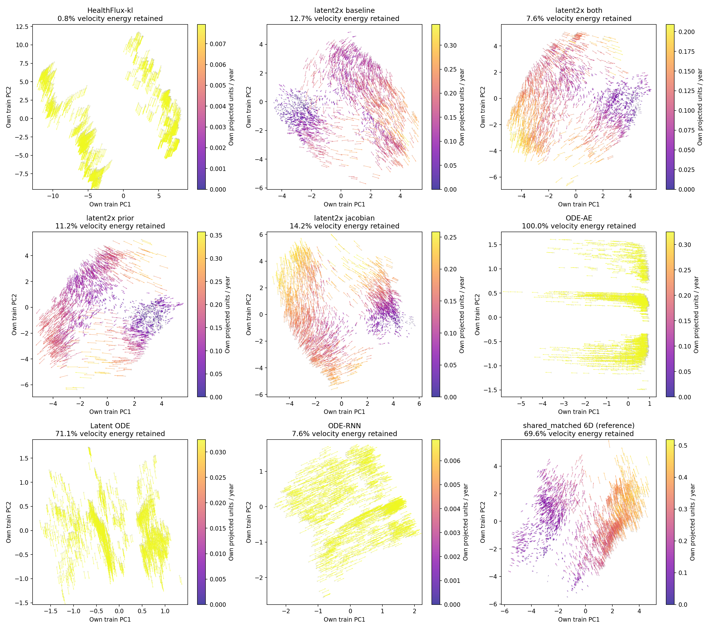

### 再换一个平面，把主要运动方向显示出来

状态PCA选择的是患者差异最大的方向；速度主平面选择的是ODE运动最集中的方向。这里对训练状态上的原始速度做未中心化SVD，保留平均流，取前两个方向。验证、测试和病例轨迹沿用同一投影。全部SVD与能量计算使用CUDA float64。

下表最后一列计算训练平均速度所占的能量比例：N‖平均速度‖²除以各状态速度平方和。接近100%表示采样位置上的速度方向和大小都接近共同值。

| 模型 | 状态PCA中的速度能量 | 速度主平面中的速度能量 | 该平面保留的状态方差 | 平均速度向量解释的训练速度能量 |
|---|---:|---:|---:|---:|
| HealthFlux-kl | 0.82% | 100.00% | 1.41% | 100.00% |
| latent2x baseline | 12.72% | 93.18% | 9.68% | 75.83% |
| latent2x both | 7.60% | 98.15% | 11.28% | 83.94% |
| latent2x prior | 11.18% | 95.52% | 15.35% | 72.58% |
| latent2x jacobian | 14.16% | 95.87% | 16.95% | 77.02% |
| ODE-AE | 100.00% | 100.00% | 69.28% | 100.00% |
| Latent ODE | 71.06% | 100.00% | 24.93% | 100.00% |
| ODE-RNN | 7.56% | 100.00% | 5.63% | 100.00% |
| shared_matched 6D (reference) | 69.62% | 99.83% | 49.86% | 69.25% |

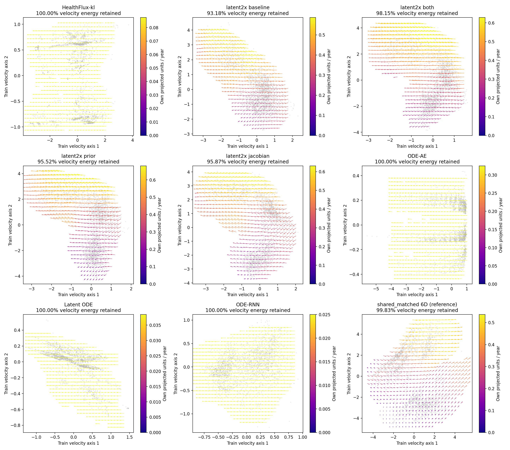

HealthFlux的状态PCA只保留0.82%的速度能量，换到速度主平面后保留约100%；latent2x四组从7.60%～14.16%提高到93.18%～98.15%。这说明它们的主要运动方向与最大状态差异方向并不重合。

HealthFlux-kl、Latent ODE、ODE-RNN的平均速度向量解释了几乎100%的训练速度能量，概率ODE-AE也超过99.99%。在本次采样的训练状态上，这些ODE速度接近共同方向的平移。latent2x四组的对应比例约为72.58%～83.94%，还保留了更多随位置改变的速度分量。

这也解释了为什么局部方向一致性接近1不直接对应最低预测误差：一组几乎恒定的速度也会高度一致。测试预测还取决于状态中保留的信息、观测更新、读出函数及原生未来反馈路径。

## 5. HealthFlux的256维ODE位置与384维完整健康表示

HealthFlux的h由ODE连续推进；随机部分z在有观测时取后验均值，在无观测查询时取先验均值。解码器使用二者经LayerNorm组成的384维表示。因此，本次提供h和完整表示r两套训练集PCA：前者配速度箭头，后者观察完整健康表示的临床信息。

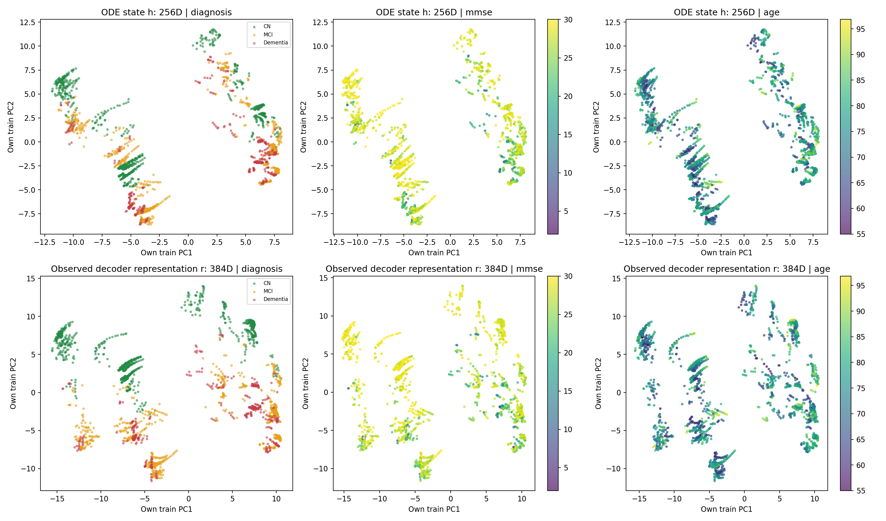

## 6. 固定同三位患者，看ODE与观测更新如何交替

病例沿用原shared_matched报告中的三位测试患者：CN示例003_S_4900、MCI示例002_S_4219、Dementia示例002_S_0619。类别来自完整记录的末次真实诊断，仅用于固定绘图名单。三位患者在所有模型中完全相同。

蓝线为历史时段的ODE轨迹，橙色虚线为真实观测导致的状态更新，黑点标记检查时刻的状态，紫线为末次状态出发的五年纯ODE外推。星号是这条轨迹的初始估计。

对正向模型，一条历史轨迹固定一次初始化，再依次吸收观测。shared_matched系列按原实现使用该次完整历史的截止年龄初始化。对概率ODE-AE和Latent ODE，主图使用生成状态空间，蓝线是整段历史条件下的生成轨迹；它们的观测编码器位于另一状态空间，因此主图没有橙色更新线。

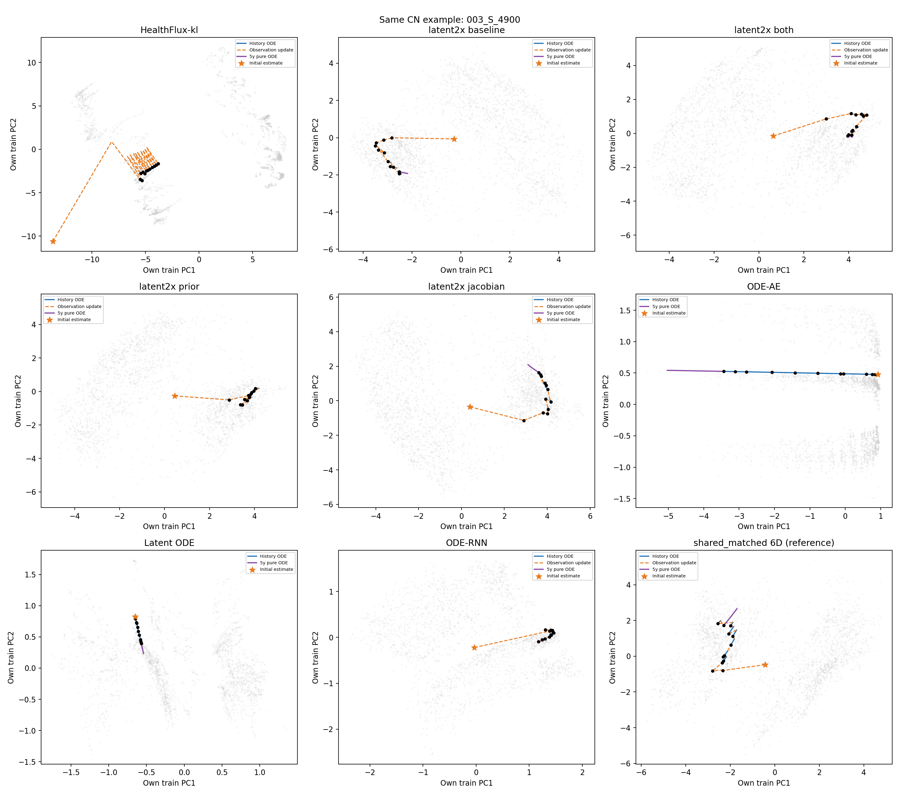

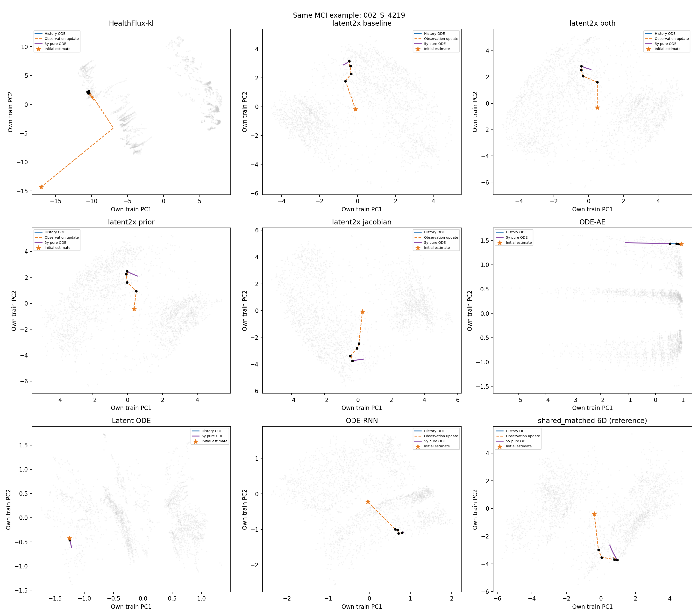

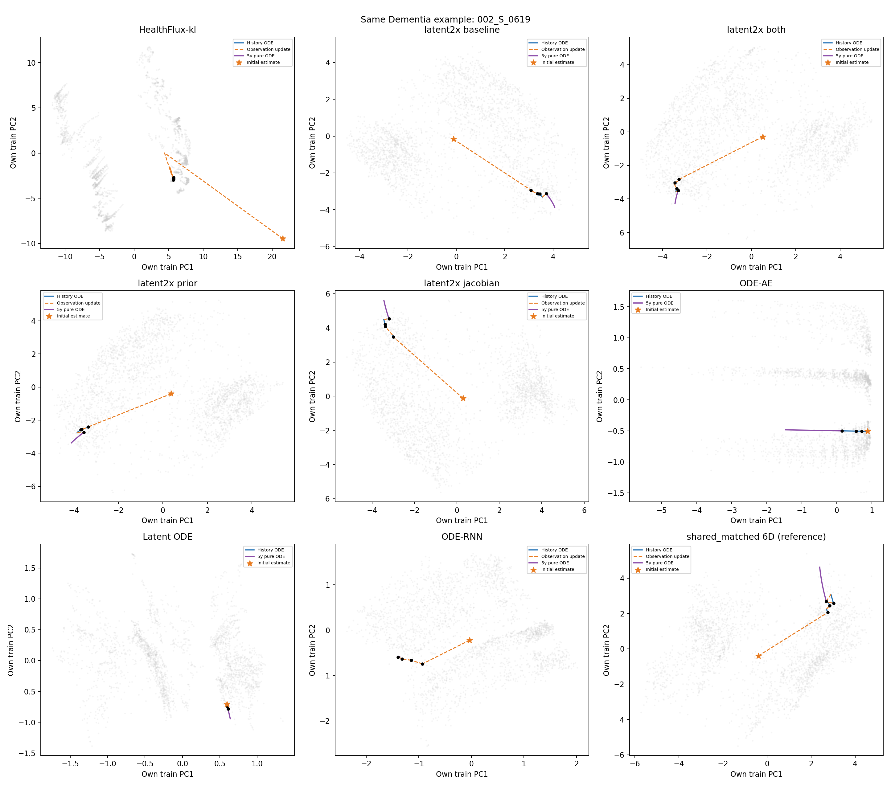

同一批轨迹也在速度主平面中投影：[CN病例](comparison_velocity_case_1.png) · [MCI病例](comparison_velocity_case_2.png) · [Dementia病例](comparison_velocity_case_3.png)。这组图更直接显示主要ODE位移。

## 7. 冻结前三次检查，比较后续MMSE曲线

这一步与上一节的完整历史展示分开：每个模型只读取同一患者的前三次检查，然后在之后五年内只沿ODE推进，曲线读取各自已有的MMSE输出。真实随访仅用于黑色星号。没有重新拟合临床预测头。

HealthFlux在0时刻用实心点标记观测后读出，用空心点标记同一h位置下的无观测先验读出；未来曲线从先验分支出发。ODE-RNN另外用绿色虚线方块画出原生协议在真实未来检查时点的预测反馈结果，实线展示纯ODE分量。

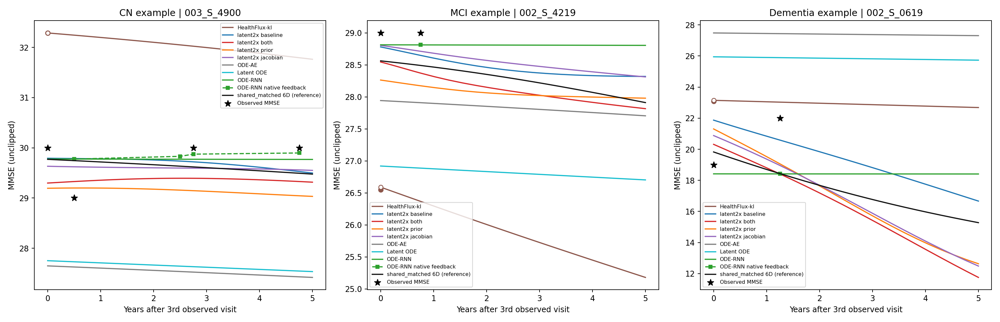

密集绘图查询不会替换真实检查间隔上的积分端点。HealthFlux仍使用原RK4，其他模型仍使用原自适应求解器；未来检查时点的读出已与原forward数值核对。

CN示例中，shared_matched和latent2x的输出更接近29～30分，HealthFlux起点输出约32.28分，概率ODE-AE和Latent ODE则偏低。这里保留各头的原始输出，没有裁剪到量表范围。MCI示例中，多数组模型给出缓慢变化；HealthFlux的起点偏低，并继续下降。Dementia示例的真实后续MMSE由19升到22，而几组shared模型仍预测下降，这个病例展示了群体下降趋势与个体随访改善之间的差异。

ODE-RNN的纯ODE MMSE实线在三例中几乎水平，原生反馈预测另用虚线方块显示。它的最终预测行为需要把ODE与反馈GRU一起看。HealthFlux的读出还经过年龄、背景条件的随机先验和非线性解码器，因此相近的潜在速度也可以在不同起点读出不同MMSE曲线。

## 8. 将几类发现放在一起比较

先看表示：latent2x的四组在完整状态中使用了更多变化方向，并保持了疾病相关结构。再看动力学：其速度变化主要集中在少数方向，但仍随状态位置变化；both组的前两速度方向保留98.15%的能量，baseline为93.18%。最后回到共同任务，both组的未来与整体测试误差最低。

jacobian组有本次最高的诊断轮廓系数，但未来误差为1.02670，略高于baseline的1.02030。状态分组指标与预测指标没有形成同一排序。概率ODE-AE、Latent ODE和HealthFlux-kl的场可以非常齐整，测试误差仍高于latent2x，这说明图中的平滑和集中需要与实际预测结果一起解读。

这批seed 0结果形成了清楚的对应关系：latent2x增加了状态变化的有效方向，both组让速度更集中在主要方向并得到较低测试误差；诊断分群和局部方向一致性，则分别描述了表示结构和场的局部行为。

## 9. 逐模型查看与复现记录

| 模型 | 状态 | 平滑场 | 原始全量场 | 速度主平面 | 患者轨迹 | 交互页面 | GPU记录 |
|---|---|---|---|---|---|---|---|
| HealthFlux-kl | [图](healthflux_kl/state_space.png) | [图](healthflux_kl/velocity_field.png) | [图](healthflux_kl/velocity_field_raw.png) | [图](healthflux_kl/velocity_aligned.png) | [图](healthflux_kl/patient_paths.png) | [打开](healthflux_kl/interactive.html) | [记录](healthflux_kl/statistics.json) |
| latent2x baseline | [图](latent2x_baseline/state_space.png) | [图](latent2x_baseline/velocity_field.png) | [图](latent2x_baseline/velocity_field_raw.png) | [图](latent2x_baseline/velocity_aligned.png) | [图](latent2x_baseline/patient_paths.png) | [打开](latent2x_baseline/interactive.html) | [记录](latent2x_baseline/statistics.json) |
| latent2x both | [图](latent2x_both/state_space.png) | [图](latent2x_both/velocity_field.png) | [图](latent2x_both/velocity_field_raw.png) | [图](latent2x_both/velocity_aligned.png) | [图](latent2x_both/patient_paths.png) | [打开](latent2x_both/interactive.html) | [记录](latent2x_both/statistics.json) |
| latent2x prior | [图](latent2x_prior/state_space.png) | [图](latent2x_prior/velocity_field.png) | [图](latent2x_prior/velocity_field_raw.png) | [图](latent2x_prior/velocity_aligned.png) | [图](latent2x_prior/patient_paths.png) | [打开](latent2x_prior/interactive.html) | [记录](latent2x_prior/statistics.json) |
| latent2x jacobian | [图](latent2x_jacobian/state_space.png) | [图](latent2x_jacobian/velocity_field.png) | [图](latent2x_jacobian/velocity_field_raw.png) | [图](latent2x_jacobian/velocity_aligned.png) | [图](latent2x_jacobian/patient_paths.png) | [打开](latent2x_jacobian/interactive.html) | [记录](latent2x_jacobian/statistics.json) |
| ODE-AE | [图](ode_ae/state_space.png) | [图](ode_ae/velocity_field.png) | [图](ode_ae/velocity_field_raw.png) | [图](ode_ae/velocity_aligned.png) | [图](ode_ae/patient_paths.png) | [打开](ode_ae/interactive.html) | [记录](ode_ae/statistics.json) |
| Latent ODE | [图](latent_ode/state_space.png) | [图](latent_ode/velocity_field.png) | [图](latent_ode/velocity_field_raw.png) | [图](latent_ode/velocity_aligned.png) | [图](latent_ode/patient_paths.png) | [打开](latent_ode/interactive.html) | [记录](latent_ode/statistics.json) |
| ODE-RNN | [图](ode_rnn/state_space.png) | [图](ode_rnn/velocity_field.png) | [图](ode_rnn/velocity_field_raw.png) | [图](ode_rnn/velocity_aligned.png) | [图](ode_rnn/patient_paths.png) | [打开](ode_rnn/interactive.html) | [记录](ode_rnn/statistics.json) |
| shared_matched 6D (reference) | [图](shared_matched/state_space.png) | [图](shared_matched/velocity_field.png) | [图](shared_matched/velocity_field_raw.png) | [图](shared_matched/velocity_aligned.png) | [图](shared_matched/patient_paths.png) | [打开](shared_matched/interactive.html) | [记录](shared_matched/statistics.json) |

全部模型保持原检查点参数，未重新训练。提取、ODE求解、PCA、近邻和平面投影均在RTX 4090上执行；CPU用于汇总与绘图。每组记录物理GPU、实际张量设备、检查点与数据哈希、原指标重算差异及状态提取核对。

[任务与检查点清单](manifest.json) · [完成核对](verification.json) · [汇总数据](summary.json)

```bash
bash scripts/run_state_space_model_comparison.sh
```
