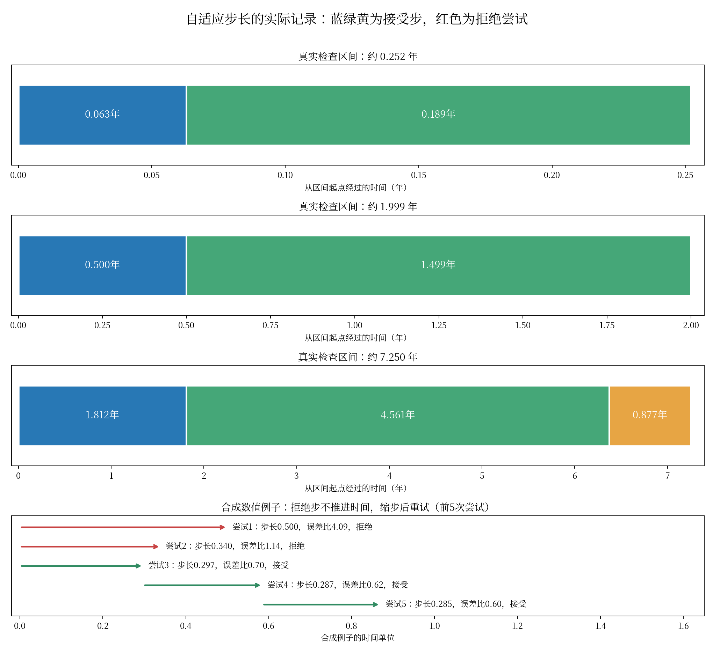

# 自适应 ODE 步长的直观例子

## 1. 先分清实际时间和求解器内部进度

求解器对每次请求的时间区间，先换算成内部进度 u=0 到 u=1。若实际跨度为 Δt，则内部一步 Δu 对应实际时间步长 Δu×Δt。因此，内部都走0.25和0.75两步，不代表每次都走相同的天数或年数。

## 2. 真实模型的三个区间

下列例子来自已完成确定性 ODE-AE 检查点的真实测试推断。为保护患者信息，只保存相对间隔，没有导出患者标识、年龄、检查日期或结果。

| 区间 | 内部步长 | 换算后的实际步长（年） | 是否接受 |
|---|---|---|---|
| 0.251884 年 | 0.250000 + 0.750000 | 0.062971 + 0.188913 | 全部接受 |
| 1.998631 年 | 0.250000 + 0.750000 | 0.499658 + 1.498973 | 全部接受 |
| 7.249825 年 | 0.250000 + 0.629068 + 0.120932 | 1.812456 + 4.560629 + 0.876739 | 全部接受 |

短区间的两步约为23天和69天；接近两年的区间则约为半年和一年半。7.25年区间的第三步较短，是为了刚好到达区间末端，不意味着那里一定突然出现快速病理变化。

每一行是在批积分中选择一位患者的间隔来换算。该批患者共享内部步长，记录的误差比是批内归一化误差的均方根，不是这个患者独立求解的误差。数值步的中间位置也不是新增的真实检查记录。

## 3. 拒绝和重试是什么样子

使用已知方程 dz/dt=3z 的合成例子，区间长度为2，rtol=1e-4、atol=1e-6。它不是ADNI治疗或病程轨迹，只用来展示控制器如何缩步。

| 尝试 | 出发时间 | 尝试步长 | 归一化误差比 | 结果 |
|---:|---:|---:|---:|---|
| 1 | 0.000000 | 0.500000 | 4.0878 | 拒绝，仍留在出发点 |
| 2 | 0.000000 | 0.339559 | 1.1449 | 拒绝，仍留在出发点 |
| 3 | 0.000000 | 0.297441 | 0.7034 | 接受并前进 |
| 4 | 0.297441 | 0.287208 | 0.6168 | 接受并前进 |
| 5 | 0.584648 | 0.284713 | 0.5980 | 接受并前进 |

误差比大于1时不接受；小于等于1时接受，再据此调整下一步。这个例子先后拒绝0.500和约0.340的步长，缩到约0.297后才通过。拒绝的计算不能回收，所以仍计入NFE。

同一合成例子把rtol收紧到1e-5后，接受步从7增加到13，拒绝步均为2。这个现象说明步数取决于向量场、实际区间、状态和精度要求，并非只由网络参数量决定。

## 4. 反向积分

实际编码区间 Δt=-0.503761 年，内部仍从0推进到1，实际时间则向过去走。两步分别为 -0.125940 年、-0.377821 年。负号表示方向，不表示负的计算量。

完整每次尝试的起点、步长、误差比、接受标记和设备记录见 `traces.json`。所有模型诊断和数值例子均在CUDA执行，分别使用物理GPU 0–3，未改变正式检查点。
