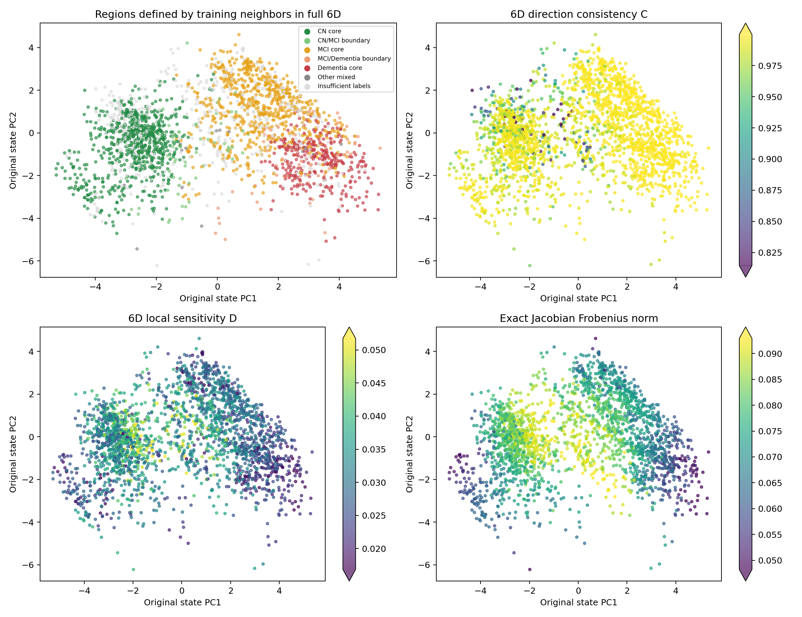
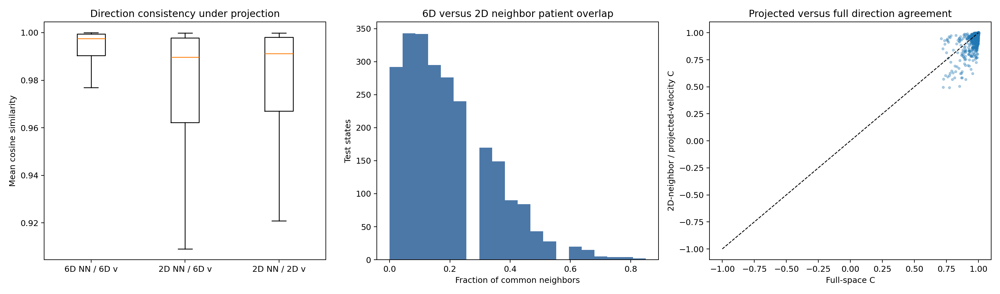
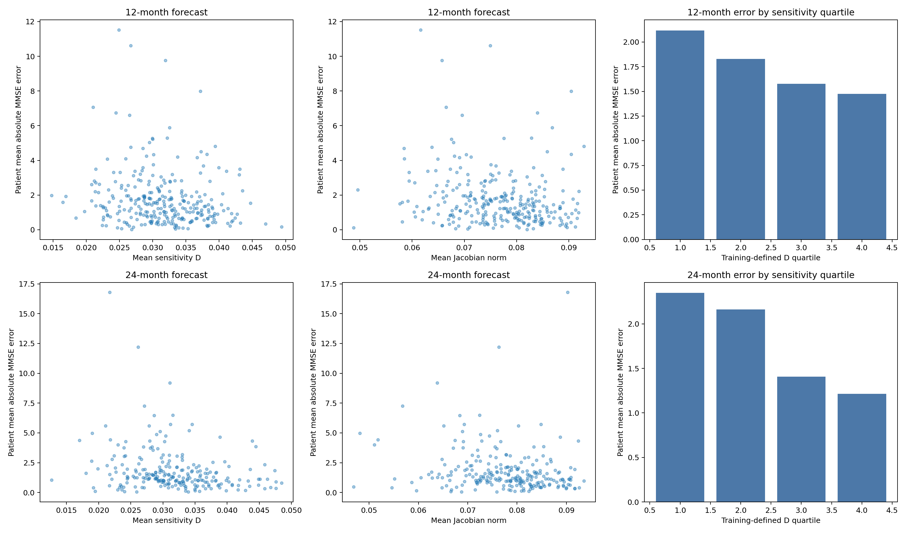

# 实验 B：高维局部速度一致性与长期预测误差

## 1. 从六维邻域研究相似患者的演化

本实验使用 weak_prior（22,545参数，第70轮检查点）及其17,165个状态。每个状态对应一位患者某次历史截止点的估计。近邻距离直接在完整六维潜在空间中计算。

主邻域由20位不同训练患者构成：每位患者仅保留距查询状态最近的一个状态，查询患者自身的所有随访排除。验证集与测试集的近邻均来自训练集。另计算k=10和40的结果。

方向一致性C是查询状态与各邻居原始六维速度的余弦相似度平均值；局部敏感性D是速度差范数除以状态距离后的平均值。Jacobian范数使用共享向量场的完整6×6精确导数。

\[\bar C_i=\frac1k\sum_j\frac{f(z_i)^\top f(z_j)}{\|f(z_i)\|\|f(z_j)\|+\epsilon},\qquad D_i=\frac1k\sum_j\frac{\|f(z_i)-f(z_j)\|}{\|z_i-z_j\|+\epsilon}.\]

## 2. 五类核心区与交界区

区域由六维训练邻域中的诊断比例定义。某类占比至少80%为该类核心区；CN/MCI或MCI/痴呆两类合计至少80%、且各占至少20%为交界区，核心区优先。诊断有效邻居至少占80%。其余状态列为其他混合区或标签不足。



图中的坐标只用于显示，区域和数值都在六维空间中计算。色条范围取训练状态数值的1%–99%分位。

| 测试区域 | 状态数 | 患者数 | 平均C | C第10分位 | 平均D | 平均Jacobian范数 | 反向邻居占比 |
|---|---:|---:|---:|---:|---:|---:|---:|
| CN core | 708 | 180 | 0.983 | 0.966 | 0.034 | 0.078 | 0.007% |
| CN/MCI boundary | 66 | 47 | 0.948 | 0.844 | 0.037 | 0.080 | 0.076% |
| MCI core | 691 | 184 | 0.995 | 0.987 | 0.030 | 0.076 | 0.000% |
| MCI/Dementia boundary | 82 | 46 | 0.994 | 0.985 | 0.028 | 0.069 | 0.000% |
| Dementia core | 308 | 105 | 0.999 | 0.999 | 0.025 | 0.064 | 0.000% |
| Other mixed | 15 | 12 | 0.985 | 0.974 | 0.033 | 0.074 | 0.000% |
| Insufficient labels | 532 | 255 | 0.980 | 0.942 | 0.034 | 0.078 | 0.009% |

以C<0.9标记局部方向分歧，测试集中共有 73 个状态，占 3.04%。具体为：CN core 29个、CN/MCI boundary 13个、MCI core 2个、Other mixed 1个、Insufficient labels 28个。

同一患者可在不同历史截止点进入不同区域。反向邻居指六维速度余弦小于0的邻居。

## 3. 二维投影怎样改变局部一致性

分别在六维状态和原PCA二维坐标中寻找20位不同患者。对于二维邻居，同时计算其六维原始速度和二维投影速度的方向一致性。



| 近邻空间 / 速度空间 | 测试平均C | C第10分位 |
|---|---:|---:|
| 6D neighbors / 6D velocities | 0.9872 | 0.9715 |
| 2D neighbors / 6D velocities | 0.9683 | 0.9184 |
| 2D neighbors / projected velocities | 0.9705 | 0.9273 |
| Random distinct training patients / 6D velocities | 0.6893 | 0.4940 |

两种近邻列表中相同患者的平均占比为 **19.06%**。二维坐标保留原状态51.93%的方差，其邻域组成与六维邻域存在上述差异。

随机参照从20位不同训练患者中取状态，排除查询患者本人；每位训练患者的代表状态以固定种子随机选择。它用于比较相邻患者与一般患者之间的方向一致性。

## 4. 用未来12、24个月的真实MMSE评价预测

对每个历史截止点，在目标月份±3个月窗口内选择最接近目标日期、且有真实MMSE的下一次检查。模型只使用截止点及之前的历史，沿六维ODE直接推进到目标检查的实际时间。误差为预测MMSE与真实MMSE的绝对差，单位为分。时间沿用原季度聚合数据。

主相关分析先按患者汇总：D和Jacobian取该患者各有效起点的平均值，E取相应预测绝对误差的平均值。按患者重抽样1000次给出95%区间。调整相关性使用秩残差，控制年龄、实际间隔、历史次数、最近MMSE及其缺失和时间间隔、性别、当前诊断构成。

| 预测时长 | 测试患者 / 起点 | MMSE MAE（患者等权） | D与误差Spearman | 95%区间 | 调整后相关 | 95%区间 |
|---|---:|---:|---:|---|---:|---|
| 12个月 | 289 / 1022 | 1.750 | -0.187 | [-0.305, -0.076] | 0.045 | [-0.085, 0.171] |
| 24个月 | 237 / 698 | 1.827 | -0.262 | [-0.376, -0.135] | -0.095 | [-0.239, 0.052] |



图中每个散点是一位患者。四分组的D边界由相应时长的训练患者确定；柱高为测试患者的平均MMSE绝对误差。

| 预测时长 | Jacobian与误差Spearman | 95%区间 | 调整后相关 | 95%区间 |
|---|---:|---|---:|---|
| 12个月 | -0.199 | [-0.323, -0.077] | 0.077 | [-0.048, 0.191] |
| 24个月 | -0.222 | [-0.348, -0.088] | -0.020 | [-0.170, 0.133] |

下面按预测起点列出区域误差，单位为MMSE分。与局部一致性及敏感性表结合，可以比较各区域的动力学与预测表现。

| 测试区域 | 12个月起点数 | 12个月MAE | 24个月起点数 | 24个月MAE |
|---|---:|---:|---:|---:|
| CN core | 227 | 0.944 | 213 | 0.999 |
| CN/MCI boundary | 30 | 1.800 | 18 | 1.498 |
| MCI core | 373 | 1.672 | 255 | 1.841 |
| MCI/Dementia boundary | 34 | 2.564 | 13 | 2.206 |
| Dementia core | 131 | 2.716 | 60 | 3.452 |
| Other mixed | 7 | 1.596 | 5 | 1.571 |
| Insufficient labels | 220 | 1.492 | 134 | 1.166 |

## 5. 邻域大小与区域误差

| k | 测试平均C | 测试平均D | 12个月D与误差相关 | 24个月D与误差相关 |
|---|---:|---:|---:|---:|
| 10 | 0.9917 | 0.0317 | -0.135 | -0.238 |
| 20 | 0.9872 | 0.0315 | -0.187 | -0.262 |
| 40 | 0.9796 | 0.0310 | -0.209 | -0.329 |

区域的12/24个月误差见 [region_forecast_errors.csv](region_forecast_errors.csv)，敏感性四组见 [sensitivity_quartiles.csv](sensitivity_quartiles.csv)。

## 6. 本实验对动力学规整化的启示

以调整后的D—误差相关及患者bootstrap区间判断局部敏感性与长期误差的联系，再结合区域误差和不同k值的结果。正相关区间整体高于零，表示在所控制的临床信息之外，敏感性更高的患者同时具有更大误差。区间跨零则呈现较弱或不稳定的关联。

## 7. 原始结果与复现

所有近邻搜索、向量场、Jacobian及ODE预测在物理GPU 3（NVIDIA GeForce RTX 4090）上完成。CPU用于数据整理、统计汇总、bootstrap及绘图。模型没有重新训练。

[状态级数值](state_local_metrics.csv) · [近邻索引与完整数值](neighborhoods.npz) · [预测起点与误差](forecast_errors.csv) · [患者级汇总](patient_forecast_summary.csv) · [完整指标](metrics.json) · [检查与设备记录](provenance.json)

```bash
CUDA_VISIBLE_DEVICES=3 /home/xjh/miniforge3/envs/ode/bin/python \
  -m paper_odeae.diagnostics.local_dynamics --gpu 3 \
  --source paper_odeae/results/weak_prior_state_space \
  --output paper_odeae/results/weak_prior_local_dynamics
```

## 8. 与原始 shared_matched 的同任务比较

| 时长 | 原始MMSE MAE | weak_prior MMSE MAE | 原始调整后D—误差相关 | weak_prior调整后相关 |
|---|---:|---:|---:|---:|
| 12个月 | 1.803 | 1.750 | 0.107 | 0.045 |
| 24个月 | 1.850 | 1.827 | 0.025 | -0.095 |

[查看患者配对区间、局部动力学并排图和实验A比较](../weak_prior_research_AB/report.zh-CN.md)
