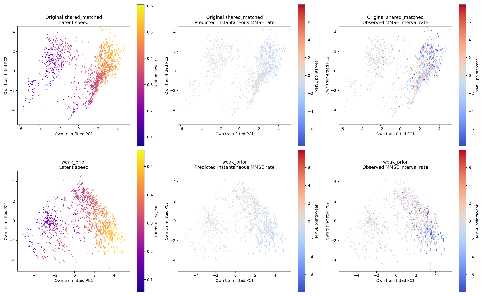
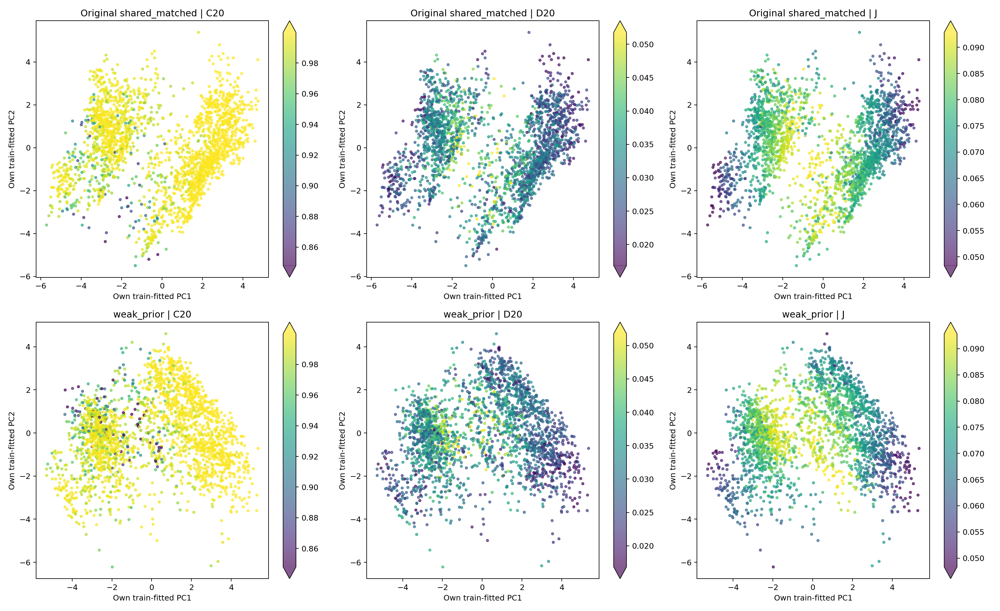

# weak_prior 版本：重做实验 A 与实验 B

## 1. 比较对象和统一条件

原始 shared_matched 使用第56轮检查点，weak_prior 使用第70轮检查点。两者都是22,545参数、六维确定性状态和共享向量场；weak_prior 的训练额外加入0.01倍校正前预测损失。此次只执行状态提取与评价。

患者划分、17,165个历史状态、临床单位换算、检查间隔、近邻排除规则、区域阈值、bootstrap次数和随机种子均保持一致。每个模型只用自身训练状态拟合PCA，原始图与新图并列展示。实验A/B的数值比较使用同一患者、同一历史起点和同一真实目标。

## 2. 实验 A：临床变化速度

| 测试指标 | 原始 shared_matched | weak_prior |
|---|---:|---:|
| 相邻MMSE间隔数 | 1086 | 1086 |
| 患者数 | 286 | 286 |
| MAE（分/年） | 1.894 | 1.884 |
| RMSE（分/年） | 2.907 | 2.893 |
| Pearson | 0.299 | 0.320 |
| Spearman | 0.188 | 0.196 |
| 预测年变化率标准差 | 0.430 | 0.456 |
| 上升/下降准确率 | 58.62% | 58.49% |
| 下降/不变/上升准确率 | 42.27% | 42.17% |
| 首次有效历史的快速下降AUROC | 0.863 | 0.859 |

按同一患者配对，weak_prior 的年变化率MAE减少 0.0099分/年，95%区间 [0.0035, 0.0164]；首次有效历史AUROC变化 -0.0046，95%区间 [-0.0205, 0.0118]。

上排原始模型，下排weak_prior。三列分别按潜在速度、预测MMSE瞬时年变化率、真实随访MMSE年变化率着色。临床两列使用相同色条，箭头保留各模型真实潜在速度投影。

| 诊断组 | 原始真实平均速率 | 原始预测平均速率 | weak_prior预测平均速率 | 原始MAE | weak_prior MAE |
|---|---:|---:|---:|---:|---:|
| CN | -0.127 | -0.056 | -0.043 | 1.075 | 1.069 |
| MCI | -0.507 | -0.407 | -0.390 | 1.894 | 1.889 |
| Dementia | -2.407 | -1.005 | -1.065 | 3.621 | 3.591 |

## 3. 实验 B：高维局部动力学

主邻域仍为20位不同训练患者，排除同一患者的所有其他状态。相同规则在两套六维表示上分别寻找近邻；Jacobian 使用各模型共享向量场的完整导数。

| 指标 | 原始 shared_matched | weak_prior |
|---|---:|---:|
| 六维局部平均方向一致性 | 0.9927 | 0.9872 |
| 六维局部平均敏感性D | 0.0312 | 0.0315 |
| 二维/六维近邻患者重合率 | 0.1877 | 0.1906 |

上排原始模型，下排weak_prior，三列为方向一致性C、敏感性D和Jacobian范数。每列颜色范围统一，坐标是各自模型的训练状态PCA。

| 预测时长 | 模型 | 患者数 | MMSE MAE | D—误差Spearman | 调整后相关 | 调整后95%区间 |
|---|---|---:|---:|---:|---:|---|
| 12个月 | shared_matched | 289 | 1.803 | -0.102 | 0.107 | [-0.016, 0.218] |
| 12个月 | weak_prior | 289 | 1.750 | -0.187 | 0.045 | [-0.085, 0.171] |
| 24个月 | shared_matched | 237 | 1.850 | -0.137 | 0.025 | [-0.113, 0.157] |
| 24个月 | weak_prior | 237 | 1.827 | -0.262 | -0.095 | [-0.239, 0.052] |

12个月患者等权MAE减少 0.0532分，配对患者bootstrap 95%区间 [-0.0035, 0.1101]。

24个月患者等权MAE减少 0.0226分，配对患者bootstrap 95%区间 [-0.0442, 0.0892]。

## 4. 这些变化说明什么

weak_prior使MMSE年变化率MAE降低 0.52%，相关性略有提升。预测变化率的标准差由 0.430 增至 0.456 分/年，真实变化率标准差为 2.989 分/年，预测幅度仍明显更小。方向准确率和患者排序表现与原模型接近。

12和24个月的预测误差点估计均下降，相应配对区间在表中列出。weak_prior的局部方向一致性略低、D相近；控制诊断和最近MMSE等信息后，两个时长的D—误差相关区间都覆盖零。校正前监督带来了小幅临床预测改善，实验B仍未呈现局部敏感性越高、长期误差越大的稳定正相关。

## 5. 独立报告和复现

[weak_prior实验A完整报告](../weak_prior_clinical_velocity/report.zh-CN.md) · [weak_prior实验B完整报告](../weak_prior_local_dynamics/report.zh-CN.md) · [weak_prior状态空间](../weak_prior_state_space/report.zh-CN.md)

[原始实验A](../shared_matched_clinical_velocity/report.zh-CN.md) · [原始实验B](../shared_matched_local_dynamics/report.zh-CN.md) · [配对比较数据](comparison.json)

weak_prior状态提取及实验A在GPU 2上完成，实验B在GPU 3上完成；模型与ODE计算使用CUDA。数据整理、统计及绘图使用CPU。已有模型训练继续运行。
