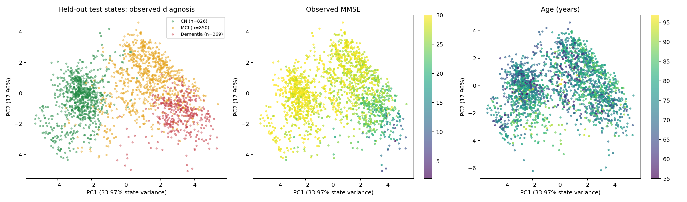
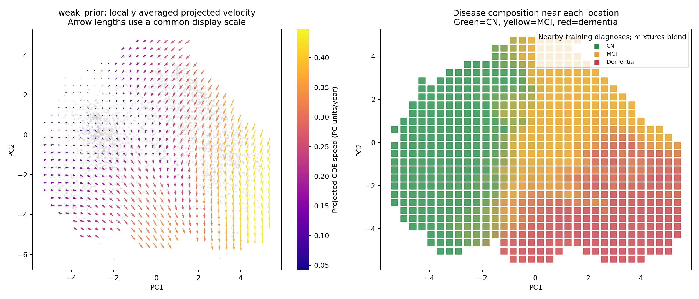
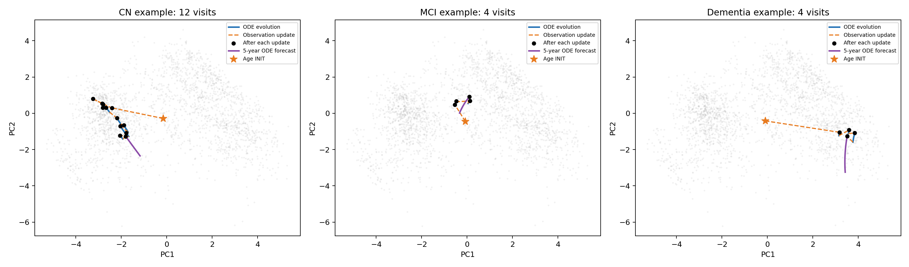

# weak_prior 的状态与速度投影

本页使用已完成的 weak_prior 第70轮检查点，参数量22,545。训练在原始 shared_matched 损失之外增加了0.01倍校正前预测损失。

## 1. 状态分布

共提取17,165个历史截止点状态，患者和时间点与原始实验一致。只用weak_prior训练状态拟合PCA，前两维保留51.93%状态方差。

## 2. 共享向量场

同一投影保留70.04%速度能量。图中箭头为附近训练状态的平均投影速度，右图为相同邻域的诊断构成。

## 3. 历史吸收与生成轨迹

蓝线为ODE连续演化，橙色虚线为观测更新，黑点为更新后的状态，紫线为五年ODE外推。示例患者与原始状态空间实验使用相同选择规则。

## 4. 临床与局部动力学研究

[实验A：临床变化速度](../weak_prior_clinical_velocity/report.zh-CN.md) · [实验B：局部一致性与长期误差](../weak_prior_local_dynamics/report.zh-CN.md) · [与原始shared_matched的配对比较](../weak_prior_research_AB/report.zh-CN.md)

[交互页面](interactive.html)可缩放并查看单个状态。[统计与设备记录](statistics.json)保存检查点哈希、数据哈希和CUDA设备。
