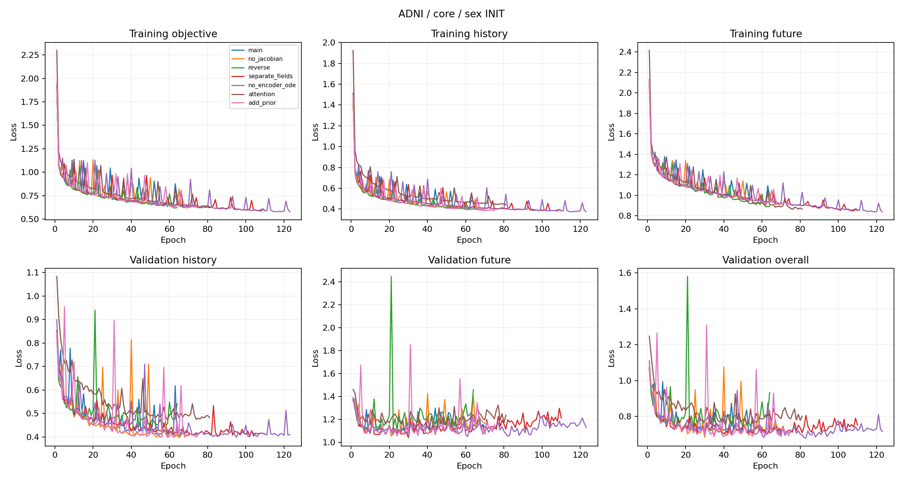
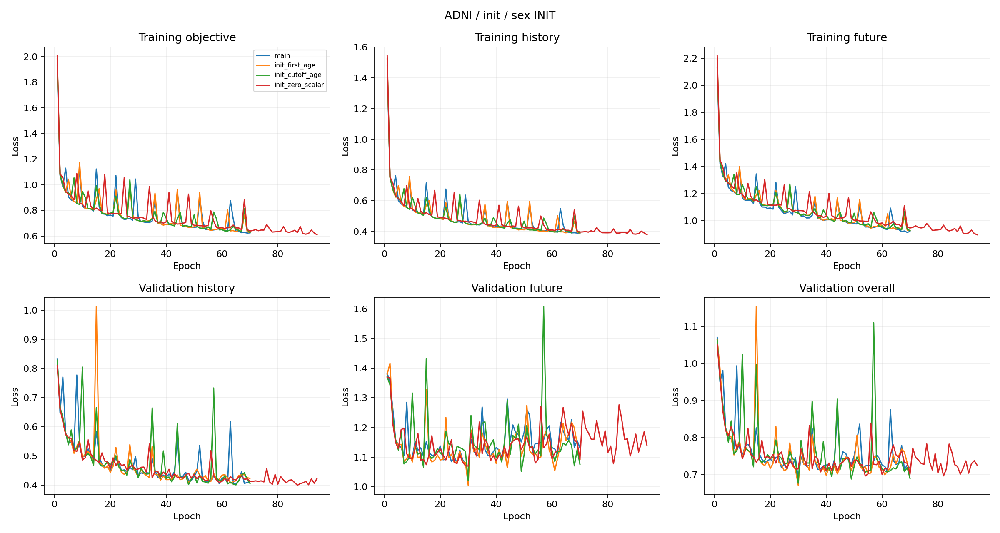
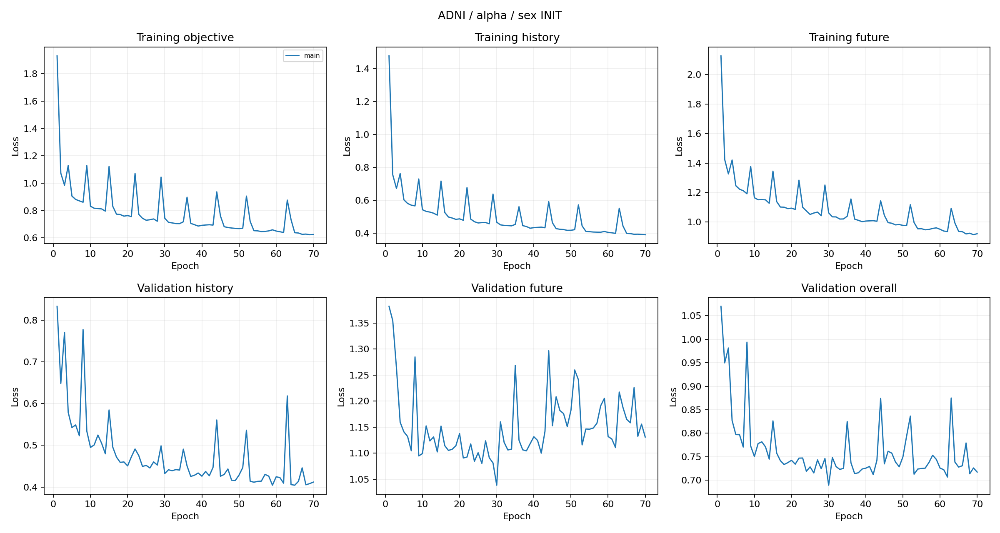
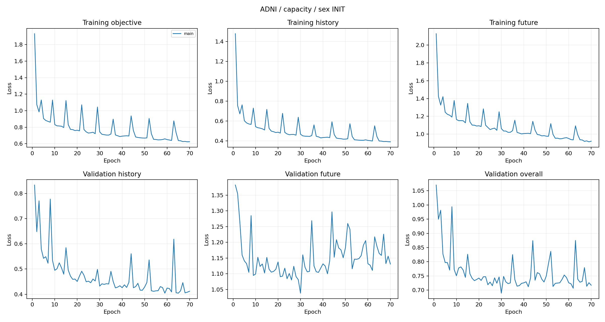
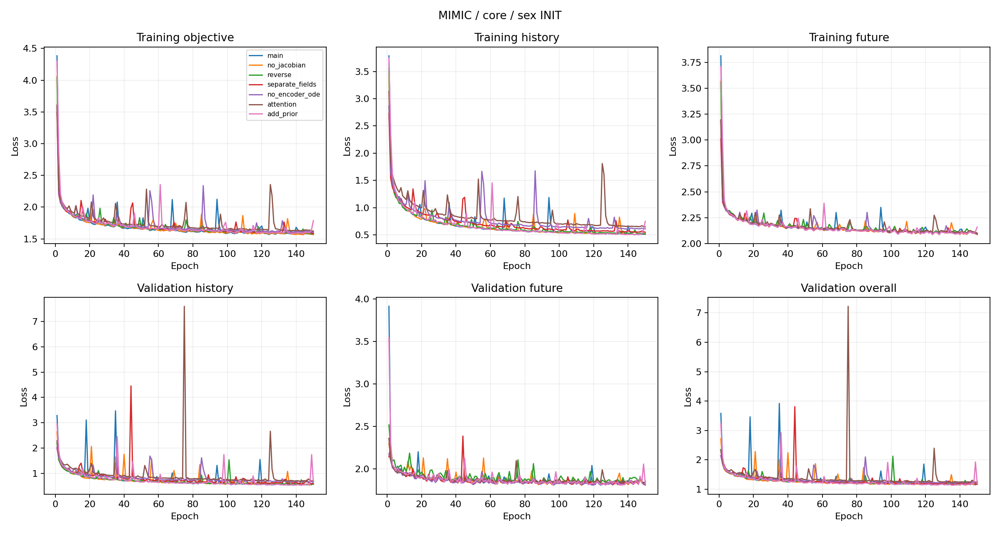
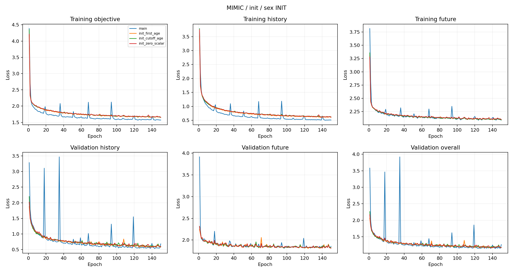
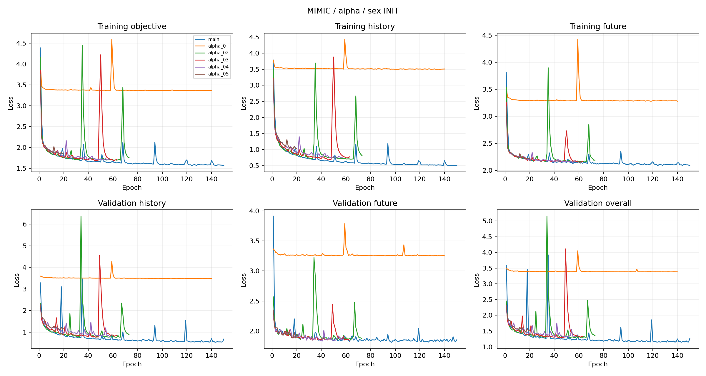
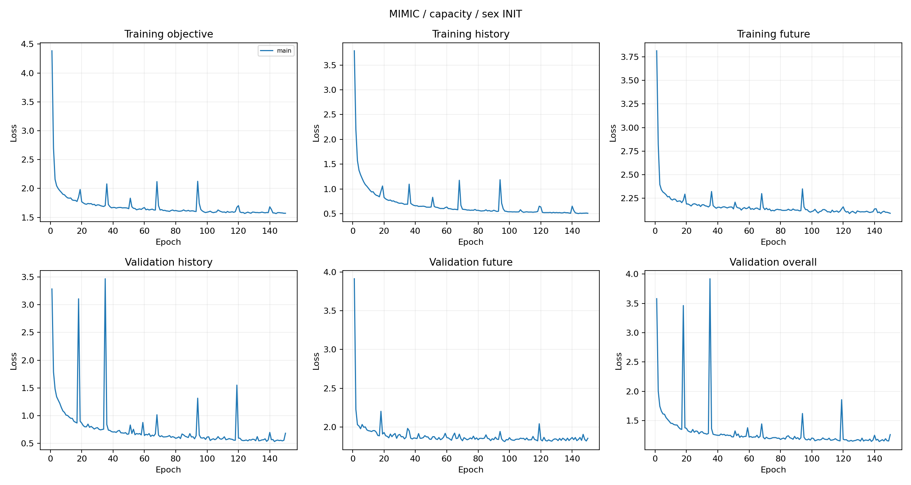

# 论文实验清单：性别 INIT、共享 ODE 与残差观测更新

更新日期：2026-11-05。本文按论文实验主题组织，每节给出实验介绍、比较设置、结果表和图表交付。空白单元格表示对应结果尚未获得。只填写符合本轮模型定义与评价标准的结果。

## 一、模型定义与共同实验标准

### 1.1 主模型 M0

患者检查按实际时间顺序输入。模型先把性别映射为首次历史检查时刻的潜在状态，再用共享 ODE 描述检查之间的连续变化。新检查到达时，UPDATE 产生候选状态，残差门控吸收其中一部分修正。吸收全部已知历史后，从历史截止点向未来预测或向过去回顾，两类生成路径继续使用同一个速度场。

\[
z_0^-=\operatorname{INIT}_\eta(\mathrm{sex}),\qquad
\dot z=f_\theta(z),\qquad
z_k^+=0.9z_k^-+0.1U_\phi(z_k^-,y_k).
\]

训练保留原来的历史回顾与未来预测联合重建目标。数值字段使用 MSE，类别字段使用 CE，按有效观测掩码逐字段归一化后求和。历史与未来的全部有效时间点合并计算主重建项；辅助项为 0.01 Jacobian 正则与 0.02 ODE 参数 L2。

\[
\mathcal L_{\mathrm{M0}}=
\mathcal L_{\mathrm{recon,MSE}}+\mathcal L_{\mathrm{recon,CE}}
+0.01\,\mathbb E_z\|J_f(z)\|_F^2
+0.02\,\mathcal R_{\mathrm{ODE}}.
\]

weak prior 系数为 0。历史回顾主损失仍然完整端到端反向传播。Jacobian 沿用现有实现：有效生成状态先 detach，每个 28×28 Jacobian 的平方元素求和，再在状态间求平均，只对向量场参数施加该正则梯度。

| 项目 | 固定设置 |
| --- | --- |
| 潜在状态 | 28 维 |
| INIT | 1→159→28；F=0、M=1；初始状态放在首次历史检查时刻 |
| 共享 ODE | 28→188→28，Tanh；编码、未来预测、历史回顾共享全部参数 |
| UPDATE | 保留原网络，固定 α=0.1 残差更新 |
| Decoder | 保留原数值字段和类别输出头 |
| weak prior / Jacobian / ODE L2 | 0 / 0.01 / 0.02 |
| ADNI / MIMIC 参数量 | 44,875 / 43,280 |
| 本轮主模型状态 | 两个数据集均需从固定种子重新训练 |

ADNI 缓存使用 PTGENDER−1，即 M=0、F=1；INIT 入口需映射为 F=0、M=1。MIMIC 缓存已为 F=0、M=1。类别预测目标继续沿用各自缓存编码，只转换 INIT 输入。实际进入 INIT 的标量为 0/1；若复用内部除以 100 的年龄接口，应补偿缩放并审计真实输入张量。性别只取预测时已经可用的静态资料或首次历史记录，缺失策略根据训练集确定。

实现来源：[模块设计](../ablation/Ablation.zh-CN.md)、[INIT 输入与 CUDA 审计](../mimic_experiment/init_covariate_ablation.py)、[当前模型方法](CURRENT_MODEL_METHOD.zh-CN.md)。

### 1.2 数据与训练标准

ADNI 检验多年疾病演化，MIMIC 检验小时尺度的不规则临床序列，CausalMed 检验动作条件下的反事实推演。三个数据集分别固定患者划分，归一化只使用训练集。验证整体误差选择最佳检查点，重新载入后进行独立测试。

| 项目 | ADNI | MIMIC | CausalMed |
| --- | --- | --- | --- |
| 训练 / 验证 / 测试患者 | 2,093 / 393 / 414 | 21,517 / 4,649 / 4,536 | 10,000 / 2,000 / 2,000 |
| 版本 | local_available，40 字段 / 展开 49 维 | chronology_v2，31 字段 / 展开 44 维 | γ=1，公开事实数据 |
| 归一化 / 时间单位 | 训练 min-max / 年 | 训练 min-max / 小时 | 训练 z-score / 年 |
| 训练历史 | 枚举所有非空历史前缀 | 每轮采样 6/12/18/24 小时截止点 | 原患者级历史截止点采样 |
| 主测试 | 各历史前缀之后的真实随访 | 前 24 小时历史，预测后续至 48 小时 | 首次达到 3 年的检查后分叉，五策略至 8 年边界 |
| 新模型 batch / 梯度累计 | 32 / 无 | 128 / 无 | 128 / 无 |
| 训练上限 | 150 轮，含续训累计 | 150 轮，含续训累计 | 150 轮，含续训累计 |
| 停止规则 | 至少 50 轮；验证整体 40 轮无改善早停 | 相同 | 相同 |

新主模型与消融使用 Adam，学习率 0.003，每 2,000 步乘 0.97，输入 dropout=0.1，梯度范数裁剪上限 10；Tsit5 的 rtol=1e−4、atol=1e−6。baseline 保留各自方法的概率目标与求解器。首轮固定 seed=0，并按患者配对 bootstrap 给出结果差值区间；患者重抽样不替代训练种子的变异评价。

独立作业排队使用物理 GPU 0、1、2、3，每张卡默认一个作业。模型训练、验证、测试、ODE、自动微分、PCA、近邻与几何诊断均在 CUDA 上执行。CPU 负责数据准备、文件、统计和绘图。训练接入 SwanLab，记录分项损失、梯度、学习率与验证曲线。

数据来源：[ADNI/MIMIC 合同](ADNI_MIMIC_DATASETS.zh-CN.md)、[CausalMed 公开输入](../CausalMed/latent2x_experiment/data.py)、[150 轮政策](EXPERIMENT_POLICY.json)。

### 1.3 结果与参数比较口径

H 是历史区间误差，F 是未来预测误差，O 是全部有效时间点重新汇总的整体误差。各数值字段计算 MSE，各类别字段计算 CE，字段内取有效观测均值，再按字段求和。因此 O 不等于 H、F 的简单平均。ODE-RNN 的 H 为读取该时刻观测前的因果预测，其余模型的 H 为历史重构，主要共同预测比较采用 F。

同预算组匹配实际唯一参数：ADNI 44,875、MIMIC 43,280。HealthFlux 保留原生 256+128 维并列出容量。超过 150 轮的 baseline 先在前 150 轮验证记录中确定应选轮次，再取得相应权重进行 CUDA 复评；缺少该权重时在新目录重训。完成核验前结果留空。

所有填入数字均需关联配置、数据哈希、源码、检查点 SHA256、实际轮次与结果 JSON。同一个 M0 在后续各节复用同一检查点，不重复训练参照组。

## 二、主要比较实验

### 2.1 ADNI：纵向临床预测

每个模型读取相同患者、相同历史前缀，以相同缺失掩码评价未来随访。主要比较包括 M0、概率与确定性 ODE-AE、ODE-RNN、Latent ODE 和 HealthFlux-KL。优先比较同预算模型，再用原容量表区分方法与容量的影响。每组交付混合字段误差、40 字段的原单位 MAE/RMSE 或类别准确率，重点列出 MMSE、CDR-SB、ADAS-Cog 与诊断。未来目标从不进入观测 UPDATE。

表 1：ADNI 主要比较。

| 模型 | 总参数 | 可训练参数 | 完成 / 最佳轮次 | 历史 H ↓ | 未来 F ↓ | 整体 O ↓ | 状态 |
| --- | --- | --- | --- | --- | --- | --- | --- |
| M0（性别 INIT） | 44,875 | 44,875 |  |  |  |  | running |
| ODE-AE（概率，同预算） | 44,875 | 44,875 | 81 / 41 | 3.026708 | 3.238572 | 3.118315 | 已有合格结果 |
| 确定性 ODE-AE（同预算） | 44,875 | 44,875 |  |  |  |  | queued |
| ODE-RNN（同预算） | 44,875 | 44,875 | 69 / 29 | 1.376041 | 1.032329 | 1.228165 | 已有合格结果 |
| Latent ODE（同预算） | 44,875 | 44,875 |  |  |  |  | queued |
| HealthFlux-KL（KL=1） | 5,156,722 | 5,156,722 | 58 / 18 | 0.808341 | 1.534999 | 1.127324 | 已有合格结果 |
| HealthFlux-KL（KL=0.01） | 5,156,722 | 5,156,722 | 50 / 3 | 1.084390 | 1.603200 | 1.311567 | 已有合格结果 |

表 2：ADNI 原容量补充比较。

| 模型 | 总参数 | 可训练参数 | 完成 / 最佳轮次 | 历史 H ↓ | 未来 F ↓ | 整体 O ↓ | 状态 |
| --- | --- | --- | --- | --- | --- | --- | --- |
| ODE-AE（概率，原容量） | 3,003 | 3,003 | 90 / 50 | 3.014009 | 3.247804 | 3.115103 | 已有合格结果 |
| 确定性 ODE-AE（22,545 参数） | 22,545 | 22,545 | 116 / 76 | 0.666808 | 1.191548 | 0.894758 | 已有合格结果 |
| ODE-RNN（原容量） | 32,746 | 22,545 | 96 / 56 | 1.370759 | 1.120580 | 1.264065 | 已有合格结果 |
| Latent ODE（原容量） | 72,266 | 62,065 | 69 / 29 | 2.524608 | 2.836983 | 2.659362 | 已有合格结果 |

主要图为各模型共同患者的预测轨迹、逐字段误差和患者配对差值。确定性同预算模型保留原编码与独立生成机制，宽度调整至 44,875 个实际参数。两种 HealthFlux KL 分别列出，最终设置由验证集选择。

结果来源：[同预算 ADNI](../paper_odeae/results/baselines_matched_latent2x/summary.md)、[原容量 ADNI](../paper_odeae/results/baselines_full/summary.md)、[HealthFlux](../healthflux/results/adni_comparison/summary.md)。

已填写的同预算 baseline 中，ODE-RNN 的未来误差为 1.032329，概率 ODE-AE 为 3.238572；HealthFlux 的两种 KL 设置分别为 1.534999 和 1.603200。后续主比较据此评价新 M0 的预测质量与参数效率。

### 2.2 MIMIC：联合临床预测与保持最近值

主测试以 ICU 前 24 小时历史预测之后 24 小时。除混合误差外，27 个数值字段的原单位 MSE 除以各自训练标准差平方后等权平均，得到数值标准化 MSE。加入保持最近值基线，历史从未测到的字段用训练均值或众数。完整输出包含全部 31 字段、GCS 分类准确率和临床单位误差，用于判断动力学模型对具体预测任务的收益。

表 3：MIMIC 主要比较。

| 模型 | 总参数 | 可训练参数 | 完成 / 最佳轮次 | 历史 H ↓ | 未来 F ↓ | 整体 O ↓ | 状态 |
| --- | --- | --- | --- | --- | --- | --- | --- |
| M0（性别 INIT） | 43,280 | 43,280 |  |  |  |  | running |
| ODE-AE（概率，同预算） | 43,280 | 43,280 | 124 / 84 | 3.201955 | 2.552856 | 3.218515 | 已有合格结果 |
| 确定性 ODE-AE（同预算） | 43,280 | 43,280 |  |  |  |  | queued |
| ODE-RNN（同预算） | 43,280 | 43,280 |  |  |  |  | queued |
| Latent ODE（同预算） | 43,280 | 43,280 | 84 / 44 | 3.162445 | 2.482012 | 3.155783 | 已有合格结果 |
| HealthFlux-KL（KL=0.01） | 4,409,965 | 4,409,197 | 110 / 70 | 1.265998 | 1.947004 | 1.591760 | 已有合格结果 |

表 4：MIMIC 原容量补充比较。

| 模型 | 总参数 | 可训练参数 | 完成 / 最佳轮次 | 历史 H ↓ | 未来 F ↓ | 整体 O ↓ | 状态 |
| --- | --- | --- | --- | --- | --- | --- | --- |
| ODE-AE（概率，原容量） | 2,838 | 2,838 |  |  |  |  | 待预算内评测 |
| ODE-RNN（原容量） | 31,813 | 21,612 |  |  |  |  | 待预算内评测 |
| Latent ODE（原容量） | 70,565 | 60,364 | 104 / 64 | 3.175188 | 2.499839 | 3.167512 | 已有合格结果 |

表 5：MIMIC 临床单位与数值标准化指标，GCS 使用现有三个类别头。

| 模型 | 数值标准化 MSE ↓ | 心率 MAE（bpm）↓ | 平均动脉压 MAE（mmHg）↓ | GCS-eye 准确率 ↑ | GCS-motor 准确率 ↑ | GCS-verbal 准确率 ↑ |
| --- | --- | --- | --- | --- | --- | --- |
| M0 |  |  |  |  |  |  |
| ODE-AE（概率，同预算） | 0.936109 | 14.576447 | 11.323553 | 0.657706 | 0.745507 | 0.738490 |
| 确定性 ODE-AE（同预算） |  |  |  |  |  |  |
| ODE-RNN（同预算） |  |  |  |  |  |  |
| Latent ODE（同预算） | 0.927523 | 14.112172 | 11.465836 | 0.666847 | 0.751594 | 0.762287 |
| HealthFlux-KL | 0.919463 | 14.576796 | 10.894301 | 0.704928 | 0.817546 | 0.821996 |
| 保持最近值 | 0.580933 | 9.748846 | 9.939788 | 0.709336 | 0.829541 | 0.836751 |

配对误差按患者汇总并给出置信区间。主模型以性别进入 INIT；baseline 保留各方法既有年龄条件或年龄协变量，各模型静态输入及训练方式随配置一并记录。

结果来源：[同预算 MIMIC](../mimic_experiment/results/baselines_matched_latent2x/summary.md)、[原单位与简单基线](../mimic_experiment/results/baselines_single_cuda/summary.md)、[确定性模型](../mimic_experiment/results/baselines_with_deterministic_cuda/summary.md)。

已填写的 HealthFlux 数值标准化 MSE 为 0.919463，保持最近值为 0.580933。后续 M0 与其他模型需要同时接受这两个参照的检验，结果分析结合生命体征、化验与 GCS 分项展开。

### 2.3 预测跨度与历史信息量

在固定最佳检查点上改变评价窗口，研究更长推演和更少历史观测的影响。ADNI 按实际间隔统计 0–12、12–24、24–36、36–60 个月。MIMIC 从 24 小时截止点计算未来 6/12/24 小时累计误差，再分别读取前 6/12 小时历史测试。每个窗口报告人数和有效目标数，各模型使用相同患者、时间点与掩码。

表 6：MIMIC 不同未来范围的累计误差。

| 模型 | 未来 6 小时 ↓ | 未来 12 小时 ↓ | 未来 24 小时 ↓ |
| --- | --- | --- | --- |
| M0 |  |  |  |
| ODE-AE（概率，同预算） | 2.499316 | 2.512097 | 2.552856 |
| 确定性 ODE-AE（同预算） |  |  |  |
| ODE-RNN（同预算） |  |  |  |
| Latent ODE（同预算） | 2.423923 | 2.437131 | 2.482012 |
| HealthFlux-KL | 1.657210 | 1.778248 | 1.947004 |

表 7：M0 在不同信息量与跨度下的表现。

| 数据集 | 窗口 / 上下文 | 患者数 | 有效目标数 | 未来误差 ↓ | 数值标准化 MSE ↓ |
| --- | --- | --- | --- | --- | --- |
| ADNI | 0–12 个月 |  |  |  |  |
| ADNI | 12–24 个月 |  |  |  |  |
| ADNI | 24–36 个月 |  |  |  |  |
| ADNI | 36–60 个月 |  |  |  |  |
| MIMIC | 6 小时历史 / 至 48 小时 |  |  |  |  |
| MIMIC | 12 小时历史 / 至 48 小时 |  |  |  |  |
| MIMIC | 24 小时历史 / 至 48 小时 |  |  |  |  |

主要图为误差随预测跨度和历史观测数的曲线。患者等权汇总，避免随访较多的患者主导比较。

方案来源：[MIMIC 时间窗口评价](../mimic_experiment/results/baselines_single_cuda/summary.md)、[ADNI 共同任务](../paper_odeae/results/baselines_full/summary.md)。

### 2.4 CausalMed γ=1：反事实、治疗效应与策略选择

固定分叉患者状态后执行 Never、Always、Delayed、Aggressive、Conservative 五策略，封存预测与模型产生的治疗区间，再由独立评分器读取配对真值。报告全轨迹 CF-RMSE、1/2/3 年终点误差、Always 相对 Never 的 √PEHE、ATE 误差、策略遗憾和最优策略准确率。

公开数据只有静态 c，没有性别，因此合成适配版命名为 M0-c：INIT 接收训练集归一化的公开 c；其余使用共享 ODE、α=0.1、无 weak prior、Jacobian=0.01。门控只用于观测 UPDATE。治疗切换仍采用新旧动作条件输出之差，相同动作下位移为零。新目标实现必须显式删除原代码写死的 prior 系数。

表 8：γ=1 反事实比较，治疗效应与策略指标为 3 年窗口。

| 模型 | 参数量 | 全轨迹 CF-RMSE ↓ | 3 年 CF-RMSE ↓ | 3 年 √PEHE ↓ | 3 年 ATE 误差 ↓ | 3 年策略遗憾 ↓ | 状态 |
| --- | --- | --- | --- | --- | --- | --- | --- |
| M0-c（公开 c INIT） | 31,314 |  |  |  |  |  | 待新训练 |
| ODE-AE | 1,843 | 5.250657 | 5.305324 | 10.498133 | 10.394523 | 1.302645 | 已有合格结果 |
| 确定性 ODE-AE（同预算） | 31,314 |  |  |  |  |  | 待预算内评测 |
| HealthFlux-KL（原生容量） | 4,361,412 | 1.408327 | 0.929265 | 1.867809 | 1.307587 | 0.233698 | 已有合格结果 |

确定性模型匹配到 31,314 参数，HealthFlux 保留原生容量。四模型对相同固定病例绘制五策略真实/预测平行轨迹，补充每策略误差和 1/2 年指标。动作关闭测试复用相同检查点与分叉状态，只关闭未来动作校正，检验模型是否使用治疗信息。

表 9：M0-c 动作通路测试。

| 设置 | 全轨迹 CF-RMSE ↓ | 3 年 √PEHE ↓ | 3 年 ATE 误差 ↓ | 3 年策略遗憾 ↓ |
| --- | --- | --- | --- | --- |
| 正常动作输入 |  |  |  |  |
| 同检查点关闭未来动作校正 |  |  |  |  |

方案与结果来源：[四模型反事实评价](../CausalMed/outputs/gamma1_model_comparison/summary.md)、[动作适配](../CausalMed/latent2x_experiment/README.zh-CN.md)、[目标与动作代码](../CausalMed/latent2x_experiment/model.py)。

## 三、核心消融实验

以下六个主题均在 ADNI、MIMIC 实施，固定性别 INIT、无 prior、28 维状态及相同训练预算。除研究变量外保持 M0 设置，实际总参数分别精确为 44,875 和 43,280。所有参照行复用 M0。

### 3.1 历史读取顺序

M0 从最早历史检查开始，向未来逐条演化和吸收，最终状态放在历史截止点。反序组将性别 INIT 输出放在最近历史检查时刻，向过去逐条吸收，将最终状态放在最早历史检查，再从该时刻向未来生成整条轨迹。两组使用相同 INIT 网络和共享速度场参数化，积分方向由实际时间差正负决定。本实验比较读取顺序及对应时间锚点对预测、回顾与稳定性的影响。

表 10：反序共享 ODE。

| 数据集 | 模型 | 参数量 | 最佳轮次 | 历史 H ↓ | 未来 F ↓ | 整体 O ↓ |
| --- | --- | --- | --- | --- | --- | --- |
| ADNI | M0 | 44,875 |  |  |  |  |
| ADNI | 反序共享 ODE | 44,875 |  |  |  |  |
| MIMIC | M0 | 43,280 |  |  |  |  |
| MIMIC | 反序共享 ODE | 43,280 |  |  |  |  |

交付分项损失、验证曲线、最佳轮次和长期患者配对误差；反序移除仅服务于 prior 的辅助读取。

方案与实现来源：[ADNI 编码方向](../paper_odeae/results/latent2x_history_encoder_ablation/summary.md)、[α 方向实验](../mimic_experiment/results/weak_prior_ablation_cuda/targeted_causal_ablation/summary.md)、[方向实现](../mimic_experiment/alpha_direction_model.py)。

### 3.2 统一共享场与独立双场

将 M0 的单一共享速度场替换为历史编码场与预测/回顾生成场，其余模块不变。共享场 28→188→28 共 10,744 参数；双场都用宽 94，编码场去掉末层 bias 后为 5,358，生成场为 5,386，合计仍为 10,744。实验检验相同总预算集中学习统一动力学，还是分给两个专用场更有效。

表 11：等预算独立双场。

| 数据集 | 模型 | 参数量 | 最佳轮次 | 历史 H ↓ | 未来 F ↓ | 整体 O ↓ |
| --- | --- | --- | --- | --- | --- | --- |
| ADNI | M0 | 44,875 |  |  |  |  |
| ADNI | 等预算独立双场 | 44,875 |  |  |  |  |
| MIMIC | M0 | 43,280 |  |  |  |  |
| MIMIC | 等预算独立双场 | 43,280 |  |  |  |  |

L2 对两场独立参数求和，Jacobian 在相同有效生成状态上对两场取平均。交付预测结果、状态衔接、分项训练曲线与求解成本。

方案与实现来源：[等参数双场设计](../ablation/Ablation.zh-CN.md)、[参数核验](../mimic_experiment/component_ablation_model.py)、[两场损失](../mimic_experiment/component_ablation_loss.py)。

### 3.3 历史检查间的 ODE 演化

只取消历史观测之间的 ODE 推进，下一次 UPDATE 前直接继承上一次 UPDATE 后状态。INIT、残差 UPDATE、生成 ODE、Decoder 和所有损失不变。共享 ODE 仍通过未来预测和历史回顾训练，实际任务参数量保持一致。按训练集预先固定的间隔不均匀度分组，检验连续时间编码对不规则随访的作用。

表 12：历史间隔无 ODE 推进。

| 数据集 | 模型 | 参数量 | 最佳轮次 | 历史 H ↓ | 未来 F ↓ | 整体 O ↓ |
| --- | --- | --- | --- | --- | --- | --- |
| ADNI | M0 | 44,875 |  |  |  |  |
| ADNI | 历史间隔无 ODE 推进 | 44,875 |  |  |  |  |
| MIMIC | M0 | 43,280 |  |  |  |  |
| MIMIC | 历史间隔无 ODE 推进 | 43,280 |  |  |  |  |

交付误差随历史最大间隔、间隔变异系数、观测条数变化的曲线，以及主要测试指标。

方案与实现来源：[历史编码器](../paper_odeae/history_encoders.py)、[不规则性定义](SAMPLING_IRREGULARITY_COMPARISON.zh-CN.md)。

### 3.4 注意力与实际时间编码

以因果注意力和实际时间位置编码替换整个 ODE+UPDATE 历史编码器，生成端保留原 ODE 与 Decoder。只读取截止点以内的有效历史，时间编码采用实际时间差。先核查现有实现的参数归属，再精确配置替换宽度，保持总预算。该组比较完整编码器家族；3.3 节则单独检验检查间 ODE 推进。

表 13：注意力＋实际时间编码。

| 数据集 | 模型 | 参数量 | 最佳轮次 | 历史 H ↓ | 未来 F ↓ | 整体 O ↓ |
| --- | --- | --- | --- | --- | --- | --- |
| ADNI | M0 | 44,875 |  |  |  |  |
| ADNI | 注意力＋实际时间编码 | 44,875 |  |  |  |  |
| MIMIC | M0 | 43,280 |  |  |  |  |
| MIMIC | 注意力＋实际时间编码 | 43,280 |  |  |  |  |

注意力替换 UPDATE 后不再应用 α 门控。交付预测时长、短历史表现、训练曲线与实际成本。

方案与实现来源：[ADNI 编码器比较](../paper_odeae/results/latent2x_history_encoder_ablation/summary.md)、[MIMIC 编码器比较](../mimic_experiment/results/history_encoder_ablation_cuda/summary.md)、[实现](../paper_odeae/history_encoders.py)。

### 3.5 Jacobian 正则

仅将 Jacobian 权重从 0.01 改为 0，保留所有主重建、ODE L2、性别 INIT 与门控设置。主要指标评价预测效果，第 4.6 节进一步对这两个检查点进行扰动实验，将局部规整性与实际输出稳定性联系起来。训练中保存加权及未加权 Jacobian 值、历史/未来分项损失和梯度。

表 14：Jacobian=0。

| 数据集 | 模型 | 参数量 | 最佳轮次 | 历史 H ↓ | 未来 F ↓ | 整体 O ↓ |
| --- | --- | --- | --- | --- | --- | --- |
| ADNI | M0 | 44,875 |  |  |  |  |
| ADNI | Jacobian=0 | 44,875 |  |  |  |  |
| MIMIC | M0 | 43,280 |  |  |  |  |
| MIMIC | Jacobian=0 | 43,280 |  |  |  |  |

分别报告平均误差、长期误差、患者配对差值区间；结果分析与第 4.6 节联合撰写。

方案与实现来源：[损失消融设计](../paper_odeae/results/latent2x_loss_ablation/summary.md)、[精确 Jacobian](../paper_odeae/jacobian.py)、[效用方法](../ablation/results/jacobian_utility_adni/report.zh-CN.md)。

### 3.6 weak prior 增项对照

以无 weak prior 的 M0 为参照，只加回 0.01 weak prior，检验目标简化的影响。该辅助项在每次观测吸收前评价预测，与从最终截止点生成的主重建项分开记录。INIT、α、参数、训练配置和全部测试设置相同，比较预测误差以及额外监督的计算成本。

表 15：加回 0.01 weak prior。

| 数据集 | 模型 | 参数量 | 最佳轮次 | 历史 H ↓ | 未来 F ↓ | 整体 O ↓ |
| --- | --- | --- | --- | --- | --- | --- |
| ADNI | M0 | 44,875 |  |  |  |  |
| ADNI | 加回 0.01 weak prior | 44,875 |  |  |  |  |
| MIMIC | M0 | 43,280 |  |  |  |  |
| MIMIC | 加回 0.01 weak prior | 43,280 |  |  |  |  |

此处列入后续计划；执行使用新的独立目录，保留此前停止任务和停止标记。交付完整结果与曲线。

方案与实现来源：[模块损失设计](../ablation/Ablation.zh-CN.md)、[字段与归约实现](../mimic_experiment/component_ablation_loss.py)。

## 四、状态空间、流形与动力学理论探究

以下各节均纳入本轮论文实验。使用 M0 和对应消融的最佳检查点，冻结模型，复用现有 Decoder 与诊断头，不增加可学习参数。数值表完成后插入实际图组，并围绕观察结果撰写分析。

### 4.1 状态空间与速度场的平行可视化

在各模型训练集 UPDATE 后状态上分别拟合 PCA，固定用于该模型的测试状态、速度箭头和病例轨迹。ADNI 按诊断、MMSE、CDR-SB 着色；MIMIC 按 GCS、心率等预先固定指标着色。原始逐状态箭头与邻域平均速度场分别展示，测试状态与自由生成状态分开标记。计算状态平面保留的方差和速度能量，检查二维图对动力学的表达程度。

表 16：状态与速度的二维信息保留。

| 数据集 | 模型 | 状态 PCA2 方差占比 ↑ | 该平面速度能量占比 ↑ | 速度 PCA2 能量占比 ↑ | 状态有效秩 |
| --- | --- | --- | --- | --- | --- |
| ADNI | M0 |  |  |  |  |
| ADNI | 确定性 ODE-AE（同预算） |  |  |  |  |
| ADNI | ODE-AE（概率，同预算） |  |  |  |  |
| ADNI | ODE-RNN（同预算） |  |  |  |  |
| ADNI | Latent ODE（同预算） |  |  |  |  |
| ADNI | HealthFlux-KL |  |  |  |  |
| MIMIC | M0 |  |  |  |  |
| MIMIC | 确定性 ODE-AE（同预算） |  |  |  |  |
| MIMIC | ODE-AE（概率，同预算） |  |  |  |  |
| MIMIC | ODE-RNN（同预算） |  |  |  |  |
| MIMIC | Latent ODE（同预算） |  |  |  |  |
| MIMIC | HealthFlux-KL |  |  |  |  |

主要图为状态分布、未平滑速度场、平均速度场、UPDATE 跳变和自由演化轨迹。ADNI 固定病例为 003_S_4900、002_S_4219、002_S_0619，并展示临床真实/预测曲线；MIMIC 从预先固定的患者名单展示 24→48 小时轨迹。不同模型分别使用自己的训练 PCA，各自内部保持坐标一致。编码状态与生成状态不同的模型分别提取两类表示，速度场图匹配实际生成状态及对应生成场；概率模型沿用共同测试的均值预测与条件定义。

方案来源：[共享场方法](../paper_odeae/results/shared_matched_state_space/report.zh-CN.md)、[模型横向可视化](../paper_odeae/results/state_space_model_comparison/report.zh-CN.md)、[ODE-AE 病例](../paper_odeae/results/odeae_baseline_state_space/report.zh-CN.md)。

### 4.2 临床速度：潜在运动对应怎样的真实指标变化

用已有 Decoder 计算 \(\dot y=\nabla g(z)^\top f(z)\)。区间评价从前一次 UPDATE 后状态出发，自由积分到下一次真实检查，取解码差除以真实间隔，与真实变化率比较；预测区间内不吸收终点观测。ADNI 评价 MMSE、CDR-SB 年变化，MIMIC 评价心率和平均动脉压的小时变化。

表 17：真实随访区间上的临床变化率预测。

| 数据集 | 指标 / 单位 | 区间数 | 患者数 | 变化率 MAE ↓ | Pearson r ↑ | Spearman ρ ↑ | 方向准确率 ↑ |
| --- | --- | --- | --- | --- | --- | --- | --- |
| ADNI | MMSE，分/年 |  |  |  |  |  |  |
| ADNI | CDR-SB，分/年 |  |  |  |  |  |  |
| MIMIC | 心率，bpm/小时 |  |  |  |  |  |  |
| MIMIC | 平均动脉压，mmHg/小时 |  |  |  |  |  |  |

主要图并排展示同一 PCA 位置下的潜在速度、预测临床变化率与真实变化率，并绘制真实/预测散点。稳定、上升、下降的判定规则在训练/验证阶段固定，患者等权汇总后 bootstrap。

方案来源：[临床速度实验 A](../paper_odeae/results/shared_matched_clinical_velocity/report.zh-CN.md)。

### 4.3 MMSE 下降速度的分解

将临床速度写为 \(\dot y=\|\nabla g(z)\|\,\|f(z)\|\cos\theta\)，按 CN、MCI、Dementia 分析潜在速度、Decoder 敏感性和临床方向投影。沿真实区间积分得到临床变化预算，并单独分析真实下降较快的区间。快速下降阈值根据训练分布或预先固定的临床规则确定。

表 18：M0 的 MMSE 动力学机制。

| 组别 | 患者数 | 平均 ‖f‖ | 平均 ‖∇g‖ | 平均 cosθ | 真实年变化 | 预测年变化 | 变化率偏差 |
| --- | --- | --- | --- | --- | --- | --- | --- |
| CN |  |  |  |  |  |  |  |
| MCI |  |  |  |  |  |  |  |
| Dementia |  |  |  |  |  |  |  |
| 快速下降区间 |  |  |  |  |  |  |  |

图表包括三个分解因素的分布、速度与临床梯度夹角、快速下降与稳定患者的轨迹。根据实际分解结果判断临床变化偏差来自哪一部分。

方案来源：[MMSE 机制分解](../paper_odeae/results/mmse_decline_mechanism/report.zh-CN.md)。

### 4.4 高维局部一致性与预测误差

在完整 28 维中为测试状态寻找其他训练患者的 k 近邻，主分析 k=20，补充 10/40。计算速度余弦 \(C_{ij}\)、局部变化比 \(D_{ij}=\|f_i-f_j\|/(\|z_i-z_j\|+\epsilon)\) 和 Jacobian 范数。核心与交界区域根据训练近邻诊断比例定义，并提前冻结。随后比较局部变化比与未来误差的关联，调整时间跨度、观测数和缺失程度。

表 19：ADNI 各区域的局部动力学。

| 区域 | 患者数 | 方向一致性 C ↑ | 局部变化比 D | Jacobian 范数 | 二维/高维邻域重叠率 |
| --- | --- | --- | --- | --- | --- |
| CN 核心 |  |  |  |  |  |
| CN/MCI 交界 |  |  |  |  |  |
| MCI 核心 |  |  |  |  |  |
| MCI/Dementia 交界 |  |  |  |  |  |
| Dementia 核心 |  |  |  |  |  |

表 20：局部变化比与未来误差的关联。

| 数据集 | 窗口 | 患者数 | Spearman ρ | 调整后关联 | 95% CI |
| --- | --- | --- | --- | --- | --- |
| ADNI | 12 个月 |  |  |  |  |
| ADNI | 24 个月 |  |  |  |  |
| MIMIC | 12 小时 |  |  |  |  |
| MIMIC | 24 小时 |  |  |  |  |

主要图为高维方向一致性与敏感性在 PCA 位置上的热图、分层误差散点。近零速度与重复状态的处理写入配置，按患者汇总和重抽样。

方案来源：[局部动力学实验 B](../paper_odeae/results/shared_matched_local_dynamics/report.zh-CN.md)。

### 4.5 低维流形与动力学维度

提取两个真实数据集的训练/测试状态，计算全局 PCA90/95/99% 维度、TwoNN、kNN 内在维度和局部 PCA。以同协方差高斯点云为比较，并按患者独立抽样复核。把速度分解为训练近邻切空间内外分量，检验状态点云的低方差方向是否仍承载重要临床演化。

表 21：M0 的几何维度与切空间外速度。

| 数据集 | PCA95% 维度 | TwoNN 维度 | kNN 维度 | 局部 PCA95% 维度 | 12 维局部切平面外速度能量 |
| --- | --- | --- | --- | --- | --- |
| ADNI |  |  |  |  |  |
| MIMIC |  |  |  |  |  |

进一步比较原始自由推演、训练点云构建的冻结几何投影、向训练均值收缩。投影维数与收回强度只在验证集选择，再固定用于测试。Decoder 诱导的临床度量用于量化潜在位移对输出的影响。该分析不训练新参数。

表 22：冻结几何投影的预测检验。

| 数据集 | 设置 | 未来误差 ↓ | 相对原始推演差值 | 主要临床 RMSE ↓ |
| --- | --- | --- | --- | --- |
| ADNI | 原始自由积分 |  |  |  |
| ADNI | 验证集选定的冻结投影 |  |  |  |
| ADNI | 向均值收缩对照 |  |  |  |
| MIMIC | 原始自由积分 |  |  |  |
| MIMIC | 验证集选定的冻结投影 |  |  |  |
| MIMIC | 向均值收缩对照 |  |  |  |

主要图为维度随近邻数变化、真实点云与高斯对照、切空间内外速度、投影前后临床轨迹。结果分析区分“状态可以压缩”和“动力学可以限制在低维平面”。

方案来源：[流形设计](../paper_odeae/results/latent2x_both_manifold/report.zh-CN.md)、[几何与投影评价](../paper_odeae/results/latent2x_both_manifold/metrics_report.zh-CN.md)。

### 4.6 Jacobian 的效用：误差传播、噪声和长期预测

使用 M0 与第 3.5 节无 Jacobian 模型，在相同患者、扰动方向和噪声下比较。先测局部 Jacobian，再测完整 ODE 流增益 \(\|D_z\Phi_T(z)\|_2\) 和临床输出扰动。潜在扰动为状态范数的 1%，固定 8 个方向；观测噪声为训练标准差的 1% 和 5%，只作用于输入历史中的可变数值字段，目标与评价掩码保持干净。

ADNI 取 0/1/2/3/5 年，MIMIC 取 0/6/12/24 小时。导数采用 float64 严容差，与更严容差或独立方法做收敛核验。按患者配对 bootstrap 给出差值区间，把正则对规整性的影响与实际误差改善分别量化。

表 23：规整性与实际鲁棒性。

| 数据集 | 模型 | 平均 ‖Jf‖² ↓ | 最长范围流增益中位数 ↓ | 5% 噪声输出偏移 RMSE ↓ | 干净目标临床 RMSE ↓ | 长范围临床 RMSE ↓ |
| --- | --- | --- | --- | --- | --- | --- |
| ADNI | M0 |  |  |  |  |  |
| ADNI | 无 Jacobian |  |  |  |  |  |
| MIMIC | M0 |  |  |  |  |  |
| MIMIC | 无 Jacobian |  |  |  |  |  |

ADNI 主要临床指标为 MMSE、补充 CDR-SB；MIMIC 主要连续指标为心率、补充平均动脉压。联合预测另外报告数值标准化 MSE。图表包括流增益随时间变化、噪声—误差曲线、长跨度配对差值与区间，据此判断正则的实际作用。

方案来源：[正则效用设计及数值核验](../ablation/results/jacobian_utility_adni/report.zh-CN.md)、[实现脚本](../mimic_experiment/jacobian_utility_adni.py)。

### 4.7 连续疾病阶段与 MCI 转化

利用已有诊断头定义 \(s=p_{\mathrm{MCI}}+2p_{\mathrm{Dementia}}\)，通过自动微分计算 \(\dot s=\nabla s^\top f\)。从固定已知历史截止点自由推演 0/6/12/24/36/60 个月。每个窗口内每位 MCI 患者只选一个预先确定的锚点：窗口内有 Dementia 记录为转化，稳定组须有足以支持该窗口的真实随访。当前评分、瞬时速度、未来评分增量与未来 Dementia 概率分别预测转化。

表 24：疾病阶段与真实转化区分能力。

| 窗口 | 稳定 / 转化患者数 | 预测量 | AUROC ↑ | AUPRC ↑ | 相对 s₀ 的 AUROC 差值 |
| --- | --- | --- | --- | --- | --- |
| 12 个月 |  | 当前 s₀ |  |  |  |
| 12 个月 |  | 瞬时速度 ṡ₀ |  |  |  |
| 12 个月 |  | 阶段增量 Δs |  |  |  |
| 12 个月 |  | 未来 Dementia 概率 |  |  |  |
| 24 个月 |  | 当前 s₀ |  |  |  |
| 24 个月 |  | 瞬时速度 ṡ₀ |  |  |  |
| 24 个月 |  | 阶段增量 Δs |  |  |  |
| 24 个月 |  | 未来 Dementia 概率 |  |  |  |
| 36 个月 |  | 当前 s₀ |  |  |  |
| 36 个月 |  | 瞬时速度 ṡ₀ |  |  |  |
| 36 个月 |  | 阶段增量 Δs |  |  |  |
| 36 个月 |  | 未来 Dementia 概率 |  |  |  |

主要图为相同 PCA 坐标上的阶段/速度热图、稳定与转化患者的平均阶段曲线、ROC 与 PR 对比。按患者计算区间，检验自由 ODE 推演是否在当前诊断概率之外增加区分信息。

方案来源：[连续阶段与转化评价](../paper_odeae/results/shared_matched_continuous_stage/report.zh-CN.md)。

### 4.8 训练稳定性与递归增益

M0 训练中记录历史/未来损失对共享 ODE 的梯度范数及余弦，并在固定患者和固定跨度上跟踪向过去、未来积分的敏感性。预定轮次冻结参数，测量 UPDATE 状态 Jacobian 和截止点对历史状态的递归增益。与性别 INIT、无 prior、α=1 组比较，检验门控对 UPDATE 递归及历史损失梯度放大的影响。

表 25：MIMIC 稳定性。

| 模型 | 最佳轮次 | 停止轮次 | 历史/未来梯度比 P95 | 梯度余弦中位数 | 递归状态增益 P95 | 非有限值次数 |
| --- | --- | --- | --- | --- | --- | --- |
| M0（α=0.1） |  |  |  |  |  |  |
| 同配置 α=1 |  |  |  |  |  |  |

真实训练 batch 与固定诊断 batch 分别标记，诊断阶段不执行参数更新。图中共同展示分项损失、梯度比、递归增益和验证误差。α=1 在第 5.2 节完成后复用；先开展 M0 的训练记录与冻结分析。

方案来源：[梯度诊断](../mimic_experiment/results/direction_full_batch_cuda/gradient_sensitivity_analysis/report.zh-CN.md)、[敏感性与积分精度](../mimic_experiment/results/weak_prior_ablation_cuda/mechanism_diagnosis/report.zh-CN.md)、[针对性干预](../mimic_experiment/results/weak_prior_ablation_cuda/targeted_causal_ablation/summary.md)。

### 4.9 求解成本与预测质量

在相同 GPU 型号、共同测试患者和固定 batch 上测量编码/生成 NFE、接受与拒绝步数、每患者耗时和峰值显存。各模型权重固定，同样预热并同步 CUDA 后计时，记录求解器、容差、时间单位和统计范围。固定步长方法记录实际步数，自适应方法分别记录接受/拒绝步。

表 26：准确性与推演成本。

| 数据集 | 模型 | 编码 NFE | 生成 NFE | 接受 / 拒绝步 | 每患者 ms ↓ | 峰值显存 GiB ↓ | 未来误差 ↓ |
| --- | --- | --- | --- | --- | --- | --- | --- |
| ADNI | M0 |  |  |  |  |  |  |
| ADNI | 确定性 ODE-AE（同预算） |  |  |  |  |  |  |
| ADNI | ODE-AE（概率，同预算） |  |  |  |  |  |  |
| ADNI | ODE-RNN（同预算） |  |  |  |  |  |  |
| ADNI | Latent ODE（同预算） |  |  |  |  |  |  |
| ADNI | HealthFlux-KL |  |  |  |  |  |  |
| MIMIC | M0 |  |  |  |  |  |  |
| MIMIC | 确定性 ODE-AE（同预算） |  |  |  |  |  |  |
| MIMIC | ODE-AE（概率，同预算） |  |  |  |  |  |  |
| MIMIC | ODE-RNN（同预算） |  |  |  |  |  |  |
| MIMIC | Latent ODE（同预算） |  |  |  |  |  |  |
| MIMIC | HealthFlux-KL |  |  |  |  |  |  |

主要图为误差—成本关系和真实病例的动态步长，展示观测更新前后时间步变化。

方案来源：[完整测试步数](../paper_odeae/results/solver_steps_full_test/summary.zh-CN.md)、[动态步长病例](../paper_odeae/results/step_examples/examples.zh-CN.md)。

## 五、最后完成的补充消融

### 5.1 INIT 初始化方式

只替换 INIT 的标量输入，比较性别、首次检查年龄、历史截止点年龄、固定零输入。四组保留 1→159→28 网络，输出放在首次历史时刻；年龄按年/100 输入。零输入仍通过原 INIT 网络，它检验无个体静态信息的起点，并单列恒零输入使首层 159 个权重不参与任务这一事实。其他损失、α 和全部训练设置一致。

表 27：INIT 信息消融。

| 数据集 | INIT 输入 | 总参数 | 任务使用参数 | 历史 H ↓ | 未来 F ↓ | 整体 O ↓ |
| --- | --- | --- | --- | --- | --- | --- |
| ADNI | 性别（M0） | 44,875 | 44,875 |  |  |  |
| ADNI | 首次检查年龄 | 44,875 | 44,875 |  |  |  |
| ADNI | 截止点年龄 | 44,875 | 44,875 |  |  |  |
| ADNI | 固定零输入 | 44,875 | 44,716 |  |  |  |
| MIMIC | 性别（M0） | 43,280 | 43,280 |  |  |  |
| MIMIC | 首次检查年龄 | 43,280 | 43,280 |  |  |  |
| MIMIC | 截止点年龄 | 43,280 | 43,280 |  |  |  |
| MIMIC | 固定零输入 | 43,280 | 43,121 |  |  |  |

按相同种子配对训练曲线与测试误差，把静态输入信息与网络容量分别说明。

方案来源：[INIT 实验与审计](../mimic_experiment/results/init_covariate_ablation_cuda/summary.md)、[ADNI 字段来源](../paper_odeae/data.py)。

### 5.2 固定 α=0、0.1、0.2、0.3、0.4、0.5、1

统一性别 INIT、无 prior、Jacobian=0.01 和共享场，仅改变残差更新幅度。α=0 不吸收观测，只依赖 INIT 与 ODE；α=1 完全采用 UPDATE 候选状态。比较全部取值的历史回顾、未来预测与训练稳定性，绘制 α—误差、训练曲线和递归增益曲线。α=0.1 复用 M0，α=1 同时供第 4.8 节分析。

表 28：固定残差门控系数。

| α | ADNI 参数 | ADNI H ↓ | ADNI F ↓ | ADNI O ↓ | MIMIC 参数 | MIMIC H ↓ | MIMIC F ↓ | MIMIC O ↓ |
| --- | --- | --- | --- | --- | --- | --- | --- | --- |
| 0 | 44,875 |  |  |  | 43,280 |  |  |  |
| 0.1（M0） | 44,875 |  |  |  | 43,280 |  |  |  |
| 0.2 | 44,875 |  |  |  | 43,280 |  |  |  |
| 0.3 | 44,875 |  |  |  | 43,280 |  |  |  |
| 0.4 | 44,875 |  |  |  | 43,280 |  |  |  |
| 0.5 | 44,875 |  |  |  | 43,280 |  |  |  |
| 1 | 44,875 |  |  |  | 43,280 |  |  |  |

α=0 保留名义结构，但 UPDATE 不参与任务；实际使用参数为 ADNI 27,993、MIMIC 27,193。所有组上限 150 轮，分别报告实际完成与最佳轮次。

方案来源：[门控扫描设计](../mimic_experiment/results/weak_prior_ablation_cuda/targeted_causal_ablation/summary.md)。

### 5.3 容量分配与潜在维度

固定最终模型的输入、损失和门控，比较潜在维度 6/28/73，以及分别增加 INIT、UPDATE、ODE 宽度的效果。先登记每个版本的精确参数和宽度，再训练。容量研究有意改变预算，分析额外参数投向哪一模块更有收益；28 维行复用 M0。

表 29：容量分配。

| 数据集 | 设置 | 潜在维度 | 实际参数 | 未来 F ↓ | 整体 O ↓ | 每增加 1 万参数的未来误差改善 |
| --- | --- | --- | --- | --- | --- | --- |
| ADNI | 较小状态 | 6 | 22,545 |  |  |  |
| ADNI | M0 | 28 | 44,875 |  |  |  |
| ADNI | 较大状态 | 73 | 90,550 |  |  |  |
| ADNI | 仅 INIT 扩容 | 28 | 59,185 |  |  |  |
| ADNI | 仅 UPDATE 扩容 | 28 | 95,437 |  |  |  |
| ADNI | 仅 ODE 扩容 | 28 | 77,023 |  |  |  |
| MIMIC | 较小状态 | 6 | 20,950 |  |  |  |
| MIMIC | M0 | 28 | 43,280 |  |  |  |
| MIMIC | 较大状态 | 73 | 88,955 |  |  |  |
| MIMIC | 仅 INIT 扩容 | 28 | 57,590 |  |  |  |
| MIMIC | 仅 UPDATE 扩容 | 28 | 91,457 |  |  |  |
| MIMIC | 仅 ODE 扩容 | 28 | 75,428 |  |  |  |

主要图为误差—参数量—耗时关系，每组报告实际训练曲线。

方案来源：[潜在维度扩容](../paper_odeae/results/shared_matched_latent_scaling/summary.md)、[模块扩容](../paper_odeae/results/shared_matched_scaling_4x/summary.md)。

## 六、后续 Agent 执行清单

### 6.1 执行顺序

本次仅形成计划与结果表；后续任务使用独立输出根目录 publication_sex_init/results/，已有训练、检查点与停止标记保持原状。P0 先补齐主结果，P1 完成核心消融和理论探究，P2 最后完成 INIT、完整 α 与容量补充。

| 阶段 | 任务 ID | 工作 | 交付 |
| --- | --- | --- | --- |
| P0 | SETUP | 性别入口、精确参数、损失和 CUDA 核验 | 冻结配置与输入审计 |
| P0 | M-ADNI、M-MIMIC | 两个真实数据集主模型从种子初始化 | 主结果与曲线 |
| P0 | B-ADNI、B-MIMIC | 同预算/原容量基线复用、预算核验与补缺 | 横向比较表 |
| P0 | M-CF、B-CF | γ=1 适配版与反事实基线 | 封存预测、独立评分 |
| P1 | A-REV、A-SPLIT、A-ENCODE | 读取顺序、共享场、编码 ODE | 两数据集各 3 组 |
| P1 | A-ATTN、A-J0、A-PRIOR | 编码器家族、Jacobian、prior 增项 | 两数据集各 3 组 |
| P1 | D-HORIZON、D-STATE、D-CLINICAL、D-MMSE、D-LOCAL | 时间窗口、空间与临床动力学 | 图组、表格、定量解释 |
| P1 | D-GEOM、D-JAC、D-STAGE、D-STABILITY、D-COST、D-CF | 流形、效用、转化、稳定性、成本、反事实 | 图组、表格、定量解释 |
| P2 | X-INIT | 三种额外 INIT 对照，性别行复用 M0 | 表 27 与曲线 |
| P2 | X-ALPHA | 六种额外 α，0.1 行复用 M0 | 表 28 与曲线 |
| P2 | X-CAPACITY | 潜在维度和模块容量补充 | 表 29 与曲线 |

D-JAC 依赖 A-J0；D-STABILITY 的 α=1 比较等待 X-ALPHA 对应组，M0 诊断可提前完成。主模型完成后即可开展其余冻结分析，GPU 0–3 分配独立作业。

### 6.2 代码衔接

| 位置 | 本轮要求 |
| --- | --- |
| INIT 入口 | F=0/M=1；ADNI 映射、真实输入缩放、首条历史来源可审计；网络与时间锚点固定 |
| component_ablation_study / checks | 参照为性别 INIT、prior=0、Jacobian=.01、α=.1；只更改指定变量 |
| component_ablation_loss | 保持原主重建归约与梯度；prior=0 时不依赖无效辅助输出 |
| alpha_direction_model | 记录反序初始时间与生成锚点，去掉仅服务于 prior 的辅助读取 |
| history_encoders | 注意力只看历史；核对参数；无编码 ODE 组保留残差 UPDATE |
| CausalMed model | 显式去 prior；仅观测门控；动作差值不变；公开 c 初始化 |
| 训练恢复 | 完整保存 Adam、调度器、Python/NumPy/Torch/CUDA RNG、数据顺序与 batch 位置 |

实现入口：[组件配置](../mimic_experiment/component_ablation_study.py)、[梯度与参数核验](../mimic_experiment/component_ablation_checks.py)、[损失](../mimic_experiment/component_ablation_loss.py)、[方向模型](../mimic_experiment/alpha_direction_model.py)、[历史编码](../paper_odeae/history_encoders.py)、[CausalMed](../CausalMed/latent2x_experiment/model.py)。

### 6.3 每节完成标准

每节交付实验介绍、填写后的结果表、真实曲线/图组、结果分析。分析按“实际数值→比较含义→支持的模型论点”展开，报告患者配对区间。动力学分析保存患者、截止点、时间跨度与积分精度；固定诊断不更新参数。

训练产物包含 best/last、完整恢复状态、SwanLab、配置、数据与源码哈希、检查点 SHA256、实际唯一参数量、物理 GPU 和张量设备。曲线包含训练/验证总损失、MSE、CE、历史/未来分项、Jacobian、L2、裁剪前后梯度范数与学习率。所有表中缺失指标继续留空，获得结果后再据实填写和分析。

机器可读入口：[任务、依赖和可复用数值来源](no_weak_prior_rerun_plan.json)。

## 七、实时执行进度

更新时间（UTC）：2026-11-05T15:40:04.755948+00:00。控制器状态：running。

旧 GPU 作业已中断，本轮独立目录保留配置、CUDA 预检、完整恢复状态和 SwanLab。下表展示实际进度；测试指标在完整评测后写入前文。

| 任务 | GPU | 状态 | 当前 / 完成轮次 | 最佳验证整体 | 记录 |
|---|---|---|---|---|---|
| mimic_main | 0 | running | 15 | 1.424525 | [目录](../publication_sex_init/results/mimic/main) |
| mimic_no_jacobian | 2 | running | 15 | 1.427268 | [目录](../publication_sex_init/results/mimic/no_jacobian) |
| mimic_reverse |  | queued |  |  | [目录](../publication_sex_init/results/mimic/reverse) |
| mimic_separate_fields |  | queued |  |  | [目录](../publication_sex_init/results/mimic/separate_fields) |
| mimic_no_encoder_ode |  | queued |  |  | [目录](../publication_sex_init/results/mimic/no_encoder_ode) |
| mimic_attention |  | queued |  |  | [目录](../publication_sex_init/results/mimic/attention) |
| mimic_add_prior |  | queued |  |  | [目录](../publication_sex_init/results/mimic/add_prior) |
| mimic_init_first_age |  | queued |  |  | [目录](../publication_sex_init/results/mimic/init_first_age) |
| mimic_init_cutoff_age |  | queued |  |  | [目录](../publication_sex_init/results/mimic/init_cutoff_age) |
| mimic_init_zero_scalar |  | queued |  |  | [目录](../publication_sex_init/results/mimic/init_zero_scalar) |
| mimic_alpha_0 |  | queued |  |  | [目录](../publication_sex_init/results/mimic/alpha_0) |
| mimic_alpha_02 |  | queued |  |  | [目录](../publication_sex_init/results/mimic/alpha_02) |
| mimic_alpha_03 |  | queued |  |  | [目录](../publication_sex_init/results/mimic/alpha_03) |
| mimic_alpha_04 |  | queued |  |  | [目录](../publication_sex_init/results/mimic/alpha_04) |
| mimic_alpha_05 |  | queued |  |  | [目录](../publication_sex_init/results/mimic/alpha_05) |
| mimic_alpha_1 |  | queued |  |  | [目录](../publication_sex_init/results/mimic/alpha_1) |
| adni_main | 1 | running | 17 | 0.744822 | [目录](../publication_sex_init/results/adni/main) |
| adni_no_jacobian | 3 | running | 16 | 0.733057 | [目录](../publication_sex_init/results/adni/no_jacobian) |
| adni_reverse |  | queued |  |  | [目录](../publication_sex_init/results/adni/reverse) |
| adni_separate_fields |  | queued |  |  | [目录](../publication_sex_init/results/adni/separate_fields) |
| adni_no_encoder_ode |  | queued |  |  | [目录](../publication_sex_init/results/adni/no_encoder_ode) |
| adni_attention |  | queued |  |  | [目录](../publication_sex_init/results/adni/attention) |
| adni_add_prior |  | queued |  |  | [目录](../publication_sex_init/results/adni/add_prior) |
| adni_init_first_age |  | queued |  |  | [目录](../publication_sex_init/results/adni/init_first_age) |
| adni_init_cutoff_age |  | queued |  |  | [目录](../publication_sex_init/results/adni/init_cutoff_age) |
| adni_init_zero_scalar |  | queued |  |  | [目录](../publication_sex_init/results/adni/init_zero_scalar) |
| adni_alpha_0 |  | queued |  |  | [目录](../publication_sex_init/results/adni/alpha_0) |
| adni_alpha_02 |  | queued |  |  | [目录](../publication_sex_init/results/adni/alpha_02) |
| adni_alpha_03 |  | queued |  |  | [目录](../publication_sex_init/results/adni/alpha_03) |
| adni_alpha_04 |  | queued |  |  | [目录](../publication_sex_init/results/adni/alpha_04) |
| adni_alpha_05 |  | queued |  |  | [目录](../publication_sex_init/results/adni/alpha_05) |
| adni_alpha_1 |  | queued |  |  | [目录](../publication_sex_init/results/adni/alpha_1) |
| adni_deterministic_matched |  | queued |  |  | [目录](../publication_sex_init/results/adni/adni_deterministic_matched) |
| adni_latent_ode_matched_150 |  | queued |  |  | [目录](../publication_sex_init/results/adni/adni_latent_ode_matched_150) |
| adni_latent_6 |  | queued |  |  | [目录](../publication_sex_init/results/adni/adni_latent_6) |
| adni_latent_73 |  | queued |  |  | [目录](../publication_sex_init/results/adni/adni_latent_73) |
| adni_init_expand |  | queued |  |  | [目录](../publication_sex_init/results/adni/adni_init_expand) |
| adni_update_expand |  | queued |  |  | [目录](../publication_sex_init/results/adni/adni_update_expand) |
| adni_ode_expand |  | queued |  |  | [目录](../publication_sex_init/results/adni/adni_ode_expand) |
| mimic_deterministic_matched |  | queued |  |  | [目录](../publication_sex_init/results/mimic/mimic_deterministic_matched) |
| mimic_ode_rnn_matched_150 |  | queued |  |  | [目录](../publication_sex_init/results/mimic/mimic_ode_rnn_matched_150) |
| mimic_ode_rnn_native_150 |  | queued |  |  | [目录](../publication_sex_init/results/mimic/mimic_ode_rnn_native_150) |
| mimic_ode_ae_native_budget_audit |  | queued |  |  | [目录](../publication_sex_init/results/mimic/mimic_ode_ae_native_budget_audit) |
| mimic_latent_6 |  | queued |  |  | [目录](../publication_sex_init/results/mimic/mimic_latent_6) |
| mimic_latent_73 |  | queued |  |  | [目录](../publication_sex_init/results/mimic/mimic_latent_73) |
| mimic_init_expand |  | queued |  |  | [目录](../publication_sex_init/results/mimic/mimic_init_expand) |
| mimic_update_expand |  | queued |  |  | [目录](../publication_sex_init/results/mimic/mimic_update_expand) |
| mimic_ode_expand |  | queued |  |  | [目录](../publication_sex_init/results/mimic/mimic_ode_expand) |
| causalmed_main |  | queued |  |  | [目录](../publication_sex_init/results/causalmed/causalmed_main) |
| causalmed_deterministic_budget_audit |  | queued |  |  | [目录](../publication_sex_init/results/causalmed/causalmed_deterministic_budget_audit) |
| adni_state |  | queued |  |  | [目录](../publication_sex_init/analysis/adni/state) |
| adni_horizons |  | queued |  |  | [目录](../publication_sex_init/analysis/adni/horizons) |
| adni_clinical |  | queued |  |  | [目录](../publication_sex_init/analysis/adni/clinical) |
| adni_local |  | queued |  |  | [目录](../publication_sex_init/analysis/adni/local) |
| adni_geometry |  | queued |  |  | [目录](../publication_sex_init/analysis/adni/manifold/adni_geometry) |
| adni_dynamics |  | queued |  |  | [目录](../publication_sex_init/analysis/adni/manifold/adni_dynamics) |
| adni_cost |  | queued |  |  | [目录](../publication_sex_init/analysis/adni/cost) |
| adni_jacobian_utility |  | queued |  |  | [目录](../publication_sex_init/analysis/adni/jacobian_utility) |
| adni_baseline_state_ode_ae |  | queued |  |  | [目录](../publication_sex_init/analysis/adni/baseline_state/ode_ae) |
| adni_baseline_cost_ode_ae |  | queued |  |  | [目录](../publication_sex_init/analysis/adni/baseline_cost/ode_ae) |
| adni_baseline_state_deterministic |  | queued |  |  | [目录](../publication_sex_init/analysis/adni/baseline_state/deterministic) |
| adni_baseline_cost_deterministic |  | queued |  |  | [目录](../publication_sex_init/analysis/adni/baseline_cost/deterministic) |
| adni_baseline_state_latent_ode |  | queued |  |  | [目录](../publication_sex_init/analysis/adni/baseline_state/latent_ode) |
| adni_baseline_cost_latent_ode |  | queued |  |  | [目录](../publication_sex_init/analysis/adni/baseline_cost/latent_ode) |
| adni_baseline_state_ode_rnn |  | queued |  |  | [目录](../publication_sex_init/analysis/adni/baseline_state/ode_rnn) |
| adni_baseline_cost_ode_rnn |  | queued |  |  | [目录](../publication_sex_init/analysis/adni/baseline_cost/ode_rnn) |
| adni_baseline_state_healthflux |  | queued |  |  | [目录](../publication_sex_init/analysis/adni/baseline_state/healthflux) |
| adni_baseline_cost_healthflux |  | queued |  |  | [目录](../publication_sex_init/analysis/adni/baseline_cost/healthflux) |
| mimic_state |  | queued |  |  | [目录](../publication_sex_init/analysis/mimic/state) |
| mimic_horizons |  | queued |  |  | [目录](../publication_sex_init/analysis/mimic/horizons) |
| mimic_clinical |  | queued |  |  | [目录](../publication_sex_init/analysis/mimic/clinical) |
| mimic_local |  | queued |  |  | [目录](../publication_sex_init/analysis/mimic/local) |
| mimic_geometry |  | queued |  |  | [目录](../publication_sex_init/analysis/mimic/manifold/mimic_geometry) |
| mimic_dynamics |  | queued |  |  | [目录](../publication_sex_init/analysis/mimic/manifold/mimic_dynamics) |
| mimic_cost |  | queued |  |  | [目录](../publication_sex_init/analysis/mimic/cost) |
| mimic_jacobian_utility |  | queued |  |  | [目录](../publication_sex_init/analysis/mimic/jacobian_utility) |
| mimic_baseline_state_ode_ae |  | queued |  |  | [目录](../publication_sex_init/analysis/mimic/baseline_state/ode_ae) |
| mimic_baseline_cost_ode_ae |  | queued |  |  | [目录](../publication_sex_init/analysis/mimic/baseline_cost/ode_ae) |
| mimic_baseline_state_deterministic |  | queued |  |  | [目录](../publication_sex_init/analysis/mimic/baseline_state/deterministic) |
| mimic_baseline_cost_deterministic |  | queued |  |  | [目录](../publication_sex_init/analysis/mimic/baseline_cost/deterministic) |
| mimic_baseline_state_latent_ode |  | queued |  |  | [目录](../publication_sex_init/analysis/mimic/baseline_state/latent_ode) |
| mimic_baseline_cost_latent_ode |  | queued |  |  | [目录](../publication_sex_init/analysis/mimic/baseline_cost/latent_ode) |
| mimic_baseline_state_ode_rnn |  | queued |  |  | [目录](../publication_sex_init/analysis/mimic/baseline_state/ode_rnn) |
| mimic_baseline_cost_ode_rnn |  | queued |  |  | [目录](../publication_sex_init/analysis/mimic/baseline_cost/ode_rnn) |
| mimic_baseline_state_healthflux |  | queued |  |  | [目录](../publication_sex_init/analysis/mimic/baseline_state/healthflux) |
| mimic_baseline_cost_healthflux |  | queued |  |  | [目录](../publication_sex_init/analysis/mimic/baseline_cost/healthflux) |
| adni_stage |  | queued |  |  | [目录](../publication_sex_init/analysis/adni/stage) |
| adni_mmse |  | queued |  |  | [目录](../publication_sex_init/analysis/adni/mmse) |
| mimic_stability |  | queued |  |  | [目录](../publication_sex_init/analysis/mimic/stability) |

[队列状态](../publication_sex_init/queue.json) · [完整实验配置](../publication_sex_init/manifest.json) · [旧作业中断记录](../publication_sex_init/preemption_record.json)
