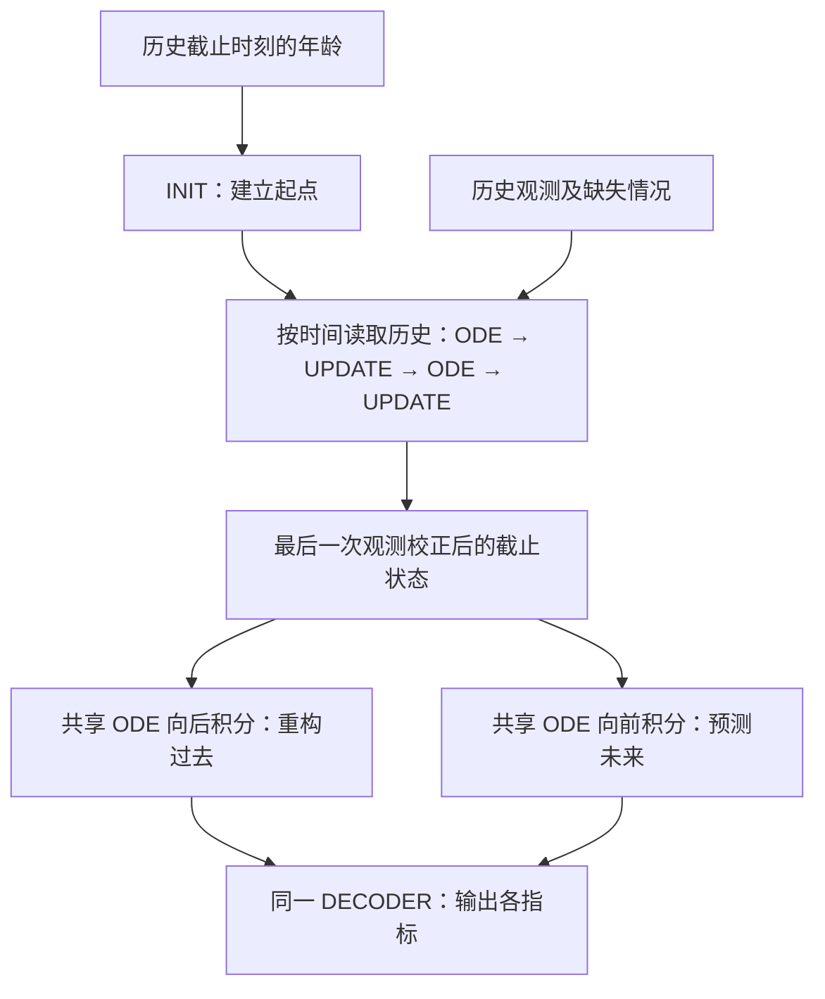
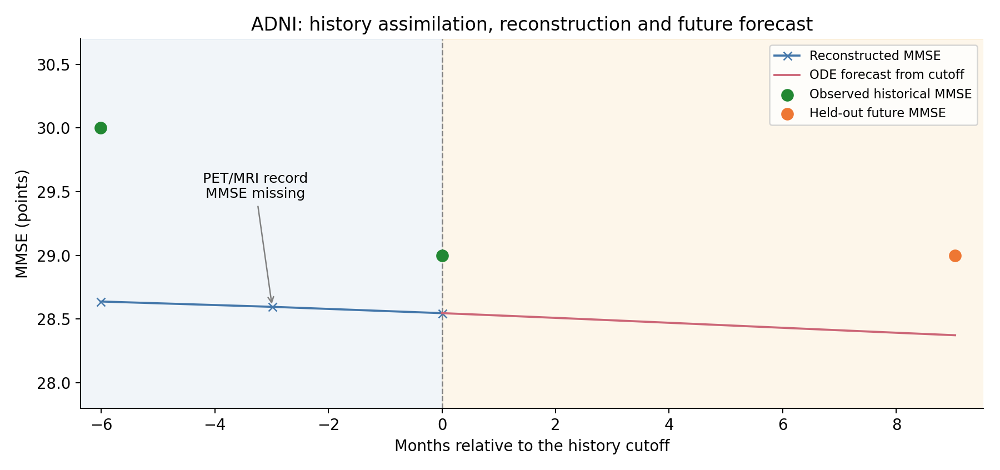
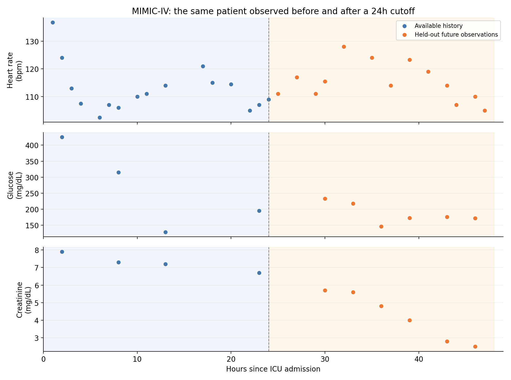

# 当前模型方法：从纵向观测到连续状态轨迹

与HealthFlux-KL、ODE-AE、ODE-RNN和Latent ODE的思想、结构和训练对照，见[五类模型方法简明比较](MODEL_METHODS_COMPARISON.zh-CN.md)。

## 1. 从患者的检查记录出发

一位患者会在不同时间接受检查。每次检查的项目可能不同，间隔也可能不同：这次有量表，下次有影像；有的指标反复测量，有的很久才测一次。

我们希望把这些记录放到同一条时间线上，逐次吸收已有信息，形成对患者当前状态的估计。然后，从这个状态出发，重构过去的指标，并预测未来的变化。

本文介绍当前使用的 **latent2x both**。它沿用 shared_matched 的共享 ODE 结构，将潜在状态设为28维，并同时加入 weak prior 和 Jacobian 正则，两个权重均为0.01。

下面先用与数据集无关的方式说明方法。最后分别用 ADNI 和 MIMIC 的一位真实测试患者，展示同一套流程如何落到具体记录上。

## 2. 怎样表示一位患者的数据

### 2.1 每次观测包含时间、数值和掩码

一位患者的序列写成：

\[
\{(t_1,y_1,m_1),(t_2,y_2,m_2),\ldots,(t_N,y_N,m_N)\}.
\]

| 符号 | 含义 | 直观理解 |
|---|---|---|
| \(t_i\) | 第 \(i\) 次观测的时间 | 这次记录发生在什么时候 |
| \(y_i\) | 各字段的实际观测值 | 这次测到了什么 |
| \(m_i\) | 各字段的观测掩码 | 测到记为1，缺失记为0 |
| \(N\) | 这位患者的观测次数 | 时间线上有多少条记录 |

模型直接使用相邻观测之间的实际时间差。两次检查相隔多久，状态就演化多久。

一次预测任务还要指定**历史截止点**。假设只允许读取前 \(c\) 次观测，那么：

- 第1至第 \(c\) 次是已知历史，用于估计患者状态。
- 第 \(c+1\) 次及以后是未来记录，用于评价预测。

下文统一把最后一次已知观测的时刻记为 \(t_c\)。

### 2.2 数值字段与类别字段怎样进入网络

数值字段先根据训练集做归一化。例如，某字段训练集最小值为 \(b_j\)、最大值与最小值之差为 \(a_j\)，则：

\[
\widetilde y_{ij}=\frac{y_{ij}-b_j}{a_j}.
\]

类别字段采用独热编码。例如三种类别分别表示为 `[1,0,0]`、`[0,1,0]`、`[0,0,1]`。

随后，把每个字段的编码乘以该字段的观测掩码。缺失数值变成0，缺失类别的整段独热编码变成0。将各字段拼接，得到这一时刻的输入向量 \(x_i\)。

因此，需要区分两个维度：

- **原始字段数 \(F\)**：实际有多少项检查或资料。
- **展开维度 \(D\)**：数值字段和独热编码拼接后的向量长度。

UPDATE 实际接收的是“当前状态＋处理后的观测向量”。掩码通过上述逐字段相乘参与输入处理，也用于决定哪些标签参与损失。

## 3. 模型由哪四个网络组成

### 3.1 潜在状态：用一个向量概括当前估计

模型用潜在状态 \(z\in\mathbb R^d\) 概括患者。当前版本取 \(d=28\)。

可以把它理解成一个由模型学习的“患者状态坐标”。不同观测共同决定患者处在什么位置；后续演化取决于这个位置。临床指标通过解码器从状态中读出。

模型的四个网络都采用“线性层 → Tanh → 线性层”：

| 模块 | 输入 → 隐藏层 → 输出 | 负责什么 |
|---|---|---|
| INIT | 1 → 159 → 28 | 根据年龄建立读取历史前的状态 |
| 共享 ODE 向量场 \(f_\theta\) | 28 → 188 → 28 | 决定状态随时间如何连续变化 |
| UPDATE \(U_\phi\) | \((28+D)\) → 159 → 28 | 吸收新观测，修正状态估计 |
| DECODER \(g_\psi\) | 28 → 159 → \(D\) | 从状态读出各指标预测 |

这四个网络的参数由全部训练患者共同学习。每位患者的状态则由自己的年龄、观测值、缺失情况和时间间隔决定。

### 3.2 INIT：年龄提供起始信息

一次预测任务中，设患者在历史截止时刻的年龄为 \(a_c\)，则初始化为：

\[
z_1^-=\operatorname{INIT}(a_c/100).
\]

这里的上标“−”表示尚未读取当前观测。模型把这个状态作为第一次历史观测前的起点，再从第一次观测开始按时间向前处理。

当前 INIT 只接收年龄。性别、诊断及其他字段按普通观测的方式交给 UPDATE。

年龄和 ODE 时钟分别承担不同角色：年龄用于建立起始状态；时钟用于计算两次观测之间经过了多久。一次预测任务确定历史截止点后，年龄初始化也随之固定。

### 3.3 共享 ODE：学习状态的变化速度

在没有新观测的时间段内，状态按照下面的方程演化：

\[
\frac{dz(t)}{dt}=f_\theta(z(t)).
\]

\(f_\theta(z)\) 输出一个与状态同维度的速度向量：它告诉模型，此刻应该沿什么方向变化、变化多快。

向量场的参数在所有患者之间共享。患者状态不同，送入 \(f_\theta\) 的位置就不同，因此可以得到不同速度和轨迹。

向量场以状态为输入。年龄和已经吸收的观测通过状态影响后续速度，时间间隔决定沿这一速度场推进多久。

把从状态 \(z\) 出发、演化 \(\Delta t\) 后的结果记为：

\[
\Phi_{\Delta t}(z).
\]

例如，\(\Phi_{3}(z)\) 表示演化3个时间单位。时间单位由数据任务统一指定，整个训练和测试都使用这一单位。

当前使用自适应 **Tsitouras 5(4)** 求解器，容差为 `rtol=1e-4`、`atol=1e-6`。求解器会在两次观测之间选择内部计算步长，逐步完成积分。这些内部计算点用于推进 ODE；观测校正发生在真实历史记录处。

### 3.4 UPDATE：把新证据融入状态

状态演化到第 \(i\) 次观测时，先得到读取该条记录前的状态：

\[
z_i^-=\Phi_{t_i-t_{i-1}}(z_{i-1}^+).
\]

再把它与当前观测输入拼接，交给 UPDATE：

\[
z_i^+=U_\phi([z_i^-,x_i]).
\]

上标“＋”表示已经吸收这次观测。于是，历史读取由两种动作交替组成：

**经过一段时间，用 ODE 推进；得到一条观测，用 UPDATE 校正。**

这里的跳变表达的是新证据对状态估计的修正。例如，一次新化验提示患者比模型原先估计的更严重，UPDATE 就可以把状态调整到更符合这条证据的位置。

第一次观测直接在 INIT 状态上更新。随后重复“演化—校正”，直到读完历史。

### 3.5 DECODER：把状态读成临床指标

任意时刻的状态都可以交给同一个解码器：

\[
o(t)=g_\psi(z(t)).
\]

输出按字段拆开：

- 数值字段输出一个归一化预测值，再按训练集参数还原到原始单位。
- 类别字段输出一组 logits，经该组 Softmax 得到类别概率。

例如，一个三分类字段占用3个输出位置。这三个位置组成它的预测头；不同字段共享 DECODER 的隐藏层。

状态的移动也可以转成某项指标的变化速度。如果某数值字段的原始单位预测为 \(\widehat y_j=b_j+a_jg_j(z)\)，则：

\[
\frac{d\widehat y_j}{dt}
=a_j\nabla_zg_j(z)^\top f_\theta(z).
\]

这个速度同时取决于状态的运动和解码器对该方向的响应，因此可以将潜在轨迹读成具体指标的变化。

## 4. 怎样从历史得到一条完整预测轨迹

### 4.1 先把已知记录全部读完

对前 \(c\) 条历史记录依次执行 ODE 和 UPDATE，最终得到：

\[
z_c^+.
\]

它就是本次预测任务的**截止状态**：概括截至 \(t_c\) 为止已获得的信息。

### 4.2 再从截止状态向两个时间方向积分

之后，以 \(z_c^+\) 为共同起点，生成整条轨迹：

\[
\widetilde z(t)=\Phi_{t-t_c}(z_c^+),
\qquad
\widehat y(t)=\operatorname{Decode}(\widetilde z(t)).
\]

| 查询时间 | 积分方向 | 得到的结果 |
|---|---|---|
| \(t<t_c\) | 负时间间隔，向后积分 | 基于全部已知历史重构过去 |
| \(t=t_c\) | 直接解码截止状态 | 当前指标估计 |
| \(t>t_c\) | 正时间间隔，向前积分 | 从当前估计出发的未来预测 |

历史编码、历史重构、未来推演使用的是**同一个 \(f_\theta\)**。向过去生成时，求解器使用负时间间隔；向未来生成时，使用正时间间隔。

两条生成路径都直接从保存的截止状态出发。模型完成历史重构后，会重新取这个截止状态，再进行未来推演。

### 4.3 分清三个读数，它们各自承担什么任务

同一个历史时刻，可以出现三种预测：

| 读数 | 计算方式 | 使用的信息 | 用途 |
|---|---|---|---|
| **观测前预测** | \(g_\psi(z_i^-)\) | 年龄和第 \(i\) 次之前的历史 | 训练 weak prior |
| **观测后读数** | \(g_\psi(z_i^+)\) | 再加上当前观测 | 表达这次更新后的状态 |
| **历史重构** | \(g_\psi(\Phi_{t_i-t_c}(z_c^+))\) | 截至第 \(c\) 次的全部历史 | 主训练目标中的历史部分、测试历史误差 |

例如，读到第五次检查后再重构第二次，模型使用的是前五次检查形成的截止状态。观测前预测则是在第二次检查尚未交给 UPDATE 时计算。

这个区别也对应两类监督：主损失要求最终状态生成的整条轨迹符合记录；weak prior 要求逐次读取历史时，ODE 的预测也能解释即将到来的观测。

## 5. 训练损失怎样组成

### 5.1 主目标：整条轨迹上的数值与类别误差

对一个训练样本，模型读取指定历史前缀，然后预测全部目标时刻。历史部分用于重构，未来部分用于预测。

对于数值字段 \(j\)，单次误差是：

\[
\ell_j=(\widehat{\widetilde y}_j-\widetilde y_j)^2.
\]

对于类别字段 \(j\)，单次误差是正确类别概率的负对数：

\[
\ell_j=-\log p_j(y_j).
\]

每个字段先在有效观测上取平均：

\[
E_j=
\frac{\sum_{b,i}m_{bij}\,\ell_j(\widehat y_{bi},y_{bi})}
{\sum_{b,i}m_{bij}}.
\]

其中 \(b\) 表示批次内的患者—历史前缀样本，\(i\) 表示时间点。对有有效观测的字段求和，得到：

\[
\mathcal L_{\mathrm{data}}
=\underbrace{\sum_{j\in\mathrm{数值}}E_j}_{\mathcal L_{\mathrm{MSE}}}
+\underbrace{\sum_{j\in\mathrm{类别}}E_j}_{\mathcal L_{\mathrm{CE}}}.
\]

这样，每个字段先形成自己的平均误差，再参与总体目标。一个有5类的字段仍然贡献一项交叉熵。

### 5.2 weak prior：让观测到来前的预测也受到监督

历史编码过程中，在每次 UPDATE 之前，先解码 \(z_i^-\)，再与即将读入的真实观测比较：

\[
\widehat y_i^-=\operatorname{Decode}(z_i^-).
\]

按上一节相同的“字段内取平均、字段间求和”规则，得到 \(\mathcal L_{\mathrm{prior}}\)。监督从第二条历史记录开始，一直覆盖到历史截止点。

这项损失鼓励 ODE 从前一次更新状态出发，经过实际时间间隔后，就能对下一次检查给出合适预测。UPDATE 仍负责吸收新证据，而 ODE 也持续获得直接的预测监督。

训练输入中的随机遮盖只影响送入 UPDATE 的观测，weak prior 的监督标签继续使用原始有效观测掩码。

### 5.3 Jacobian正则：控制相邻状态的速度变化

向量场的 Jacobian 为：

\[
J_f(z)=\frac{\partial f_\theta(z)}{\partial z}.
\]

它描述状态位置稍微变化时，速度会怎样变化。当前正则项为：

\[
\mathcal L_{\mathrm{jac}}
=\frac{1}{|\mathcal S|}
\sum_{z\in\mathcal S}\|J_f(\operatorname{sg}(z))\|_F^2.
\]

\(\mathcal S\) 是从截止状态生成历史和未来轨迹时，所有有效目标时刻的状态集合。\(\operatorname{sg}\) 表示将采样位置作为固定坐标：正则在这些位置调整向量场参数。

28维状态对应28×28的 Jacobian。每个位置将784项导数的平方相加，再对所有有效位置取平均。

对于当前两层 Tanh 向量场，Jacobian 可以精确写为：

\[
J_f(z)=W_2\operatorname{diag}\!\left(1-\tanh^2(W_1z+b_1)\right)W_1.
\]

代码直接使用这个表达式计算正则及参数梯度。它鼓励相近状态具有相近速度，从而减少局部动力学中不必要的变化。

### 5.4 ODE参数L2：约束向量场的参数规模

将共享 ODE 中全部权重和偏置的平方求和：

\[
\mathcal L_{\mathrm{ODE\text{-}L2}}=\sum_{p\in\theta}\|p\|_2^2.
\]

同一个向量场承担编码与生成，参数在这一项中计一次。

### 5.5 合并成当前 both 版本的目标

\[
\boxed{
\mathcal L=
\mathcal L_{\mathrm{MSE}}
+\mathcal L_{\mathrm{CE}}
+0.02\mathcal L_{\mathrm{ODE\text{-}L2}}
+0.01\mathcal L_{\mathrm{prior}}
+0.01\mathcal L_{\mathrm{jac}}
}
\]

| 部分 | 主要作用 |
|---|---|
| MSE＋交叉熵 | 使截止状态生成的历史和未来轨迹符合实际记录 |
| weak prior | 使逐次读取历史时的观测前预测更准确 |
| Jacobian正则 | 使邻近状态的速度变化更平缓 |
| ODE参数L2 | 控制向量场参数规模 |

模型以单一确定性状态表示患者。INIT、UPDATE、共享 ODE 和 DECODER 在这一目标下联合训练。

## 6. 一轮训练如何进行

### 6.1 先划分患者，再拟合数据变换

训练、验证、测试以患者为单位划分。同一患者的全部记录使用同一个划分。

归一化参数由训练患者的有效观测拟合，随后固定用于验证和测试。类别编码、时间单位和字段顺序也在训练开始前确定。

### 6.2 从患者记录中构造预测任务

训练时，为患者选择一个历史截止点，形成一个“患者—历史前缀”样本。比如，一位患者有五次记录，读前两次预测后面三次，与读前四次预测最后一次，是两个训练任务。

历史前缀可以按协议枚举，也可以每轮抽取。实际采用的方式见最后两个数据实例。

### 6.3 每个批次按顺序完成六步

1. **准备输入。** 将数值归一化、类别展开，并按历史范围构造输入掩码。训练时随机遮盖10%的可输入字段。
2. **读取历史。** INIT建立起点，随后交替运行ODE和UPDATE，同时收集观测前预测。
3. **生成轨迹。** 保存截止状态，从中分别向过去和未来积分，在目标时间点解码。
4. **计算损失。** 在有效标签上计算主误差、weak prior，并加入Jacobian和ODE参数L2。
5. **更新参数。** 沿网络和积分计算图反向传播，裁剪梯度，再由Adam更新四个模块。
6. **记录训练。** SwanLab记录各项损失、学习率、梯度和运行信息。

未来真实记录在训练中承担监督标签的作用；历史输入由单独的输入掩码确定。

当前学习率为0.003，按 \(0.97^{\mathrm{step}/2000}\) 衰减，梯度范数裁剪上限为10。

### 6.4 每轮验证，选出最佳检查点

验证时，按预先确定的历史截止协议构造任务，使用全部可获得的历史观测，关闭输入随机遮盖。

选模依据是验证集的**整体数据误差**：将历史和未来有效观测合并，重新计算每个字段的平均误差，再将数值MSE与类别交叉熵求和。

当前最多训练300轮，至少训练50轮；验证整体误差连续40轮没有改善时早停。每次验证改善就保存检查点，最后载入最佳检查点进行测试。

训练、验证和模型计算在CUDA上执行。多卡训练将各卡的字段误差和观测数量汇总，形成全局损失；设备和配置随实验一起保存。

## 7. 测试时模型得到什么，输出什么

### 7.1 输入一段已知历史

对于测试患者，先根据协议确定 \(t_c\)。把截至该时刻的真实记录交给模型，得到 \(z_c^+\)。

未来查询时间指定了模型要预测到哪里。模型从同一截止状态积分到这些时刻，并由 DECODER 输出各字段预测。未来真实数值和类别在结果汇总时作为评价标签读取。

整个未来推演过程中，患者状态随ODE连续演化。之后若获得新检查，可以把新记录纳入历史，再形成新的截止状态和预测。

### 7.2 分别评价历史、未来与整体

| 结果名称 | 使用哪些目标 | 回答的问题 |
|---|---|---|
| 历史重构误差，代码称 `interpolation` | 截止点及之前 | 最终历史状态能否生成符合过去记录的轨迹 |
| 未来预测误差，代码称 `forecast` | 截止点之后 | 从当前估计出发，未来指标预测得怎样 |
| 整体误差，代码称 `overall` | 历史与未来合并 | 整条生成轨迹与全部有效记录相差多少 |

每一栏都独立汇总其覆盖的有效观测，按字段计算均值后求和。整体误差也按这个规则重新计算。

评估包含多个历史前缀时，同一次真实检查会对应多个“在不同已知历史下预测它”的任务。这些任务各自进入统计。

### 7.3 将预测还原到便于理解的单位

数值输出按训练集参数反归一化：

\[
\widehat y_j=b_j+a_j\widehat{\widetilde y}_j.
\]

随后可以报告原始单位下的 MAE、RMSE；类别输出可报告概率及分类准确率。

另一种跨字段汇总方式，是将各数值字段的原始单位MSE除以该字段训练标准差的平方，再对字段取平均。这样可以在统一的标准差尺度上阅读不同指标的预测误差。

## 8. 用 ADNI 的一个病例走完整个流程

### 8.1 这位患者有哪些记录

当前 ADNI 实例使用40个原始字段，类别展开后为49维。数值包括量表、PET、MRI变化和体液指标等。数据按自然年季度聚合，以季度末作为时间点，ODE以**年**为单位积分。

这里使用测试患者 **002_S_4219**。取前三次季度记录作为历史，以2012年3月31日为截止点，预测约9个月后的检查。

| 日期 | 相对截止点，约 | 诊断 | MMSE | CDR-SB | 淀粉样PET SUVR | 海马体积相对首次变化 | 本次任务中的角色 |
|---|---:|---|---:|---:|---:|---:|---|
| 2011-09-30 | −6个月 | MCI | 30 | 1.0 | — | 0.00% | 历史输入 |
| 2011-12-31 | −3个月 | — | — | — | 1.0618 | +1.69% | 历史输入 |
| 2012-03-31 | 0 | MCI | 29 | 1.0 | — | −0.56% | 历史输入、截止点 |
| 2012-12-31 | +9个月 | MCI | 29 | 0.5 | — | −0.99% | 未来评价目标 |

“—”表示该季度没有该字段的观测。表中展示部分字段，模型读取的是该季度全部可用字段。

### 8.2 模型怎样读取前三条记录

**第一步：年龄初始化。** 截止点年龄约80.0821岁，因此 INIT 的输入约为0.800821。得到28维起点，放在第一次历史观测之前。

**第二步：读取2011年9月的记录。** 把已知诊断、MMSE、CDR-SB及其他可用字段交给 UPDATE，得到第一次校正后的状态。

**第三步：演化到2011年12月，再吸收PET和MRI。** 两条记录的实际时间差约为0.2519年。ODE先推进这段时间，再由UPDATE吸收该季度观测。这个季度的MMSE缺失，但PET和MRI仍然提供状态信息。

**第四步：演化到2012年3月，再吸收第三次观测。** 再推进约0.2491年，使用MMSE=29、MCI诊断等信息校正，得到本次任务的截止状态 \(z_c^+\)。

### 8.3 怎样重构过去、预测未来

从截止状态向过去积分，可以得到前三个季度的重构。从同一状态向未来积分约0.7529年，可以得到2012年12月的预测。

已有 latent2x both 最佳检查点的该病例输出如下，MMSE均已还原为分数：

| 日期 | 实际MMSE | 模型生成MMSE | 这一读数的含义 |
|---|---:|---:|---|
| 2011-09-30 | 30 | 28.64 | 由第三次记录后的截止状态向过去重构 |
| 2011-12-31 | — | 28.60 | 在该时间点生成MMSE估计 |
| 2012-03-31 | 29 | 28.55 | 解码截止状态 |
| 2012-12-31 | 29 | 28.37 | 从截止状态自由演化到未来 |

未来这次MMSE的绝对误差约为0.63分。第二季度的MMSE没有真实标签，其生成值用于展示轨迹；评分时按该字段的观测掩码处理。

### 8.4 这位患者如何进入完整训练和测试

ADNI协议枚举患者的全部历史前缀。对于这位有四次记录的患者，会形成四个任务：

| 读取的历史 | 未来目标 |
|---|---|
| 第1次 | 第2、3、4次 |
| 第1、2次 | 第3、4次 |
| 第1、2、3次 | 第4次，即上面的例子 |
| 第1、2、3、4次 | 历史重构任务 |

训练患者按同样方式构造任务；这位测试患者用于模型训练完成后的评价。各前缀的历史重构和未来预测分别汇入完整测试指标。

## 9. 用 MIMIC 的一个病例走完整个流程

### 9.1 同一种结构换成 ICU 的小时记录

当前 MIMIC-IV 实例取每位患者首次 ICU 住院的前48小时。31个原始字段展开为44维，包括27个数值字段、3个GCS类别字段和性别。记录按可用时间聚合到小时窗口，以窗口结束时刻表示，ODE以**小时**为单位积分。

主要测试任务固定读取前24小时，预测第24至48小时。训练时，每位患者每轮从可用的6、12、18、24小时历史截止点中选一个。

这里使用测试患者 **10004235**，入ICU年龄锚点推算值为47岁。前后两天各有22个非空小时窗口。下面展示部分实际记录：

| ICU后小时 | 心率，bpm | 血糖，mg/dL | 肌酐，mg/dL | 本次任务中的角色 |
|---|---:|---:|---:|---|
| 1 | 136.75 | — | — | 历史输入 |
| 2 | 124.00 | 425 | 7.9 | 历史输入 |
| 8 | 106.00 | 315 | 7.3 | 历史输入 |
| 13 | 114.00 | 129 | 7.2 | 历史输入 |
| 23 | 107.00 | 195 | 6.7 | 历史输入 |
| 24 | 109.00 | — | — | 历史输入、截止点 |
| 30 | 115.50 | 233 | 5.7 | 未来评价目标 |
| 36 | — | 146 | 4.8 | 未来评价目标 |
| 43 | 114.00 | 176 | 2.8 | 未来评价目标 |
| 46 | 110.00 | 172 | 2.5 | 未来评价目标 |
| 48 | — | — | — | 该小时有其他字段，作为未来评价目标 |

第48小时有呼吸频率15次/分钟，因此这一行仍是有效记录。表格只展示心率、血糖、肌酐三项。

图中蓝点是模型能够读取的历史观测，橙点是未来评价标签。

### 9.2 读取历史时发生什么

**第一步：年龄初始化。** 将47岁换算到第24小时，约为47.0027岁。INIT接收约0.470027；ODE的观测时刻则是1、2、3……小时。

**第二步：逐条吸收前24小时记录。** 第1小时有心率、血压、呼吸及GCS等信息。第2小时增加血糖425、肌酐7.9，UPDATE把这些新信息融入状态。

**第三步：按实际间隔推进。** 这位患者第5小时没有任何有效字段，记录从第4小时直接到第6小时。ODE推进2小时，再吸收第6小时的观测。

**第四步：读到第24小时。** 第23小时的肌酐6.7已影响患者状态。第24小时记录包含心率、血压，UPDATE继续利用这些字段，形成最终截止状态。每次更新使用当次可用观测，之前的信息通过潜在状态传递。

### 9.3 从第24小时推演到第48小时

保存截止状态 \(z_{24}^+\) 后，模型按需要查询：

\[
\widehat y(30)=\operatorname{Decode}(\Phi_6(z_{24}^+)),
\]

\[
\widehat y(36)=\operatorname{Decode}(\Phi_{12}(z_{24}^+)),
\]

\[
\widehat y(48)=\operatorname{Decode}(\Phi_{24}(z_{24}^+)).
\]

生成其他未来小时的方式相同。期间状态只随ODE演化，未来检查留在评价表中。

对于这个病例，肌酐在第23小时为6.7，未来第30、36、43、46小时分别为5.7、4.8、2.8、2.5。模型需要根据前24小时的联合信息，预测出后续这些时刻的肌酐。实际计算误差时，将预测反归一化到mg/dL，再与对应观测比较。

第36小时没有心率标签，就按血糖、肌酐和该时刻其他有效字段评分。第48小时有呼吸频率标签，就评价该字段。每个时间点的观测掩码决定评价项目。

### 9.4 同一截止状态也要解释前24小时

从 \(z_{24}^+\) 向过去积分，可以重构第1、2、8、13、23小时等历史记录。训练时，这部分误差与后24小时预测误差一起进入主损失。

weak prior 则发生在更早的历史读取过程中。例如，在第23小时的真实记录交给 UPDATE 前，先解码 \(z_{23}^-\)，与该时刻的肌酐6.7、血糖195等有效标签比较。

Jacobian正则作用于从截止状态生成的历史和未来状态。这样，同一个病例同时提供了“整条轨迹是否符合观测”“新观测到来前是否预测合理”“局部速度变化是否平缓”三类训练信号。

## 10. 两个数据实例如何对应到同一方法

ADNI与MIMIC分别训练各自的参数。两个实例共用上文的网络结构和训练目标，输入输出字段与时间单位按各自任务配置。

| 项目 | ADNI实例 | MIMIC-IV实例 |
|---|---|---|
| 轨迹内容 | 长期认知、影像及其他检查 | ICU生命体征、化验与GCS |
| 原始字段 / 展开维度 | 40 / 49 | 31 / 44 |
| 潜在维度 | 28 | 28 |
| INIT / UPDATE / DECODER隐藏宽度 | 159 | 159 |
| 共享ODE隐藏宽度 | 188 | 188 |
| 参数量 | 44,875 | 43,280 |
| ODE时间单位 | 年 | 小时 |
| 历史任务构造 | 枚举全部历史前缀 | 训练每人每轮抽取一个截止点 |
| 主要测试 | 全部历史前缀下的重构与未来预测 | 前24小时预测后24小时 |
| weak prior / Jacobian权重 | 0.01 / 0.01 | 0.01 / 0.01 |

### 实现与病例来源

- [模型结构、历史编码、生成与字段误差](../paper_odeae/models.py)
- [自适应ODE求解器](../paper_odeae/solver.py)与[精确Jacobian正则](../paper_odeae/jacobian.py)
- [ADNI数据及历史前缀](../paper_odeae/data.py)、[训练和测试](../paper_odeae/train.py)、[both训练配置](../paper_odeae/results/latent2x_loss_ablation/both/seed_0/config.json)
- [MIMIC数据与任务说明](../mimic_experiment/README.zh-CN.md)、[历史截止任务](../mimic_experiment/data.py)、[四卡训练与测试](../mimic_experiment/train_ddp.py)
- [病例数值及来源校验记录](assets/current_model/case_data.json)。ADNI预测复用已完成CUDA诊断保存的[病例输出](../paper_odeae/results/state_space_model_comparison/latent2x_both/forecast_cases.json)，对应both版本第81轮最佳检查点。
- [病例提取与绘图脚本](build_current_model_examples.py)。脚本读取整理数据和已有预测，生成本文图表。
