# 论文实验结果与分析：性别 INIT、共享 ODE 与残差观测更新

更新日期：2026-11-08。本文围绕主要比较、核心消融、动力学机制与补充消融组织本轮实验。每个主题依次说明问题、设置、数值结果和图表解释；原始配置、指标和日志由文中链接提供。

<!-- publication-caption -->
阅读顺序：第一章定义模型与统计口径，第二章比较三类数据集的预测效果，第三章逐项检查核心设计，第四章研究学到的状态空间与动力学，第五章讨论初始化、门控和容量。第七章逐项列出 89 个作业的执行记录；其中验证分数用于选模，前文结果表使用独立测试分数。
<!-- /publication-caption -->

## 一、模型定义与共同实验标准

### 1.1 主模型 M0

患者检查按实际时间顺序输入。模型先把性别映射为首次历史检查时刻的潜在状态，再用共享 ODE 描述检查之间的连续变化。新检查到达时，UPDATE 产生候选状态，残差门控吸收其中一部分修正。吸收全部已知历史后，从历史截止点向未来预测或向过去回顾，两类生成路径继续使用同一个速度场。

\[
z_0^-=\operatorname{INIT}_\eta(\mathrm{sex}),\qquad
\dot z=f_\theta(z),\qquad
z_k^+=0.9z_k^-+0.1U_\phi(z_k^-,y_k).
\]

训练保留原来的历史回顾与未来预测联合重建目标。数值字段使用 MSE，类别字段使用 CE，按有效观测掩码逐字段归一化后求和。历史与未来的全部有效时间点合并计算主重建项；辅助项为 0.01 Jacobian 正则与 0.02 ODE 参数 L2。

\[
\mathcal L_{\mathrm{M0}}=
\mathcal L_{\mathrm{recon,MSE}}+\mathcal L_{\mathrm{recon,CE}}
+0.01\,\mathbb E_z\|J_f(z)\|_F^2
+0.02\,\mathcal R_{\mathrm{ODE}}.
\]

weak prior 系数为 0。历史回顾主损失仍然完整端到端反向传播。Jacobian 沿用现有实现：有效生成状态先 detach，每个 28×28 Jacobian 的平方元素求和，再在状态间求平均，只对向量场参数施加该正则梯度。

| 项目 | 固定设置 |
| --- | --- |
| 潜在状态 | 28 维 |
| INIT | 1→159→28；F=0、M=1；初始状态放在首次历史检查时刻 |
| 共享 ODE | 28→188→28，Tanh；编码、未来预测、历史回顾共享全部参数 |
| UPDATE | 保留原网络，固定 α=0.1 残差更新 |
| Decoder | 保留原数值字段和类别输出头 |
| weak prior / Jacobian / ODE L2 | 0 / 0.01 / 0.02 |
| ADNI / MIMIC 参数量 | 44,875 / 43,280 |
| 本轮主模型状态 | 两个数据集均已完成，最佳轮次分别为 ADNI 30、MIMIC 143 |

<!-- publication-caption -->
**设置表 A：主模型结构。** 本轮 M0 保留 28 维状态和现有网络，只以性别决定起点；观测残差门控固定为 0.1。两个数据集参数量差异来自观测字段数。
<!-- /publication-caption -->

ADNI 缓存使用 PTGENDER−1，即 M=0、F=1；INIT 入口需映射为 F=0、M=1。MIMIC 缓存已为 F=0、M=1。类别预测目标继续沿用各自缓存编码，只转换 INIT 输入。实际进入 INIT 的标量为 0/1；若复用内部除以 100 的年龄接口，应补偿缩放并审计真实输入张量。性别只取预测时已经可用的静态资料或首次历史记录，缺失策略根据训练集确定。

实现来源：[模块设计](../ablation/Ablation.zh-CN.md)、[INIT 输入与 CUDA 审计](../mimic_experiment/init_covariate_ablation.py)、[当前模型方法](CURRENT_MODEL_METHOD.zh-CN.md)。

### 1.2 数据与训练标准

ADNI 检验多年疾病演化，MIMIC 检验小时尺度的不规则临床序列，CausalMed 检验动作条件下的反事实推演。三个数据集分别固定患者划分，归一化只使用训练集。验证整体误差选择最佳检查点，重新载入后进行独立测试。

| 项目 | ADNI | MIMIC | CausalMed |
| --- | --- | --- | --- |
| 训练 / 验证 / 测试患者 | 2,093 / 393 / 414 | 21,517 / 4,649 / 4,536 | 10,000 / 2,000 / 2,000 |
| 版本 | local_available，40 字段 / 展开 49 维 | chronology_v2，31 字段 / 展开 44 维 | γ=1，公开事实数据 |
| 归一化 / 时间单位 | 训练 min-max / 年 | 训练 min-max / 小时 | 训练 z-score / 年 |
| 训练历史 | 枚举所有非空历史前缀 | 每轮采样 6/12/18/24 小时截止点 | 原患者级历史截止点采样 |
| 主测试 | 各历史前缀之后的真实随访 | 前 24 小时历史，预测后续至 48 小时 | 首次达到 3 年的检查后分叉，五策略至 8 年边界 |
| 新模型 batch / 梯度累计 | 32 / 无 | 128 / 无 | 128 / 无 |
| 训练上限 | 150 轮，含续训累计 | 150 轮，含续训累计 | 150 轮，含续训累计 |
| 停止规则 | 至少 50 轮；验证整体 40 轮无改善早停 | 相同 | 相同 |

<!-- publication-caption -->
**设置表 B：数据与训练标准。** 时间单位和历史构造按数据集确定，患者划分与训练归一化固定。三个数据集的新训练上限都是 150 轮，均无梯度累计。
<!-- /publication-caption -->

新主模型与消融使用 Adam，学习率 0.003，每 2,000 步乘 0.97，输入 dropout=0.1，梯度范数裁剪上限 10；Tsit5 的 rtol=1e−4、atol=1e−6。baseline 保留各自方法的概率目标与求解器。首轮固定 seed=0，并按患者配对 bootstrap 给出结果差值区间；患者重抽样不替代训练种子的变异评价。

独立作业排队使用物理 GPU 0、1、2、3，每张卡默认一个作业。模型训练、验证、测试、ODE、自动微分、PCA、近邻与几何诊断均在 CUDA 上执行。CPU 负责数据准备、文件、统计和绘图。训练接入 SwanLab，记录分项损失、梯度、学习率与验证曲线。

数据来源：[ADNI/MIMIC 合同](ADNI_MIMIC_DATASETS.zh-CN.md)、[CausalMed 公开输入](../CausalMed/latent2x_experiment/data.py)、[150 轮政策](EXPERIMENT_POLICY.json)。

### 1.3 结果与参数比较口径

H 是历史区间误差，F 是未来预测误差，O 是全部有效时间点重新汇总的整体误差。各数值字段计算 MSE，各类别字段计算 CE，字段内取有效观测均值，再按字段求和。因此 O 不等于 H、F 的简单平均。ODE-RNN 的 H 为读取该时刻观测前的因果预测，其余模型的 H 为历史重构，主要共同预测比较采用 F。

同预算组匹配实际唯一参数：ADNI 44,875、MIMIC 43,280。HealthFlux 保留原生 256+128 维并列出容量。超过 150 轮的 baseline 先在前 150 轮验证记录中确定应选轮次，再取得相应权重进行 CUDA 复评；缺少该权重时在新目录重训。完成核验前结果留空。

所有填入数字均需关联配置、数据哈希、源码、检查点 SHA256、实际轮次与结果 JSON。同一个 M0 在后续各节复用同一检查点，不重复训练参照组。

## 二、主要比较实验

### 2.1 ADNI：纵向临床预测

每个模型读取相同患者、相同历史前缀，以相同缺失掩码评价未来随访。主要比较包括 M0、概率与确定性 ODE-AE、ODE-RNN、Latent ODE 和 HealthFlux-KL。优先比较同预算模型，再用原容量表区分方法与容量的影响。每组交付混合字段误差、40 字段的原单位 MAE/RMSE 或类别准确率，重点列出 MMSE、CDR-SB、ADAS-Cog 与诊断。未来目标从不进入观测 UPDATE。

表 1：ADNI 主要比较。

| 模型 | 总参数 | 可训练参数 | 完成 / 最佳轮次 | 历史 H ↓ | 未来 F ↓ | 整体 O ↓ | 状态 |
| --- | --- | --- | --- | --- | --- | --- | --- |
| M0（性别 INIT） | 44,875 | 44,875 | 70 / 30 | 0.408170 | 0.991104 | 0.659699 | complete |
| ODE-AE（概率，同预算） | 44,875 | 44,875 | 81 / 41 | 3.026708 | 3.238572 | 3.118315 | 已有合格结果 |
| 确定性 ODE-AE（同预算） | 44,875 | 44,875 | 72 / 32 | 0.691729 | 1.239294 | 0.929746 | complete |
| ODE-RNN（同预算） | 44,875 | 44,875 | 69 / 29 | 1.376041 | 1.032329 | 1.228165 | 已有合格结果 |
| Latent ODE（同预算） | 44,875 | 44,875 | 150 / 148 | 2.495544 | 2.801288 | 2.627455 | complete |
| HealthFlux-KL（KL=1） | 5,156,722 | 5,156,722 | 58 / 18 | 0.808341 | 1.534999 | 1.127324 | 已有合格结果 |
| HealthFlux-KL（KL=0.01） | 5,156,722 | 5,156,722 | 50 / 3 | 1.084390 | 1.603200 | 1.311567 | 已有合格结果 |

<!-- publication-caption -->
**表 1 说明与分析。** 所有模型使用相同 ADNI 测试患者和历史前缀，H、F、O 均为数值 MSE 与类别 CE 的字段和。M0 的未来误差为 0.991104，低于同预算 ODE-RNN 的 1.032329 和确定性 ODE-AE 的 1.239294；相对降幅分别为 3.99% 和 20.03%。各模型的最佳轮次由验证整体误差选择。 原始结果：[记录 1](../publication_sex_init/results/adni/main/metrics.json)。
<!-- /publication-caption -->

表 2：ADNI 原容量补充比较。

| 模型 | 总参数 | 可训练参数 | 完成 / 最佳轮次 | 历史 H ↓ | 未来 F ↓ | 整体 O ↓ | 状态 |
| --- | --- | --- | --- | --- | --- | --- | --- |
| ODE-AE（概率，原容量） | 3,003 | 3,003 | 90 / 50 | 3.014009 | 3.247804 | 3.115103 | 已有合格结果 |
| 确定性 ODE-AE（22,545 参数） | 22,545 | 22,545 | 116 / 76 | 0.666808 | 1.191548 | 0.894758 | 已有合格结果 |
| ODE-RNN（原容量） | 32,746 | 22,545 | 96 / 56 | 1.370759 | 1.120580 | 1.264065 | 已有合格结果 |
| Latent ODE（原容量） | 72,266 | 62,065 | 69 / 29 | 2.524608 | 2.836983 | 2.659362 | 已有合格结果 |

<!-- publication-caption -->
**表 2 说明与分析。** 本表保留各 baseline 的原始容量，用来观察容量变化后的结果。确定性 ODE-AE 从 22,545 增至表 1 的 44,875 参数后，未来误差由 1.191548 变为 1.239294；增加参数并未带来更低的测试误差。总参数与可训练参数分列，冻结参数计入前者。
<!-- /publication-caption -->

主要图为各模型共同患者的预测轨迹、逐字段误差和患者配对差值。确定性同预算模型保留原编码与独立生成机制，宽度调整至 44,875 个实际参数。两种 HealthFlux KL 分别列出，最终设置由验证集选择。

结果来源：[同预算 ADNI](../paper_odeae/results/baselines_matched_latent2x/summary.md)、[原容量 ADNI](../paper_odeae/results/baselines_full/summary.md)、[HealthFlux](../healthflux/results/adni_comparison/summary.md)。

同预算方法中，M0 的未来误差最低。HealthFlux 的两种 KL 设置分别为 1.534999 和 1.603200，均高于 M0；其参数量约为 M0 的 115 倍。

### 2.2 MIMIC：联合临床预测与保持最近值

主测试以 ICU 前 24 小时历史预测之后 24 小时。除混合误差外，27 个数值字段的原单位 MSE 除以各自训练标准差平方后等权平均，得到数值标准化 MSE。加入保持最近值基线，历史从未测到的字段用训练均值或众数。完整输出包含全部 31 字段、GCS 分类准确率和临床单位误差，用于判断动力学模型对具体预测任务的收益。

表 3：MIMIC 主要比较。

| 模型 | 总参数 | 可训练参数 | 完成 / 最佳轮次 | 历史 H ↓ | 未来 F ↓ | 整体 O ↓ | 状态 |
| --- | --- | --- | --- | --- | --- | --- | --- |
| M0（性别 INIT） | 43,280 | 43,280 | 150 / 143 | 0.518334 | 1.795789 | 1.125570 | complete |
| ODE-AE（概率，同预算） | 43,280 | 43,280 | 124 / 84 | 3.201955 | 2.552856 | 3.218515 | 已有合格结果 |
| 确定性 ODE-AE（同预算） | 43,280 | 43,280 | 150 / 143 | 1.268689 | 1.998123 | 1.617079 | complete |
| ODE-RNN（同预算） | 43,280 | 43,280 | 150 / 149 | 2.292080 | 1.760460 | 2.365583 | complete |
| Latent ODE（同预算） | 43,280 | 43,280 | 84 / 44 | 3.162445 | 2.482012 | 3.155783 | 已有合格结果 |
| HealthFlux-KL（KL=0.01） | 4,409,965 | 4,409,197 | 110 / 70 | 1.265998 | 1.947004 | 1.591760 | 已有合格结果 |

<!-- publication-caption -->
**表 3 说明与分析。** 所有模型读取前 24 小时，再预测至第 48 小时。M0 的整体误差为 1.125570，未来误差为 1.795789；ODE-RNN 的未来误差更低，为 1.760460。M0 在历史回顾上的优势与未来预测的排名需要分别阅读。 原始结果：[记录 1](../publication_sex_init/results/mimic/main/metrics.json)。
<!-- /publication-caption -->

表 4：MIMIC 原容量补充比较。

| 模型 | 总参数 | 可训练参数 | 完成 / 最佳轮次 | 历史 H ↓ | 未来 F ↓ | 整体 O ↓ | 状态 |
| --- | --- | --- | --- | --- | --- | --- | --- |
| ODE-AE（概率，原容量） | 2,838 | 2,838 | 178（前150选模） / 138 | 3.167254 | 2.557352 | 3.202431 | 预算内复评完成 |
| ODE-RNN（原容量） | 31,813 | 21,612 | 150 / 133 | 2.292473 | 1.763826 | 2.367157 | complete |
| Latent ODE（原容量） | 70,565 | 60,364 | 104 / 64 | 3.175188 | 2.499839 | 3.167512 | 已有合格结果 |

<!-- publication-caption -->
**表 4 说明与分析。** 原容量模型补充方法的容量参照。概率 ODE-AE 的历史训练实际完成 178 轮，本次只在前 150 轮中选中第 138 轮并重新评价；表中保留了真实训练轮数。原容量 ODE-RNN 与同预算版本的未来误差接近，分别为 1.763826 与 1.760460。
<!-- /publication-caption -->

表 5：MIMIC 临床单位与数值标准化指标，GCS 使用现有三个类别头。

| 模型 | 数值标准化 MSE ↓ | 心率 MAE（bpm）↓ | 平均动脉压 MAE（mmHg）↓ | GCS-eye 准确率 ↑ | GCS-motor 准确率 ↑ | GCS-verbal 准确率 ↑ |
| --- | --- | --- | --- | --- | --- | --- |
| M0 | 0.913959 | 14.057971 | 11.731977 | 0.736253 | 0.841209 | 0.846045 |
| ODE-AE（概率，同预算） | 0.936109 | 14.576447 | 11.323553 | 0.657706 | 0.745507 | 0.738490 |
| 确定性 ODE-AE（同预算） | 0.931347 | 14.240708 | 11.243132 | 0.693764 | 0.813451 | 0.816752 |
| ODE-RNN（同预算） | 0.892733 | 14.770653 | 10.615592 | 0.737300 | 0.846065 | 0.849083 |
| Latent ODE（同预算） | 0.927523 | 14.112172 | 11.465836 | 0.666847 | 0.751594 | 0.762287 |
| HealthFlux-KL | 0.919463 | 14.576796 | 10.894301 | 0.704928 | 0.817546 | 0.821996 |
| 保持最近值 | 0.580933 | 9.748846 | 9.939788 | 0.709336 | 0.829541 | 0.836751 |

<!-- publication-caption -->
**表 5 说明与分析。** 数值标准化 MSE 对 27 个数值字段等权平均，其余列保留临床单位或分类准确率。保持最近值的数值标准化 MSE 为 0.580933，优于本表全部神经模型；M0 的 GCS 分类则分别达到 0.736253、0.841209、0.846045。不同输出任务呈现不同排序。
<!-- /publication-caption -->

配对误差按患者汇总并给出置信区间。主模型以性别进入 INIT；baseline 保留各方法既有年龄条件或年龄协变量，各模型静态输入及训练方式随配置一并记录。

结果来源：[同预算 MIMIC](../mimic_experiment/results/baselines_matched_latent2x/summary.md)、[原单位与简单基线](../mimic_experiment/results/baselines_single_cuda/summary.md)、[确定性模型](../mimic_experiment/results/baselines_with_deterministic_cuda/summary.md)。

M0 的数值标准化 MSE 为 0.913959，与 HealthFlux 的 0.919463 接近；保持最近值为 0.580933。当前模型对联合预测和 GCS 读出有不同表现，单独的数值预测仍有明显改进空间。

### 2.3 预测跨度与历史信息量

在固定最佳检查点上改变评价窗口，研究更长推演和更少历史观测的影响。ADNI 按实际间隔统计 0–12、12–24、24–36、36–60 个月。MIMIC 从 24 小时截止点计算未来 6/12/24 小时累计误差，再分别读取前 6/12 小时历史测试。每个窗口报告人数和有效目标数，各模型使用相同患者、时间点与掩码。

表 6：MIMIC 不同未来范围的累计误差。

| 模型 | 未来 6 小时 ↓ | 未来 12 小时 ↓ | 未来 24 小时 ↓ |
| --- | --- | --- | --- |
| M0 | 1.452228 | 1.595583 | 1.795789 |
| ODE-AE（概率，同预算） | 2.499316 | 2.512097 | 2.552856 |
| 确定性 ODE-AE（同预算） | 1.765421 | 1.850548 | 1.998123 |
| ODE-RNN（同预算） | 1.404701 | 1.563089 | 1.760460 |
| Latent ODE（同预算） | 2.423923 | 2.437131 | 2.482012 |
| HealthFlux-KL | 1.657210 | 1.778248 | 1.947004 |

<!-- publication-caption -->
**表 6 说明与分析。** 三列均从同一个 24 小时截止点出发，分别累计未来 6、12、24 小时的有效目标。M0 的误差从 1.452228 增至 1.795789；三个窗口中 ODE-RNN 均略低于 M0，M0 均低于确定性 ODE-AE 和 HealthFlux-KL。窗口内字段覆盖也会影响混合误差。
<!-- /publication-caption -->

表 7：M0 在不同信息量与跨度下的表现。

| 数据集 | 窗口 / 上下文 | 患者数 | 有效目标数 | 未来误差 ↓ | 数值标准化 MSE ↓ |
| --- | --- | --- | --- | --- | --- |
| ADNI | 0–12 个月 | 402 | 51779 | 0.770486 | 0.576038 |
| ADNI | 12–24 个月 | 314 | 35079 | 0.908277 | 0.580695 |
| ADNI | 24–36 个月 | 247 | 26991 | 0.965078 | 0.604100 |
| ADNI | 36–60 个月 | 202 | 41951 | 1.057661 | 0.595249 |
| MIMIC | 6 小时历史 / 至 48 小时 | 4513 | 1249385 | 2.345358 | 0.976745 |
| MIMIC | 12 小时历史 / 至 48 小时 | 4536 | 1054771 | 2.109963 | 0.934973 |
| MIMIC | 24 小时历史 / 至 48 小时 | 4536 | 687074 | 1.795789 | 0.913959 |

<!-- publication-caption -->
**表 7 说明与分析。** ADNI 各行是互不重叠的实际预测间隔，MIMIC 各行则改变已知历史长度。ADNI 的未来误差随跨度由 0.770486 增至 1.057661；MIMIC 由 6 小时增加到 24 小时历史后，未来误差从 2.345358 降至 1.795789。人数和有效目标数用于说明每个统计范围。 原始结果：[记录 1](../publication_sex_init/analysis/adni/horizons/metrics.json)、[记录 2](../publication_sex_init/analysis/mimic/horizons/metrics.json)。
<!-- /publication-caption -->

主要图为误差随预测跨度和历史观测数的曲线。患者等权汇总，避免随访较多的患者主导比较。

方案来源：[MIMIC 时间窗口评价](../mimic_experiment/results/baselines_single_cuda/summary.md)、[ADNI 共同任务](../paper_odeae/results/baselines_full/summary.md)。

### 2.4 CausalMed γ=1：反事实、治疗效应与策略选择

固定分叉患者状态后执行 Never、Always、Delayed、Aggressive、Conservative 五策略，封存预测与模型产生的治疗区间，再由独立评分器读取配对真值。报告全轨迹 CF-RMSE、1/2/3 年终点误差、Always 相对 Never 的 √PEHE、ATE 误差、策略遗憾和最优策略准确率。

公开数据只有静态 c，没有性别，因此合成适配版命名为 M0-c：INIT 接收训练集归一化的公开 c；其余使用共享 ODE、α=0.1、无 weak prior、Jacobian=0.01。门控只用于观测 UPDATE。治疗切换仍采用新旧动作条件输出之差，相同动作下位移为零。新目标实现必须显式删除原代码写死的 prior 系数。

表 8：γ=1 反事实比较，治疗效应与策略指标为 3 年窗口。

| 模型 | 参数量 | 全轨迹 CF-RMSE ↓ | 3 年 CF-RMSE ↓ | 3 年 √PEHE ↓ | 3 年 ATE 误差 ↓ | 3 年策略遗憾 ↓ | 状态 |
| --- | --- | --- | --- | --- | --- | --- | --- |
| M0-c（公开 c INIT） | 31,314 | 0.962064 | 0.839837 | 1.445902 | 1.280701 | 0.221523 | complete |
| ODE-AE | 1,843 | 5.250657 | 5.305324 | 10.498133 | 10.394523 | 1.302645 | 已有合格结果 |
| 确定性 ODE-AE（同预算） | 31,314 | 1.212183 | 1.078809 | 1.705769 | 1.528060 | 0.349563 | complete |
| HealthFlux-KL（原生容量） | 4,361,412 | 1.408327 | 0.929265 | 1.867809 | 1.307587 | 0.233698 | 已有合格结果 |

<!-- publication-caption -->
**表 8 说明与分析。** 四模型面对相同分叉患者和五种治疗策略，表内治疗效应及策略指标取 3 年窗口。M0-c 的全轨迹 CF-RMSE 为 0.962064，低于同预算确定性 ODE-AE 的 1.212183 和原生 HealthFlux-KL 的 1.408327；3 年策略遗憾也最低。M0-c 的静态输入为公开 c。 原始结果：[记录 1](../publication_sex_init/results/causalmed/causalmed_main/metrics.json)。
<!-- /publication-caption -->

确定性模型匹配到 31,314 参数，HealthFlux 保留原生容量。四模型对相同固定病例绘制五策略真实/预测平行轨迹，补充每策略误差和 1/2 年指标。动作关闭测试复用相同检查点与分叉状态，只关闭未来动作校正，检验模型是否使用治疗信息。

表 9：M0-c 动作通路测试。

| 设置 | 全轨迹 CF-RMSE ↓ | 3 年 √PEHE ↓ | 3 年 ATE 误差 ↓ | 3 年策略遗憾 ↓ |
| --- | --- | --- | --- | --- |
| 正常动作输入 | 0.962064 | 1.445902 | 1.280701 | 0.221523 |
| 同检查点关闭未来动作校正 | 5.486232 | 10.073400 | 9.927675 | 1.302645 |

<!-- publication-caption -->
**表 9 说明与分析。** 两行使用完全相同的模型权重和分叉状态，只切换未来动作校正。关闭动作后，CF-RMSE 从 0.962064 升至 5.486232，3 年策略遗憾从 0.221523 升至 1.302645，说明治疗输入确实参与了反事实轨迹和策略排序。 原始结果：[记录 1](../publication_sex_init/results/causalmed/causalmed_main/metrics.json)。
<!-- /publication-caption -->

方案与结果来源：[四模型反事实评价](../CausalMed/outputs/gamma1_model_comparison/summary.md)、[动作适配](../CausalMed/latent2x_experiment/README.zh-CN.md)、[目标与动作代码](../CausalMed/latent2x_experiment/model.py)。

<!-- publication-figures -->

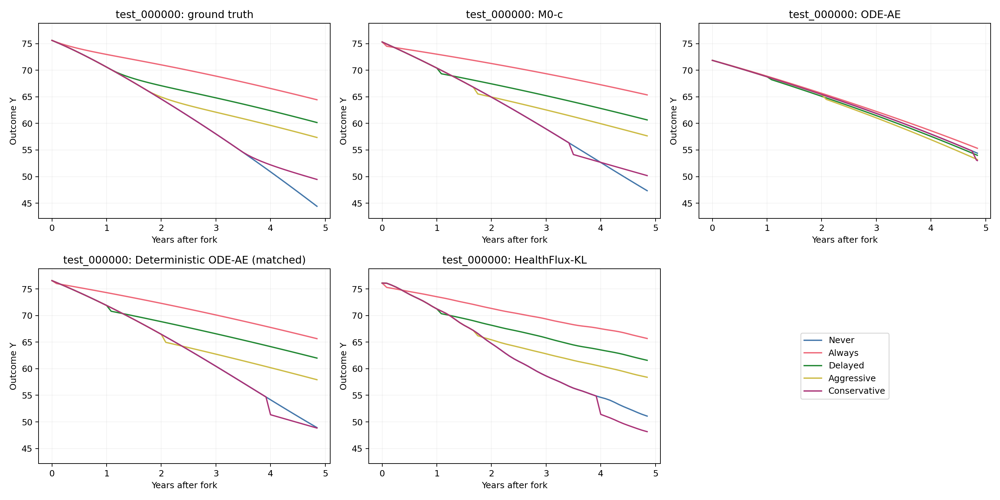

**图 1｜CausalMed 固定病例 1：五策略轨迹。** 病例 test_000000 来自预先固定的前三位公开测试患者。各行/列按图内模型和策略标签对齐，真实曲线与预测曲线使用同一时间轴。从同一历史状态分叉后，模型只读取策略动作并自由推演。该图用于观察治疗效应随时间累积的偏差，整体准确性见表 8。

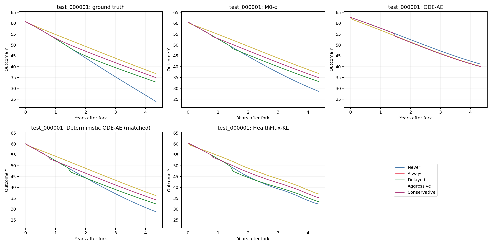

**图 2｜CausalMed 固定病例 2：五策略轨迹。** 病例 test_000001 来自预先固定的前三位公开测试患者。各行/列按图内模型和策略标签对齐，真实曲线与预测曲线使用同一时间轴。从同一历史状态分叉后，模型只读取策略动作并自由推演。该图用于观察治疗效应随时间累积的偏差，整体准确性见表 8。

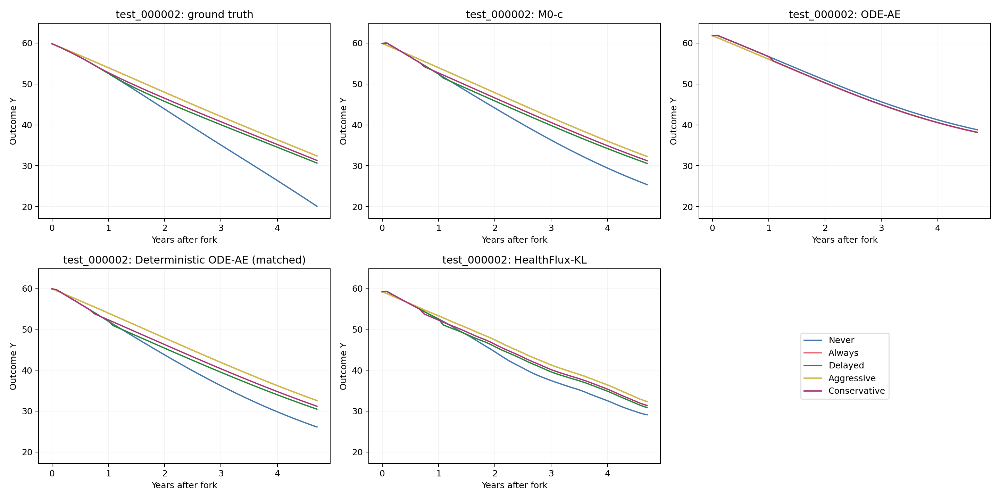

**图 3｜CausalMed 固定病例 3：五策略轨迹。** 病例 test_000002 来自预先固定的前三位公开测试患者。各行/列按图内模型和策略标签对齐，真实曲线与预测曲线使用同一时间轴。从同一历史状态分叉后，模型只读取策略动作并自由推演。该图用于观察治疗效应随时间累积的偏差，整体准确性见表 8。

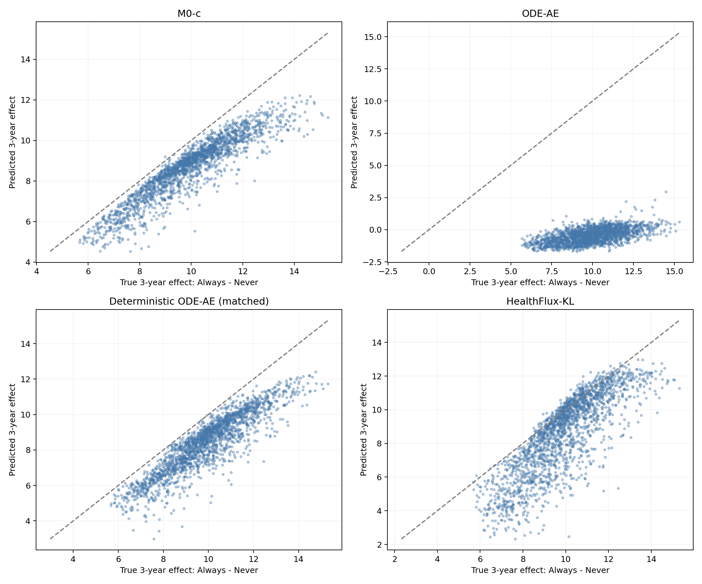

**图 4｜CausalMed 个体治疗效应比较。** 同一患者的 Always 与 Never 预测差形成个体治疗效应，再与配对真值比较；四模型使用相同测试查询。M0-c 的 3 年 √PEHE 为 1.445902，确定性 ODE-AE 为 1.705769，HealthFlux-KL 为 1.867809。图内个体差异与表 8 的总体指标共同评价效应估计。

<!-- /publication-figures -->

## 三、核心消融实验

以下六个主题均在 ADNI、MIMIC 实施，固定性别 INIT、无 prior、28 维状态及相同训练预算。除研究变量外保持 M0 设置，实际总参数分别精确为 44,875 和 43,280。所有参照行复用 M0。

### 3.1 历史读取顺序

M0 从最早历史检查开始，向未来逐条演化和吸收，最终状态放在历史截止点。反序组将性别 INIT 输出放在最近历史检查时刻，向过去逐条吸收，将最终状态放在最早历史检查，再从该时刻向未来生成整条轨迹。两组使用相同 INIT 网络和共享速度场参数化，积分方向由实际时间差正负决定。本实验比较读取顺序及对应时间锚点对预测、回顾与稳定性的影响。

表 10：反序共享 ODE。

| 数据集 | 模型 | 参数量 | 最佳轮次 | 历史 H ↓ | 未来 F ↓ | 整体 O ↓ |
| --- | --- | --- | --- | --- | --- | --- |
| ADNI | M0 | 44,875 | 30 | 0.408170 | 0.991104 | 0.659699 |
| ADNI | 反序共享 ODE | 44,875 | 24 | 0.421880 | 1.052676 | 0.694368 |
| MIMIC | M0 | 43,280 | 143 | 0.518334 | 1.795789 | 1.125570 |
| MIMIC | 反序共享 ODE | 43,280 | 140 | 0.543740 | 1.826991 | 1.152911 |

<!-- publication-caption -->
**表 10 说明与分析。** 只改变历史读取顺序及其对应的生成起点，参数预算保持一致。改为反序后，ADNI 未来误差由 0.991104 升至 1.052676，MIMIC 由 1.795789 升至 1.826991；本轮正序在两数据集的 H、F、O 均较低。 原始结果：[记录 1](../publication_sex_init/results/adni/reverse/metrics.json)、[记录 2](../publication_sex_init/results/mimic/reverse/metrics.json)。
<!-- /publication-caption -->

交付分项损失、验证曲线、最佳轮次和长期患者配对误差；反序移除仅服务于 prior 的辅助读取。

方案与实现来源：[ADNI 编码方向](../paper_odeae/results/latent2x_history_encoder_ablation/summary.md)、[α 方向实验](../mimic_experiment/results/weak_prior_ablation_cuda/targeted_causal_ablation/summary.md)、[方向实现](../mimic_experiment/alpha_direction_model.py)。

### 3.2 统一共享场与独立双场

将 M0 的单一共享速度场替换为历史编码场与预测/回顾生成场，其余模块不变。共享场 28→188→28 共 10,744 参数；双场都用宽 94，编码场去掉末层 bias 后为 5,358，生成场为 5,386，合计仍为 10,744。实验检验相同总预算集中学习统一动力学，还是分给两个专用场更有效。

表 11：等预算独立双场。

| 数据集 | 模型 | 参数量 | 最佳轮次 | 历史 H ↓ | 未来 F ↓ | 整体 O ↓ |
| --- | --- | --- | --- | --- | --- | --- |
| ADNI | M0 | 44,875 | 30 | 0.408170 | 0.991104 | 0.659699 |
| ADNI | 等预算独立双场 | 44,875 | 70 | 0.397826 | 1.034055 | 0.672761 |
| MIMIC | M0 | 43,280 | 143 | 0.518334 | 1.795789 | 1.125570 |
| MIMIC | 等预算独立双场 | 43,280 | 143 | 0.567956 | 1.792220 | 1.150422 |

<!-- publication-caption -->
**表 11 说明与分析。** 共享场与双场的 ODE 参数总数都为 10,744，双场将预算拆成两个较窄的网络。ADNI 中共享场未来误差较低；MIMIC 双场的未来误差略低，为 1.792220，但历史和整体误差较高。因此，共享场的主要收益体现在统一预算下的综合表现。 原始结果：[记录 1](../publication_sex_init/results/adni/separate_fields/metrics.json)、[记录 2](../publication_sex_init/results/mimic/separate_fields/metrics.json)。
<!-- /publication-caption -->

L2 对两场独立参数求和，Jacobian 在相同有效生成状态上对两场取平均。交付预测结果、状态衔接、分项训练曲线与求解成本。

方案与实现来源：[等参数双场设计](../ablation/Ablation.zh-CN.md)、[参数核验](../mimic_experiment/component_ablation_model.py)、[两场损失](../mimic_experiment/component_ablation_loss.py)。

### 3.3 历史检查间的 ODE 演化

只取消历史观测之间的 ODE 推进，下一次 UPDATE 前直接继承上一次 UPDATE 后状态。INIT、残差 UPDATE、生成 ODE、Decoder 和所有损失不变。共享 ODE 仍通过未来预测和历史回顾训练，实际任务参数量保持一致。按训练集预先固定的间隔不均匀度分组，检验连续时间编码对不规则随访的作用。

表 12：历史间隔无 ODE 推进。

| 数据集 | 模型 | 参数量 | 最佳轮次 | 历史 H ↓ | 未来 F ↓ | 整体 O ↓ |
| --- | --- | --- | --- | --- | --- | --- |
| ADNI | M0 | 44,875 | 30 | 0.408170 | 0.991104 | 0.659699 |
| ADNI | 历史间隔无 ODE 推进 | 44,875 | 83 | 0.384466 | 1.067369 | 0.680741 |
| MIMIC | M0 | 43,280 | 143 | 0.518334 | 1.795789 | 1.125570 |
| MIMIC | 历史间隔无 ODE 推进 | 43,280 | 137 | 0.637975 | 1.801833 | 1.191184 |

<!-- publication-caption -->
**表 12 说明与分析。** 无编码 ODE 组仍保留每次观测 UPDATE 和全部生成 ODE，仅略过历史检查之间的连续演化。去掉该演化后，ADNI 未来误差增加 0.076265，MIMIC 增加 0.006044；MIMIC 历史误差同时从 0.518334 增至 0.637975。 原始结果：[记录 1](../publication_sex_init/results/adni/no_encoder_ode/metrics.json)、[记录 2](../publication_sex_init/results/mimic/no_encoder_ode/metrics.json)。
<!-- /publication-caption -->

交付误差随历史最大间隔、间隔变异系数、观测条数变化的曲线，以及主要测试指标。

方案与实现来源：[历史编码器](../paper_odeae/history_encoders.py)、[不规则性定义](SAMPLING_IRREGULARITY_COMPARISON.zh-CN.md)。

### 3.4 注意力与实际时间编码

以因果注意力和实际时间位置编码替换整个 ODE+UPDATE 历史编码器，生成端保留原 ODE 与 Decoder。只读取截止点以内的有效历史，时间编码采用实际时间差。先核查现有实现的参数归属，再精确配置替换宽度，保持总预算。该组比较完整编码器家族；3.3 节则单独检验检查间 ODE 推进。

表 13：注意力＋实际时间编码。

| 数据集 | 模型 | 参数量 | 最佳轮次 | 历史 H ↓ | 未来 F ↓ | 整体 O ↓ |
| --- | --- | --- | --- | --- | --- | --- |
| ADNI | M0 | 44,875 | 30 | 0.408170 | 0.991104 | 0.659699 |
| ADNI | 注意力＋实际时间编码 | 44,875 | 41 | 0.480454 | 1.042857 | 0.722888 |
| MIMIC | M0 | 43,280 | 143 | 0.518334 | 1.795789 | 1.125570 |
| MIMIC | 注意力＋实际时间编码 | 43,280 | 146 | 0.669728 | 1.827927 | 1.220535 |

<!-- publication-caption -->
**表 13 说明与分析。** 注意力组用实际时间编码的因果注意力替换整个历史 ODE＋UPDATE 编码器，总参数匹配 M0。两数据集的 H、F、O 均高于 M0；ADNI 和 MIMIC 的未来误差分别为 1.042857、1.827927。该结果对应编码器整体替换。 原始结果：[记录 1](../publication_sex_init/results/adni/attention/metrics.json)、[记录 2](../publication_sex_init/results/mimic/attention/metrics.json)。
<!-- /publication-caption -->

注意力替换 UPDATE 后不再应用 α 门控。交付预测时长、短历史表现、训练曲线与实际成本。

方案与实现来源：[ADNI 编码器比较](../paper_odeae/results/latent2x_history_encoder_ablation/summary.md)、[MIMIC 编码器比较](../mimic_experiment/results/history_encoder_ablation_cuda/summary.md)、[实现](../paper_odeae/history_encoders.py)。

### 3.5 Jacobian 正则

仅将 Jacobian 权重从 0.01 改为 0，保留所有主重建、ODE L2、性别 INIT 与门控设置。主要指标评价预测效果，第 4.6 节进一步对这两个检查点进行扰动实验，将局部规整性与实际输出稳定性联系起来。训练中保存加权及未加权 Jacobian 值、历史/未来分项损失和梯度。

表 14：Jacobian=0。

| 数据集 | 模型 | 参数量 | 最佳轮次 | 历史 H ↓ | 未来 F ↓ | 整体 O ↓ |
| --- | --- | --- | --- | --- | --- | --- |
| ADNI | M0 | 44,875 | 30 | 0.408170 | 0.991104 | 0.659699 |
| ADNI | Jacobian=0 | 44,875 | 30 | 0.406780 | 1.002962 | 0.664303 |
| MIMIC | M0 | 43,280 | 143 | 0.518334 | 1.795789 | 1.125570 |
| MIMIC | Jacobian=0 | 43,280 | 140 | 0.523425 | 1.801018 | 1.130368 |

<!-- publication-caption -->
**表 14 说明与分析。** 本表全部是最佳验证轮次对应的测试结果，区别于第七章的最佳验证整体误差。去掉正则后，ADNI 未来误差增加 0.011858，MIMIC 增加 0.005229，均为小幅变化。正则对完整 ODE 流和实际噪声的影响见表 23。 原始结果：[记录 1](../publication_sex_init/results/adni/no_jacobian/metrics.json)、[记录 2](../publication_sex_init/results/mimic/no_jacobian/metrics.json)。
<!-- /publication-caption -->

分别报告平均误差、长期误差、患者配对差值区间；结果分析与第 4.6 节联合撰写。

方案与实现来源：[损失消融设计](../paper_odeae/results/latent2x_loss_ablation/summary.md)、[精确 Jacobian](../paper_odeae/jacobian.py)、[效用方法](../ablation/results/jacobian_utility_adni/report.zh-CN.md)。

### 3.6 weak prior 增项对照

以无 weak prior 的 M0 为参照，只加回 0.01 weak prior，检验目标简化的影响。该辅助项在每次观测吸收前评价预测，与从最终截止点生成的主重建项分开记录。INIT、α、参数、训练配置和全部测试设置相同，比较预测误差以及额外监督的计算成本。

表 15：加回 0.01 weak prior。

| 数据集 | 模型 | 参数量 | 最佳轮次 | 历史 H ↓ | 未来 F ↓ | 整体 O ↓ |
| --- | --- | --- | --- | --- | --- | --- |
| ADNI | M0 | 44,875 | 30 | 0.408170 | 0.991104 | 0.659699 |
| ADNI | 加回 0.01 weak prior | 44,875 | 35 | 0.383589 | 1.001450 | 0.649977 |
| MIMIC | M0 | 43,280 | 143 | 0.518334 | 1.795789 | 1.125570 |
| MIMIC | 加回 0.01 weak prior | 43,280 | 136 | 0.518295 | 1.794376 | 1.124726 |

<!-- publication-caption -->
**表 15 说明与分析。** 本轮只在 M0 上加回 0.01 weak prior。ADNI 的历史和整体误差下降，未来误差略升；MIMIC 的未来误差从 1.795789 变为 1.794376，变化很小。这组结果没有显示出跨数据集一致的未来预测收益。 原始结果：[记录 1](../publication_sex_init/results/adni/add_prior/metrics.json)、[记录 2](../publication_sex_init/results/mimic/add_prior/metrics.json)。
<!-- /publication-caption -->

本轮使用独立目录完成对照，完整训练与验证曲线见下图。

方案与实现来源：[模块损失设计](../ablation/Ablation.zh-CN.md)、[字段与归约实现](../mimic_experiment/component_ablation_loss.py)。

<!-- publication-figures -->

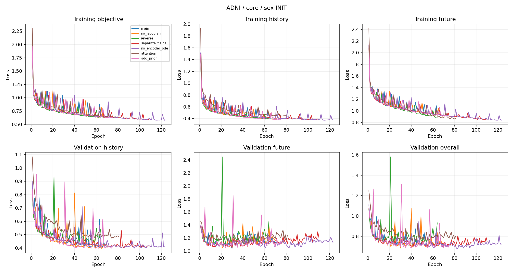

**图 5｜ADNI 核心消融训练与验证曲线。** 横轴为训练轮次；上排依次为总训练目标、历史误差、未来误差，下排为验证历史、未来、整体误差。不同线条为主模型、去正则、反序、双场、无编码 ODE、注意力和加回 prior。主模型完成 70 轮、在第 30 轮取得最佳验证整体结果。训练分项各自归一化，不能直接相加还原总目标；最终测试值见对应表格。

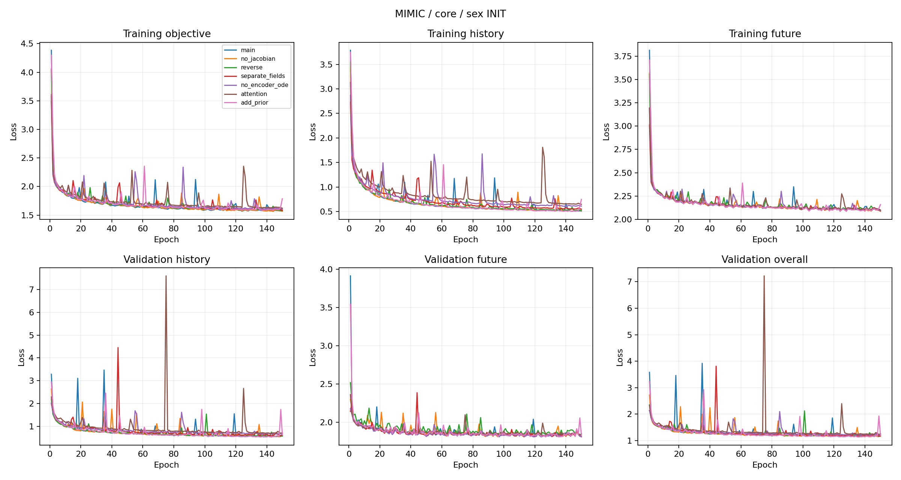

**图 6｜MIMIC 核心消融训练与验证曲线。** 横轴为训练轮次；上排依次为总训练目标、历史误差、未来误差，下排为验证历史、未来、整体误差。不同线条为主模型、去正则、反序、双场、无编码 ODE、注意力和加回 prior。主模型完成 150 轮、在第 143 轮取得最佳验证整体结果。训练分项各自归一化，不能直接相加还原总目标；最终测试值见对应表格。

<!-- /publication-figures -->

## 四、状态空间、流形与动力学理论探究

以下分析读取本轮 M0 和对应消融的最佳检查点，冻结权重，复用已有 Decoder 与诊断头。状态空间、临床速度、局部几何和转化验证从不同角度检验同一个模型。每个图组紧接所属主题，表后解释对应数值的含义。

### 4.1 状态空间与速度场的平行可视化

在各模型训练集 UPDATE 后状态上分别拟合 PCA，固定用于该模型的测试状态、速度箭头和病例轨迹。ADNI 按诊断、MMSE、CDR-SB 着色；MIMIC 按 GCS、心率等预先固定指标着色。原始逐状态箭头与邻域平均速度场分别展示，测试状态与自由生成状态分开标记。计算状态平面保留的方差和速度能量，检查二维图对动力学的表达程度。

表 16：状态与速度的二维信息保留。

| 数据集 | 模型 | 状态 PCA2 方差占比 ↑ | 该平面速度能量占比 ↑ | 速度 PCA2 能量占比 ↑ | 状态有效秩 |
| --- | --- | --- | --- | --- | --- |
| ADNI | M0 | 0.423579 | 0.155978 | 0.961101 | 12.298638 |
| ADNI | 确定性 ODE-AE（同预算） | 0.494077 | 0.129026 | 0.996914 | 5.619301 |
| ADNI | ODE-AE（概率，同预算） | 0.990252 | 0.998787 | 0.999992 | 2.072200 |
| ADNI | ODE-RNN（同预算） | 0.517965 | 0.158409 | 1.000000 | 10.409617 |
| ADNI | Latent ODE（同预算） | 0.800922 | 0.683721 | 1.000000 | 3.519032 |
| ADNI | HealthFlux-KL | 0.515408 | 0.004066 | 0.999993 | 9.377731 |
| MIMIC | M0 | 0.378823 | 0.014060 | 0.986715 | 14.185255 |
| MIMIC | 确定性 ODE-AE（同预算） | 0.686293 | 0.387486 | 0.707490 | 4.050542 |
| MIMIC | ODE-AE（概率，同预算） | 0.998225 | 0.997333 | 0.999596 | 1.995012 |
| MIMIC | ODE-RNN（同预算） | 0.459161 | 0.362694 | 0.999995 | 12.598784 |
| MIMIC | Latent ODE（同预算） | 0.992823 | 0.048062 | 1.000000 | 1.250804 |
| MIMIC | HealthFlux-KL | 0.522709 | 0.029986 | 1.000000 | 11.861217 |

<!-- publication-caption -->
**表 16 说明与分析。** 每个模型单独使用训练状态拟合 PCA，再投影其测试状态和实际生成速度。M0 在 ADNI 的状态平面保留 42.36% 方差，却只保留 15.60% 速度能量；MIMIC 分别为 37.88% 和 1.41%。速度另拟合的二维平面可保留超过 96% 能量，说明状态分布主方向与运动主方向差异很大。 原始结果：[记录 1](../publication_sex_init/analysis/adni/state/statistics.json)、[记录 2](../publication_sex_init/analysis/mimic/state/statistics.json)。
<!-- /publication-caption -->

主要图为状态分布、未平滑速度场、平均速度场、UPDATE 跳变和自由演化轨迹。ADNI 固定病例为 003_S_4900、002_S_4219、002_S_0619，并展示临床真实/预测曲线；MIMIC 从预先固定的患者名单展示 24→48 小时轨迹。不同模型分别使用自己的训练 PCA，各自内部保持坐标一致。编码状态与生成状态不同的模型分别提取两类表示，速度场图匹配实际生成状态及对应生成场；概率模型沿用共同测试的均值预测与条件定义。

方案来源：[共享场方法](../paper_odeae/results/shared_matched_state_space/report.zh-CN.md)、[模型横向可视化](../paper_odeae/results/state_space_model_comparison/report.zh-CN.md)、[ODE-AE 病例](../paper_odeae/results/odeae_baseline_state_space/report.zh-CN.md)。

<!-- publication-figures -->

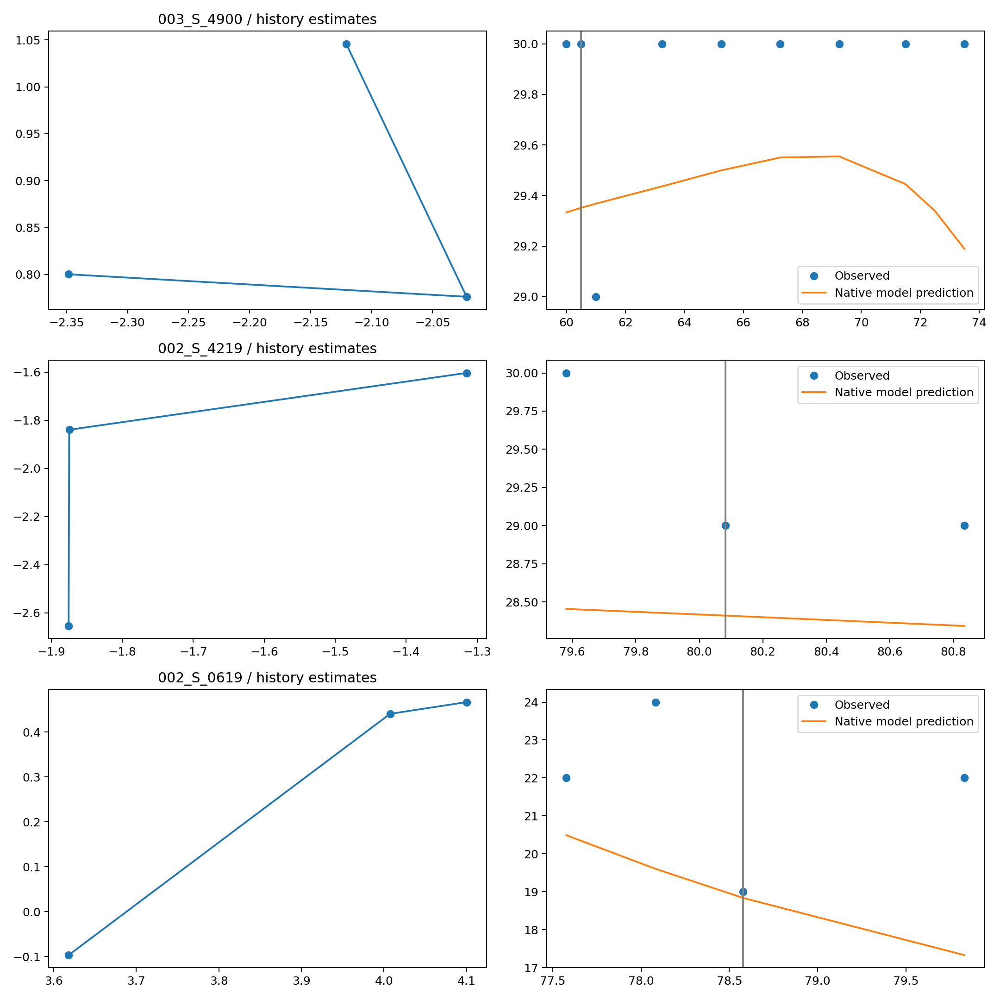

**图 7｜ADNI 确定性 ODE-AE：患者状态和临床轨迹。** 每行对应一个预先固定的测试病例，左图连接不同历史截止点的状态估计，右图比较真实观测与模型原生预测；竖线标出历史截止点。ADNI 临床指标为 MMSE，MIMIC 为心率。左侧连线包含吸收新检查产生的校正，右侧截止点以后的预测不读取目标观测。

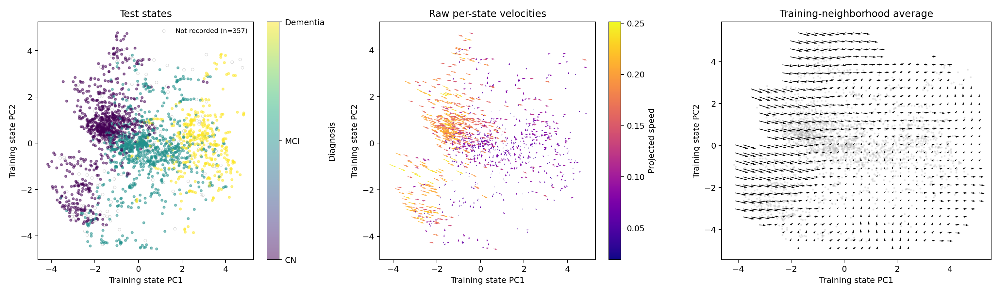

**图 8｜ADNI 确定性 ODE-AE：状态分布、原始速度与平均速度。** 左图为测试状态，颜色表示CN=0、MCI=1、Dementia=2；−1 表示本次诊断缺失；中图是各状态未经邻域平滑的速度投影，颜色表示投影速度大小；右图为训练邻域平均速度及测试位置。三个面板沿用该模型训练 PCA，保留 49.41% 状态方差和 12.90% 速度能量。不同模型各用自己的 PCA，坐标数值不直接对齐。

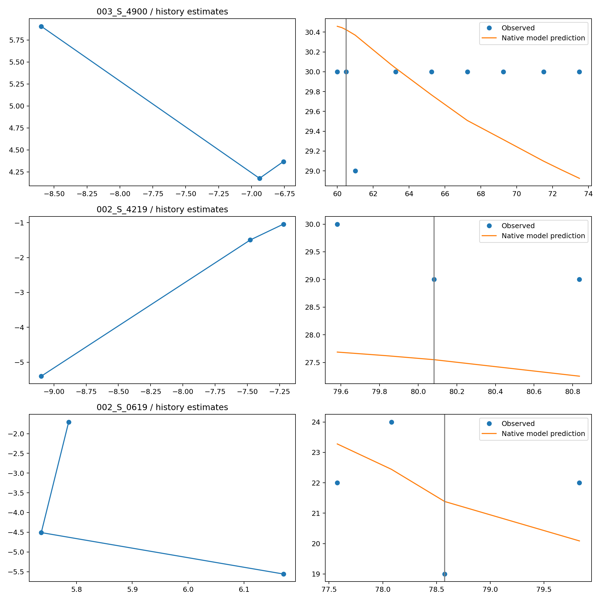

**图 9｜ADNI HealthFlux-KL：患者状态和临床轨迹。** 每行对应一个预先固定的测试病例，左图连接不同历史截止点的状态估计，右图比较真实观测与模型原生预测；竖线标出历史截止点。ADNI 临床指标为 MMSE，MIMIC 为心率。左侧连线包含吸收新检查产生的校正，右侧截止点以后的预测不读取目标观测。

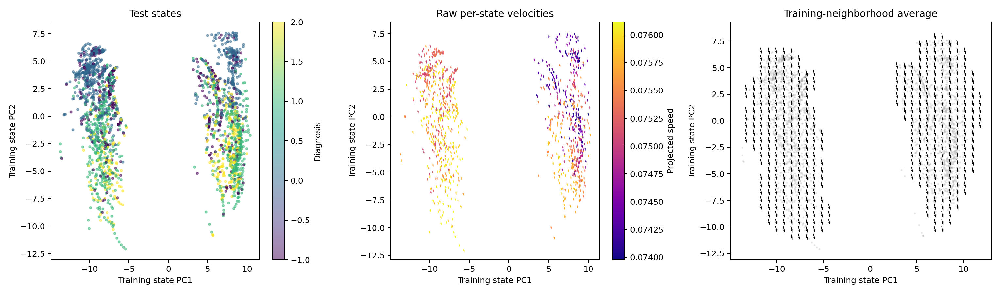

**图 10｜ADNI HealthFlux-KL：状态分布、原始速度与平均速度。** 左图为测试状态，颜色表示CN=0、MCI=1、Dementia=2；−1 表示本次诊断缺失；中图是各状态未经邻域平滑的速度投影，颜色表示投影速度大小；右图为训练邻域平均速度及测试位置。三个面板沿用该模型训练 PCA，保留 51.54% 状态方差和 0.41% 速度能量。不同模型各用自己的 PCA，坐标数值不直接对齐。

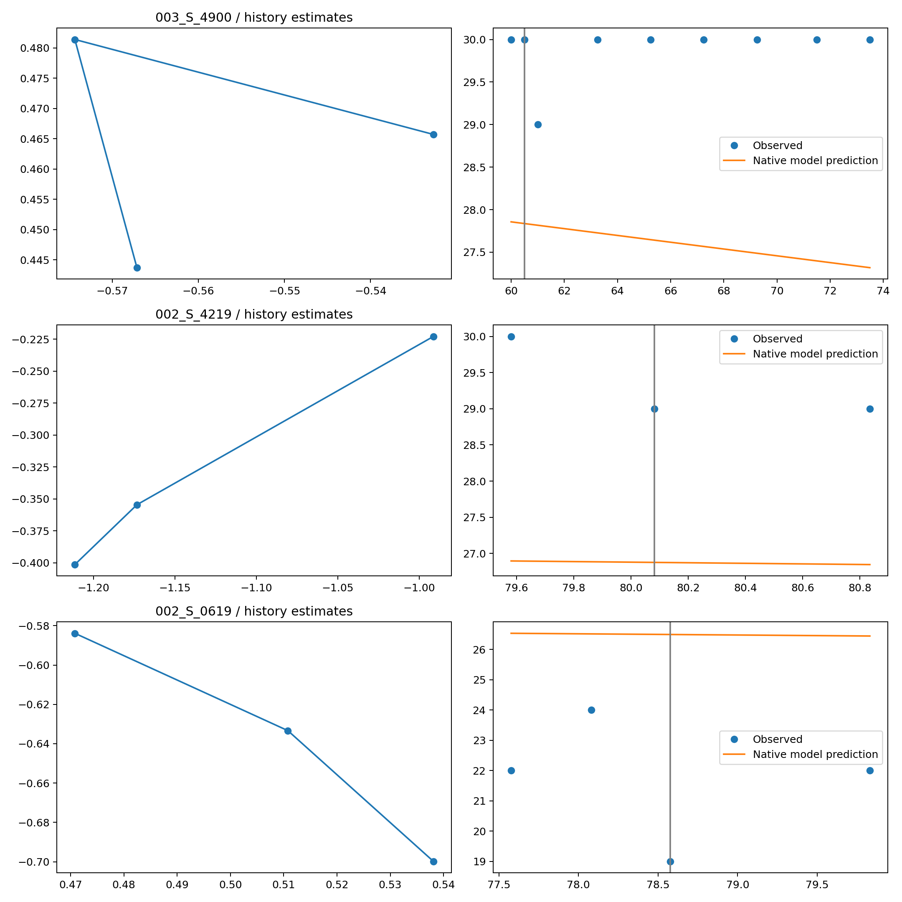

**图 11｜ADNI Latent ODE：患者状态和临床轨迹。** 每行对应一个预先固定的测试病例，左图连接不同历史截止点的状态估计，右图比较真实观测与模型原生预测；竖线标出历史截止点。ADNI 临床指标为 MMSE，MIMIC 为心率。左侧连线包含吸收新检查产生的校正，右侧截止点以后的预测不读取目标观测。

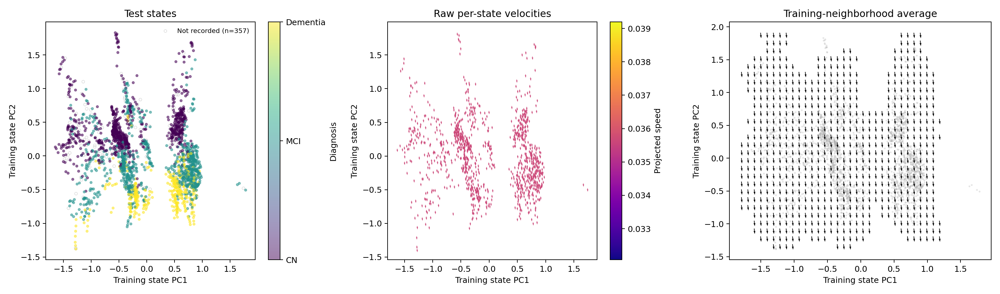

**图 12｜ADNI Latent ODE：状态分布、原始速度与平均速度。** 左图为测试状态，颜色表示CN=0、MCI=1、Dementia=2；−1 表示本次诊断缺失；中图是各状态未经邻域平滑的速度投影，颜色表示投影速度大小；右图为训练邻域平均速度及测试位置。三个面板沿用该模型训练 PCA，保留 80.09% 状态方差和 68.37% 速度能量。不同模型各用自己的 PCA，坐标数值不直接对齐。

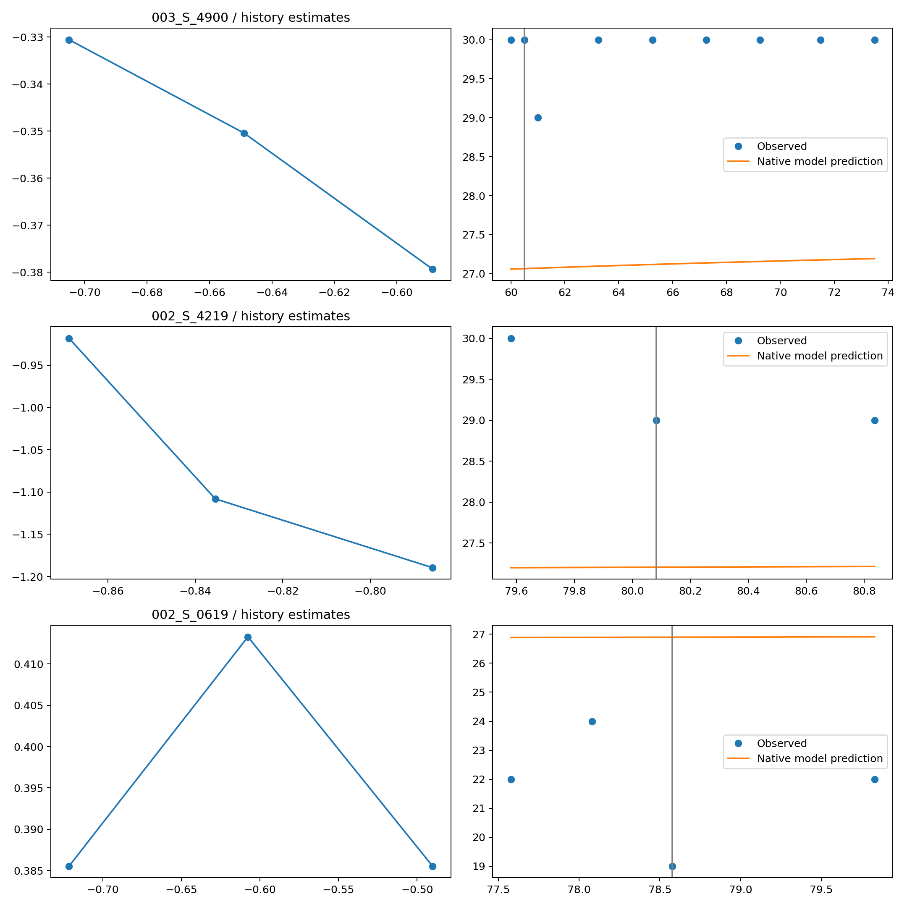

**图 13｜ADNI 概率 ODE-AE：患者状态和临床轨迹。** 每行对应一个预先固定的测试病例，左图连接不同历史截止点的状态估计，右图比较真实观测与模型原生预测；竖线标出历史截止点。ADNI 临床指标为 MMSE，MIMIC 为心率。左侧连线包含吸收新检查产生的校正，右侧截止点以后的预测不读取目标观测。

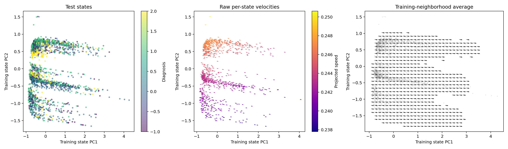

**图 14｜ADNI 概率 ODE-AE：状态分布、原始速度与平均速度。** 左图为测试状态，颜色表示CN=0、MCI=1、Dementia=2；−1 表示本次诊断缺失；中图是各状态未经邻域平滑的速度投影，颜色表示投影速度大小；右图为训练邻域平均速度及测试位置。三个面板沿用该模型训练 PCA，保留 99.03% 状态方差和 99.88% 速度能量。不同模型各用自己的 PCA，坐标数值不直接对齐。

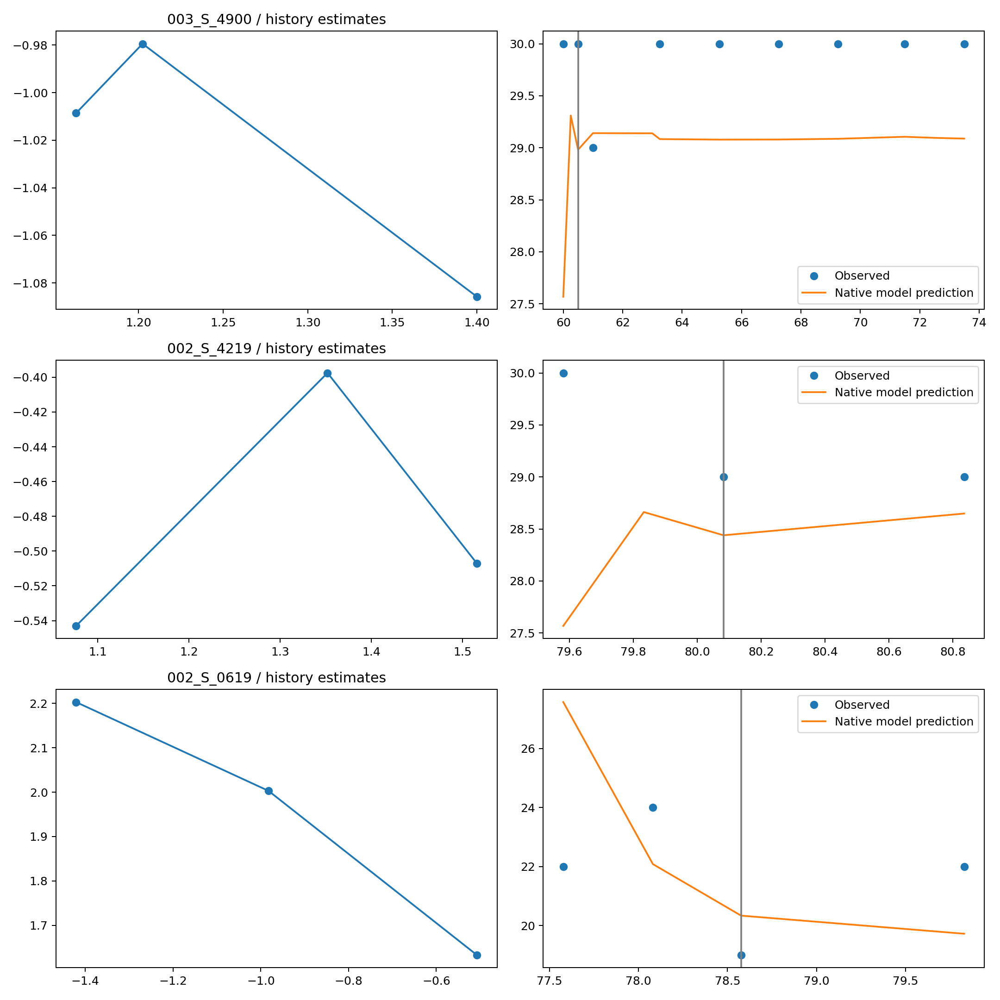

**图 15｜ADNI ODE-RNN：患者状态和临床轨迹。** 每行对应一个预先固定的测试病例，左图连接不同历史截止点的状态估计，右图比较真实观测与模型原生预测；竖线标出历史截止点。ADNI 临床指标为 MMSE，MIMIC 为心率。左侧连线包含吸收新检查产生的校正，右侧截止点以后的预测不读取目标观测。

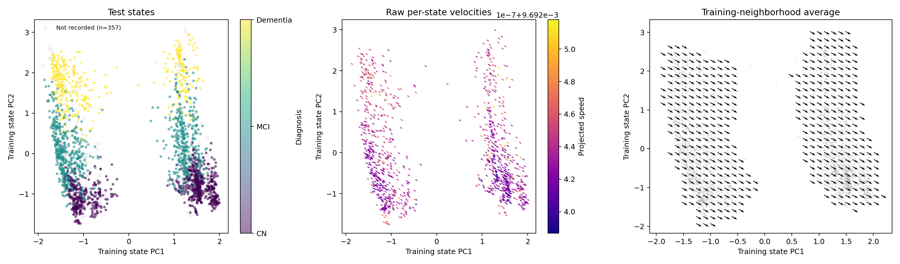

**图 16｜ADNI ODE-RNN：状态分布、原始速度与平均速度。** 左图为测试状态，颜色表示CN=0、MCI=1、Dementia=2；−1 表示本次诊断缺失；中图是各状态未经邻域平滑的速度投影，颜色表示投影速度大小；右图为训练邻域平均速度及测试位置。三个面板沿用该模型训练 PCA，保留 51.80% 状态方差和 15.84% 速度能量。不同模型各用自己的 PCA，坐标数值不直接对齐。

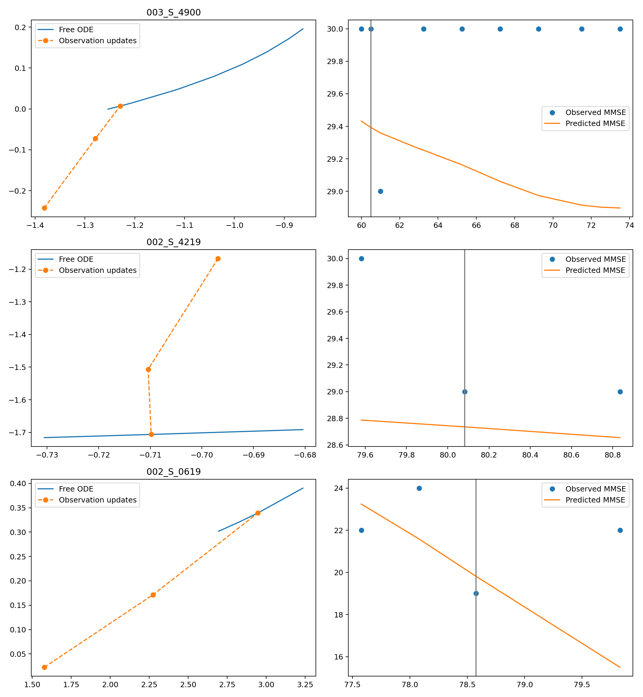

**图 17｜ADNI M0：患者状态和临床轨迹。** 每行对应一个预先固定的测试病例，左图连接不同历史截止点的状态估计，右图比较真实观测与模型原生预测；竖线标出历史截止点。ADNI 临床指标为 MMSE，MIMIC 为心率。左侧连线包含吸收新检查产生的校正，右侧截止点以后的预测不读取目标观测。

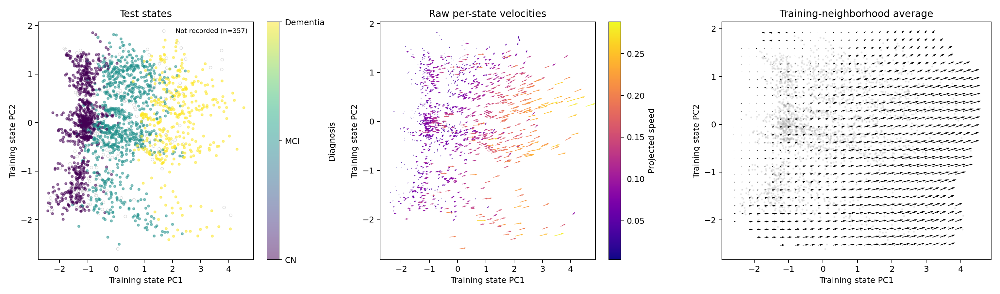

**图 18｜ADNI M0：状态分布、原始速度与平均速度。** 左图为测试状态，颜色表示CN=0、MCI=1、Dementia=2；−1 表示本次诊断缺失；中图是各状态未经邻域平滑的速度投影，颜色表示投影速度大小；右图为训练邻域平均速度及测试位置。三个面板沿用该模型训练 PCA，保留 42.36% 状态方差和 15.60% 速度能量。不同模型各用自己的 PCA，坐标数值不直接对齐。 测试状态沿 PC1 呈现从 CN 到 Dementia 的顺序，右侧的投影运动整体更快。

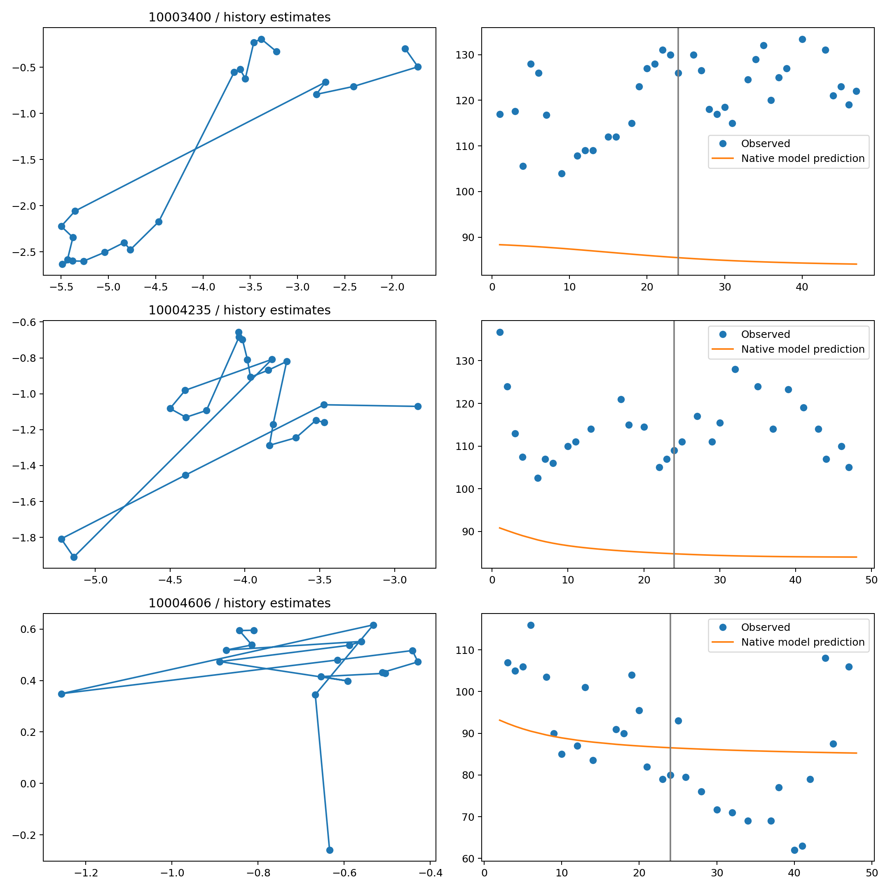

**图 19｜MIMIC 确定性 ODE-AE：患者状态和临床轨迹。** 每行对应一个预先固定的测试病例，左图连接不同历史截止点的状态估计，右图比较真实观测与模型原生预测；竖线标出历史截止点。ADNI 临床指标为 MMSE，MIMIC 为心率。左侧连线包含吸收新检查产生的校正，右侧截止点以后的预测不读取目标观测。

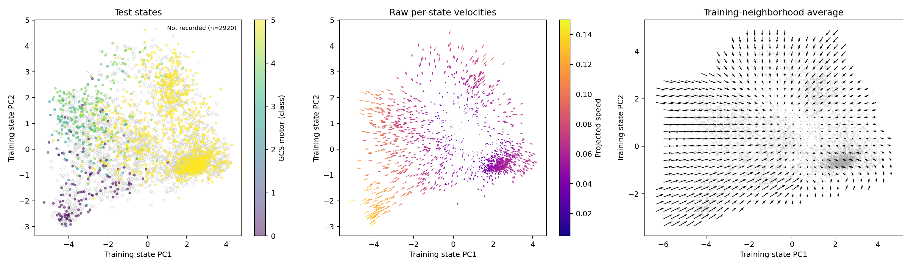

**图 20｜MIMIC 确定性 ODE-AE：状态分布、原始速度与平均速度。** 左图为测试状态，颜色表示GCS-motor 类别；−1 表示本次记录缺失；中图是各状态未经邻域平滑的速度投影，颜色表示投影速度大小；右图为训练邻域平均速度及测试位置。三个面板沿用该模型训练 PCA，保留 68.63% 状态方差和 38.75% 速度能量。不同模型各用自己的 PCA，坐标数值不直接对齐。

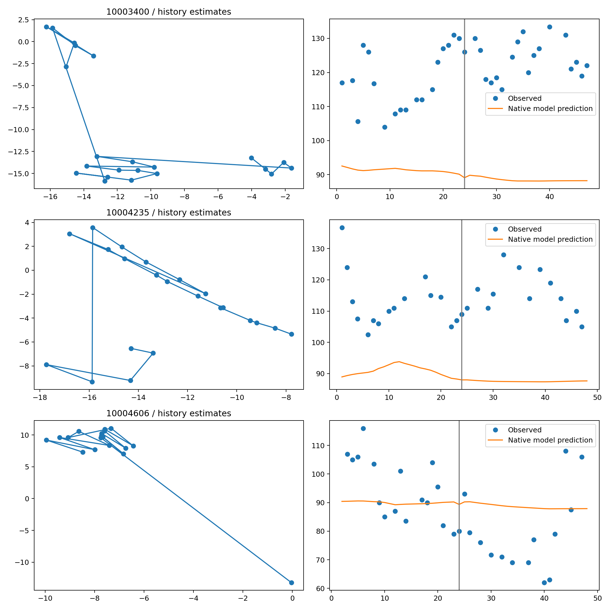

**图 21｜MIMIC HealthFlux-KL：患者状态和临床轨迹。** 每行对应一个预先固定的测试病例，左图连接不同历史截止点的状态估计，右图比较真实观测与模型原生预测；竖线标出历史截止点。ADNI 临床指标为 MMSE，MIMIC 为心率。左侧连线包含吸收新检查产生的校正，右侧截止点以后的预测不读取目标观测。

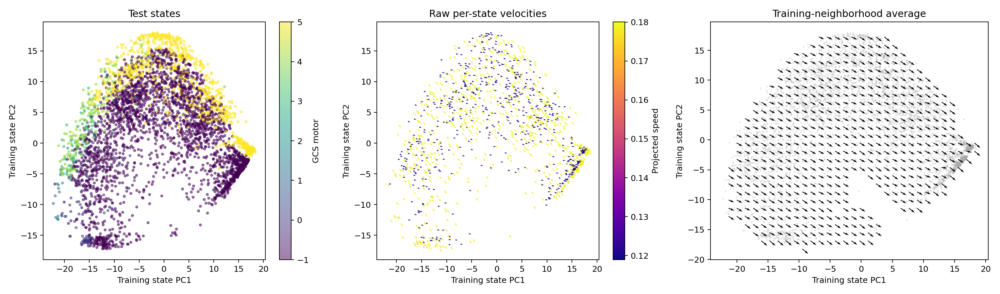

**图 22｜MIMIC HealthFlux-KL：状态分布、原始速度与平均速度。** 左图为测试状态，颜色表示GCS-motor 类别；−1 表示本次记录缺失；中图是各状态未经邻域平滑的速度投影，颜色表示投影速度大小；右图为训练邻域平均速度及测试位置。三个面板沿用该模型训练 PCA，保留 52.27% 状态方差和 3.00% 速度能量。不同模型各用自己的 PCA，坐标数值不直接对齐。

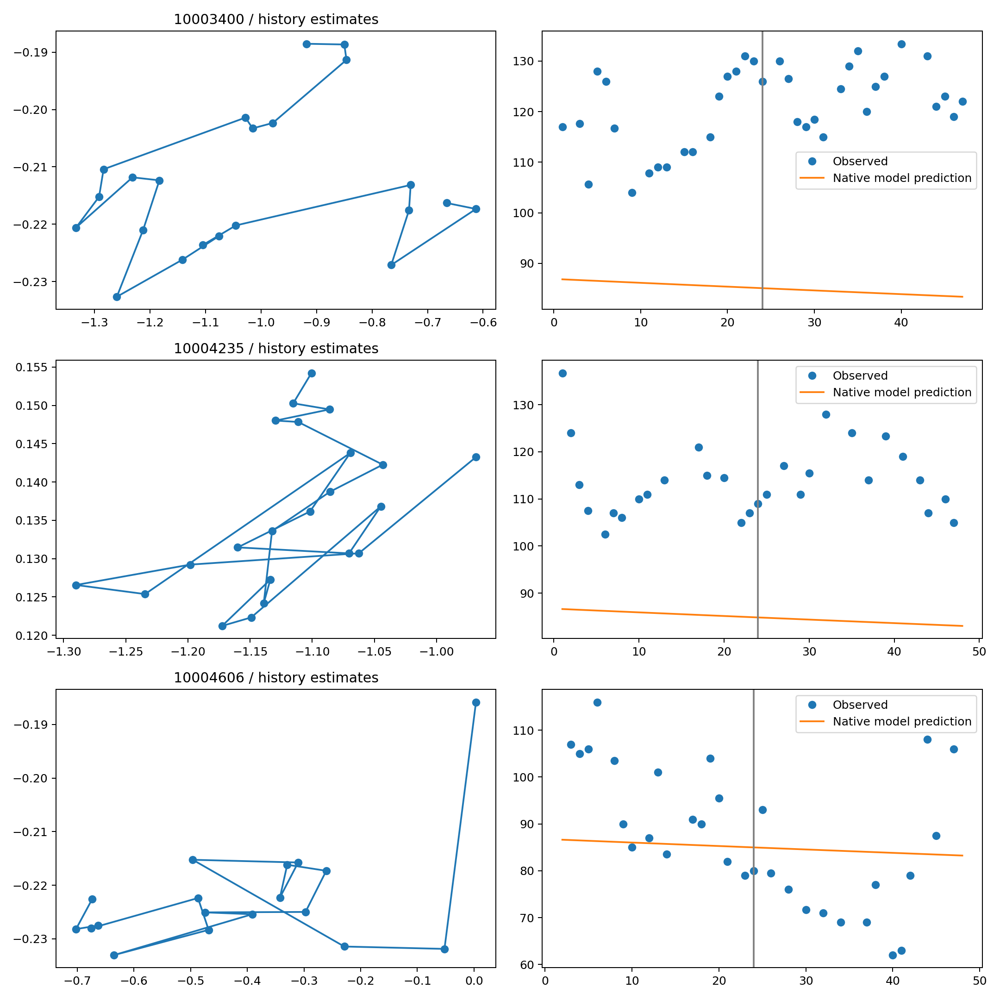

**图 23｜MIMIC Latent ODE：患者状态和临床轨迹。** 每行对应一个预先固定的测试病例，左图连接不同历史截止点的状态估计，右图比较真实观测与模型原生预测；竖线标出历史截止点。ADNI 临床指标为 MMSE，MIMIC 为心率。左侧连线包含吸收新检查产生的校正，右侧截止点以后的预测不读取目标观测。

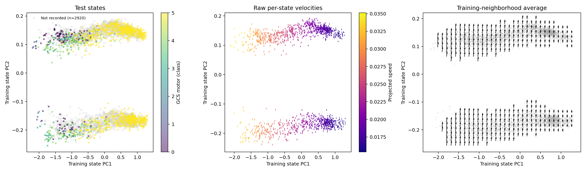

**图 24｜MIMIC Latent ODE：状态分布、原始速度与平均速度。** 左图为测试状态，颜色表示GCS-motor 类别；−1 表示本次记录缺失；中图是各状态未经邻域平滑的速度投影，颜色表示投影速度大小；右图为训练邻域平均速度及测试位置。三个面板沿用该模型训练 PCA，保留 99.28% 状态方差和 4.81% 速度能量。不同模型各用自己的 PCA，坐标数值不直接对齐。

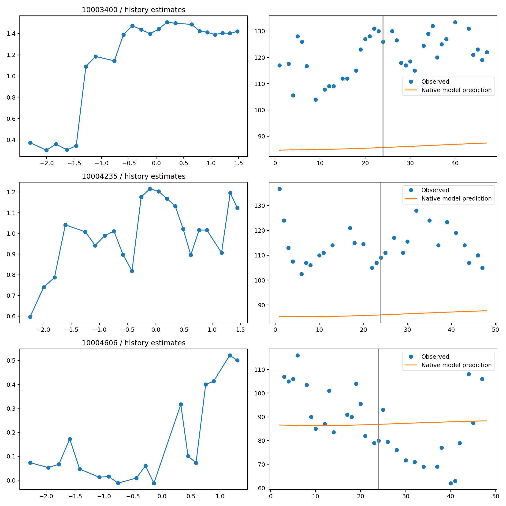

**图 25｜MIMIC 概率 ODE-AE：患者状态和临床轨迹。** 每行对应一个预先固定的测试病例，左图连接不同历史截止点的状态估计，右图比较真实观测与模型原生预测；竖线标出历史截止点。ADNI 临床指标为 MMSE，MIMIC 为心率。左侧连线包含吸收新检查产生的校正，右侧截止点以后的预测不读取目标观测。

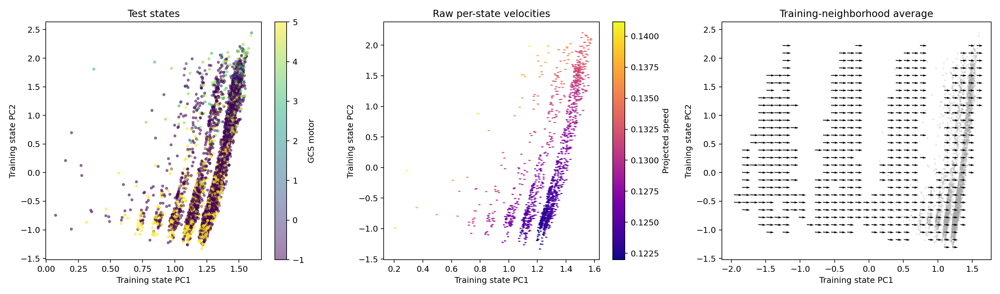

**图 26｜MIMIC 概率 ODE-AE：状态分布、原始速度与平均速度。** 左图为测试状态，颜色表示GCS-motor 类别；−1 表示本次记录缺失；中图是各状态未经邻域平滑的速度投影，颜色表示投影速度大小；右图为训练邻域平均速度及测试位置。三个面板沿用该模型训练 PCA，保留 99.82% 状态方差和 99.73% 速度能量。不同模型各用自己的 PCA，坐标数值不直接对齐。

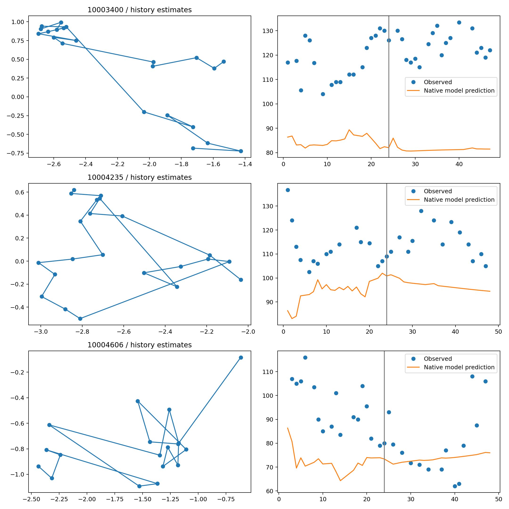

**图 27｜MIMIC ODE-RNN：患者状态和临床轨迹。** 每行对应一个预先固定的测试病例，左图连接不同历史截止点的状态估计，右图比较真实观测与模型原生预测；竖线标出历史截止点。ADNI 临床指标为 MMSE，MIMIC 为心率。左侧连线包含吸收新检查产生的校正，右侧截止点以后的预测不读取目标观测。

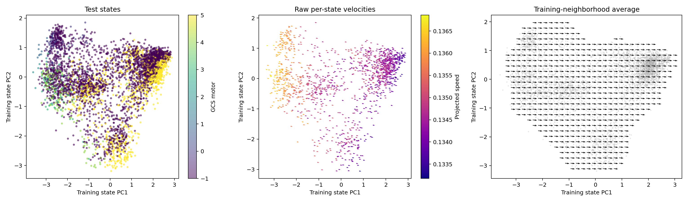

**图 28｜MIMIC ODE-RNN：状态分布、原始速度与平均速度。** 左图为测试状态，颜色表示GCS-motor 类别；−1 表示本次记录缺失；中图是各状态未经邻域平滑的速度投影，颜色表示投影速度大小；右图为训练邻域平均速度及测试位置。三个面板沿用该模型训练 PCA，保留 45.92% 状态方差和 36.27% 速度能量。不同模型各用自己的 PCA，坐标数值不直接对齐。

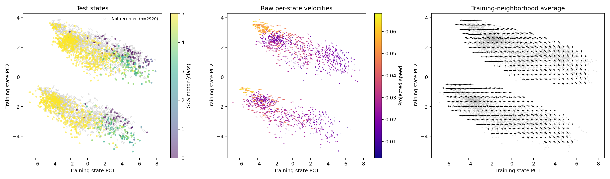

**图 29｜MIMIC M0：状态分布、原始速度与平均速度。** 左图为测试状态，颜色表示GCS-motor 类别；−1 表示本次记录缺失；中图是各状态未经邻域平滑的速度投影，颜色表示投影速度大小；右图为训练邻域平均速度及测试位置。三个面板沿用该模型训练 PCA，保留 37.88% 状态方差和 1.41% 速度能量。不同模型各用自己的 PCA，坐标数值不直接对齐。

<!-- /publication-figures -->

### 4.2 临床速度：潜在运动对应怎样的真实指标变化

用已有 Decoder 计算 \(\dot y=\nabla g(z)^\top f(z)\)。区间评价从前一次 UPDATE 后状态出发，自由积分到下一次真实检查，取解码差除以真实间隔，与真实变化率比较；预测区间内不吸收终点观测。ADNI 评价 MMSE、CDR-SB 年变化，MIMIC 评价心率和平均动脉压的小时变化。

表 17：真实随访区间上的临床变化率预测。

| 数据集 | 指标 / 单位 | 区间数 | 患者数 | 变化率 MAE ↓ | Pearson r ↑ | Spearman ρ ↑ | 方向准确率 ↑ |
| --- | --- | --- | --- | --- | --- | --- | --- |
| ADNI | MMSE，分/年 | 1086 | 286 | 1.180359 | 0.584676 | 0.452651 | 0.667939 |
| ADNI | CDR-SB，分/年 | 1122 | 292 | 0.699779 | 0.500110 | 0.526746 | 0.745455 |
| MIMIC | 心率，bpm/小时 | 3902 | 3902 | 4.020811 | 0.023726 | 0.037267 | 0.499862 |
| MIMIC | 平均动脉压，mmHg/小时 | 3875 | 3875 | 5.428788 | 0.019067 | 0.028291 | 0.511962 |

<!-- publication-caption -->
**表 17 说明与分析。** ADNI 按患者先平均相邻随访区间的真实/预测变化率，再计算 MAE 和相关性；区间数另外列出。MIMIC 每位患者从固定截止点预测下次有效测量。MMSE 和 CDR-SB 的 Pearson 相关分别为 0.584676、0.500110；心率及平均动脉压的相关接近零，方向准确率约为 50%。 原始结果：[记录 1](../publication_sex_init/analysis/adni/clinical/metrics.json)、[记录 2](../publication_sex_init/analysis/mimic/clinical/metrics.json)。
<!-- /publication-caption -->

主要图并排展示同一 PCA 位置下的潜在速度、预测临床变化率与真实变化率，并绘制真实/预测散点。稳定、上升、下降的判定规则在训练/验证阶段固定，患者等权汇总后 bootstrap。

方案来源：[临床速度实验 A](../paper_odeae/results/shared_matched_clinical_velocity/report.zh-CN.md)。

<!-- publication-figures -->

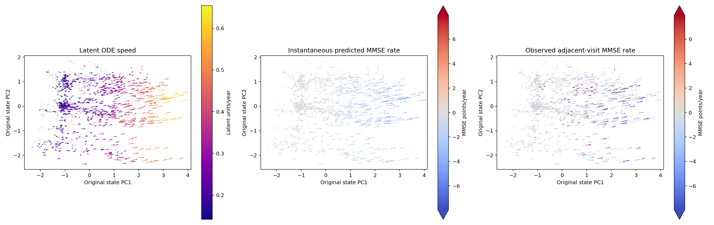

**图 30｜ADNI 潜在速度与临床 MMSE 速度。** 三个面板保持同一训练 PCA 坐标，依次展示潜在运动、Decoder 链式导数得到的 MMSE 年变化率、真实相邻检查的年变化率。负值表示认知评分下降。箭头大小与临床下降幅度通过 Decoder 梯度联系起来，表 17 给出独立随访区间验证。

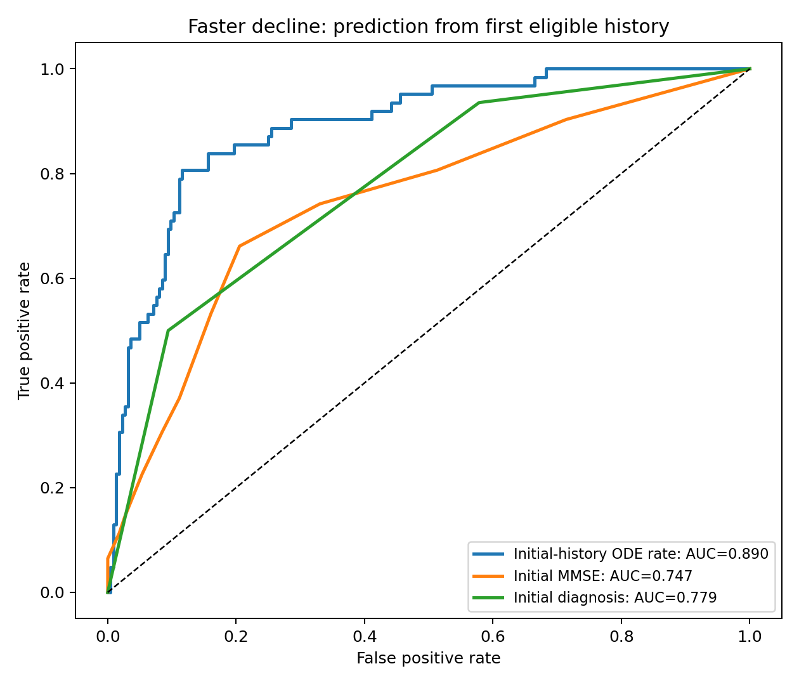

**图 31｜ADNI 快速 MMSE 下降的风险排序。** 横轴为假阳性率，纵轴为真阳性率；每位患者在首个合格历史节点产生预测，快速下降阈值由训练集确定。曲线比较初始历史的 ODE 预测变化率、初始 MMSE 及初始诊断，图例标出各自 AUROC。该图评价进展速度的区分能力，误差幅度由表 17 评价。

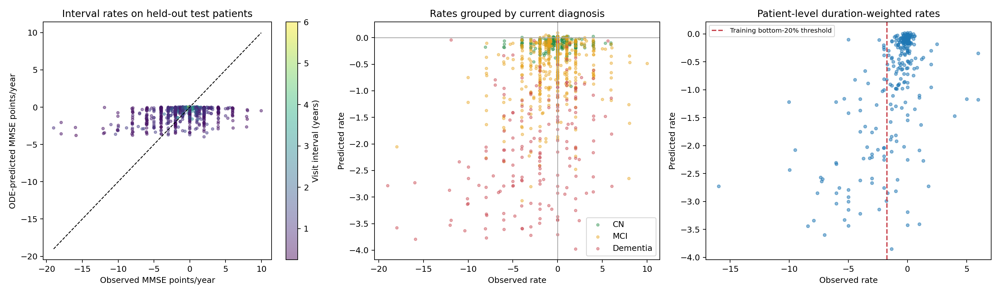

**图 32｜ADNI 真实与预测 MMSE 年变化率。** 左图每点是一个测试随访区间，横轴为真实、纵轴为预测变化率，虚线是完全一致线，颜色为检查间隔；中图按当前诊断着色；右图按患者用时间加权汇总，竖线为训练集快速下降阈值。预测对改善和急剧下降均更靠近群体趋势，快速下降幅度不足与表 18 一致。图的区间/时长加权与表 17 的患者等权口径分别标明。

<!-- /publication-figures -->

### 4.3 MMSE 下降速度的分解

将临床速度写为 \(\dot y=\|\nabla g(z)\|\,\|f(z)\|\cos\theta\)，按 CN、MCI、Dementia 分析潜在速度、Decoder 敏感性和临床方向投影。沿真实区间积分得到临床变化预算，并单独分析真实下降较快的区间。快速下降阈值根据训练分布或预先固定的临床规则确定。

表 18：M0 的 MMSE 动力学机制。

| 组别 | 患者数 | 平均 ‖f‖ | 平均 ‖∇g‖ | 平均 cosθ | 真实年变化 | 预测年变化 | 变化率偏差 |
| --- | --- | --- | --- | --- | --- | --- | --- |
| CN | 111 | 0.184768 | 2.307842 | -0.235704 | -0.126880 | -0.113206 | 0.013674 |
| MCI | 153 | 0.252661 | 3.280958 | -0.429399 | -0.507486 | -0.516176 | -0.008690 |
| Dementia | 82 | 0.457123 | 6.261727 | -0.659654 | -2.406913 | -2.025149 | 0.381764 |
| 快速下降区间 | 36 | 0.479664 | 7.429773 | -0.691779 | -8.795925 | -2.531310 | 6.264615 |

<!-- publication-caption -->
**表 18 说明与分析。** 潜在速度、Decoder 梯度及夹角共同决定 MMSE 变化。Dementia 的速度和 Decoder 梯度均高于 CN，方向也更朝向 MMSE 下降；其平均预测年变化为 −2.025149，真实为 −2.406913。快速下降区间仍有较大偏差，表明模型对急剧变化的幅度估计不足。 原始结果：[记录 1](../publication_sex_init/analysis/adni/mmse/metrics.json)。
<!-- /publication-caption -->

图表包括三个分解因素的分布、速度与临床梯度夹角、快速下降与稳定患者的轨迹。根据实际分解结果判断临床变化偏差来自哪一部分。

方案来源：[MMSE 机制分解](../paper_odeae/results/mmse_decline_mechanism/report.zh-CN.md)。

<!-- publication-figures -->

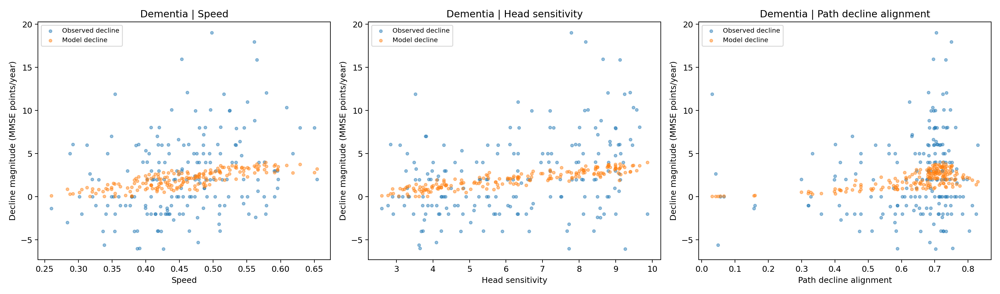

**图 33｜ADNI Dementia 下降幅度与动力学因素。** 各面板将真实下降与潜在速度、Decoder 梯度及方向投影联系起来，单位由图内坐标标明。快速下降区间的真实 MMSE 年变化为 −8.795925，模型为 −2.531310；较大的潜在速度尚不足以覆盖这些极端变化。

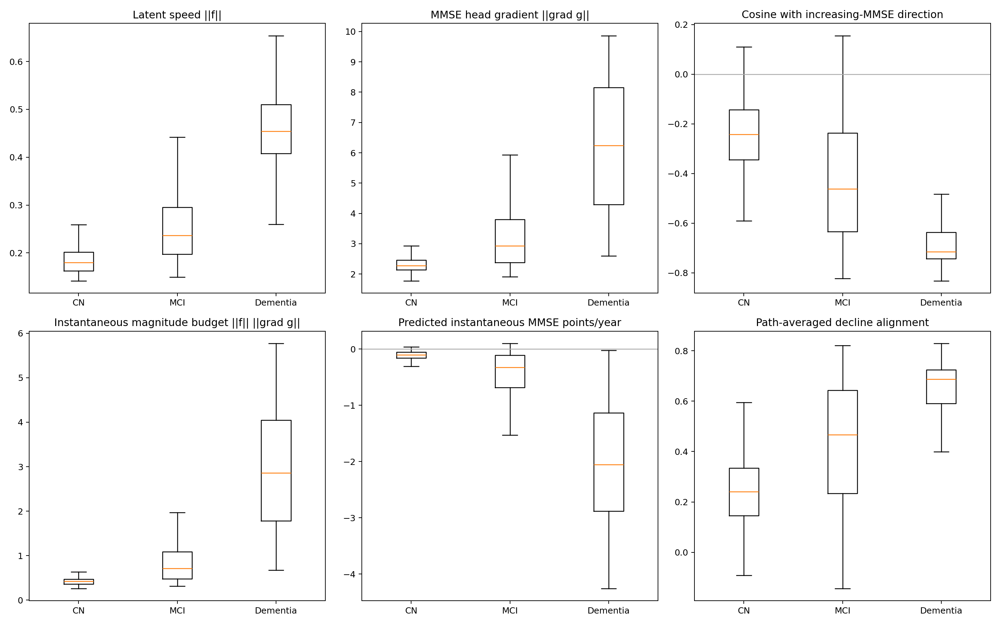

**图 34｜ADNI 三类诊断的 MMSE 速度分解。** 按 CN、MCI、Dementia 分组比较速度范数、MMSE 梯度范数、夹角余弦与临床变化率。表 18 中 Dementia 三个因素共同指向更快的 MMSE 下降，仍存在约 0.382 分/年的平均偏慢。三个因素的均值分别报告，均值乘积不等于临床速度均值。

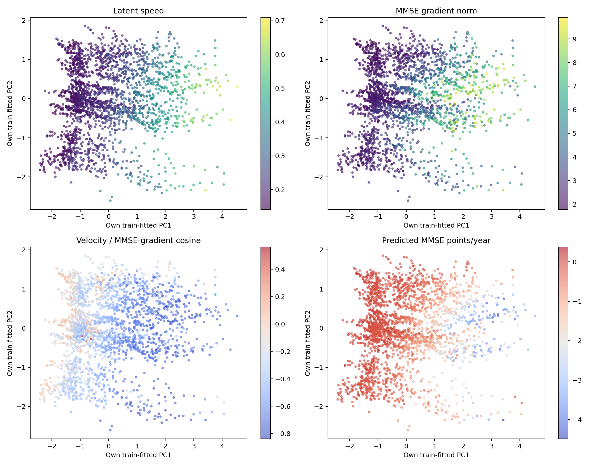

**图 35｜ADNI MMSE 速度分解在状态空间中的分布。** 每个面板在相同训练 PCA 位置显示一个链式导数因素或最终 MMSE 速度。读图时将速度大小、Decoder 敏感性和方向共同考虑，临床变化率由三者逐状态相乘得到；表 18 提供诊断组定量比较。

<!-- /publication-figures -->

### 4.4 高维局部一致性与预测误差

在完整 28 维中为测试状态寻找其他训练患者的 k 近邻，主分析 k=20，补充 10/40。计算速度余弦 \(C_{ij}\)、局部变化比 \(D_{ij}=\|f_i-f_j\|/(\|z_i-z_j\|+\epsilon)\) 和 Jacobian 范数。核心与交界区域根据训练近邻诊断比例定义，并提前冻结。随后比较局部变化比与未来误差的关联，调整时间跨度、观测数和缺失程度。

表 19：ADNI 各区域的局部动力学。

| 区域 | 患者数 | 方向一致性 C ↑ | 局部变化比 D | Jacobian 范数 | 二维/高维邻域重叠率 |
| --- | --- | --- | --- | --- | --- |
| CN 核心 | 182 | 0.971363 | 0.042926 | 0.197480 | 0.227392 |
| CN/MCI 交界 | 30 | 0.908424 | 0.051484 | 0.192731 | 0.074167 |
| MCI 核心 | 188 | 0.979188 | 0.048155 | 0.194219 | 0.165554 |
| MCI/Dementia 交界 | 43 | 0.988932 | 0.043293 | 0.183751 | 0.137306 |
| Dementia 核心 | 102 | 0.995201 | 0.040199 | 0.180069 | 0.191386 |

<!-- publication-caption -->
**表 19 说明与分析。** 邻居从完整 28 维训练状态中按不同患者选取，区域由训练邻居的诊断构成决定；每个区域内先按患者汇总。C 接近 1 表示局部速度方向一致，D 衡量相近位置的速度变化。CN/MCI 交界的 C 最低，为 0.908424；二维邻居重叠率仅约 7%–23%，因此高维结果需要单独计算。 原始结果：[记录 1](../publication_sex_init/analysis/adni/local/metrics.json)。
<!-- /publication-caption -->

表 20：局部变化比与未来误差的关联。

| 数据集 | 窗口 | 患者数 | Spearman ρ | 调整后关联 | 95% CI |
| --- | --- | --- | --- | --- | --- |
| ADNI | 12 个月 | 289 | -0.003252 | -0.019578 | [-0.139707615365008, 0.0979210159283932] |
| ADNI | 24 个月 | 237 | 0.067620 | 0.017609 | [-0.10827031807871795, 0.15164349298185736] |
| MIMIC | 12 小时 | 4525 | -0.048665 | -0.051730 | [-0.08176744464076464, -0.02083902581477323] |
| MIMIC | 24 小时 | 4482 | -0.057128 | -0.055833 | [-0.0855242044323593, -0.02647890750339627] |

<!-- publication-caption -->
**表 20 说明与分析。** 调整后关联控制历史信息和覆盖等预定协变量，区间由患者重抽样获得。ADNI 的两个区间都跨零；MIMIC 的关联虽为负且区间未跨零，绝对值也只有约 0.05。本轮数据未呈现“局部 D 越大，未来误差越大”的一致模式。 原始结果：[记录 1](../publication_sex_init/analysis/adni/local/metrics.json)、[记录 2](../publication_sex_init/analysis/mimic/local/metrics.json)。
<!-- /publication-caption -->

主要图为高维方向一致性与敏感性在 PCA 位置上的热图、分层误差散点。近零速度与重复状态的处理写入配置，按患者汇总和重抽样。

方案来源：[局部动力学实验 B](../paper_odeae/results/shared_matched_local_dynamics/report.zh-CN.md)。

<!-- publication-figures -->

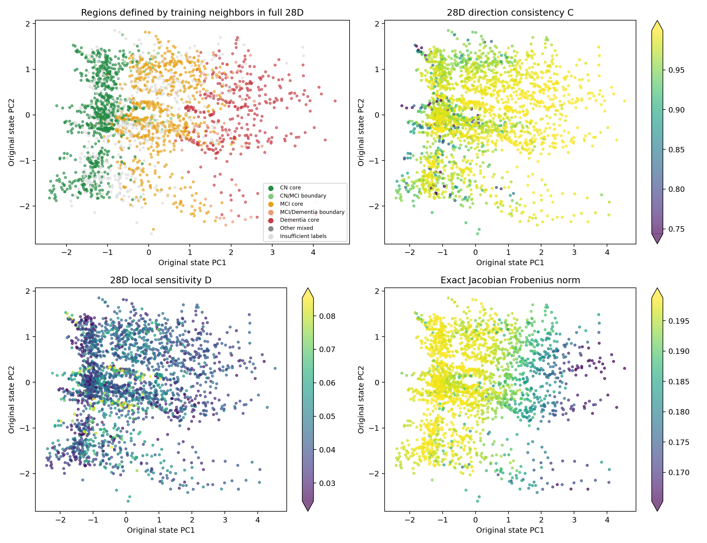

**图 36｜ADNI 28 维局部动力学在 PCA 上的位置。** 四个面板分别为训练邻居定义的疾病区域、完整 28 维速度余弦 C、局部变化比 D、Jacobian Frobenius 范数。颜色范围取训练分布，测试状态只投影到固定坐标。CN/MCI 交界的一致性较低，而 Dementia 核心区域较高，患者等权数值见表 19。

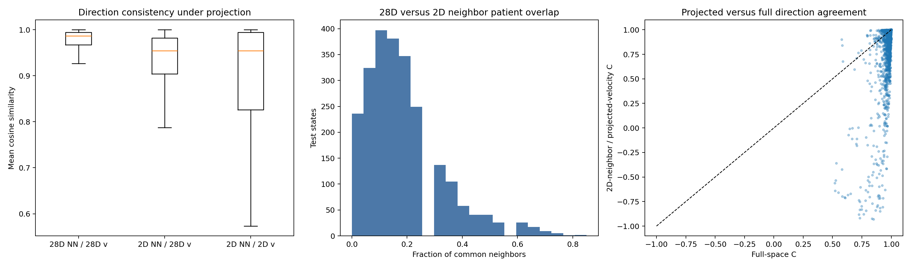

**图 37｜ADNI 二维投影改变了哪些近邻和速度关系。** 左图比较完整 28 维邻居/速度、二维邻居/高维速度、二维邻居/投影速度的余弦分布；中图为两种空间选出的患者邻居重叠率；右图逐状态比较完整与投影一致性。邻居重叠率较低说明二维可视化重排了局部关系，高维一致性由独立计算获得。

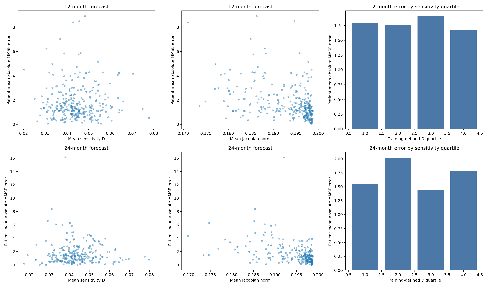

**图 38｜ADNI 局部动力学与 12/24 个月 MMSE 误差。** 每排对应一个未来窗口，前两列将患者 MMSE MAE 分别与 D、Jacobian 范数比较，最后一列按训练集定义的 D 四分位分组。散点和分组用于检查单调关系；表 20 的调整后关联区间均跨零，未得到 ADNI 上 D 增大导致长期误差增大的证据。

<!-- /publication-figures -->

### 4.5 低维流形与动力学维度

提取两个真实数据集的训练/测试状态，计算全局 PCA90/95/99% 维度、TwoNN、kNN 内在维度和局部 PCA。以同协方差高斯点云为比较，并按患者独立抽样复核。把速度分解为训练近邻切空间内外分量，检验状态点云的低方差方向是否仍承载重要临床演化。

表 21：M0 的几何维度与切空间外速度。

| 数据集 | PCA95% 维度 | TwoNN 维度 | kNN 维度 | 局部 PCA95% 维度 | 12 维局部切平面外速度能量 |
| --- | --- | --- | --- | --- | --- |
| ADNI | 16 | 6.464356 | 6.716753 | 13.000000 | 0.774764 |
| MIMIC | 19 | 9.926769 | 8.762235 | 14.000000 | 0.627746 |

<!-- publication-caption -->
**表 21 说明与分析。** PCA95% 衡量全局线性维度，TwoNN、kNN 和局部 PCA 衡量不同尺度的局部结构。ADNI、MIMIC 的 PCA95% 分别需要 16、19 维。表中最后一列取最长诊断跨度的 12 维训练局部切平面，平面外速度能量中位数为 77.48%、62.77%，说明低方差方向仍承担明显运动。 原始结果：[记录 1](../publication_sex_init/analysis/adni/manifold/adni_geometry/summary.json)、[记录 2](../publication_sex_init/analysis/mimic/manifold/mimic_geometry/summary.json)。
<!-- /publication-caption -->

进一步比较原始自由推演、训练点云构建的冻结几何投影、向训练均值收缩。投影维数与收回强度只在验证集选择，再固定用于测试。Decoder 诱导的临床度量用于量化潜在位移对输出的影响。该分析不训练新参数。

表 22：冻结几何投影的预测检验。

| 数据集 | 设置 | 未来误差 ↓ | 相对原始推演差值 | 主要临床 RMSE ↓ |
| --- | --- | --- | --- | --- |
| ADNI | 原始自由积分 | 0.876559 | 0.000000 | 2.497509 |
| ADNI | 验证集选定的冻结投影 | 0.876559 | 0.000000 | 2.497509 |
| ADNI | 向均值收缩对照 | 0.941312 | 0.064753 | 2.723866 |
| MIMIC | 原始自由积分 | 1.823537 | 0.000000 | 17.612551 |
| MIMIC | 验证集选定的冻结投影 | 1.823537 | 0.000000 | 17.612551 |
| MIMIC | 向均值收缩对照 | 1.814655 | -0.008883 | 17.963891 |

<!-- publication-caption -->
**表 22 说明与分析。** 该表只评价冻结投影探针预先选定的患者、状态和目标，统计范围独立于主测试表。两个数据集的验证集都为局部投影选择了原始推演，因此相应测试差值为零。MIMIC 的均值收缩略降低混合误差，却增大心率 RMSE，反映两项指标的权衡。 原始结果：[记录 1](../publication_sex_init/analysis/adni/manifold/adni_dynamics/summary.json)、[记录 2](../publication_sex_init/analysis/mimic/manifold/mimic_dynamics/summary.json)。
<!-- /publication-caption -->

主要图为维度随近邻数变化、真实点云与高斯对照、切空间内外速度、投影前后临床轨迹。结果分析区分“状态可以压缩”和“动力学可以限制在低维平面”。

方案来源：[流形设计](../paper_odeae/results/latent2x_both_manifold/report.zh-CN.md)、[几何与投影评价](../paper_odeae/results/latent2x_both_manifold/metrics_report.zh-CN.md)。

<!-- publication-figures -->

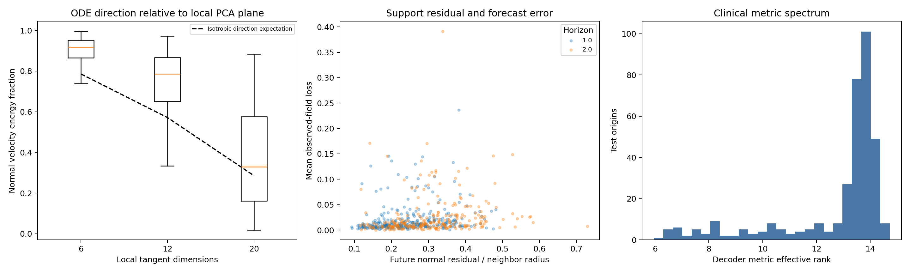

**图 39｜ADNI 局部切空间与临床动力学。** 图组把 ODE 速度分为训练近邻局部切空间内外分量，并结合 Decoder 诱导的输出变化分析。表 21 中最长跨度、12 维局部平面外的速度能量中位数在 ADNI 为 77.48%、MIMIC 为 62.77%。状态方差小的方向仍可包含显著演化。

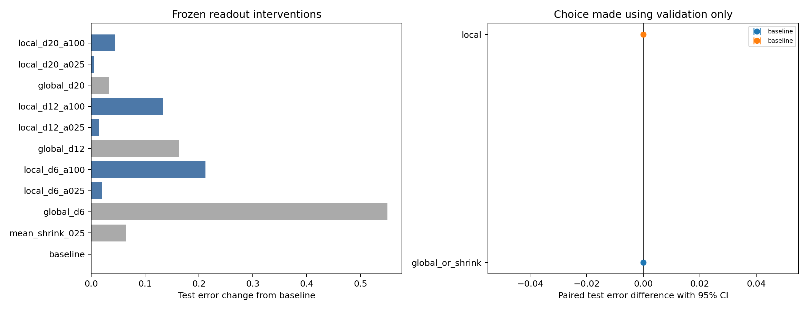

**图 40｜ADNI 冻结几何投影对预测的影响。** 左图为各固定投影/收缩设置相对原始推演的测试误差变化，零线为原始结果；右图只展示验证集选定设置的配对测试差值与 95% 区间。两个数据集的局部投影选择均为 baseline，对应差值为零。投影探针使用独立固定查询集，参见表 22。

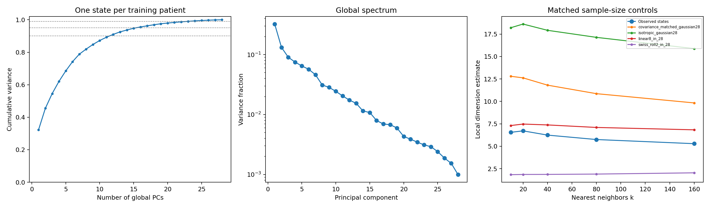

**图 41｜ADNI 全局与局部维度证据。** 图组比较 PCA 累计方差、局部维度估计和同协方差高斯对照，尺度和近邻数见各面板。ADNI、MIMIC 的 PCA95% 分别为 16、19 维，均明显高于二维展示；局部估计更低，说明点云在不同尺度上具有不同的有效维度。

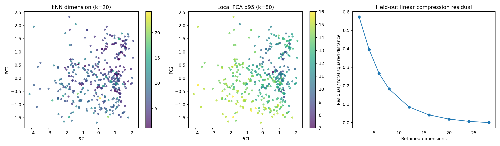

**图 42｜ADNI 近邻尺度下的状态几何结构。** 各面板按图内近邻数和尺度比较局部 PCA、内在维度及相关结构，训练点云定义所有坐标和邻域。与同协方差对照结合，可以区分全局各向异性和局部组织结构；具体维度统计见表 21。

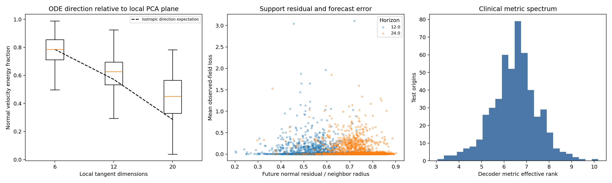

**图 43｜MIMIC 局部切空间与临床动力学。** 图组把 ODE 速度分为训练近邻局部切空间内外分量，并结合 Decoder 诱导的输出变化分析。表 21 中最长跨度、12 维局部平面外的速度能量中位数在 ADNI 为 77.48%、MIMIC 为 62.77%。状态方差小的方向仍可包含显著演化。

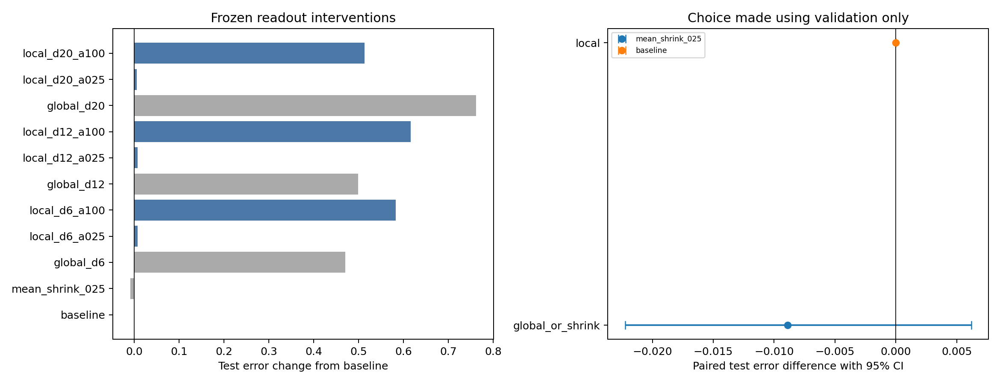

**图 44｜MIMIC 冻结几何投影对预测的影响。** 左图为各固定投影/收缩设置相对原始推演的测试误差变化，零线为原始结果；右图只展示验证集选定设置的配对测试差值与 95% 区间。两个数据集的局部投影选择均为 baseline，对应差值为零。投影探针使用独立固定查询集，参见表 22。

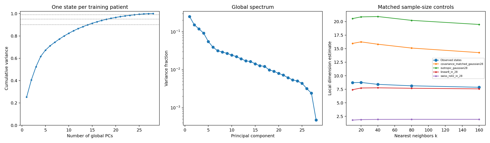

**图 45｜MIMIC 全局与局部维度证据。** 图组比较 PCA 累计方差、局部维度估计和同协方差高斯对照，尺度和近邻数见各面板。ADNI、MIMIC 的 PCA95% 分别为 16、19 维，均明显高于二维展示；局部估计更低，说明点云在不同尺度上具有不同的有效维度。

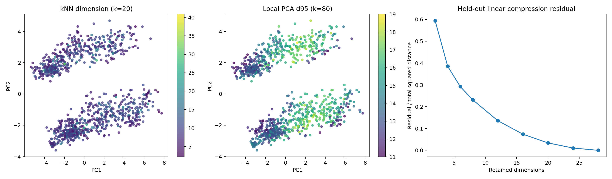

**图 46｜MIMIC 近邻尺度下的状态几何结构。** 各面板按图内近邻数和尺度比较局部 PCA、内在维度及相关结构，训练点云定义所有坐标和邻域。与同协方差对照结合，可以区分全局各向异性和局部组织结构；具体维度统计见表 21。

<!-- /publication-figures -->

### 4.6 Jacobian 的效用：误差传播、噪声和长期预测

使用 M0 与第 3.5 节无 Jacobian 模型，在相同患者、扰动方向和噪声下比较。先测局部 Jacobian，再测完整 ODE 流增益 \(\|D_z\Phi_T(z)\|_2\) 和临床输出扰动。潜在扰动为状态范数的 1%，固定 8 个方向；观测噪声为训练标准差的 1% 和 5%，只作用于输入历史中的可变数值字段，目标与评价掩码保持干净。

ADNI 取 0/1/2/3/5 年，MIMIC 取 0/6/12/24 小时。导数采用 float64 严容差，与更严容差或独立方法做收敛核验。按患者配对 bootstrap 给出差值区间，把正则对规整性的影响与实际误差改善分别量化。

表 23：规整性与实际鲁棒性。

| 数据集 | 模型 | 平均 ‖Jf‖² ↓ | 最长范围流增益中位数 ↓ | 5% 噪声输出偏移 RMSE ↓ | 干净目标临床 RMSE ↓ | 长范围临床 RMSE ↓ |
| --- | --- | --- | --- | --- | --- | --- |
| ADNI | M0 | 0.037316 | 1.307137 | 0.100330 | 2.502182 | 2.696735 |
| ADNI | 无 Jacobian | 0.040122 | 1.303868 | 0.103002 | 2.445351 | 2.617349 |
| MIMIC | M0 | 0.002714 | 1.400300 | 0.079155 | 17.467556 | 17.469675 |
| MIMIC | 无 Jacobian | 0.002524 | 1.305954 | 0.103395 | 19.473933 | 19.439107 |

<!-- publication-caption -->
**表 23 说明与分析。** 局部 Jacobian 与完整流增益分别描述瞬时速度变化和有限时间误差放大；最长范围分别为 ADNI 5 年、MIMIC 24 小时。ADNI 的流诊断每患者取前三次以内历史后的状态，MIMIC 取 24 小时历史后的状态。5% 噪声列测相对干净输入预测的偏移，干净目标列测对真实 MMSE 或心率的误差，单位分别为分、bpm。长期列仅用 ADNI 至少 3 年、MIMIC 超过 12 小时的目标。 本轮结果：ADNI M0 的平均 ‖Jf‖² 为 0.037316、最长流增益中位数为 1.307137、5% 噪声输出偏移为 0.100330；ADNI 无 Jacobian 的平均 ‖Jf‖² 为 0.040122、最长流增益中位数为 1.303868、5% 噪声输出偏移为 0.103002；MIMIC M0 的平均 ‖Jf‖² 为 0.002714、最长流增益中位数为 1.400300、5% 噪声输出偏移为 0.079155；MIMIC 无 Jacobian 的平均 ‖Jf‖² 为 0.002524、最长流增益中位数为 1.305954、5% 噪声输出偏移为 0.103395。 ADNI 中，正则模型的干净临床 RMSE 为 2.502182，无正则为 2.445351；局部 ‖Jf‖² 的变化与完整流增益、临床误差分别评价。 MIMIC 中，正则模型的干净临床 RMSE 为 17.467556，无正则为 19.473933；局部 ‖Jf‖² 的变化与完整流增益、临床误差分别评价。 ADNI 的局部 Jacobian 和噪声输出偏移略小，完整流增益略大，MMSE RMSE 较高；MIMIC 的局部 Jacobian 和流增益均较大，噪声输出偏移和心率 RMSE 却更低。临床误差传播还经过 Decoder 和历史观测吸收，三个指标分别呈现了这条路径的不同环节。 配对区间和数值收敛证据见 [ADNI](../publication_sex_init/analysis/adni/jacobian_utility/paired_bootstrap.json)、[MIMIC](../publication_sex_init/analysis/mimic/jacobian_utility/paired_bootstrap.json) 及各自 metrics.json。 原始结果：[记录 1](../publication_sex_init/analysis/adni/jacobian_utility/metrics.json)、[记录 2](../publication_sex_init/analysis/mimic/jacobian_utility/metrics.json)。
<!-- /publication-caption -->

ADNI 主要临床指标为 MMSE、补充 CDR-SB；MIMIC 主要连续指标为心率、补充平均动脉压。联合预测另外报告数值标准化 MSE。图表包括流增益随时间变化、噪声—误差曲线、长跨度配对差值与区间，据此判断正则的实际作用。

方案来源：[正则效用设计及数值核验](../ablation/results/jacobian_utility_adni/report.zh-CN.md)、[实现脚本](../mimic_experiment/jacobian_utility_adni.py)。

<!-- publication-figures -->

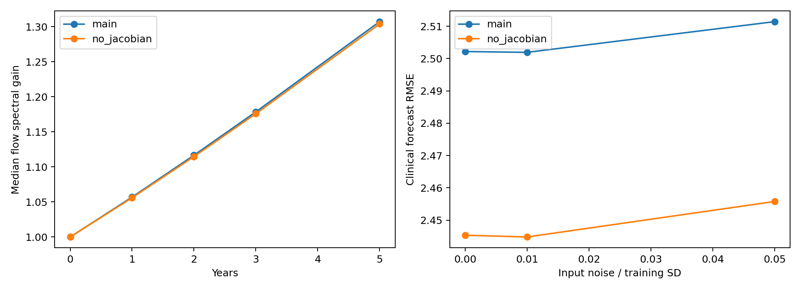

**图 47｜ADNI Jacobian 正则的流增益与噪声效用。** 左图横轴为自由推演时长，纵轴为患者 ODE 流最大奇异值的中位数；右图横轴为历史输入噪声占训练标准差的比例，纵轴为对干净临床目标的 RMSE。两条线对应 M0 与无 Jacobian，潜在流敏感性和输出误差分别测量。数值见表 23，收敛检验保存在同目录 metrics.json。

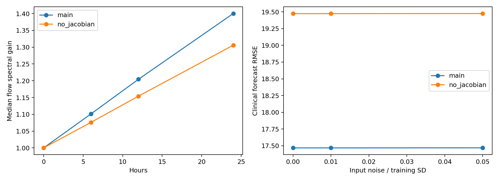

**图 48｜MIMIC Jacobian 正则的流增益与噪声效用。** 左图横轴为自由推演时长，纵轴为患者 ODE 流最大奇异值的中位数；右图横轴为历史输入噪声占训练标准差的比例，纵轴为对干净临床目标的 RMSE。两条线对应 M0 与无 Jacobian，潜在流敏感性和输出误差分别测量。数值见表 23，收敛检验保存在同目录 metrics.json。

<!-- /publication-figures -->

### 4.7 连续疾病阶段与 MCI 转化

利用已有诊断头定义 \(s=p_{\mathrm{MCI}}+2p_{\mathrm{Dementia}}\)，通过自动微分计算 \(\dot s=\nabla s^\top f\)。从固定已知历史截止点自由推演 0/6/12/24/36/60 个月。每个窗口内每位 MCI 患者只选一个预先确定的锚点：窗口内有 Dementia 记录为转化，稳定组须有足以支持该窗口的真实随访。当前评分、瞬时速度、未来评分增量与未来 Dementia 概率分别预测转化。

表 24：疾病阶段与真实转化区分能力。

| 窗口 | 稳定 / 转化患者数 | 预测量 | AUROC ↑ | AUPRC ↑ | 相对 s₀ 的 AUROC 差值 |
| --- | --- | --- | --- | --- | --- |
| 12 个月 | 138 / 11 | 当前 s₀ | 0.801713 | 0.319959 | 0.000000 |
| 12 个月 | 138 / 11 | 瞬时速度 ṡ₀ | 0.729908 | 0.171282 | -0.071805 |
| 12 个月 | 138 / 11 | 阶段增量 Δs | 0.761528 | 0.248887 | -0.040184 |
| 12 个月 | 138 / 11 | 未来 Dementia 概率 | 0.808959 | 0.319616 | 0.007246 |
| 24 个月 | 73 / 23 | 当前 s₀ | 0.771888 | 0.571793 | 0.000000 |
| 24 个月 | 73 / 23 | 瞬时速度 ṡ₀ | 0.725432 | 0.392964 | -0.046456 |
| 24 个月 | 73 / 23 | 阶段增量 Δs | 0.769506 | 0.523279 | -0.002382 |
| 24 个月 | 73 / 23 | 未来 Dementia 概率 | 0.818940 | 0.590956 | 0.047052 |
| 36 个月 | 52 / 29 | 当前 s₀ | 0.747347 | 0.631433 | 0.000000 |
| 36 个月 | 52 / 29 | 瞬时速度 ṡ₀ | 0.743369 | 0.559875 | -0.003979 |
| 36 个月 | 52 / 29 | 阶段增量 Δs | 0.795093 | 0.660452 | 0.047745 |
| 36 个月 | 52 / 29 | 未来 Dementia 概率 | 0.813660 | 0.681677 | 0.066313 |

<!-- publication-caption -->
**表 24 说明与分析。** 每个窗口按患者定义稳定和转化组，预测只读取窗口开始前的历史。未来 Dementia 概率在 24、36 个月的 AUROC 为 0.818940、0.813660，比当前阶段评分提高 0.047052、0.066313。单独使用瞬时速度的 AUROC 均较低，累计推演提供了更多区分信息。 原始结果：[记录 1](../publication_sex_init/analysis/adni/stage/metrics.json)。
<!-- /publication-caption -->

主要图为相同 PCA 坐标上的阶段/速度热图、稳定与转化患者的平均阶段曲线、ROC 与 PR 对比。按患者计算区间，检验自由 ODE 推演是否在当前诊断概率之外增加区分信息。

方案来源：[连续阶段与转化评价](../paper_odeae/results/shared_matched_continuous_stage/report.zh-CN.md)。

<!-- publication-figures -->

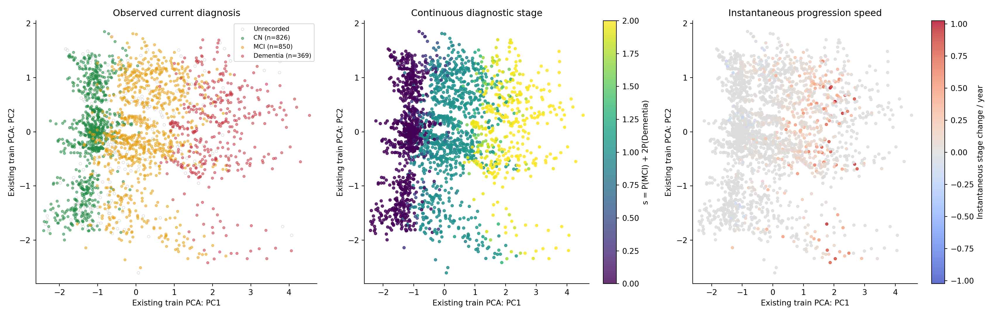

**图 49｜ADNI 连续疾病阶段评分。** 颜色为已有诊断头得到的 s=p(MCI)+2p(Dementia)，范围 0–2，坐标沿用主模型训练 PCA。患者末次状态阶段评分与当前诊断的 Spearman 相关为 0.937936，体现连续诊断结构；未来转化的区分能力另见表 24。

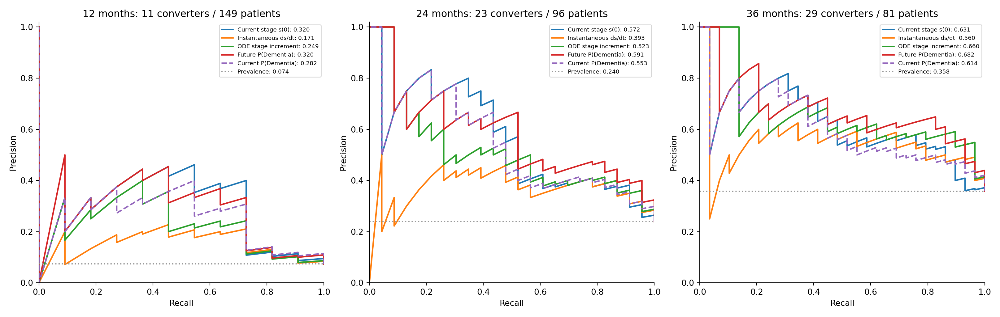

**图 50｜ADNI MCI 转化预测 PR。** 横轴为召回率，纵轴为精确率；曲线使用与 ROC 相同的患者和评分，水平参照随窗口转化比例改变。未来 Dementia 概率在 24、36 个月的 AUPRC 分别为 0.590956、0.681677，见表 24。各窗口样本构成分别列出。

**图 51｜ADNI MCI 转化预测 ROC。** 横轴是假阳性率，纵轴是真阳性率；各面板对应 12/24/36 个月，比较当前评分、瞬时速度、阶段增量与未来 Dementia 概率。后者在 24、36 个月分别达到 AUROC 0.818940、0.813660，高于当前评分。图例数值与表 24 对应。

**图 52｜ADNI 稳定与转化 MCI 的阶段演化。** 三列按真实 12/24/36 个月转化分组，上排为预测平均 s(t)，下排为相对起点的增量；红色为转化组、蓝色为稳定组，阴影为患者均值的 95% bootstrap 区间，竖线标出评价窗口。两组都沿 ODE 上升，转化组的增量更大。真实随访只用于分组。

**图 53｜ADNI 连续阶段的瞬时进展速度。** 箭头为 ODE 在固定 PCA 上的投影，颜色按图中标尺表示 ṡ=∇sᵀf 或阶段评分。正速度表示阶段评分上升，负速度表示下降。测试 UPDATE 状态中，CN、MCI、Dementia 的正速度比例约为 91.3%、70.9%、95.4%；自由推演不执行未来 UPDATE。

<!-- /publication-figures -->

### 4.8 训练稳定性与递归增益

读取 M0 训练记录，并在已保存参数检查点上，使用固定诊断 batch 重新计算历史/未来损失对共享 ODE 的梯度范数及余弦，以及向过去、未来积分的敏感性。预定轮次冻结参数，测量 UPDATE 状态 Jacobian 和截止点对历史状态的递归增益。与性别 INIT、无 prior、α=1 组比较，检验门控对 UPDATE 递归及历史损失梯度放大的影响。

表 25：MIMIC 稳定性。

| 模型 | 最佳轮次 | 停止轮次 | 历史/未来梯度比 P95 | 梯度余弦中位数 | 递归状态增益 P95 | 数值异常终止次数 |
| --- | --- | --- | --- | --- | --- | --- |
| M0（α=0.1） | 143 | 150 | 0.132387 | 0.171285 | 2.964593 | 0 |
| 同配置 α=1 | 45 | 85 | 0.630442 | -0.095179 | 2.323582 | 0 |

<!-- publication-caption -->
**表 25 说明与分析。** 梯度、余弦和递归增益来自固定八位训练患者的冻结诊断，沿可用检查点统计；历史与未来共享原主损失的字段分母。最佳/停止轮次来自真实训练日志。数值异常计数指训练因非有限量终止的记录；诊断不更新权重，检查点跨度和固定样本见原始 JSON。 本轮固定诊断中，M0（α=0.1） 的梯度比 P95 为 0.132387、递归增益 P95 为 2.964593；同配置 α=1 的梯度比 P95 为 0.630442、递归增益 P95 为 2.323582。 两组本轮均无数值异常终止；较差的验证选模/测试结果与发生数值崩溃是两个不同观察。表内 P95 按唯一参数快照计算，同一检查点的 best 文件与归档副本仅计一次。 α=0.1 的历史/未来梯度比更低，梯度余弦中位数为正；α=1 的余弦中位数为负。α=0.1 的递归增益 P95 较高，本轮证据主要体现为梯度平衡和方向的改善。 原始结果：[记录 1](../publication_sex_init/analysis/mimic/stability/metrics.json)。
<!-- /publication-caption -->

真实训练 batch 与固定诊断 batch 分别标记，诊断阶段不执行参数更新。图中共同展示分项损失、梯度比、递归增益和验证误差。α=1 在第 5.2 节完成后复用；先开展 M0 的训练记录与冻结分析。

方案来源：[梯度诊断](../mimic_experiment/results/direction_full_batch_cuda/gradient_sensitivity_analysis/report.zh-CN.md)、[敏感性与积分精度](../mimic_experiment/results/weak_prior_ablation_cuda/mechanism_diagnosis/report.zh-CN.md)、[针对性干预](../mimic_experiment/results/weak_prior_ablation_cuda/targeted_causal_ablation/summary.md)。

<!-- publication-figures -->

**图 54｜MIMIC 固定患者的梯度与递归增益。** 横轴为实际参数检查点轮次，各面板比较历史/未来 ODE 梯度比、梯度余弦、递归状态增益和向过去/未来的流增益。颜色区分 α=0.1 与 α=1。所有测量读取同一批八位患者及固定 dropout 掩码；曲线只连接实际保存的检查点，零参数更新。

<!-- /publication-figures -->

### 4.9 求解成本与预测质量

在相同 GPU 型号、共同测试患者和固定 batch 上测量编码/生成 NFE、接受与拒绝步数、每患者耗时和峰值显存。各模型权重固定，同样预热并同步 CUDA 后计时，记录求解器、容差、时间单位和统计范围。固定步长方法记录实际步数，自适应方法分别记录接受/拒绝步。

表 26：准确性与推演成本。

| 数据集 | 模型 | 编码 NFE | 生成 NFE | 接受 / 拒绝步 | 每患者 ms ↓ | 峰值显存 GiB ↓ | 未来误差 ↓ |
| --- | --- | --- | --- | --- | --- | --- | --- |
| ADNI | M0 | 10374 | 21070 | 4492 / 0 | 2.836761 | 0.010066 | 0.991104 |
| ADNI | 确定性 ODE-AE（同预算） | 10374 | 10913 | 3041 / 0 | 1.985739 | 0.010098 | 1.239294 |
| ADNI | ODE-AE（概率，同预算） | 10374 | 10906 | 3040 / 0 | 2.118005 | 0.010085 | 3.238572 |
| ADNI | ODE-RNN（同预算） | 0 | 10906 | 1558 / 0 | 1.416972 | 0.010221 | 1.032329 |
| ADNI | Latent ODE（同预算） | 10374 | 11970 | 3192 / 0 | 2.462290 | 0.010210 | 2.801288 |
| ADNI | HealthFlux-KL | 2964 | 6020 | 2246 / 0 | 4.441614 | 0.086844 | 1.534999 |
| MIMIC | M0 | 46032 | 114296 | 22904 / 0 | 7.733908 | 0.010611 | 1.795789 |
| MIMIC | 确定性 ODE-AE（同预算） | 46032 | 91868 | 19700 / 0 | 6.510393 | 0.010691 | 1.998123 |
| MIMIC | ODE-AE（概率，同预算） | 46032 | 91854 | 19698 / 0 | 6.875124 | 0.010679 | 2.552856 |
| MIMIC | ODE-RNN（同预算） | 0 | 91854 | 13122 / 0 | 6.179508 | 0.010993 | 1.760460 |
| MIMIC | Latent ODE（同预算） | 46032 | 114296 | 22904 / 0 | 9.303266 | 0.010990 | 2.482012 |
| MIMIC | HealthFlux-KL | 33028 | 82172 | 28800 / 0 | 15.435726 | 0.076205 | 1.947004 |

<!-- publication-caption -->
**表 26 说明与分析。** NFE 与接受/拒绝步数为本次测量的全部 batch 总和；耗时除以患者上下文条数，显存为 CUDA 分配峰值。ADNI 同一患者可能对应多个前缀。ODE-RNN 在单一循环中读取和生成，本次挂钩将其调用统一计入生成列，编码列的 0 表示没有独立分期计数。误差列复用表 1、3 的完整测试 F，耗时使用原生求解器。 原始结果：[记录 1](../publication_sex_init/analysis/adni/cost/metrics.json)、[记录 2](../publication_sex_init/analysis/mimic/cost/metrics.json)。
<!-- /publication-caption -->

主要图为误差—成本关系和真实病例的动态步长，展示观测更新前后时间步变化。

方案来源：[完整测试步数](../paper_odeae/results/solver_steps_full_test/summary.zh-CN.md)、[动态步长病例](../paper_odeae/results/step_examples/examples.zh-CN.md)。

## 五、最后完成的补充消融

### 5.1 INIT 初始化方式

只替换 INIT 的标量输入，比较性别、首次检查年龄、历史截止点年龄、固定零输入。四组保留 1→159→28 网络，输出放在首次历史时刻；年龄按年/100 输入。零输入仍通过原 INIT 网络，它检验无个体静态信息的起点，并单列恒零输入使首层 159 个权重不参与任务这一事实。其他损失、α 和全部训练设置一致。

表 27：INIT 信息消融。

| 数据集 | INIT 输入 | 总参数 | 任务使用参数 | 历史 H ↓ | 未来 F ↓ | 整体 O ↓ |
| --- | --- | --- | --- | --- | --- | --- |
| ADNI | 性别（M0） | 44,875 | 44,875 | 0.408170 | 0.991104 | 0.659699 |
| ADNI | 首次检查年龄 | 44,875 | 44,875 | 0.406547 | 0.999671 | 0.662624 |
| ADNI | 截止点年龄 | 44,875 | 44,875 | 0.405482 | 0.998405 | 0.661391 |
| ADNI | 固定零输入 | 44,875 | 44,716 | 0.388724 | 0.994942 | 0.650405 |
| MIMIC | 性别（M0） | 43,280 | 43,280 | 0.518334 | 1.795789 | 1.125570 |
| MIMIC | 首次检查年龄 | 43,280 | 43,280 | 0.561271 | 1.804835 | 1.152926 |
| MIMIC | 截止点年龄 | 43,280 | 43,280 | 0.583042 | 1.796273 | 1.160405 |
| MIMIC | 固定零输入 | 43,280 | 43,121 | 0.564581 | 1.798886 | 1.151459 |

<!-- publication-caption -->
**表 27 说明与分析。** 四组仅更换 INIT 标量，网络形状一致；固定零输入组首层的 159 个输入权重不参与任务。ADNI 中零输入的整体误差更低，而性别初始化的未来误差最低；MIMIC 中性别初始化的 H、F、O 均最低。静态信息的影响随任务而变。 原始结果：[记录 1](../publication_sex_init/results/adni)、[记录 2](../publication_sex_init/results/mimic)。
<!-- /publication-caption -->

按相同种子配对训练曲线与测试误差，把静态输入信息与网络容量分别说明。

方案来源：[INIT 实验与审计](../mimic_experiment/results/init_covariate_ablation_cuda/summary.md)、[ADNI 字段来源](../paper_odeae/data.py)。

<!-- publication-figures -->

**图 55｜ADNI INIT 信息消融曲线。** 横轴为训练轮次；上排依次为总训练目标、历史误差、未来误差，下排为验证历史、未来、整体误差。不同线条仅改变性别、首次年龄、截止点年龄或零输入。主模型完成 70 轮、在第 30 轮取得最佳验证整体结果。训练分项各自归一化，不能直接相加还原总目标；最终测试值见对应表格。

**图 56｜MIMIC INIT 信息消融曲线。** 横轴为训练轮次；上排依次为总训练目标、历史误差、未来误差，下排为验证历史、未来、整体误差。不同线条仅改变性别、首次年龄、截止点年龄或零输入。主模型完成 150 轮、在第 143 轮取得最佳验证整体结果。训练分项各自归一化，不能直接相加还原总目标；最终测试值见对应表格。

<!-- /publication-figures -->

### 5.2 固定 α=0、0.1、0.2、0.3、0.4、0.5、1

统一性别 INIT、无 prior、Jacobian=0.01 和共享场，仅改变残差更新幅度。α=0 不吸收观测，只依赖 INIT 与 ODE；α=1 完全采用 UPDATE 候选状态。比较全部取值的历史回顾、未来预测与训练稳定性，绘制 α—误差、训练曲线和递归增益曲线。α=0.1 复用 M0，α=1 同时供第 4.8 节分析。

表 28：固定残差门控系数。

| α | ADNI 参数 | ADNI H ↓ | ADNI F ↓ | ADNI O ↓ | MIMIC 参数 | MIMIC H ↓ | MIMIC F ↓ | MIMIC O ↓ |
| --- | --- | --- | --- | --- | --- | --- | --- | --- |
| 0 | 44,875 | 2.929797 | 3.145403 | 3.022726 | 43,280 | 3.468286 | 3.260205 | 3.371561 |
| 0.1（M0） | 44,875 | 0.408170 | 0.991104 | 0.659699 | 43,280 | 0.518334 | 1.795789 | 1.125570 |
| 0.2 | 44,875 | 0.423667 | 1.002643 | 0.673835 | 43,280 | 0.740721 | 1.828306 | 1.259096 |
| 0.3 | 44,875 | 0.429540 | 0.972916 | 0.663170 | 43,280 | 0.618202 | 1.804084 | 1.182985 |
| 0.4 | 44,875 | 0.421409 | 1.005712 | 0.675146 | 43,280 | 0.743699 | 1.828634 | 1.260399 |
| 0.5 | 44,875 | 0.434800 | 1.003305 | 0.681792 | 43,280 | 0.935326 | 1.849352 | 1.372285 |
| 1 | 44,875 | 0.475560 | 1.010041 | 0.707794 | 43,280 | 1.139334 | 1.861454 | 1.484949 |

<!-- publication-caption -->
**表 28 说明与分析。** α 控制观测校正幅度，α=0 完全不吸收检查，α=1 完全采用 UPDATE 输出。两数据集 α=0 的误差均大幅增加。ADNI 的未来误差在 α=0.3 最低，为 0.972916，整体误差在 α=0.1 更低；MIMIC 的 H、F、O 均在 α=0.1 最低。 原始结果：[记录 1](../publication_sex_init/results/adni)、[记录 2](../publication_sex_init/results/mimic)。
<!-- /publication-caption -->

α=0 保留名义结构，但 UPDATE 不参与任务；实际使用参数为 ADNI 27,993、MIMIC 27,193。所有组上限 150 轮，分别报告实际完成与最佳轮次。

方案来源：[门控扫描设计](../mimic_experiment/results/weak_prior_ablation_cuda/targeted_causal_ablation/summary.md)。

<!-- publication-figures -->

**图 57｜ADNI 残差门控系数消融曲线。** 横轴为训练轮次；上排依次为总训练目标、历史误差、未来误差，下排为验证历史、未来、整体误差。不同线条仅改变 α；α=0.1 对应 main。主模型完成 70 轮、在第 30 轮取得最佳验证整体结果。训练分项各自归一化，不能直接相加还原总目标；最终测试值见对应表格。

**图 58｜MIMIC 残差门控系数消融曲线。** 横轴为训练轮次；上排依次为总训练目标、历史误差、未来误差，下排为验证历史、未来、整体误差。不同线条仅改变 α；α=0.1 对应 main。主模型完成 150 轮、在第 143 轮取得最佳验证整体结果。训练分项各自归一化，不能直接相加还原总目标；最终测试值见对应表格。

<!-- /publication-figures -->

### 5.3 容量分配与潜在维度

固定最终模型的输入、损失和门控，比较潜在维度 6/28/73，以及分别增加 INIT、UPDATE、ODE 宽度的效果。先登记每个版本的精确参数和宽度，再训练。容量研究有意改变预算，分析额外参数投向哪一模块更有收益；28 维行复用 M0。

表 29：容量分配。

| 数据集 | 设置 | 潜在维度 | 实际参数 | 未来 F ↓ | 整体 O ↓ | 每增加 1 万参数的未来误差改善 |
| --- | --- | --- | --- | --- | --- | --- |
| ADNI | 较小状态 | 6 | 22,545 | 1.169170 | 0.846076 | 0.079743 |
| ADNI | M0 | 28 | 44,875 | 0.991104 | 0.659699 |  |
| ADNI | 较大状态 | 73 | 90,550 | 1.000654 | 0.644905 | -0.002091 |
| ADNI | 仅 INIT 扩容 | 28 | 59,185 | 1.045890 | 0.686712 | -0.038285 |
| ADNI | 仅 UPDATE 扩容 | 28 | 95,437 | 1.023940 | 0.673185 | -0.006494 |
| ADNI | 仅 ODE 扩容 | 28 | 77,023 | 0.990884 | 0.659751 | 0.000068 |
| MIMIC | 较小状态 | 6 | 20,950 | 1.875487 | 1.498969 | 0.035691 |
| MIMIC | M0 | 28 | 43,280 | 1.795789 | 1.125570 |  |
| MIMIC | 较大状态 | 73 | 88,955 | 1.853753 | 1.272846 | -0.012690 |
| MIMIC | 仅 INIT 扩容 | 28 | 57,590 | 1.796852 | 1.135824 | -0.000743 |
| MIMIC | 仅 UPDATE 扩容 | 28 | 91,457 | 1.796542 | 1.125878 | -0.000156 |
| MIMIC | 仅 ODE 扩容 | 28 | 75,428 | 1.894425 | 1.443249 | -0.030682 |

<!-- publication-caption -->
**表 29 说明与分析。** 潜在维度和模块扩容分别改变预算，参照均为同数据集的 M0。6→28 维的未来预测改善明显，28→73 维未继续降低未来误差；单独扩容 INIT 或 UPDATE 也未形成稳定收益。较小状态行的最后一列表示从该组扩至 M0 的单位参数收益，其余行表示从 M0 扩至该组的收益，负值表示变差。 原始结果：[记录 1](../publication_sex_init/results/adni)、[记录 2](../publication_sex_init/results/mimic)。
<!-- /publication-caption -->

主要图为误差—参数量—耗时关系，每组报告实际训练曲线。

方案来源：[潜在维度扩容](../paper_odeae/results/shared_matched_latent_scaling/summary.md)、[模块扩容](../paper_odeae/results/shared_matched_scaling_4x/summary.md)。

<!-- publication-figures -->

**图 59｜ADNI 容量分配训练与验证曲线。** 横轴为训练轮次；上排依次为总训练目标、历史误差、未来误差，下排为验证历史、未来、整体误差。不同线条对应潜在维度及 INIT、UPDATE、ODE 宽度调整。主模型完成 70 轮、在第 30 轮取得最佳验证整体结果。训练分项各自归一化，不能直接相加还原总目标；最终测试值见对应表格。

**图 60｜MIMIC 容量分配训练与验证曲线。** 横轴为训练轮次；上排依次为总训练目标、历史误差、未来误差，下排为验证历史、未来、整体误差。不同线条对应潜在维度及 INIT、UPDATE、ODE 宽度调整。主模型完成 150 轮、在第 143 轮取得最佳验证整体结果。训练分项各自归一化，不能直接相加还原总目标；最终测试值见对应表格。

<!-- /publication-figures -->

## 六、实验组织与复现入口

### 6.1 执行顺序

本轮实验共 89 个队列任务；全部任务使用独立输出根目录 publication_sex_init/results/，已有训练、检查点与停止标记保持原状。P0 先补齐主结果，P1 完成核心消融和理论探究，P2 最后完成 INIT、完整 α 与容量补充。

| 阶段 | 任务 ID | 工作 | 交付 |
| --- | --- | --- | --- |
| P0 | SETUP | 性别入口、精确参数、损失和 CUDA 核验 | 冻结配置与输入审计 |
| P0 | M-ADNI、M-MIMIC | 两个真实数据集主模型从种子初始化 | 主结果与曲线 |
| P0 | B-ADNI、B-MIMIC | 同预算/原容量基线复用、预算核验与补缺 | 横向比较表 |
| P0 | M-CF、B-CF | γ=1 适配版与反事实基线 | 封存预测、独立评分 |
| P1 | A-REV、A-SPLIT、A-ENCODE | 读取顺序、共享场、编码 ODE | 两数据集各 3 组 |
| P1 | A-ATTN、A-J0、A-PRIOR | 编码器家族、Jacobian、prior 增项 | 两数据集各 3 组 |
| P1 | D-HORIZON、D-STATE、D-CLINICAL、D-MMSE、D-LOCAL | 时间窗口、空间与临床动力学 | 图组、表格、定量解释 |
| P1 | D-GEOM、D-JAC、D-STAGE、D-STABILITY、D-COST、D-CF | 流形、效用、转化、稳定性、成本、反事实 | 图组、表格、定量解释 |
| P2 | X-INIT | 三种额外 INIT 对照，性别行复用 M0 | 表 27 与曲线 |
| P2 | X-ALPHA | 六种额外 α，0.1 行复用 M0 | 表 28 与曲线 |
| P2 | X-CAPACITY | 潜在维度和模块容量补充 | 表 29 与曲线 |

<!-- publication-caption -->
**执行表 A：任务依赖。** P0 形成主要比较，P1 复用最佳模型研究机制，P2 补充 INIT、门控和容量；相同 M0 检查点在各主题中复用。
<!-- /publication-caption -->

D-JAC 依赖 A-J0；D-STABILITY 的 α=1 比较等待 X-ALPHA 对应组，M0 诊断可提前完成。主模型完成后即可开展其余冻结分析，GPU 0–3 分配独立作业。

### 6.2 代码衔接

本轮实现位于 [独立执行目录](../publication_sex_init/README.zh-CN.md)，配置与源码冻结在 [manifest](../publication_sex_init/manifest.json) 中。下表中的原入口提供算法来源。

| 位置 | 本轮要求 |
| --- | --- |
| INIT 入口 | F=0/M=1；ADNI 映射、真实输入缩放、首条历史来源可审计；网络与时间锚点固定 |
| component_ablation_study / checks | 参照为性别 INIT、prior=0、Jacobian=.01、α=.1；只更改指定变量 |
| component_ablation_loss | 保持原主重建归约与梯度；prior=0 时不依赖无效辅助输出 |
| alpha_direction_model | 记录反序初始时间与生成锚点，去掉仅服务于 prior 的辅助读取 |
| history_encoders | 注意力只看历史；核对参数；无编码 ODE 组保留残差 UPDATE |
| CausalMed model | 显式去 prior；仅观测门控；动作差值不变；公开 c 初始化 |
| 训练恢复 | 完整保存 Adam、调度器、Python/NumPy/Torch/CUDA RNG、数据顺序与 batch 位置 |

<!-- publication-caption -->
**执行表 B：代码与审计入口。** 配置、模型实现、训练恢复及诊断各自留有入口，便于复核唯一研究变量、输入范围和 CUDA 执行。
<!-- /publication-caption -->

实现入口：[组件配置](../mimic_experiment/component_ablation_study.py)、[梯度与参数核验](../mimic_experiment/component_ablation_checks.py)、[损失](../mimic_experiment/component_ablation_loss.py)、[方向模型](../mimic_experiment/alpha_direction_model.py)、[历史编码](../paper_odeae/history_encoders.py)、[CausalMed](../CausalMed/latent2x_experiment/model.py)。

### 6.3 每节完成标准

每节交付实验介绍、填写后的结果表、真实曲线/图组、结果分析。分析按“实际数值→比较含义→支持的模型论点”展开，报告患者配对区间。动力学分析保存患者、截止点、时间跨度与积分精度；固定诊断不更新参数。

训练产物包含 best/last、完整恢复状态、SwanLab、配置、数据与源码哈希、检查点 SHA256、实际唯一参数量、物理 GPU 和张量设备。曲线包含训练/验证总损失、MSE、CE、历史/未来分项、Jacobian、L2、裁剪前后梯度范数与学习率。所有表中缺失指标继续留空，获得结果后再据实填写和分析。

机器可读入口：[任务、依赖和可复用数值来源](no_weak_prior_rerun_plan.json)。

<!-- publication-caption -->
本轮 89 项作业现已全部完成，failed=0。此前失败的两项 Jacobian 效用分析和一项 MIMIC 稳定性分析，已在物理 GPU 0、1、2 补跑，参数更新次数为零。详见 [修复与数值核验](../publication_sex_init/REPAIR.zh-CN.md)、[图表与产物检查](../publication_sex_init/validation.json)。权重与大型中间状态缓存保留本地。
<!-- /publication-caption -->

## 七、实时执行进度

更新时间（UTC）：2026-11-08T06:29:40.965248+00:00。控制器状态：complete。

旧 GPU 作业已中断，本轮独立目录保留配置、CUDA 预检、完整恢复状态和 SwanLab。下表展示实际进度；测试指标在完整评测后写入前文。

| 任务 | GPU | 状态 | 当前 / 完成轮次 | 最佳验证整体 | 记录 |
|---|---|---|---|---|---|
| mimic_main | 0 | complete | 150 | 1.143193 | [目录](../publication_sex_init/results/mimic/main) |
| mimic_no_jacobian | 2 | complete | 150 | 1.142177 | [目录](../publication_sex_init/results/mimic/no_jacobian) |
| mimic_reverse | 0 | complete | 150 | 1.161481 | [目录](../publication_sex_init/results/mimic/reverse) |
| mimic_separate_fields | 3 | complete | 150 | 1.167765 | [目录](../publication_sex_init/results/mimic/separate_fields) |
| mimic_no_encoder_ode | 2 | complete | 150 | 1.206616 | [目录](../publication_sex_init/results/mimic/no_encoder_ode) |
| mimic_attention | 1 | complete | 150 | 1.232668 | [目录](../publication_sex_init/results/mimic/attention) |
| mimic_add_prior | 0 | complete | 150 | 1.137114 | [目录](../publication_sex_init/results/mimic/add_prior) |
| mimic_init_first_age | 1 | complete | 150 | 1.163184 | [目录](../publication_sex_init/results/mimic/init_first_age) |
| mimic_init_cutoff_age | 2 | complete | 150 | 1.173510 | [目录](../publication_sex_init/results/mimic/init_cutoff_age) |
| mimic_init_zero_scalar | 0 | complete | 150 | 1.163910 | [目录](../publication_sex_init/results/mimic/init_zero_scalar) |
| mimic_alpha_0 | 2 | complete | 150 | 3.380154 | [目录](../publication_sex_init/results/mimic/alpha_0) |
| mimic_alpha_02 | 1 | complete | 73 | 1.280243 | [目录](../publication_sex_init/results/mimic/alpha_02) |
| mimic_alpha_03 | 0 | complete | 150 | 1.196485 | [目录](../publication_sex_init/results/mimic/alpha_03) |
| mimic_alpha_04 | 3 | complete | 102 | 1.274625 | [目录](../publication_sex_init/results/mimic/alpha_04) |
| mimic_alpha_05 | 1 | complete | 73 | 1.390793 | [目录](../publication_sex_init/results/mimic/alpha_05) |
| mimic_alpha_1 | 2 | complete | 85 | 1.501395 | [目录](../publication_sex_init/results/mimic/alpha_1) |
| adni_main | 1 | complete | 70 | 0.689185 | [目录](../publication_sex_init/results/adni/main) |
| adni_no_jacobian | 3 | complete | 70 | 0.685637 | [目录](../publication_sex_init/results/adni/no_jacobian) |
| adni_reverse | 3 | complete | 64 | 0.737461 | [目录](../publication_sex_init/results/adni/reverse) |
| adni_separate_fields | 1 | complete | 110 | 0.696072 | [目录](../publication_sex_init/results/adni/separate_fields) |
| adni_no_encoder_ode | 0 | complete | 123 | 0.680931 | [目录](../publication_sex_init/results/adni/no_encoder_ode) |
| adni_attention | 3 | complete | 81 | 0.753351 | [目录](../publication_sex_init/results/adni/attention) |
| adni_add_prior | 2 | complete | 75 | 0.687510 | [目录](../publication_sex_init/results/adni/add_prior) |
| adni_init_first_age | 3 | complete | 70 | 0.671516 | [目录](../publication_sex_init/results/adni/init_first_age) |
| adni_init_cutoff_age | 1 | complete | 70 | 0.677058 | [目录](../publication_sex_init/results/adni/init_cutoff_age) |
| adni_init_zero_scalar | 3 | complete | 94 | 0.696441 | [目录](../publication_sex_init/results/adni/init_zero_scalar) |
| adni_alpha_0 | 3 | complete | 72 | 3.221911 | [目录](../publication_sex_init/results/adni/alpha_0) |
| adni_alpha_02 | 1 | complete | 70 | 0.692160 | [目录](../publication_sex_init/results/adni/alpha_02) |
| adni_alpha_03 | 0 | complete | 82 | 0.709801 | [目录](../publication_sex_init/results/adni/alpha_03) |
| adni_alpha_04 | 2 | complete | 120 | 0.720961 | [目录](../publication_sex_init/results/adni/alpha_04) |
| adni_alpha_05 | 3 | complete | 89 | 0.712421 | [目录](../publication_sex_init/results/adni/alpha_05) |
| adni_alpha_1 | 1 | complete | 102 | 0.749105 | [目录](../publication_sex_init/results/adni/alpha_1) |
| adni_deterministic_matched | 1 | complete | 72 | 0.928178 | [目录](../publication_sex_init/results/adni/adni_deterministic_matched) |
| adni_latent_ode_matched_150 | 3 | complete | 150 | 2.817725 | [目录](../publication_sex_init/results/adni/adni_latent_ode_matched_150) |
| adni_latent_6 | 0 | complete | 96 | 0.891199 | [目录](../publication_sex_init/results/adni/adni_latent_6) |
| adni_latent_73 | 3 | complete | 96 | 0.682395 | [目录](../publication_sex_init/results/adni/adni_latent_73) |
| adni_init_expand | 2 | complete | 70 | 0.700369 | [目录](../publication_sex_init/results/adni/adni_init_expand) |
| adni_update_expand | 1 | complete | 81 | 0.690696 | [目录](../publication_sex_init/results/adni/adni_update_expand) |
| adni_ode_expand | 0 | complete | 89 | 0.689569 | [目录](../publication_sex_init/results/adni/adni_ode_expand) |
| mimic_deterministic_matched | 1 | complete | 150 | 1.634962 | [目录](../publication_sex_init/results/mimic/mimic_deterministic_matched) |
| mimic_ode_rnn_matched_150 | 2 | complete | 150 | 2.380500 | [目录](../publication_sex_init/results/mimic/mimic_ode_rnn_matched_150) |
| mimic_ode_rnn_native_150 | 3 | complete | 150 | 2.387512 | [目录](../publication_sex_init/results/mimic/mimic_ode_rnn_native_150) |
| mimic_ode_ae_native_budget_audit | 0 | complete |  |  | [目录](../publication_sex_init/results/mimic/mimic_ode_ae_native_budget_audit) |
| mimic_latent_6 | 2 | complete | 150 | 1.517242 | [目录](../publication_sex_init/results/mimic/mimic_latent_6) |
| mimic_latent_73 | 1 | complete | 134 | 1.287041 | [目录](../publication_sex_init/results/mimic/mimic_latent_73) |
| mimic_init_expand | 3 | complete | 150 | 1.154643 | [目录](../publication_sex_init/results/mimic/mimic_init_expand) |
| mimic_update_expand | 0 | complete | 150 | 1.135265 | [目录](../publication_sex_init/results/mimic/mimic_update_expand) |
| mimic_ode_expand | 2 | complete | 50 | 1.469928 | [目录](../publication_sex_init/results/mimic/mimic_ode_expand) |
| causalmed_main | 0 | complete |  |  | [目录](../publication_sex_init/results/causalmed/causalmed_main) |
| causalmed_deterministic_budget_audit | 0 | complete |  |  | [目录](../publication_sex_init/results/causalmed/causalmed_deterministic_budget_audit) |
| adni_state | 3 | complete |  |  | [目录](../publication_sex_init/analysis/adni/state) |
| adni_horizons | 3 | complete |  |  | [目录](../publication_sex_init/analysis/adni/horizons) |
| adni_clinical | 3 | complete |  |  | [目录](../publication_sex_init/analysis/adni/clinical) |
| adni_local | 3 | complete |  |  | [目录](../publication_sex_init/analysis/adni/local) |
| adni_geometry | 3 | complete |  |  | [目录](../publication_sex_init/analysis/adni/manifold/adni_geometry) |
| adni_dynamics | 3 | complete |  |  | [目录](../publication_sex_init/analysis/adni/manifold/adni_dynamics) |
| adni_cost | 3 | complete |  |  | [目录](../publication_sex_init/analysis/adni/cost) |
| adni_jacobian_utility | 0 | complete |  |  | [目录](../publication_sex_init/analysis/adni/jacobian_utility) |
| adni_baseline_state_ode_ae | 3 | complete |  |  | [目录](../publication_sex_init/analysis/adni/baseline_state/ode_ae) |
| adni_baseline_cost_ode_ae | 3 | complete |  |  | [目录](../publication_sex_init/analysis/adni/baseline_cost/ode_ae) |
| adni_baseline_state_deterministic | 3 | complete |  |  | [目录](../publication_sex_init/analysis/adni/baseline_state/deterministic) |
| adni_baseline_cost_deterministic | 3 | complete |  |  | [目录](../publication_sex_init/analysis/adni/baseline_cost/deterministic) |
| adni_baseline_state_latent_ode | 3 | complete |  |  | [目录](../publication_sex_init/analysis/adni/baseline_state/latent_ode) |
| adni_baseline_cost_latent_ode | 3 | complete |  |  | [目录](../publication_sex_init/analysis/adni/baseline_cost/latent_ode) |
| adni_baseline_state_ode_rnn | 3 | complete |  |  | [目录](../publication_sex_init/analysis/adni/baseline_state/ode_rnn) |
| adni_baseline_cost_ode_rnn | 3 | complete |  |  | [目录](../publication_sex_init/analysis/adni/baseline_cost/ode_rnn) |
| adni_baseline_state_healthflux | 3 | complete |  |  | [目录](../publication_sex_init/analysis/adni/baseline_state/healthflux) |
| adni_baseline_cost_healthflux | 3 | complete |  |  | [目录](../publication_sex_init/analysis/adni/baseline_cost/healthflux) |
| mimic_state | 3 | complete |  |  | [目录](../publication_sex_init/analysis/mimic/state) |
| mimic_horizons | 3 | complete |  |  | [目录](../publication_sex_init/analysis/mimic/horizons) |
| mimic_clinical | 3 | complete |  |  | [目录](../publication_sex_init/analysis/mimic/clinical) |
| mimic_local | 3 | complete |  |  | [目录](../publication_sex_init/analysis/mimic/local) |
| mimic_geometry | 3 | complete |  |  | [目录](../publication_sex_init/analysis/mimic/manifold/mimic_geometry) |
| mimic_dynamics | 3 | complete |  |  | [目录](../publication_sex_init/analysis/mimic/manifold/mimic_dynamics) |
| mimic_cost | 3 | complete |  |  | [目录](../publication_sex_init/analysis/mimic/cost) |
| mimic_jacobian_utility | 1 | complete |  |  | [目录](../publication_sex_init/analysis/mimic/jacobian_utility) |
| mimic_baseline_state_ode_ae | 3 | complete |  |  | [目录](../publication_sex_init/analysis/mimic/baseline_state/ode_ae) |
| mimic_baseline_cost_ode_ae | 3 | complete |  |  | [目录](../publication_sex_init/analysis/mimic/baseline_cost/ode_ae) |
| mimic_baseline_state_deterministic | 3 | complete |  |  | [目录](../publication_sex_init/analysis/mimic/baseline_state/deterministic) |
| mimic_baseline_cost_deterministic | 3 | complete |  |  | [目录](../publication_sex_init/analysis/mimic/baseline_cost/deterministic) |
| mimic_baseline_state_latent_ode | 3 | complete |  |  | [目录](../publication_sex_init/analysis/mimic/baseline_state/latent_ode) |
| mimic_baseline_cost_latent_ode | 3 | complete |  |  | [目录](../publication_sex_init/analysis/mimic/baseline_cost/latent_ode) |
| mimic_baseline_state_ode_rnn | 3 | complete |  |  | [目录](../publication_sex_init/analysis/mimic/baseline_state/ode_rnn) |
| mimic_baseline_cost_ode_rnn | 3 | complete |  |  | [目录](../publication_sex_init/analysis/mimic/baseline_cost/ode_rnn) |
| mimic_baseline_state_healthflux | 3 | complete |  |  | [目录](../publication_sex_init/analysis/mimic/baseline_state/healthflux) |
| mimic_baseline_cost_healthflux | 3 | complete |  |  | [目录](../publication_sex_init/analysis/mimic/baseline_cost/healthflux) |
| adni_stage | 3 | complete |  |  | [目录](../publication_sex_init/analysis/adni/stage) |
| adni_mmse | 3 | complete |  |  | [目录](../publication_sex_init/analysis/adni/mmse) |
| mimic_stability | 2 | complete |  |  | [目录](../publication_sex_init/analysis/mimic/stability) |

<!-- publication-caption -->
**进度表：89 项任务的执行状态。** GPU 为实际物理编号；“最佳验证整体”用于选模，前文 H/F/O 为选中权重的测试指标。冻结分析不训练，因此训练轮次和验证列留空；目录链接提供完整原始记录。
<!-- /publication-caption -->

[队列状态](../publication_sex_init/queue.json) · [完整实验配置](../publication_sex_init/manifest.json) · [旧作业中断记录](../publication_sex_init/preemption_record.json)
