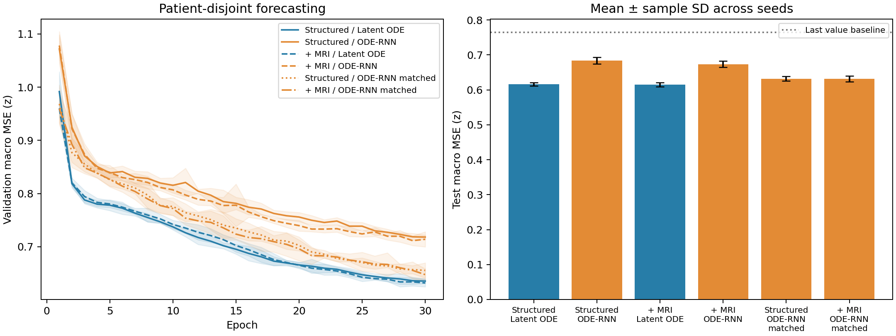

# ADNI 纵向预测实验结果

本报告按照实验设计、指标含义、结果和结果解释的顺序展开。数据处理和训练步骤见[实验说明](../../reproduction/ADNI_EXPERIMENT.zh-CN.md)。

## 1. 这次实验比较什么

我们用一位患者已经完成的检查，预测其后续随访中的检查数值。验证和测试时，模型读取前半段有效检查窗口，再预测后半段。预测时间取自实际随访记录。

训练集包含 1,677 名患者，验证集包含 312 名，测试集包含 324 名。同一患者的全部记录只属于一个集合。

实验使用两组输入。第一组是量表、海马体积、PET、脑脊液和血浆等数值特征。第二组在这些特征上增加冻结 MedicalNet 从原始 T1 MRI 提取的 16 维特征。影像从扫描发生后才进入历史。

两组使用相同患者，预测同样的 58 个数值字段。每组考察 Latent ODE、原生 ODE-RNN，以及扩大参数量后的 ODE-RNN。容量对照用于观察参数量对结果的影响。

当前共有 30 个已完成训练任务，每个任务训练 30 轮。下表中的每一行汇总相应配置的独立训练结果。各任务按验证误差选择检查点，再评价测试集。

多数最优检查点出现在接近训练轮数上限的位置。因此，这些结果描述本次训练预算下的表现；更长训练是否改变排名，需要另行观察收敛过程。

## 2. 怎样读后面的误差

### 2.1 标准化误差与原始分数

不同检查使用不同单位。程序用训练集均值和标准差把每个字段转为 z-score，再计算未来预测误差。每个字段先在有效观测上平均，最后对字段等权平均。表中的 macro MSE 就是这样得到的平方误差，越低越好。

macro MAE 使用绝对误差，也越低越好。平方误差对少量大偏差更敏感，因此报告同时保留 MSE 和 MAE。后面还会列出量表原始单位的 MAE，帮助把统计量联系到实际分数。

表格中的“均值 ± 标准差”描述不同随机种子训练的平均结果和波动，不是每位患者的预测区间。

### 2.2 用一个简单预测作为参照

持续值基线把历史最后一次观测直接当作未来预测。如果历史中没有某字段，则用训练均值。这个基线可以帮助判断模型是否比沿用旧检查值有所改善。

| 参照方法 | 验证 macro MSE | 测试 macro MSE |
|---|---:|---:|
| 持续值基线 | 0.8285 | 0.7649 |

### 2.3 怎样理解两个配置的差值

比较时，先在同一患者上计算两种配置的误差差，再对患者和随机种子做 2,000 次配对 bootstrap 重抽样，得到差值的 95% 区间。

下文的差值均为“左侧配置减右侧配置”。负值表示左侧误差较低。如果区间跨过 0，当前重抽样结果仍包含两种方向，尚不足以确认差异方向。这个区间围绕当前固定患者划分计算。

## 3. 原生模型得到什么结果

先比较两种模型各自的原生配置。以下四行分别使用数值输入和增加 MRI 后的输入。

| 输入与模型 | 训练次数 | 验证 macro MSE | 测试 macro MSE | 测试 macro MAE |
|---|---:|---:|---:|---:|
| 数值特征：Latent ODE | 5 | 0.6331 ± 0.0058 | 0.6162 ± 0.0046 | 0.5096 ± 0.0088 |
| 数值特征：原生 ODE-RNN | 5 | 0.7158 ± 0.0053 | 0.6834 ± 0.0094 | 0.5418 ± 0.0053 |
| 数值 + MRI：Latent ODE | 5 | 0.6291 ± 0.0058 | 0.6151 ± 0.0064 | 0.5092 ± 0.0068 |
| 数值 + MRI：原生 ODE-RNN | 5 | 0.7083 ± 0.0116 | 0.6736 ± 0.0092 | 0.5437 ± 0.0057 |

再把每组输入中的两个模型作配对比较：

| 输入 | 左侧 − 右侧 | 误差差值 [95% 区间] |
|---|---|---:|
| 数值特征 | Latent ODE − 原生 ODE-RNN | -0.0672 [-0.0890, -0.0478] |
| 数值 + MRI | Latent ODE − 原生 ODE-RNN | -0.0585 [-0.0769, -0.0369] |

数值组中，Latent ODE 的平均测试误差为 0.6162，原生 ODE-RNN 为 0.6834。以 ODE-RNN 作参照，平均测试误差降低 9.84%。下一节继续考察原生模型参数量不同这一因素。

## 4. 参数量接近后，结果怎样变化

原生 Latent ODE 包含历史编码和生成过程，其预测网络参数量多于原生 ODE-RNN。为了观察这一因素，实验扩大 ODE-RNN，使它的预测参数量接近对应的 Latent ODE。

下面只统计预测网络，排除本任务闲置的诊断分类头。

| 输入 | Latent ODE 参数量 | 原生 ODE-RNN 参数量 | 扩大后 ODE-RNN 参数量 |
|---|---:|---:|---:|
| 数值特征 | 65,818 | 24,570 | 65,827 |
| 数值 + MRI | 72,490 | 28,170 | 72,476 |

在参数量接近的配置中，误差如下。这里仍使用前面相同的患者和预测目标。

| 输入与模型 | 验证 macro MSE | 测试 macro MSE | 测试 macro MAE |
|---|---:|---:|---:|
| 数值特征：扩大后 ODE-RNN | 0.6503 ± 0.0059 | 0.6317 ± 0.0066 | 0.5149 ± 0.0039 |
| 数值 + MRI：扩大后 ODE-RNN | 0.6462 ± 0.0125 | 0.6315 ± 0.0081 | 0.5220 ± 0.0058 |

| 输入 | 左侧 − 右侧 | 误差差值 [95% 区间] |
|---|---|---:|
| 数值特征 | Latent ODE − 扩大后 ODE-RNN | -0.0155 [-0.0313, 0.0022] |
| 数值 + MRI | Latent ODE − 扩大后 ODE-RNN | -0.0165 [-0.0320, 0.0019] |

扩大后的 ODE-RNN 缩小了与 Latent ODE 的平均误差差距。两组输入对应的差值区间都跨过 0，因此当前证据还不足以确认参数量接近时的优势方向。

## 5. 额外的 MRI 特征带来了什么变化

这一比较保持模型种类不变，只考察输入中是否增加冻结 MRI 特征。它回答的是本次影像提取方案是否有帮助。

| 模型 | 数值输入测试 MSE | 增加 MRI 后测试 MSE | 增加后 − 增加前 [95% 区间] |
|---|---:|---:|---:|
| Latent ODE | 0.6162 ± 0.0046 | 0.6151 ± 0.0064 | -0.0011 [-0.0100, 0.0072] |
| 原生 ODE-RNN | 0.6834 ± 0.0094 | 0.6736 ± 0.0092 | -0.0098 [-0.0233, 0.0044] |

两种模型的平均 MSE 都略有下降，但对应差值区间包含 0。由此，本次冻结编码器方案尚未显示稳定增益。这里的 MRI 表征来自每位患者最早一份可用 T1；这一结果对应这套具体的提取方式。

### 5.1 结合图形查看各组变化

左图显示验证误差随训练轮数的变化，右图显示各配置的平均测试误差。右图误差棒表示不同训练种子的样本标准差，虚线表示持续值基线。

## 6. 误差具体体现在哪些检查上

### 6.1 先用实际量表分数理解误差

下面的 MAE 已还原为各量表自己的分数单位。例如，MMSE 的 MAE 为 1.77，表示预测总分与实际总分的绝对差平均约为 1.77 分。

| 输入与模型 | MMSE | CDR-SB | ADAS-13 | FAQ |
|---|---:|---:|---:|---:|
| 数值特征：Latent ODE | 1.7692 ± 0.0188 | 1.1668 ± 0.0547 | 4.2325 ± 0.1040 | 3.0562 ± 0.1317 |
| 数值特征：原生 ODE-RNN | 1.8895 ± 0.0288 | 1.1801 ± 0.0579 | 4.4680 ± 0.0782 | 3.0927 ± 0.0866 |
| 数值 + MRI：Latent ODE | 1.7762 ± 0.0319 | 1.1400 ± 0.0352 | 4.2432 ± 0.1084 | 3.0285 ± 0.1650 |
| 数值 + MRI：原生 ODE-RNN | 1.8982 ± 0.0372 | 1.2262 ± 0.0427 | 4.4749 ± 0.2005 | 3.2733 ± 0.1632 |
| 数值特征：扩大后 ODE-RNN | 1.8525 ± 0.0305 | 1.1319 ± 0.0412 | 4.2962 ± 0.1197 | 3.0279 ± 0.0857 |
| 数值 + MRI：扩大后 ODE-RNN | 1.8343 ± 0.0268 | 1.1765 ± 0.0300 | 4.3240 ± 0.0791 | 3.1348 ± 0.0458 |

### 6.2 再按检查类别查看标准化误差

下列两张表分别对应两组输入。每个数值是该类检查内各字段的平均 MSE，再汇总不同训练种子。有效观测数统计的是实际被评分的标量数量，不是患者人数。

这些数量可以帮助解释误差的波动。例如，ADAS 的有效观测多于 PET；阅读 PET 误差时，应结合较少的观测数量理解。MRI 数值记录包含质控未知或部分完成的项目，其处理规则见实验说明的数据整理部分。

#### 数值特征输入

| 检查类别 | Latent ODE | 原生 ODE-RNN | 扩大后 ODE-RNN | 有效观测数 |
|---|---:|---:|---:|---:|
| ADAS 认知量表 | 0.6401 ± 0.0061 | 0.6749 ± 0.0083 | 0.6446 ± 0.0086 | 13,699 |
| 淀粉样 PET | 0.5670 ± 0.0324 | 1.0128 ± 0.0304 | 0.7765 ± 0.0213 | 279 |
| CDR 量表 | 0.5015 ± 0.0150 | 0.5137 ± 0.0142 | 0.5025 ± 0.0162 | 7,552 |
| 脑脊液 | 0.5408 ± 0.0693 | 0.8106 ± 0.0202 | 0.5023 ± 0.0361 | 510 |
| FAQ 日常功能量表 | 0.7491 ± 0.0097 | 0.7706 ± 0.0083 | 0.7572 ± 0.0050 | 8,844 |
| MMSE 认知量表 | 0.4236 ± 0.0087 | 0.4603 ± 0.0125 | 0.4471 ± 0.0118 | 906 |
| MRI 海马体积 | 0.3192 ± 0.0425 | 0.5294 ± 0.0999 | 0.3007 ± 0.0230 | 1,256 |
| 记忆与词语学习 | 0.3834 ± 0.0023 | 0.4460 ± 0.0162 | 0.4091 ± 0.0041 | 7,099 |
| 血浆 | 1.0030 ± 0.0121 | 1.0461 ± 0.0051 | 1.0463 ± 0.0101 | 885 |
| tau PET | 0.5026 ± 0.0136 | 0.6534 ± 0.0157 | 0.6174 ± 0.0181 | 326 |

#### 数值特征 + MRI 输入

| 检查类别 | Latent ODE | 原生 ODE-RNN | 扩大后 ODE-RNN | 有效观测数 |
|---|---:|---:|---:|---:|
| ADAS 认知量表 | 0.6453 ± 0.0089 | 0.6722 ± 0.0097 | 0.6470 ± 0.0075 | 13,699 |
| 淀粉样 PET | 0.5846 ± 0.0272 | 1.0000 ± 0.0554 | 0.6904 ± 0.0676 | 279 |
| CDR 量表 | 0.5009 ± 0.0077 | 0.5176 ± 0.0168 | 0.5082 ± 0.0089 | 7,552 |
| 脑脊液 | 0.5025 ± 0.0631 | 0.7852 ± 0.0655 | 0.5259 ± 0.0468 | 510 |
| FAQ 日常功能量表 | 0.7535 ± 0.0112 | 0.7655 ± 0.0066 | 0.7577 ± 0.0046 | 8,844 |
| MMSE 认知量表 | 0.4211 ± 0.0133 | 0.4658 ± 0.0153 | 0.4337 ± 0.0086 | 906 |
| MRI 海马体积 | 0.2900 ± 0.0336 | 0.4751 ± 0.0703 | 0.3008 ± 0.0263 | 1,256 |
| 记忆与词语学习 | 0.3813 ± 0.0048 | 0.4317 ± 0.0167 | 0.4018 ± 0.0062 | 7,099 |
| 血浆 | 1.0069 ± 0.0063 | 1.0361 ± 0.0050 | 1.0427 ± 0.0127 | 885 |
| tau PET | 0.5057 ± 0.0215 | 0.5992 ± 0.0201 | 0.6125 ± 0.0200 | 326 |

查看各模型按检查类别统计的完整 MSE、MAE 和观测数

#### 数值特征：Latent ODE

| 检查类别 | macro MSE | macro MAE | 有效观测数 |
|---|---:|---:|---:|
| ADAS 认知量表 | 0.6401 ± 0.0061 | 0.5177 ± 0.0061 | 13,699 |
| 淀粉样 PET | 0.5670 ± 0.0324 | 0.5146 ± 0.0150 | 279 |
| CDR 量表 | 0.5015 ± 0.0150 | 0.4641 ± 0.0150 | 7,552 |
| 脑脊液 | 0.5408 ± 0.0693 | 0.5432 ± 0.0384 | 510 |
| FAQ 日常功能量表 | 0.7491 ± 0.0097 | 0.5578 ± 0.0295 | 8,844 |
| MMSE 认知量表 | 0.4236 ± 0.0087 | 0.4535 ± 0.0048 | 906 |
| MRI 海马体积 | 0.3192 ± 0.0425 | 0.4276 ± 0.0340 | 1,256 |
| 记忆与词语学习 | 0.3834 ± 0.0023 | 0.4745 ± 0.0017 | 7,099 |
| 血浆 | 1.0030 ± 0.0121 | 0.5390 ± 0.0048 | 885 |
| tau PET | 0.5026 ± 0.0136 | 0.4584 ± 0.0116 | 326 |

#### 数值特征：原生 ODE-RNN

| 检查类别 | macro MSE | macro MAE | 有效观测数 |
|---|---:|---:|---:|
| ADAS 认知量表 | 0.6749 ± 0.0083 | 0.5316 ± 0.0047 | 13,699 |
| 淀粉样 PET | 1.0128 ± 0.0304 | 0.7401 ± 0.0121 | 279 |
| CDR 量表 | 0.5137 ± 0.0142 | 0.4696 ± 0.0076 | 7,552 |
| 脑脊液 | 0.8106 ± 0.0202 | 0.6871 ± 0.0176 | 510 |
| FAQ 日常功能量表 | 0.7706 ± 0.0083 | 0.5560 ± 0.0129 | 8,844 |
| MMSE 认知量表 | 0.4603 ± 0.0125 | 0.4843 ± 0.0074 | 906 |
| MRI 海马体积 | 0.5294 ± 0.0999 | 0.5519 ± 0.0547 | 1,256 |
| 记忆与词语学习 | 0.4460 ± 0.0162 | 0.5191 ± 0.0103 | 7,099 |
| 血浆 | 1.0461 ± 0.0051 | 0.5599 ± 0.0022 | 885 |
| tau PET | 0.6534 ± 0.0157 | 0.4942 ± 0.0142 | 326 |

#### 数值 + MRI：Latent ODE

| 检查类别 | macro MSE | macro MAE | 有效观测数 |
|---|---:|---:|---:|
| ADAS 认知量表 | 0.6453 ± 0.0089 | 0.5303 ± 0.0171 | 13,699 |
| 淀粉样 PET | 0.5846 ± 0.0272 | 0.5369 ± 0.0093 | 279 |
| CDR 量表 | 0.5009 ± 0.0077 | 0.4627 ± 0.0097 | 7,552 |
| 脑脊液 | 0.5025 ± 0.0631 | 0.5203 ± 0.0308 | 510 |
| FAQ 日常功能量表 | 0.7535 ± 0.0112 | 0.5515 ± 0.0325 | 8,844 |
| MMSE 认知量表 | 0.4211 ± 0.0133 | 0.4553 ± 0.0082 | 906 |
| MRI 海马体积 | 0.2900 ± 0.0336 | 0.4078 ± 0.0275 | 1,256 |
| 记忆与词语学习 | 0.3813 ± 0.0048 | 0.4737 ± 0.0030 | 7,099 |
| 血浆 | 1.0069 ± 0.0063 | 0.5373 ± 0.0026 | 885 |
| tau PET | 0.5057 ± 0.0215 | 0.4539 ± 0.0078 | 326 |

#### 数值 + MRI：原生 ODE-RNN

| 检查类别 | macro MSE | macro MAE | 有效观测数 |
|---|---:|---:|---:|
| ADAS 认知量表 | 0.6722 ± 0.0097 | 0.5327 ± 0.0132 | 13,699 |
| 淀粉样 PET | 1.0000 ± 0.0554 | 0.7351 ± 0.0240 | 279 |
| CDR 量表 | 0.5176 ± 0.0168 | 0.4771 ± 0.0089 | 7,552 |
| 脑脊液 | 0.7852 ± 0.0655 | 0.6786 ± 0.0279 | 510 |
| FAQ 日常功能量表 | 0.7655 ± 0.0066 | 0.5780 ± 0.0107 | 8,844 |
| MMSE 认知量表 | 0.4658 ± 0.0153 | 0.4866 ± 0.0095 | 906 |
| MRI 海马体积 | 0.4751 ± 0.0703 | 0.5262 ± 0.0402 | 1,256 |
| 记忆与词语学习 | 0.4317 ± 0.0167 | 0.5082 ± 0.0107 | 7,099 |
| 血浆 | 1.0361 ± 0.0050 | 0.5596 ± 0.0060 | 885 |
| tau PET | 0.5992 ± 0.0201 | 0.4797 ± 0.0081 | 326 |

#### 数值特征：扩大后 ODE-RNN

| 检查类别 | macro MSE | macro MAE | 有效观测数 |
|---|---:|---:|---:|
| ADAS 认知量表 | 0.6446 ± 0.0086 | 0.5162 ± 0.0090 | 13,699 |
| 淀粉样 PET | 0.7765 ± 0.0213 | 0.6506 ± 0.0116 | 279 |
| CDR 量表 | 0.5025 ± 0.0162 | 0.4580 ± 0.0085 | 7,552 |
| 脑脊液 | 0.5023 ± 0.0361 | 0.5379 ± 0.0165 | 510 |
| FAQ 日常功能量表 | 0.7572 ± 0.0050 | 0.5528 ± 0.0251 | 8,844 |
| MMSE 认知量表 | 0.4471 ± 0.0118 | 0.4749 ± 0.0078 | 906 |
| MRI 海马体积 | 0.3007 ± 0.0230 | 0.4168 ± 0.0188 | 1,256 |
| 记忆与词语学习 | 0.4091 ± 0.0041 | 0.4929 ± 0.0029 | 7,099 |
| 血浆 | 1.0463 ± 0.0101 | 0.5541 ± 0.0065 | 885 |
| tau PET | 0.6174 ± 0.0181 | 0.4983 ± 0.0152 | 326 |

#### 数值 + MRI：扩大后 ODE-RNN

| 检查类别 | macro MSE | macro MAE | 有效观测数 |
|---|---:|---:|---:|
| ADAS 认知量表 | 0.6470 ± 0.0075 | 0.5255 ± 0.0058 | 13,699 |
| 淀粉样 PET | 0.6904 ± 0.0676 | 0.6081 ± 0.0350 | 279 |
| CDR 量表 | 0.5082 ± 0.0089 | 0.4697 ± 0.0056 | 7,552 |
| 脑脊液 | 0.5259 ± 0.0468 | 0.5399 ± 0.0250 | 510 |
| FAQ 日常功能量表 | 0.7577 ± 0.0046 | 0.5770 ± 0.0214 | 8,844 |
| MMSE 认知量表 | 0.4337 ± 0.0086 | 0.4702 ± 0.0069 | 906 |
| MRI 海马体积 | 0.3008 ± 0.0263 | 0.4173 ± 0.0218 | 1,256 |
| 记忆与词语学习 | 0.4018 ± 0.0062 | 0.4888 ± 0.0027 | 7,099 |
| 血浆 | 1.0427 ± 0.0127 | 0.5530 ± 0.0072 | 885 |
| tau PET | 0.6125 ± 0.0200 | 0.4947 ± 0.0065 | 326 |

### 6.3 按距离历史截止点的时间查看误差

未来观测分为 0–1 年、1–3 年和 3 年以上。每个时间段只统计其中实际存在的检查。不同时间段的患者和检查组成可能不同，因此表中的变化需要结合有效观测数理解。

#### 数值特征输入

| 时间跨度 | Latent ODE MSE | 原生 ODE-RNN MSE | 扩大后 ODE-RNN MSE | 有效观测数 |
|---|---:|---:|---:|---:|
| 0–1 年 | 0.7914 ± 0.0056 | 0.8447 ± 0.0065 | 0.7983 ± 0.0049 | 12,627 |
| 1–3 年 | 0.6002 ± 0.0029 | 0.6873 ± 0.0115 | 0.6270 ± 0.0047 | 14,631 |
| 3 年以上 | 0.5650 ± 0.0102 | 0.6214 ± 0.0104 | 0.5776 ± 0.0163 | 14,098 |

#### 数值特征 + MRI 输入

| 时间跨度 | Latent ODE MSE | 原生 ODE-RNN MSE | 扩大后 ODE-RNN MSE | 有效观测数 |
|---|---:|---:|---:|---:|
| 0–1 年 | 0.7890 ± 0.0057 | 0.8357 ± 0.0056 | 0.7977 ± 0.0094 | 12,627 |
| 1–3 年 | 0.5961 ± 0.0069 | 0.6715 ± 0.0096 | 0.6281 ± 0.0085 | 14,631 |
| 3 年以上 | 0.5664 ± 0.0085 | 0.6174 ± 0.0147 | 0.5761 ± 0.0098 | 14,098 |

## 7. 怎样联系到参考论文

本次实验借鉴论文利用不完整历史预测未来检查的思路。论文使用的患者、字段和评分方式与这里不同。理解两边的任务后，可以比较各自实验中观察到的变化。

关于论文模型、评分定义、报告数值，以及如何建立共同评价协议，见[与参考论文的逐步比较](paper_comparison.md)。

## 8. 计算结果怎样核对

所有训练、验证、影像编码和检查点评估都在四张 RTX 4090 上使用 CUDA。各任务的设备记录保存在 hardware.json 中。

对每个最优检查点，程序把 ODE 求解步长减半后重新计算验证误差。最大 macro MSE 变化为 9.32e-09，说明本次步长变化对该指标影响很小。

检查点独立重新加载的核对结果保存在各任务的 checkpoint_verification.json 中。整体完成情况见[completion.json](completion.json)，机器可读的聚合统计见[summary.json](summary.json)。

训练曲线与测试误差图见[comparison.png](comparison.png)。

## 附录：表格名称与结果目录的对应关系

阅读训练日志或单个任务文件时，可用下表定位。每个目录下面再按 seed_0 至 seed_4 区分独立训练。

| 本报告名称 | 结果目录 | 完整参数量 | 预测网络参数量 |
|---|---|---:|---:|
| 数值特征：Latent ODE | `structured/latent_ode/` | 76,019 | 65,818 |
| 数值特征：原生 ODE-RNN | `structured/ode_rnn/` | 34,771 | 24,570 |
| 数值 + MRI：Latent ODE | `medicalnet/latent_ode/` | 82,691 | 72,490 |
| 数值 + MRI：原生 ODE-RNN | `medicalnet/ode_rnn/` | 38,371 | 28,170 |
| 数值特征：扩大后 ODE-RNN | `structured_matched/ode_rnn/` | 90,728 | 65,827 |
| 数值 + MRI：扩大后 ODE-RNN | `medicalnet_matched/ode_rnn/` | 97,377 | 72,476 |
