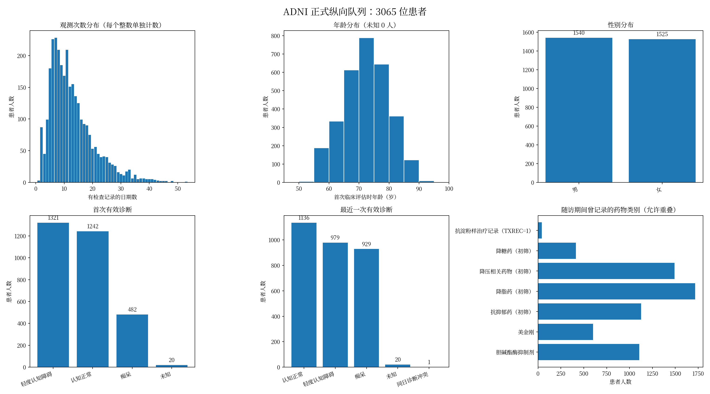
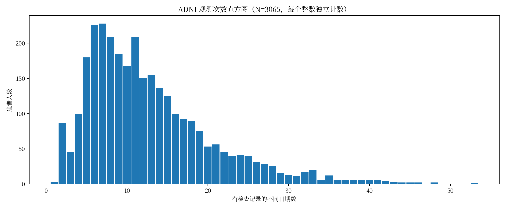

# ADNI 患者观测与人群分布统计

## 1. 先确定统计范围和口径

本报告以正式 `ADNI_multimodal_timeline/indexes/patients.csv` 中的 **3,065 位患者**为主，包含只有一次检查的患者，没有套用模型训练所需的最少随访筛选。原始 ROSTER 总名册有 **5,153 位不同 RID**，另放在 `raw_roster/` 作为补充，不能把两个范围混为同一个分母。

主报告把“观测次数”定义为 `timepoints.csv` 中 `examinations_status=present` 的不同日期数。同一天多个检查只计一次，同次计划访视跨多天完成则计多个日期。它不是扫描次数，也不是按 VISCODE 合并后的临床随访次数。另提供全部时间线日期数与有检查的自然季度数。

年龄取首次有日期的 MMSE/CDR/诊断评估时的年龄；出生日期只到月时取当月1日，只到年时取7月1日，因此是近似年龄，不是当前年龄。性别取原人口学表按日期排序后首次有效编码（1男、2女）。

诊断采用最新本地 DXSUM 文件，优先使用 DIAGNOSIS，缺失时使用唯一明确的 DXNORM/DXMCI/DXAD 标记。同日冲突单列；首次与最近一次诊断均提供。这里统计的是认知分期，不把全部痴呆都等同于阿尔茨海默病病因。[ADNI 官方诊断字段说明](https://adni.loni.usc.edu/quick-start-guide-asset101625/diagnostic.html)

药物采用整个可用随访中曾出现的药名关键词初筛，CMMED 缺失时补查 CMMEDO，并补充 ANTIAMYTX 中的 TXREC=1。类别之间允许重叠；它不是基线用药率、处方事件数，也不保证药物仍在使用。未命中不能等同于未治疗。具体规则保存于 `summary.json` 和脚本。



## 2. 观测次数分布

| 口径 | 合计日期/季度数 | 人均 | 中位数 | 最小—最大 |
|---|---:|---:|---:|---:|
| 有检查的日期（主口径） | 39,064 | 12.75 | 11 | 1—53 |
| 全部时间线日期 | 59,607 | 19.45 | 16 | 3—81 |
| 有检查的自然季度 | 18,618 | 6.07 | 5 | 1—26 |

全部时间线还包含病史、用药等非检查日期，不宜直接当成模型的有效检查次数。自然季度统计也不等于此前 40 字段实验的缓存：字段有效性和患者筛选规则仍会减少样本。



下表按每一个整数列出患者人数，零人次数也保留。完整机器可读表见 [exam_dates_counts.csv](longitudinal/exam_dates_counts.csv)。

| 检查日期数 | 患者人数 | 检查日期数 | 患者人数 |
|---:|---:|---:|---:|
| 0 | 0 | 27 | 28 |
| 1 | 3 | 28 | 26 |
| 2 | 87 | 29 | 16 |
| 3 | 45 | 30 | 13 |
| 4 | 99 | 31 | 11 |
| 5 | 180 | 32 | 17 |
| 6 | 226 | 33 | 20 |
| 7 | 228 | 34 | 6 |
| 8 | 209 | 35 | 12 |
| 9 | 185 | 36 | 5 |
| 10 | 168 | 37 | 6 |
| 11 | 209 | 38 | 6 |
| 12 | 151 | 39 | 5 |
| 13 | 155 | 40 | 5 |
| 14 | 136 | 41 | 5 |
| 15 | 125 | 42 | 4 |
| 16 | 99 | 43 | 3 |
| 17 | 92 | 44 | 2 |
| 18 | 90 | 45 | 2 |
| 19 | 75 | 46 | 2 |
| 20 | 53 | 47 | 0 |
| 21 | 56 | 48 | 2 |
| 22 | 45 | 49 | 0 |
| 23 | 40 | 50 | 0 |
| 24 | 41 | 51 | 0 |
| 25 | 40 | 52 | 0 |
| 26 | 31 | 53 | 1 |

## 3. 年龄和性别

有年龄数据 **3,065 人**，未知 0 人。首次临床评估年龄为 **72.29 ± 7.57 岁**（样本标准差），中位数 **72.36 岁**，范围 **50.45—91.45 岁**。

年龄每5岁分组明细见 [年龄分布 CSV](longitudinal/age_distribution.csv)。

| 类别 | 人数 | 占全部患者比例 |
|---|---:|---:|
| 男 | 1,540 | 50.24% |
| 女 | 1,525 | 49.76% |

## 4. 认知/疾病分期

### 首次有效诊断

| 类别 | 人数 | 占全部患者比例 |
|---|---:|---:|
| 轻度认知障碍（MCI） | 1,321 | 43.10% |
| 认知正常（CN） | 1,242 | 40.52% |
| 痴呆 | 482 | 15.73% |
| 未知 | 20 | 0.65% |

### 最近一次有效诊断

| 类别 | 人数 | 占全部患者比例 |
|---|---:|---:|
| 认知正常（CN） | 1,136 | 37.06% |
| 轻度认知障碍（MCI） | 979 | 31.94% |
| 痴呆 | 929 | 30.31% |
| 未知 | 20 | 0.65% |
| 同日诊断冲突 | 1 | 0.03% |

最近一次痴呆记录人数更多，符合队列内存在病程变化这一描述。但各人随访长短不同，且含同日冲突和缺失，不能把这两个边际分布直接当成转化率。首次到末次的交叉计数另见 [诊断变化表](longitudinal/diagnosis_transition_counts.csv)。

## 5. 药物治疗相关分布

以下均以全部 3,065 人作分母，是随访期间“曾匹配到记录”的患者数。前两类使用常见通用名及商品名，其他大类仅覆盖脚本列出的部分常用药名，并非完整药物字典。某些药物有多种用途，因此类别不能反过来当成合并疾病的诊断。

| 药物类别/记录 | 患者人数 | 占全部患者比例 |
|---|---:|---:|
| 胆碱酯酶抑制剂相关 | 1,105 | 36.05% |
| 美金刚相关 | 601 | 19.61% |
| 抗抑郁药（关键词初筛） | 1,127 | 36.77% |
| 降脂药（关键词初筛） | 1,718 | 56.05% |
| 降压相关药物（关键词初筛） | 1,492 | 48.68% |
| 降糖药（关键词初筛） | 415 | 13.54% |
| 抗淀粉样治疗表 TXREC=1 | 42 | 1.37% |

这些类别不能相加。就胆碱酯酶抑制剂与美金刚两类而言，再按整个随访期的出现情况做互斥计数：

| 用药历史初筛类别 | 人数 |
|---|---:|
| 有其他可读药名，但未命中这两类 | 1,895 |
| 仅曾记录胆碱酯酶抑制剂类 | 556 |
| 两类都曾记录（不代表同时联合用药） | 549 |
| 仅曾记录美金刚类 | 52 |
| 没有 RECCMEDS 记录，用药未知 | 11 |
| 有用药行，但药名未知 | 2 |

抗淀粉样治疗的具体药名编码需另核对字典，本报告没有猜测 TXNAME=2/3 的对应药物。更完整的用药日期与因果研究限制见[治疗研究方案](../../reproduction/ADNI_TREATMENT_PLAN.zh-CN.md)。

## 6. 原始总名册的补充统计

总名册包含 5,153 人，不要求已进入正式纵向时间线。登记日期数仅表示 REGISTRY 中记录过的不同日期，包含的研究过程可能不同，不能与主报告的检查日期数直接比较。

年龄可用 4,696 人、未知 457 人；可用年龄的均值为 71.93 ± 7.82 岁。男 2,409 人、女 2,523 人、未知 221 人。

其他诊断编码10按“待确认”单列，没有强行合并到认知正常、MCI或痴呆。所有分类表保留未知患者；各表的百分比分母均为该范围的全部患者。

补充图与完整表见 [raw_roster/](raw_roster/)。

## 7. 文件与复现

- `longitudinal/`：正式3,065人队列，逐次数、5岁年龄分组、性别、首末诊断、药物类别表和图。
- `raw_roster/`：原始5,153人名册的补充分析。
- `summary.json`：全部汇总、定义与药物关键词。
- 图片同时提供 PNG、SVG 和 PDF，便于查看及导出。

```bash
conda activate ode
python scripts/summarize_adni_population.py
```

本次只做只读数据统计和绘图，不加载模型，不改变患者数据，也不干预正在运行的 GPU 实验。所有导出均为聚合统计，不包含患者逐条标识。
